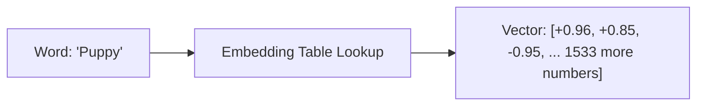
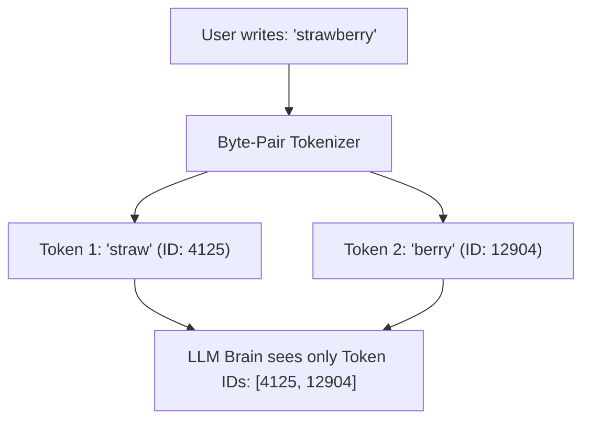
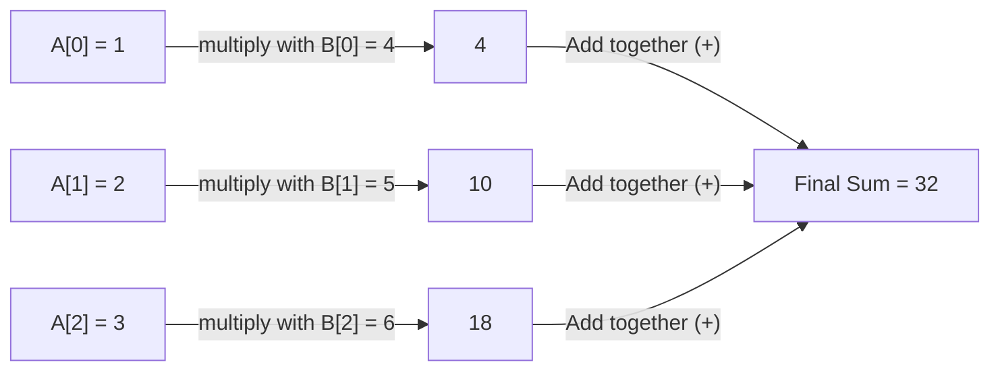
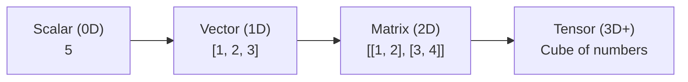
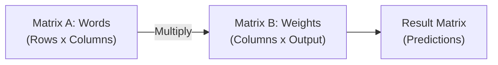
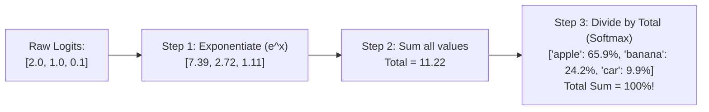
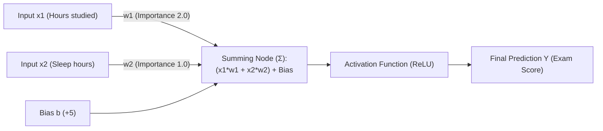
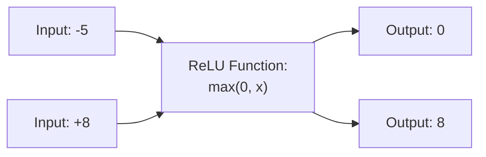
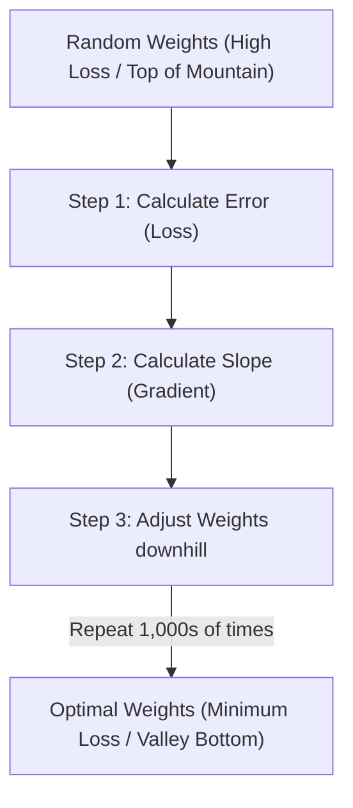
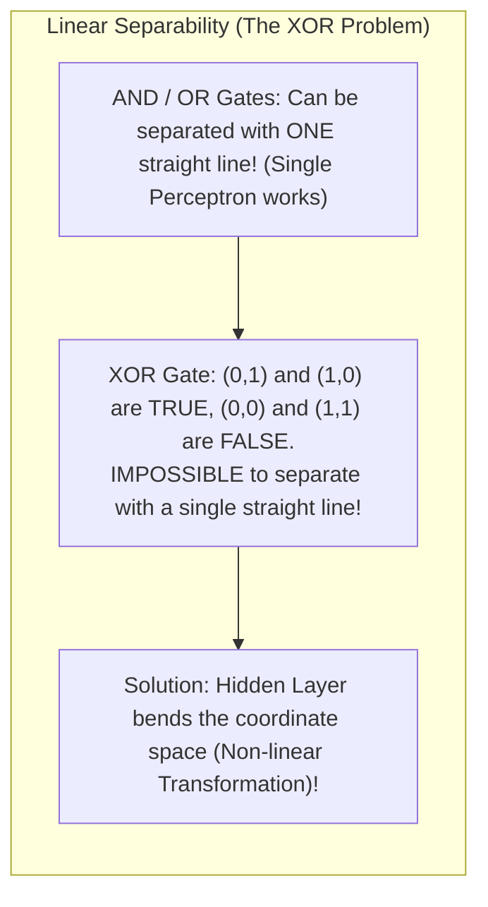

# Chapter 00: AI Mathematics, Tensors & Neural Networks from Scratch (Ground Zero)

> **Welcome!** Many engineers feel intimidated by Artificial Intelligence because textbooks use Greek letters, calculus symbols, and complex math.
> 
> Here is the secret: **Under the hood, 95% of AI is just basic multiplication and addition arranged in loops.**
> 
> In this chapter, we will explain all the math and core concepts from absolute zero using simple English, real-world analogies, step-by-step arithmetic, and code in both **Python** and **JavaScript**. No complex math background is required!

---

## 1. What is a Vector? (Feature Lists)

In programming, a **Vector** is simply a **1D list of numbers**.

### The Real-World Example: Describing a House
Imagine you want a computer to understand houses. A computer cannot look at a photo like a human. But you can describe each house with 3 numbers:
1. Number of bedrooms
2. Area in square feet
3. Distance to metro station (in kilometers)

```python
# Python
house_a = [3, 1200, 0.5]  # 3 bedrooms, 1200 sqft, 0.5 km to metro
house_b = [4, 1800, 2.0]  # 4 bedrooms, 1800 sqft, 2.0 km to metro
```

```javascript
// JavaScript
const houseA = [3, 1200, 0.5];
const houseB = [4, 1800, 2.0];
```

Congratulations! `houseA` is a **3-dimensional vector**. The "dimension" simply means **how many numbers are in the list**.

---

## 1.5 How Words Become Vectors: The Embedding Lookup Table

Houses already have numbers (bedrooms, sqft). But how do you convert words like `"dog"` or `"king"` into numbers?

### 1. The Naive Way: One-Hot Encoding (Bad)
If your dictionary has 50,000 words:
* `"apple"` = `[1, 0, 0, 0, 0, ... 0]` (49,999 zeros!)
* `"banana"` = `[0, 1, 0, 0, 0, ... 0]`
* *Problem*: The dot product between `"apple"` and `"banana"` is `0`! The computer thinks apples and bananas have zero relationship.

### 2. The Modern Way: Dense Embeddings (Good)
Instead of 50,000 zeros, we give every word a dense list of numbers (e.g., 1536 numbers in OpenAI or Gemini models). Each dimension captures a subtle concept:

| Dimension | "Dog" | "Puppy" | "Airplane" |
|---|---|---|---|
| Is it an animal? | `+0.95` | `+0.96` | `-0.90` |
| Is it small? | `-0.10` | `+0.85` | `-0.99` |
| Can it fly? | `-0.98` | `-0.95` | `+0.99` |



Because `"Dog"` and `"Puppy"` have very similar numbers, their Dot Product will be huge. The computer now understands that puppies and dogs are related!

---

## 1.6 Tokens Demystified: Why AI Cannot Count Letters in "Strawberry"

Have you ever asked an AI model: *"How many letter 'r's are in the word strawberry?"* and watched it fail or guess wrong?

Why does a multi-billion-dollar AI fail at a 1st-grade spelling question?

Because **LLMs do not read characters or letters**. They read **Tokens**!



To the LLM, the word `"strawberry"` is simply two tokens: `[4125, 12904]`. It never sees the individual letters `s-t-r-a-w-b-e-r-r-y`! That is why asking an LLM to count letters or reverse a string requires special chain-of-thought prompting.

---

## 2. The Dot Product: Measuring Similarity

The single most important math operation in all of AI is the **Dot Product**.

### How to Calculate the Dot Product by Hand
Take two lists of numbers. Multiply matching pairs together, and add up the results:

If List A = `[1, 2, 3]` and List B = `[4, 5, 6]`:

$$\text{Dot Product} = (1 \times 4) + (2 \times 5) + (3 \times 6) = 4 + 10 + 18 = 32$$



### Why does this matter in AI?
The Dot Product measures **how much two vectors point in the same direction**:
* High Positive Score = Very similar meanings (*"puppy"* and *"dog"*).
* Near Zero = Completely unrelated (*"airplane"* and *"ice cream"*).
* Negative Score = Opposite meanings.

---

## 2.5 Cosine Similarity vs. Dot Product (Handling Vector Length)

What if you have a short customer review (10 words) and a long blog post (2,000 words) that talk about the exact same topic?
* If you take the pure Dot Product, the long blog post will get a massive score simply because it has 2,000 words!
* To fix this, we use **Cosine Similarity**, which measures **only the angle**, ignoring the length:

$$\text{Cosine Similarity} = \frac{A \cdot B}{\|A\| \times \|B\|}$$

* `||A||` is the length (magnitude) of vector A.
* Cosine Similarity is always neatly bounded between **`-1.0`** (exact opposite) and **`+1.0`** (exact match).

#### Python:
```python
import math

def cosine_similarity(vec_a, vec_b):
    dot = sum(a * b for a, b in zip(vec_a, vec_b))
    mag_a = math.sqrt(sum(a * a for a in vec_a))
    mag_b = math.sqrt(sum(b * b for b in vec_b))
    return dot / (mag_a * mag_b)

v1 = [1, 2, 3]
v2 = [2, 4, 6]  # v2 is twice as long, but points in the exact same direction!
print("Cosine Similarity:", cosine_similarity(v1, v2)) # Output: 1.0 (Perfect Match!)
```

#### JavaScript:
```javascript
function cosineSimilarity(vecA, vecB) {
    let dot = 0;
    let magA = 0;
    let magB = 0;
    for (let i = 0; i < vecA.length; i++) {
        dot += vecA[i] * vecB[i];
        magA += vecA[i] * vecA[i];
        magB += vecB[i] * vecB[i];
    }
    return dot / (Math.sqrt(magA) * Math.sqrt(magB));
}

const v1 = [1, 2, 3];
const v2 = [2, 4, 6];
console.log("Cosine Similarity:", cosineSimilarity(v1, v2)); // Output: 1 (Perfect Match!)
```

---

## 3. What is a Matrix? (A Table of Vectors)

* A **Scalar** = 1 single number (e.g., `5`).
* A **Vector** = A 1D list of numbers (e.g., `[1, 2, 3]`).
* A **Matrix** = A 2D table of numbers (a list of lists).
* A **Tensor** = Any 3D, 4D, or N-dimensional block of numbers (like a stack of matrices).



### Matrix Multiplication: How LLMs Process Thousands of Words
When an LLM processes your prompt, it multiplies a Matrix of your input words by a Matrix of learned weights ($W$):



#### The Golden Rule of Matrix Multiplication
To multiply Matrix A by Matrix B:
> **The number of COLUMNS in A must equal the number of ROWS in B.**
> 
> If Matrix A is shape `(2 x 3)` and Matrix B is shape `(3 x 4)`, the output matrix will be shape `(2 x 4)`.

---

## 4. The Softmax Function: Converting Numbers to Percentages

When a language model calculates scores for the next word, it produces raw numbers called **logits** (e.g., `[2.0, 1.0, 0.1]`).
* "apple": `2.0`
* "banana": `1.0`
* "car": `0.1`

How does the computer convert these raw scores into **clean percentages** that add up to 100% (1.0)?

It uses a simple formula called **Softmax**:
1. Take $e^x$ (Euler's number $2.718$ raised to each number). This turns any negative numbers into positive numbers.
2. Sum all the exponential values.
3. Divide each value by the sum.



### Implementing Softmax from Scratch

#### Python:
```python
import math

def softmax(logits):
    exp_values = [math.exp(x) for x in logits]
    total_sum = sum(exp_values)
    return [val / total_sum for val in exp_values]

raw_scores = [2.0, 1.0, 0.1]
probs = softmax(raw_scores)
print("Probabilities:", [round(p, 3) for p in probs])
# Output: [0.659, 0.242, 0.099]  (Adds up to 1.0!)
```

#### JavaScript:
```javascript
function softmax(logits) {
    const expValues = logits.map(x => Math.exp(x));
    const totalSum = expValues.reduce((sum, val) => sum + val, 0);
    return expValues.map(val => val / totalSum);
}

const rawScores = [2.0, 1.0, 0.1];
const probs = softmax(rawScores);
console.log("Probabilities:", probs.map(p => p.toFixed(3)));
// Output: ['0.659', '0.242', '0.099'] (Adds up to 1.0!)
```

---

## 5. What is an Artificial Neuron?

An artificial neuron (the building block of all AI) is based on one simple formula:

$$\text{Output} = \text{Activation}(\text{Weight} \times \text{Input} + \text{Bias})$$



* **Inputs ($X$)**: The data coming in.
* **Weights ($W$)**: Knobs that adjust how important each input is. (If you study more, exam score goes up; so weight $w_1$ is a positive number).
* **Bias ($b$)**: A baseline offset. (Even if you studied 0 hours, your minimum score might be 5).
* **Activation Function**: Decides whether the neuron should "fire" or stay silent.

---

## 6. Why Do We Need Non-Linear Activation Functions (ReLU)?

One of the most common interview questions is: *"Why can't we just build a neural network using pure linear equations ($y = W \cdot X + b$)? Why do we need ReLU?"*

### The 1-Minute Proof
In high school math, if you have two linear lines:
* Line 1: $y = 2x$
* Line 2: $z = 3y$

If you combine them: $z = 3(2x) = 6x$.
Notice that $6x$ is **still just a straight line**! 

If you stack 100 linear layers without an activation function, the entire 100-layer neural network mathematically collapses into **a single straight line**. It can never learn complex shapes, human speech, images, or language!

### The Solution: ReLU (Rectified Linear Unit)
ReLU is the simplest function in the world:
$$\text{ReLU}(x) = \max(0, x)$$
* If the number is negative, turn it into `0`.
* If the number is positive, leave it alone.


This simple "bend" at zero allows neural networks to approximate **any mathematical curve in the universe**!

---

## 7. How Does a Model Learn? (Loss & Gradient Descent)

When a model starts, its weights are completely random numbers. It guesses randomly and makes terrible predictions.

How does it improve?

### 1. The Loss Function (Checking Mistakes)
The **Loss Function** measures the gap between the model's prediction and the real truth:
$$\text{Loss} = (\text{Prediction} - \text{Actual Truth})^2$$
* Our only goal in machine learning is to **make the Loss as close to 0 as possible**.

### 2. Gradient Descent (The Blindfolded Hiker Analogy)
Imagine you are blindfolded on a foggy mountain, and you want to walk down to the lowest valley (where Loss = 0).

What do you do?
1. You feel the ground with your foot to see which way slopes downward (this is the **Gradient**).
2. You take one small step downhill (governed by the **Learning Rate**).
3. You repeat this 10,000 times until you reach the bottom of the valley.



---

## 8. Milestone: Building a Neural Network from Scratch in Pure Python

Let's put everything together! We will build a complete 2-layer Neural Network that learns the **XOR problem** using only pure Python and NumPy. No PyTorch, no TensorFlow!

```python
import numpy as np

# 1. Inputs (X) and Expected Outputs (y) for XOR logic:
# 0,0 -> 0 | 0,1 -> 1 | 1,0 -> 1 | 1,1 -> 0
X = np.array([[0, 0], 
              [0, 1], 
              [1, 0], 
              [1, 1]])

y = np.array([[0], 
              [1], 
              [1], 
              [0]])

# 2. Initialize random weights and biases
np.random.seed(42)
W1 = np.random.randn(2, 4)  # 2 inputs -> 4 hidden neurons
b1 = np.zeros((1, 4))
W2 = np.random.randn(4, 1)  # 4 hidden neurons -> 1 output
b2 = np.zeros((1, 1))

# Activation function: Sigmoid
def sigmoid(x):
    return 1 / (1 + np.exp(-x))

def sigmoid_derivative(x):
    return x * (1 - x)

learning_rate = 0.5

# 3. Training Loop (Learning over 5,000 iterations)
for epoch in range(5000):
    # FORWARD PASS (Making predictions)
    hidden_input = np.dot(X, W1) + b1
    hidden_output = sigmoid(hidden_input)
    
    final_input = np.dot(hidden_output, W2) + b2
    predictions = sigmoid(final_input)
    
    # Calculate Loss (Error)
    error = y - predictions
    
    # BACKWARD PASS (Calculating gradients using chain rule)
    d_predicted = error * sigmoid_derivative(predictions)
    
    error_hidden = d_predicted.dot(W2.T)
    d_hidden = error_hidden * sigmoid_derivative(hidden_output)
    
    # UPDATE WEIGHTS (Gradient Descent step downhill!)
    W2 += hidden_output.T.dot(d_predicted) * learning_rate
    b2 += np.sum(d_predicted, axis=0, keepdims=True) * learning_rate
    W1 += X.T.dot(d_hidden) * learning_rate
    b1 += np.sum(d_hidden, axis=0, keepdims=True) * learning_rate

# 4. Test the trained network!
print("--- Final Predictions after Training ---")
for i in range(len(X)):
    pred = predictions[i][0]
    print(f"Input: {X[i]} -> Target: {y[i][0]} | AI Prediction: {pred:.3f} (Rounded: {round(pred)})")
```

---

## 9. Production Case Studies, Vector Drifts & Interview Traps

### Production Case Study 1: The Softmax `NaN` Numerical Overflow Crash
* **The Incident**: During production deployment of an LLM inference microservice, responses suddenly turned into empty strings or bizarre repetitive punctuation. Server logs showed tensor output values were filled with `NaN` (Not a Number).
* **Root Cause**: The developer implemented naive Softmax:
  ```python
  # DANGEROUS: Causes numerical overflow!
  def naive_softmax(x):
      return np.exp(x) / np.sum(np.exp(x))
  ```
  When the model processed a long prompt, unnormalized attention logits reached values like `x = [100, 850, 1000]`.
  In floating point math, $e^{1000} = \infty$ (`inf`). Computing `inf / inf` results in **`NaN`**! Once a single `NaN` enters a matrix multiplication, it poisons every downstream layer.
* **The Fix**: The **Numerically Stable Softmax Trick** (subtracting the row maximum before exponentiation):
  ```python
  def safe_softmax(x):
      e_x = np.exp(x - np.max(x, axis=-1, keepdims=True))
      return e_x / np.sum(e_x, axis=-1, keepdims=True)
  ```
  Since the maximum value becomes $e^0 = 1.0$, values never overflow!

### Production Case Study 2: The Zero-Weight Initialization Symmetry Collapse
* **The Incident**: A computer vision team trained a multi-layer neural network on GPU for 48 hours. The training loss refused to decrease, staying flat at high error.
* **Root Cause**: The engineer initialized weights using `W = np.zeros((d_in, d_out))`.
* **The Symmetry Trap**: When all weights start at zero, every neuron in the hidden layer computes the exact same linear combination ($0 \times x = 0$), produces the exact same activation, and receives the exact same gradient during backpropagation! The neurons remain identical copies of each other, unable to learn distinct features.
* **The Rule**: Weights must always be initialized with small random values (e.g. He/Xavier initialization). Biases can safely start at 0.

### Vector Drifts to Watch:
1. **Embedding Dimension Mismatch Drift**:
   An engineering team updates their embedding provider from OpenAI `text-embedding-ada-002` (1536 dimensions) to `text-embedding-3-large` (3072 dimensions). Because vector databases like `pgvector` or Pinecone enforce fixed column dimensions, incoming queries crash with dimension mismatch errors until the entire vector index is dropped and re-ingested.
2. **Document Length Cosine Drift**:
   Raw Dot Product measures both **angle** and **magnitude (length)**. A 10,000-word book chapter will have a far larger vector magnitude than a 10-word FAQ sentence. If you search using raw dot products, long documents artificially dominate search rankings regardless of relevance.
   * **Fix**: Always normalize vectors to unit length ($\|v\| = 1$) so Dot Product equals **Cosine Similarity**!

### FAANG Interview Scenarios & Traps:



#### Scenario 1: "Why does changing the Temperature parameter in ChatGPT alter its creativity and randomness?"
* **Answer**: Temperature $T$ scales the logits before Softmax: $P_i = \frac{e^{z_i / T}}{\sum e^{z_j / T}}$.
  * **Low Temperature ($T = 0.1$)**: Divides logits by $0.1$ (multiplies by 10). The difference between the highest logit and the second-highest logit becomes enormous. Softmax probability for the top token concentrates to $99.9\%$, making outputs deterministic and repetitive.
  * **High Temperature ($T = 1.5$)**: Shrinks differences between logits. Softmax flattens out, giving rare words a higher probability of being sampled, producing creative or chaotic text.

#### Scenario 2: "What is the mathematical proof that stacking 100 linear layers collapses into a single layer?"
* **Answer**: A linear layer is $y = W_1 x$. The next layer is $z = W_2 y = W_2(W_1 x) = (W_2 W_1) x$. Because matrix multiplication is associative and closed, the product of two matrices $W_2 W_1$ is simply another single matrix $W_{combined}$. Stacking 100 linear layers without non-linear activation functions is mathematically identical to a single matrix multiplication!

#### Scenario 3: "Why can't a single Perceptron solve the XOR Problem, and why is a Hidden Layer required?"
* **Answer**: Minsky and Papert's famous 1969 proof:
  * A single perceptron computes a single linear hyperplane: $w_1 x_1 + w_2 x_2 + b = 0$ (a straight line in 2D).
  * In the XOR truth table, the points $(0, 1)$ and $(1, 0)$ are class 1, while $(0, 0)$ and $(1, 1)$ are class 0.
  * It is geometrically impossible to draw a single straight line separating those points.
  * A **Hidden Layer** projects the 2D input into a higher-dimensional space where the points become linearly separable.

#### Scenario 4: "What is the difference between Dot Product, Cosine Similarity, and Euclidean Distance?"
* **Answer**:
  * **Dot Product ($A \cdot B = \sum A_i B_i$)**: Combines angle and vector length. Favors longer documents over shorter ones.
  * **Cosine Similarity ($\frac{A \cdot B}{\|A\| \|B\|}$)**: Normalizes vectors to unit length; measures **only the angle** between vectors ($-1$ to $+1$). Ideal for text embeddings where document length shouldn't distort semantic topic.
  * **Euclidean Distance ($L2 = \sqrt{\sum (A_i - B_i)^2}$)**: Measures physical distance between endpoints in geometric space. If vectors are unit-normalized ($\|A\| = \|B\| = 1$), Euclidean distance is monotonically related to Cosine Similarity: $L2^2 = 2 - 2 \cos(\theta)$.

#### Scenario 5: "Why does the Numerically Stable Softmax trick not change the mathematical probabilities?"
* **Answer**: We subtract the constant $c = \max(x)$ from each logit:
  $$\frac{e^{x_i - c}}{\sum e^{x_j - c}} = \frac{e^{x_i} \cdot e^{-c}}{\sum (e^{x_j} \cdot e^{-c})} = \frac{e^{x_i} \cdot e^{-c}}{e^{-c} \cdot \sum e^{x_j}} = \frac{e^{x_i}}{\sum e^{x_j}}$$
  The constant factor $e^{-c}$ factors out of the numerator and denominator and cancels out completely! The mathematical probabilities are 100% identical, but float values never exceed $e^0 = 1.0$, completely preventing GPU `NaN` overflows!

#### Scenario 6: "What do the tensor dimensions `(Batch, Sequence, Hidden)` represent in LLMs?"
* **Answer**:
  * **Batch ($B$)**: How many independent user prompts are processed simultaneously on the GPU tensor cores (e.g. $B = 8$).
  * **Sequence Length ($S$ or $N$)**: How many tokens are in each prompt (e.g. $S = 2048$).
  * **Hidden Dimension ($D$ or $d_{model}$)**: The embedding vector size representing the meaning of each token (e.g. $D = 4096$ in Llama 3).
  * Tensor shape `(8, 2048, 4096)` = $8 \times 2048 \times 4096 \times 2 \text{ bytes (FP16)} \approx 134 \text{ MB}$ of GPU memory per layer!

#### Scenario 7: "What is the difference between Dense Embeddings and Sparse Embeddings (BM25)?"
* **Answer**:
  * **Sparse Embeddings (BM25 / SPLADE)**: Massive vocabulary-sized vectors (~100,000 dimensions) where 99.9% of entries are zero. Excels at exact keyword matching (SKUs, IDs, medical drug names).
  * **Dense Embeddings (OpenAI / Cohere)**: Compact continuous vectors (768 to 3072 dimensions) where every entry is a non-zero float. Excels at fuzzy semantic concepts (*"feline"* matches *"cat"*).
  * Modern production systems combine both using **Hybrid Search** + Cross-Encoder Reranking.

#### Scenario 8: "Why does Leaky ReLU prevent the Dying ReLU problem?"
* **Answer**:
  * Standard ReLU: $\text{ReLU}(x) = 0$ for $x < 0$. The gradient is $0.0$, permanently killing weights if they drop negative.
  * **Leaky ReLU**: $\text{LeakyReLU}(x) = 0.01x$ for $x < 0$. The gradient in the negative region is a small constant `0.01`, allowing small error signals to flow backward so dormant neurons can recover.

#### Scenario 9: "Why is Matrix Transposition ($A^T$) mandatory during Attention calculation?"
* **Answer**: The Query matrix $Q$ has shape $(N \times d_k)$ and Key matrix $K$ has shape $(N \times d_k)$.
  * Matrix multiplication requires the inner dimensions to match: $(N \times d_k) \times (d_k \times N)$.
  * Transposing $K$ to $K^T$ of shape $(d_k \times N)$ allows computing $Q \cdot K^T$, yielding the square **$(N \times N)$ Attention Score matrix**, representing the pairwise relevance of every token to every other token.

#### Scenario 10: "What is Top-K Sampling vs. Top-P (Nucleus) Sampling?"
* **Answer**:
  * **Top-K**: Truncates the Softmax distribution to only the top $K$ most likely tokens (e.g. $K = 50$), zeroing out the rest. Flaw: If the top token has 95% probability, Top-50 still includes 49 low-probability hallucinations.
  * **Top-P (Nucleus)**: Dynamically selects the smallest set of tokens whose cumulative probability exceeds threshold $P$ (e.g. $P = 0.90$). If one token has 95% probability, only 1 token is considered; if the distribution is flat, it dynamically expands to 50 tokens.

---

## Checkpoint Exercise

1. How does a computer know that `"puppy"` and `"dog"` are related, but `"airplane"` is not? *(Hint: Dense embedding vectors and Dot Product).*
2. Why does an LLM fail at counting the letters in the word `"strawberry"`? *(Hint: Byte-Pair Tokens vs. individual characters).*
3. Why do we use Cosine Similarity instead of raw Dot Product when comparing documents of different lengths?
4. What happens to a negative number like `-10` when passed through ReLU?

*Now you know how AI models think at the fundamental math level! Proceed to [Chapter 01](./ai_engineer_study_plan.md).*
