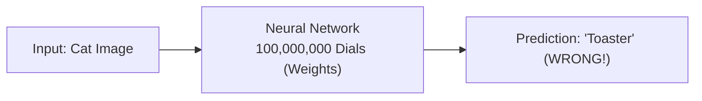
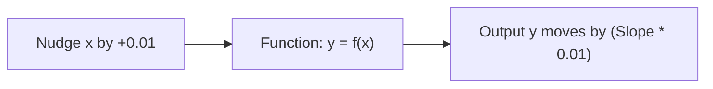
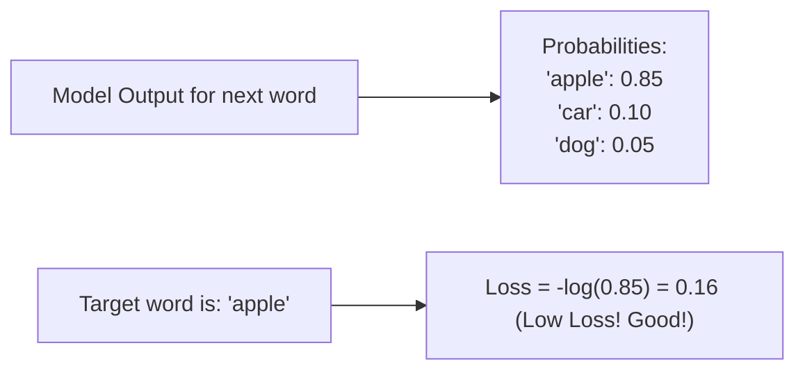
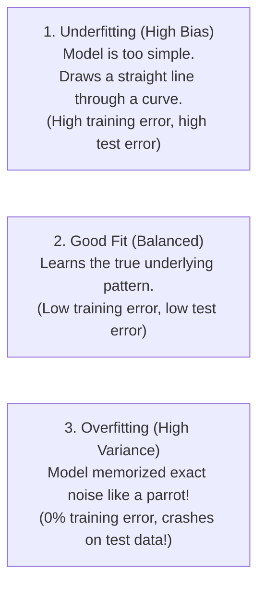
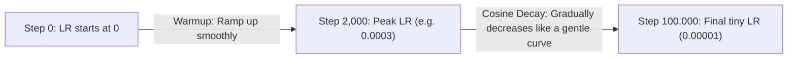

# Chapter 01: Calculus, Loss Functions & Optimization Intuition (Deep Dive)

> **Welcome to Chapter 01 of the AI Engineer Track!**
> Many software engineers run away from machine learning because they see formulas with $\partial$, $\nabla$, and $\sum$.
> 
> Here is the secret: **You do not need to solve calculus equations by hand on paper.** 
> You only need to understand the **visual intuition** of what calculus is doing: telling the computer which direction to turn each knob (weight) so that the AI makes fewer mistakes.
> 
> In this chapter, we will master gradients, loss functions, optimization algorithms, overfitting vs. underfitting, and learning rate schedulers using simple English, visual diagrams, and code in both Python and JavaScript.

---

## 1. Why Does AI Need Calculus? (The 100,000,000 Knobs Problem)

Imagine you are standing in front of a giant mixing board with **100,000,000 dials (weights)**.
* Your goal is to adjust the dials so that when you feed in an image of a cat, the speaker announces: *"Cat!"*



If you adjust dials by random trial-and-error:
* Even with a supercomputer, testing all combinations would take longer than the age of the universe!

**Calculus is the cheat code.** 
Calculus tells you:
> *"If you turn Dial #41,209 slightly to the RIGHT, your error will decrease by 0.003."*

Instead of guessing, calculus gives the exact direction and speed to turn every single dial simultaneously.

---

## 2. Derivatives & Gradients Demystified

### 1. What is a Derivative? (The Slope)
In plain English, a derivative is simply: **"If I nudge $x$ a tiny bit, how much does $y$ change?"**

Look at a simple slope:
* If $y = 3x$:
  * Every time $x$ increases by 1, $y$ increases by 3.
  * The derivative (slope) is **`+3`**.



### 2. What is a Gradient ($\nabla L$)?
A neural network doesn't have just one input; it has millions of weights ($w_1, w_2, w_3, ...$).
* A **Partial Derivative** is the slope of weight $w_1$ while keeping all other weights frozen.
* A **Gradient** is simply a **list of all those partial derivatives packaged into a vector**:
  $$\text{Gradient} = \left[ \frac{\partial L}{\partial w_1}, \frac{\partial L}{\partial w_2}, \dots, \frac{\partial L}{\partial w_n} \right]$$

> **The Fundamental Rule of Gradients**:
> The gradient vector points in the direction of **steepest increase** (maximum error).
> Therefore, to minimize error, we move in the **exact opposite direction** (Negative Gradient)!

---

## 3. Loss Functions: How an AI Measures Its Mistakes

A **Loss Function** outputs a single number: **how bad was the model's prediction?**

### 1. Mean Squared Error (MSE) — For Numbers / Regression
Used when predicting continuous values (e.g., house prices, stock prices, temperature).

$$\text{MSE} = \frac{1}{N} \sum (\text{Prediction} - \text{Actual})^2$$

```python
# Python
def mean_squared_error(predictions, targets):
    total = sum((p - t) ** 2 for p, t in zip(predictions, targets))
    return total / len(predictions)
```

---

### 2. Cross-Entropy Loss — For Classifiers & LLMs!
When an LLM generates text, it is playing a multiple-choice game over 50,000 possible next tokens.

**Cross-Entropy Loss** measures how confident the model was in the **correct token**:

$$\text{Cross-Entropy Loss} = -\log(\text{Probability assigned to the correct token})$$



* If the correct next word was `"apple"`, and the model assigned it **99% probability (`0.99`)**:
  * $\text{Loss} = -\log(0.99) = \mathbf{0.01}$ (Near zero! Model did great).
* If the model assigned `"apple"` only **1% probability (`0.01`)**:
  * $\text{Loss} = -\log(0.01) = \mathbf{4.60}$ (Huge penalty! Model was wrong and confident in the wrong word).

---

## 4. Overfitting vs. Underfitting (The Student Exam Analogy)

This is one of the most important concepts in all of machine learning:



### The Real-World Analogy:
* **Underfitting**: A lazy student who studied only 10 minutes. Fails both practice exams and final exams.
* **Overfitting**: A student who memorized the exact multiple-choice answers (`A, C, B, D`) from past papers. Scores 100% on homework, but when the teacher slightly changes the question on the real exam, they fail completely!

### How We Prevent Overfitting:
1. **L2 Regularization (Weight Decay)**: We add a penalty to the loss function ($\text{Loss} + \lambda \sum W^2$). It forces weights to stay small and smooth, preventing the model from fitting wild spikes in noise.
2. **Dropout**: During training, we randomly turn off 10% to 20% of neurons on every pass. This forces the network to learn robust, generalized patterns rather than relying on any single "genius" neuron!

---

## 5. Learning Rate Schedulers: Warmup & Cosine Decay

Should the Learning Rate ($\alpha$) stay the same throughout training? **NO!**

Modern LLMs (like Llama 3) use a **Warmup + Cosine Decay Learning Rate Scheduler**:



1. **Warmup Phase**: At the start of training, weights are random. Large steps would destabilize the model. We start with a tiny learning rate and ramp it up smoothly over the first 2,000 steps.
2. **Cosine Decay Phase**: As the model gets closer to the optimal valley bottom, we gradually shrink the learning rate following a cosine curve so it settles into the lowest minimum without overshooting!

---

## 6. Beyond Vanilla SGD: The Adam Optimizer

Modern LLMs use the **Adam (Adaptive Moment Estimation) Optimizer**:
1. **Momentum**: If gradients keep pointing in the same direction, Adam speeds up like a heavy bowling ball rolling downhill.
2. **Adaptive Per-Weight Learning Rates**: If weight $w_1$ receives massive gradients while weight $w_2$ receives tiny gradients, Adam automatically shrinks the step for $w_1$ and boosts the step for $w_2$.

---

## 7. Hands-on Code: 1D Gradient Descent from Scratch

### 1. Python Implementation:
```python
# The function: y = x^2 - 4x + 6
# Its mathematical derivative (slope): dy/dx = 2x - 4

x = 10.0
learning_rate = 0.1

for step in range(30):
    gradient = 2 * x - 4  # The slope at current x
    x = x - (learning_rate * gradient)  # Step downhill!
    y = x**2 - 4*x + 6

print(f"Optimal x = {x:.4f}, Minimum y = {y:.4f}")
# Output: Optimal x = 2.0000, Minimum y = 2.0000
```

### 2. JavaScript Implementation:
```javascript
// Function: y = x^2 - 4x + 6
// Derivative (slope): dy/dx = 2x - 4

let x = 10.0;
const learningRate = 0.1;
let y;

for (let step = 0; step < 30; step++) {
    const gradient = 2 * x - 4; // Slope at current x
    x = x - (learningRate * gradient); // Step downhill!
    y = x * x - 4 * x + 6;
}

console.log(`Optimal x = ${x.toFixed(4)}, Minimum y = ${y.toFixed(4)}`);
// Output: Optimal x = 2.0000, Minimum y = 2.0000
```

---

## Chapter 01 Checklist (Summary)

Before moving to Chapter 02, verify that you can answer these:
- [x] What is the difference between a single Derivative and a Gradient vector?
- [x] Why does Cross-Entropy Loss output a massive penalty when an LLM is confident in the wrong token?
- [x] What is the difference between Underfitting and Overfitting, and how do Dropout and Weight Decay prevent overfitting?
- [x] Why do modern LLMs use a Warmup + Cosine Decay learning rate scheduler?
- [x] Why does the Adam optimizer train deep models faster than vanilla Gradient Descent?

*Chapter 01 is complete! Proceed to [Chapter 02: Neural Networks & Backpropagation from Scratch](./chapter_02.md).*
