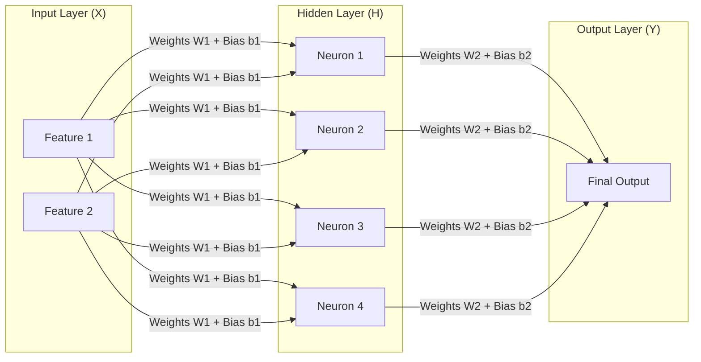
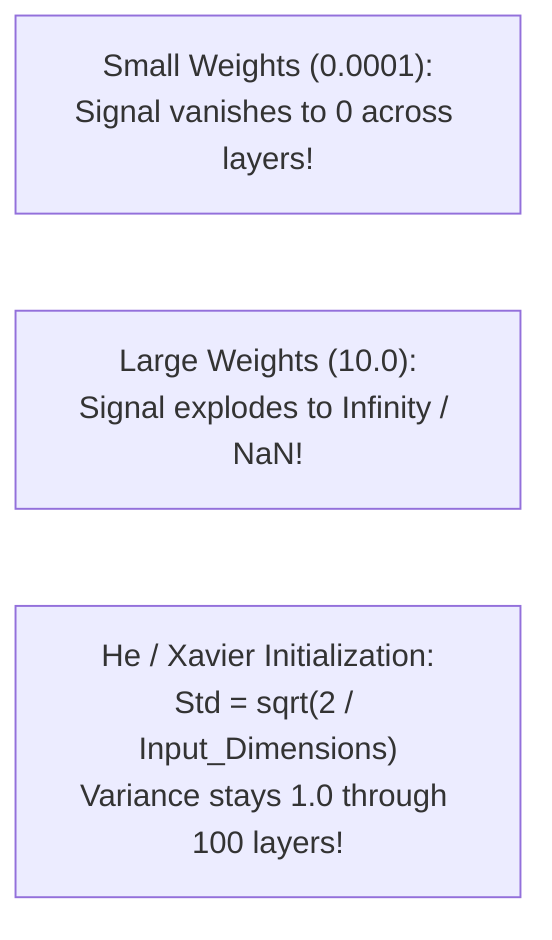
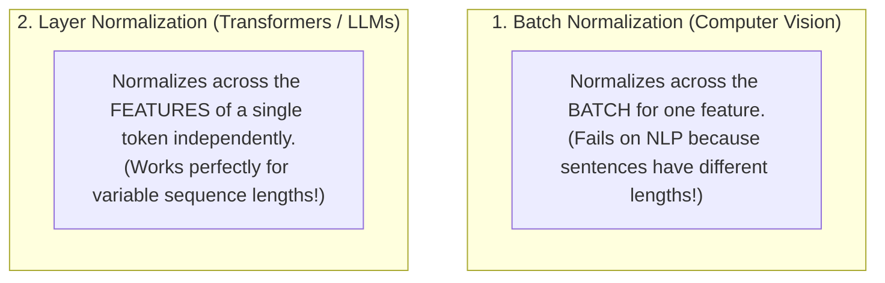
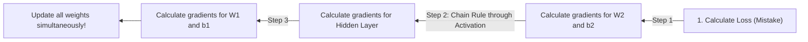

# Chapter 02: Neural Networks & Backpropagation from Scratch (Deep Dive)

> **Welcome to Chapter 02 of the AI Engineer Track!**
> Most machine learning courses tell you to type `model = torch.nn.Sequential(...)` or `model.fit()`. 
> 
> But if you only use high-level libraries, you will never understand what the GPU is actually computing, why weights blow up, or how attention layers in Transformers work.
> 
> In this chapter, we will build a complete Multi-Layer Neural Network from scratch in pure Python (NumPy) and pure JavaScript. We will derive **Backpropagation** step-by-step and master weight initialization (He/Xavier) and Layer Normalization.

---

## 1. Anatomy of a Multi-Layer Perceptron (MLP)

A **Neural Network** is simply a series of matrix multiplications separated by non-linear activation functions.



### The Matrix Dimensions:
For a batch of $B$ items:
1. **Input ($X$)**: Shape `(B x 2)` (2 features per item).
2. **First Weight Matrix ($W_1$)**: Shape `(2 x 4)` (connects 2 inputs to 4 hidden neurons).
3. **Hidden Layer ($Z_1 = X \times W_1 + b_1$)**: Shape `(B x 4)`.
4. **Activation ($A_1 = \text{Activation}(Z_1)$)**: Shape `(B x 4)`.
5. **Second Weight Matrix ($W_2$)**: Shape `(4 x 1)`.
6. **Final Output ($Z_2 = A_1 \times W_2 + b_2$)**: Shape `(B x 1)`.

---

## 2. Weight Initialization: The Xavier / He Breakthrough

What happens if you initialize weights by multiplying random numbers by `0.0001`?
* Across 50 layers, multiplying activations by tiny numbers causes signal values to **vanish to 0.000000**!
* If you initialize with large numbers like `10.0`, activations explode to **`Infinity` / `NaN`**!



### The He Initialization Formula (Kaiming He):
$$\text{Weight Standard Deviation} = \sqrt{\frac{2}{\text{Number of Input Neurons}}}$$
* In Python: `W = np.random.randn(d_in, d_out) * np.sqrt(2.0 / d_in)`.
* This single mathematical scaling guarantees that signal variance remains constant whether your network has 2 layers or 100 layers!

---

## 3. Batch Normalization vs. Layer Normalization (Why Transformers Use LayerNorm)

In deep learning, you will hear about two kinds of normalization:



* **Batch Normalization**: Used in CNNs for images. It calculates mean and variance across the batch. It fails in NLP because sentence 1 might be 5 words and sentence 2 might be 50 words!
* **Layer Normalization (LayerNorm / RMSNorm)**: Used in all modern Transformers (Llama, GPT, Claude). It normalizes the embedding dimensions of each token independently, making it immune to variable batch sizes and sequence lengths!

---

## 4. Backpropagation: The Chain Rule in Reverse



1. Error at the output: $d_{\text{output}} = \text{Predictions} - \text{Targets}$.
2. Gradient for $W_2$: $\nabla W_2 = A_1^T \times d_{\text{output}}$.
3. Error at the hidden layer: $d_{\text{hidden}} = (d_{\text{output}} \times W_2^T) \times f'(Z_1)$.
4. Gradient for $W_1$: $\nabla W_1 = X^T \times d_{\text{hidden}}$.

---

## 5. Complete Implementation in Pure Python (NumPy)

Let's train a 2-layer Neural Network to solve the non-linear **XOR Problem** from scratch using **He Initialization**:

```python
import numpy as np

# 1. Dataset: XOR truth table
X = np.array([[0, 0], [0, 1], [1, 0], [1, 1]])
y = np.array([[0], [1], [1], [0]])

# 2. He Weight Initialization
np.random.seed(42)
d_in, d_hidden, d_out = 2, 4, 1
W1 = np.random.randn(d_in, d_hidden) * np.sqrt(2.0 / d_in)
b1 = np.zeros((1, d_hidden))
W2 = np.random.randn(d_hidden, d_out) * np.sqrt(2.0 / d_hidden)
b2 = np.zeros((1, d_out))

# Activation: Sigmoid and its derivative
def sigmoid(z):
    return 1 / (1 + np.exp(-z))

def sigmoid_derivative(a):
    return a * (1 - a)

learning_rate = 0.5

# 3. Training Loop (Gradient Descent)
for epoch in range(10000):
    # --- FORWARD PASS ---
    Z1 = np.dot(X, W1) + b1
    A1 = sigmoid(Z1)
    
    Z2 = np.dot(A1, W2) + b2
    predictions = sigmoid(Z2)
    
    # --- BACKWARD PASS (Backpropagation) ---
    dZ2 = (predictions - y) * sigmoid_derivative(predictions)
    dW2 = np.dot(A1.T, dZ2)
    db2 = np.sum(dZ2, axis=0, keepdims=True)
    
    dA1 = np.dot(dZ2, W2.T)
    dZ1 = dA1 * sigmoid_derivative(A1)
    dW1 = np.dot(X.T, dZ1)
    b1_grad = np.sum(dZ1, axis=0, keepdims=True)
    
    # --- WEIGHT UPDATE ---
    W2 -= learning_rate * dW2
    b2 -= learning_rate * db2
    W1 -= learning_rate * dW1
    b1 -= learning_rate * b1_grad

# 4. Evaluation
print("--- Final Predictions ---")
for i in range(len(X)):
    pred = predictions[i][0]
    print(f"Input: {X[i]} | Target: {y[i][0]} | AI Prediction: {pred:.3f} (Rounded: {round(pred)})")
```

---

## 6. Complete Implementation in Pure JavaScript

```javascript
const X = [[0, 0], [0, 1], [1, 0], [1, 1]];
const y = [[0], [1], [1], [0]];

const sigmoid = (z) => 1 / (1 + Math.exp(-z));
const sigmoidDeriv = (a) => a * (1 - a);

// He initialization in JS
let W1 = Array.from({ length: 2 }, () => Array.from({ length: 4 }, () => (Math.random() - 0.5) * Math.sqrt(2 / 2)));
let b1 = [0, 0, 0, 0];
let W2 = Array.from({ length: 4 }, () => [(Math.random() - 0.5) * Math.sqrt(2 / 4)]);
let b2 = [0];

const learningRate = 0.5;

for (let epoch = 0; epoch < 10000; epoch++) {
    for (let i = 0; i < X.length; i++) {
        let A1 = [];
        for (let j = 0; j < 4; j++) {
            let z1 = X[i][0] * W1[0][j] + X[i][1] * W1[1][j] + b1[j];
            A1.push(sigmoid(z1));
        }

        let z2 = b2[0];
        for (let j = 0; j < 4; j++) z2 += A1[j] * W2[j][0];
        let pred = sigmoid(z2);

        let error = pred - y[i][0];
        let dZ2 = error * sigmoidDeriv(pred);

        for (let j = 0; j < 4; j++) {
            W2[j][0] -= learningRate * (A1[j] * dZ2);
        }
        b2[0] -= learningRate * dZ2;

        for (let j = 0; j < 4; j++) {
            let dZ1 = (dZ2 * W2[j][0]) * sigmoidDeriv(A1[j]);
            W1[0][j] -= learningRate * (X[i][0] * dZ1);
            W1[1][j] -= learningRate * (X[i][1] * dZ1);
            b1[j] -= learningRate * dZ1;
        }
    }
}

console.log("--- JavaScript Training Complete ---");
X.forEach((input, idx) => {
    let A1 = [0, 1, 2, 3].map(j => sigmoid(input[0] * W1[0][j] + input[1] * W1[1][j] + b1[j]));
    let z2 = b2[0] + A1.reduce((sum, val, j) => sum + val * W2[j][0], 0);
    let pred = sigmoid(z2);
    console.log(`Input: [${input}] -> Target: ${y[idx]} | Pred: ${pred.toFixed(3)} (Rounded: ${Math.round(pred)})`);
});
```

---

## 7. Production Case Studies, Architectural Drifts & Interview Traps

### Production Case Study 1: The "Dead ReLU" Epidemic in Deep Networks
* **The Incident**: A deep neural network with 30 hidden layers trained for 12 hours. During evaluation, accuracy plateaued at 20%. When engineers inspected hidden activations, **over 65% of neurons in layers 5 through 25 consistently outputted exact `0.0` for all inputs**.
* **Root Cause**: The network used a learning rate that was too high ($\alpha = 0.05$) combined with standard ReLU: $\text{ReLU}(x) = \max(0, x)$.
  * A large negative gradient update pushed the weights and bias so far into the negative territory that the linear input $z = Wx + b$ became negative for *every single sample in the dataset*.
  * For $z < 0$, the derivative of ReLU is **identically 0.0**!
  * Because the gradient was zero, backpropagation could never pass an error signal to adjust the weights again. The neurons permanently died.
* **The Modern Fix**: Modern Transformers replace ReLU with **GELU (Gaussian Error Linear Unit)** or **SwiGLU**. GELU has a smooth curvature and a small non-zero slope in the negative region, ensuring gradients never vanish completely.

### Production Case Study 2: The Batch Normalization Variable-Length Sequence Failure
* **The Incident**: An early NLP research team attempted to train a sequence-to-sequence translation model using Batch Normalization (which was standard practice in image CNNs). The training loss oscillated violently and failed to converge.
* **Root Cause**:
  * **Batch Normalization** computes the mean and variance across the *batch dimension* for a given feature index.
  * In NLP, sentences have **variable lengths** (e.g. Sentence 1 has 5 tokens, Sentence 2 has 48 tokens).
  * Padding shorter sentences with zeros skewed the mini-batch statistics. Worse, during live production serving, batch size is often $B = 1$; Batch Normalization cannot compute variance across a single sample!
* **The Transformer Breakthrough**: The Transformer authors replaced BatchNorm with **Layer Normalization (LayerNorm)**. LayerNorm normalizes across the *hidden feature dimension* of a single token independently. It does not care about sequence length or batch size!

### Architectural Drifts to Watch:
1. **Internal Covariate Shift Drift**:
   During deep backpropagation, updating weights in Layer 1 alters the distribution of inputs that Layer 2 sees on the next step. As each layer continuously chases a moving target, training destabilizes.
   * **Fix**: LayerNorm / RMSNorm resets layer inputs to zero mean and unit variance after every attention and MLP block.
2. **Vanishing Gradient Decay**:
   By the chain rule: $\frac{\partial L}{\partial W_1} = \frac{\partial L}{\partial Z_n} \cdot \prod_{i=2}^n \frac{\partial Z_i}{\partial Z_{i-1}}$. If the derivatives are $< 1.0$, multiplying 50 of them yields $0.5^{50} \approx 8.8 \times 10^{-16}$. Gradients at the input layer vanish to zero.
   * **Fix**: **Residual Connections ($x + \text{SubLayer}(x)$)**! Addition allows gradients to flow directly backward through the shortcut without attenuation.

### FAANG Interview Scenarios & Traps:

#### Scenario 1: "Why do modern LLMs like Llama 3 use RMSNorm instead of standard LayerNorm?"
* **Answer**:
  * Standard LayerNorm computes both **mean** and **variance**: $\text{LN}(x) = \frac{x - \mu}{\sqrt{\sigma^2 + \epsilon}} \cdot \gamma + \beta$.
  * Researchers discovered that centering the activations to mean $\mu = 0$ provides zero performance advantage in Transformers.
  * **RMSNorm (Root Mean Square Normalization)** drops the mean calculation entirely: $\text{RMSNorm}(x) = \frac{x}{\text{RMS}(x)} \cdot \gamma$, where $\text{RMS}(x) = \sqrt{\frac{1}{d}\sum x_i^2}$.
  * It cuts normalization compute time by **$40\%$** on GPUs with zero drop in model accuracy!

#### Scenario 2: "How does He (Kaiming) Initialization derive the formula $\text{Var}(W) = \frac{2}{d_{in}}$ for ReLU networks?"
* **Answer**:
  * For linear layers, Xavier initialization uses $\frac{1}{d_{in}}$ to keep input and output variance equal.
  * However, **ReLU zeroes out roughly half of all activations** (all negative values)!
  * This cuts the signal variance in half at every layer ($0.5 \times \text{Var}$).
  * To compensate for losing 50% of the signal energy, Kaiming He multiplied the variance by **$2$**: $\text{Var}(W) = \frac{2}{d_{in}}$, meaning standard deviation is $\sigma = \sqrt{\frac{2}{d_{in}}}$.

---

## Chapter 02 Checklist (Summary)

Before moving to Chapter 03, verify that you can answer these:
- [x] How do matrix dimensions change from input through hidden layers to the output?
- [x] Why does He / Xavier initialization use $\sqrt{2 / d_{in}}$ to prevent vanishing/exploding signals?
- [x] Why do Transformers use Layer Normalization instead of Batch Normalization?
- [x] How does backpropagation use the Calculus Chain Rule to calculate gradients in reverse?
- [x] What is the difference between an Epoch and a Batch?

*Chapter 02 is complete! Proceed to [Chapter 03: Tokenization & Byte-Pair Encoding (BPE) from Scratch](./chapter_03.md).*
