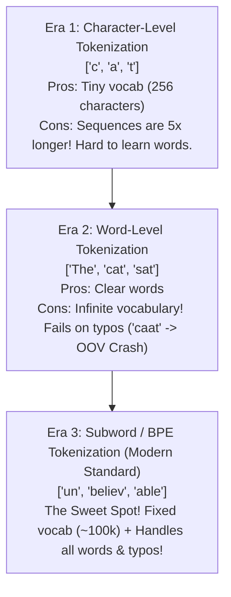
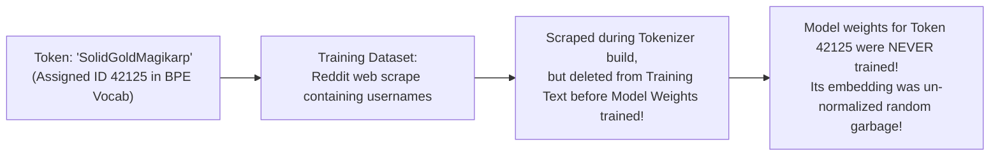

# Chapter 03: Tokenization & Byte-Pair Encoding (BPE) from Scratch (Deep Dive)

> **Welcome to Chapter 03 of the AI Engineer Track!**
> When you type a prompt into ChatGPT, Claude, or Gemini, the model does not see text. 
> 
> Before the neural network ever touches your prompt, a specialized program called a **Tokenizer** chops your text into numeric chunks called **Tokens**.
> 
> Tokenization is the source of many bizarre LLM behaviors:
> * Why models fail to count letters in words (like `"strawberry"`).
> * Why BPE, WordPiece, and SentencePiece differ.
> * What "Glitch Tokens" (like `SolidGoldMagikarp`) are and why they break models.
> * Why non-English languages cost $3\times$ to $5\times$ more API money than English!
> 
> In this chapter, we will build a functional **Byte-Pair Encoding (BPE) Tokenizer from scratch** in Python and JavaScript.

---

## 1. The Three Eras of Text Representation



### The Subword Solution:
* Common words remain whole: `"the"` $\to$ `token 42`.
* Rare or compound words are chopped into subwords: `"unbelievable"` $\to$ `["un", "believ", "able"]`.
* Typos and new slang fall back to individual characters or bytes: `"Heeeyyy"` $\to$ `["H", "eee", "yyy"]`.

---

## 2. Tokenizer Comparison: BPE vs. WordPiece vs. SentencePiece

Interviewers at AI labs love asking: *"What is the difference between BPE, WordPiece, and SentencePiece?"*

| Algorithm | Used By | How it Chooses Merges | Whitespace Handling |
|---|---|---|---|
| **BPE (Byte-Pair Encoding)** | GPT-2, GPT-4, Llama 3 | Merges the most **frequently occurring pair** of bytes/tokens. | Splits words on spaces first using Regex. |
| **WordPiece** | BERT, DistilBERT | Merges the pair that maximizes the **likelihood score / mutual information** of the training data. | Uses `##` prefix for subwords (e.g., `["play", "##ing"]`). |
| **SentencePiece** | T5, LLaMA 1, Gemma | Can use BPE or Unigram. | **Treats whitespace as an input character (`_`)**, avoiding language-specific split rules! |

---

## 3. Pre-Tokenization: Why Numbers Don't Merge with Punctuation

Before BPE merges characters, models like GPT-4 run a **Pre-Tokenization Regex** (using OpenAI's `tiktoken` library):

```regex
's|'t|'re|'ve|'m|'ll|'d| ?\p{L}+| ?\p{N}+| ?[^\s\p{L}\p{N}]+|\s+
```

### What does this regex do?
1. It splits English contractions into separate tokens: `"don't"` $\to$ `["don", "'t"]`.
2. It groups letters together, but **keeps numbers separate from letters and punctuation**: `"User42!"` $\to$ `["User", "42", "!"]`.
3. This prevents numbers from merging into words, allowing models to do math arithmetic cleanly.

---

## 4. Building a BPE Tokenizer from Scratch

### 1. Python Implementation:
```python
import collections

# Sample training text
corpus = [
    "low", "low", "low", "low", "low",
    "lower", "lower",
    "newest", "newest", "newest", "newest", "newest", "newest",
    "widest", "widest", "widest"
]

# 1. Split each word into characters with an end-of-word marker '</w>'
vocab = collections.defaultdict(int)
for word in corpus:
    vocab[' '.join(list(word)) + ' </w>'] += 1

def get_stats(vocab):
    pairs = collections.defaultdict(int)
    for word, freq in vocab.items():
        symbols = word.split()
        for i in range(len(symbols) - 1):
            pairs[symbols[i], symbols[i+1]] += freq
    return pairs

def merge_vocab(pair, v_in):
    v_out = {}
    bigram = ' '.join(pair)
    replacement = ''.join(pair)
    for word in v_in:
        w_out = word.replace(bigram, replacement)
        v_out[w_out] = v_in[word]
    return v_out

# 2. Train BPE for 5 merge steps
num_merges = 5
for step in range(num_merges):
    pairs = get_stats(vocab)
    if not pairs:
        break
    best_pair = max(pairs, key=pairs.get)
    vocab = merge_vocab(best_pair, vocab)
    print(f"Step {step + 1}: Merged pair {best_pair} (Occurred {pairs[best_pair]} times)")

print("\n--- Final Vocabulary Tokens ---")
for word in vocab:
    print(word)
```

### 2. JavaScript Implementation:
```javascript
// Sample training text
const corpus = [
    "low", "low", "low", "low", "low",
    "lower", "lower",
    "newest", "newest", "newest", "newest", "newest", "newest",
    "widest", "widest", "widest"
];

// 1. Initialize vocabulary with character spaces and end token '</w>'
let vocab = {};
corpus.forEach(word => {
    const key = word.split('').join(' ') + ' </w>';
    vocab[key] = (vocab[key] || 0) + 1;
});

function getStats(vocab) {
    const pairs = {};
    for (const [word, freq] of Object.entries(vocab)) {
        const symbols = word.split(' ');
        for (let i = 0; i < symbols.length - 1; i++) {
            const pair = `${symbols[i]},${symbols[i + 1]}`;
            pairs[pair] = (pairs[pair] || 0) + freq;
        }
    }
    return pairs;
}

function mergeVocab(bestPair, vIn) {
    const [p1, p2] = bestPair.split(',');
    const bigram = `${p1} ${p2}`;
    const replacement = `${p1}${p2}`;
    const vOut = {};
    for (const [word, freq] of Object.entries(vIn)) {
        const wOut = word.split(bigram).join(replacement);
        vOut[wOut] = freq;
    }
    return vOut;
}

// 2. Train BPE for 5 merge steps
for (let step = 0; step < 5; step++) {
    const pairs = getStats(vocab);
    const sortedPairs = Object.entries(pairs).sort((a, b) => b[1] - a[1]);
    if (sortedPairs.length === 0) break;
    
    const [bestPair, freq] = sortedPairs[0];
    vocab = mergeVocab(bestPair, vocab);
    console.log(`Step ${step + 1}: Merged pair (${bestPair}) - Frequency: ${freq}`);
}

console.log("\n--- Final Vocabulary in JS ---");
console.log(vocab);
```

---

## 5. Glitch Tokens: The `SolidGoldMagikarp` Bug

In 2023, researchers discovered a bizarre bug in GPT-3.5:
If you asked the model: *"Repeat the word SolidGoldMagikarp"*, the model would act terrified, insult the user, repeat weird gibberish, or completely hallucinate!



### Why Did This Happen?
1. The **Tokenizer vocabulary** was built on an unfiltered raw dump of Reddit (which included the username of a Reddit user named `SolidGoldMagikarp`).
2. Later, when cleaning the dataset to train the **actual neural network**, those Reddit posts were filtered out.
3. The model had an entry in its dictionary for token `42125`, but **its embedding vector was never updated during training**!
4. Querying that token fed random, uncalibrated mathematical noise into the attention layers, causing the model to glitch.

---

## 6. The Multilingual Token Tax (Case Study)

Why is running an AI startup in India or Asia more expensive than in the USA?

Because tokenizers like GPT-4's `cl100k_base` were trained mostly on English web text:

```text
English: "Hello, how are you today?"    -> 6 tokens (1x cost)
Hindi:   "नमस्ते, आज आप कैसे हैं?"      -> 19 tokens (3x cost!)
```

* **The Modern Fix**: Models like **Llama 3** expanded their vocabulary from 32,000 to **128,000 tokens**, adding thousands of Indian, Chinese, and multilingual tokens to slash latency and cost.

---

## Chapter 03 Checklist (Summary)

Before moving to Chapter 04, verify that you can answer these:
- [x] What is the difference between BPE, WordPiece, and SentencePiece?
- [x] Why does GPT-4 use a Pre-Tokenization Regex before merging subwords?
- [x] How does the BPE merge algorithm iteratively build a vocabulary from character frequencies?
- [x] What are Glitch Tokens (like `SolidGoldMagikarp`), and how do they originate?
- [x] Why does Llama 3 use a 128,000-token vocabulary instead of 32,000?

*Chapter 03 is complete! Proceed to [Chapter 04: Positional Encodings & Attention Foundations](./chapter_04.md).*
