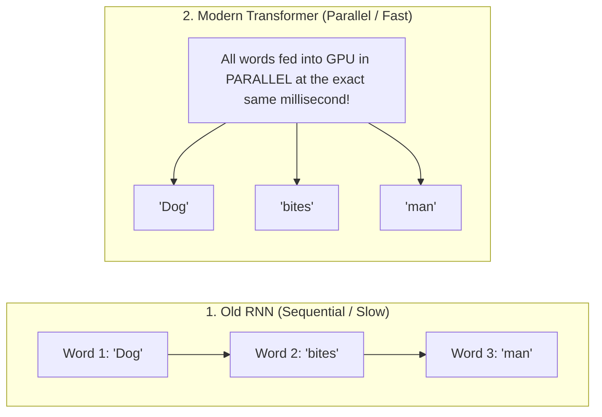
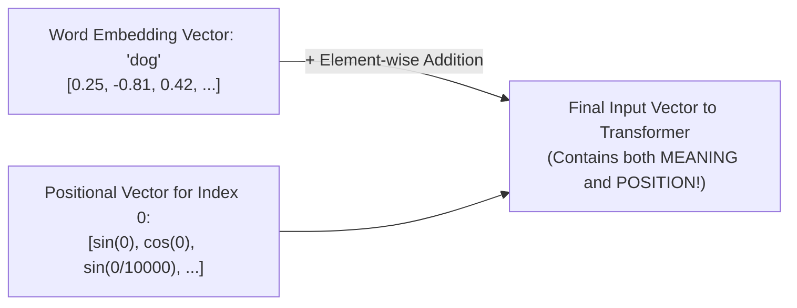
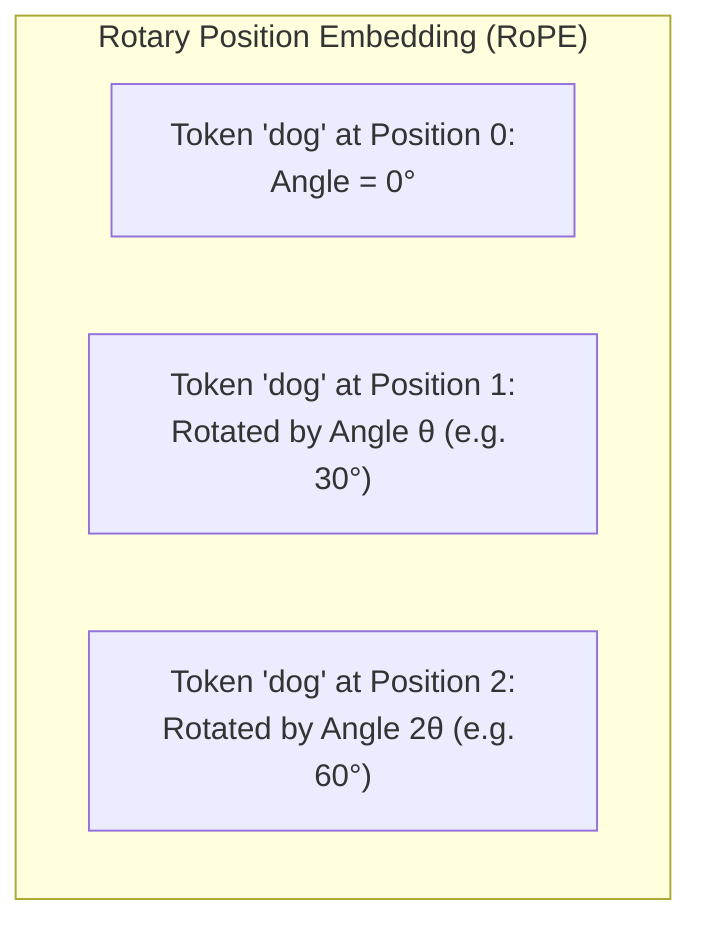
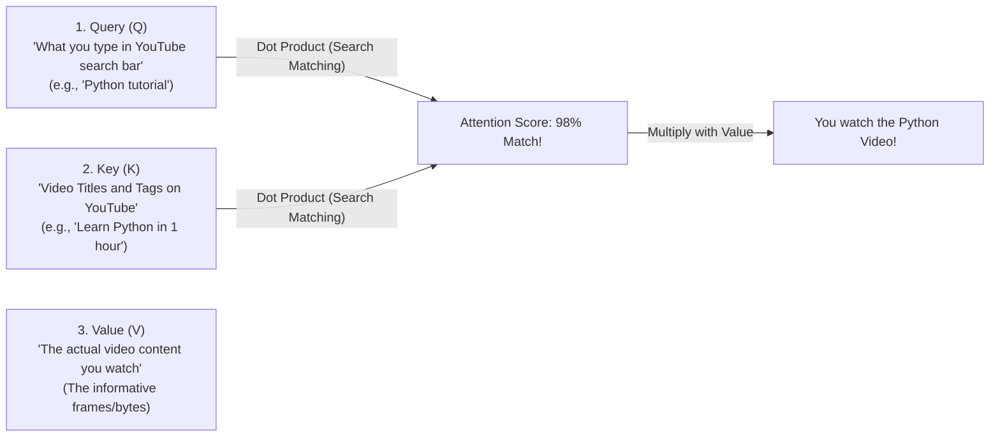
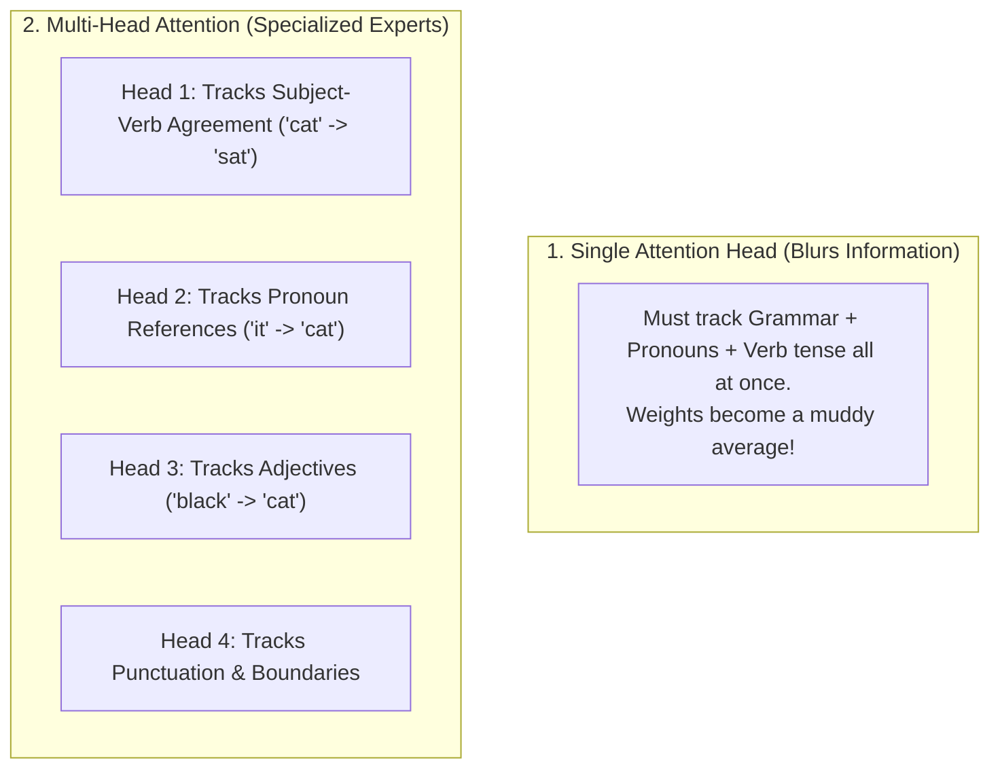
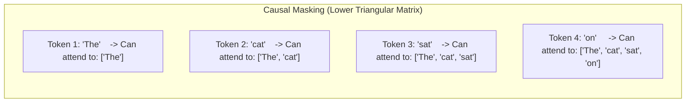
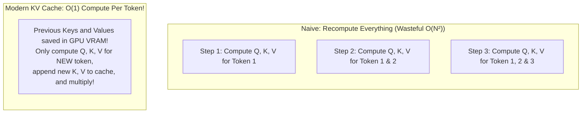
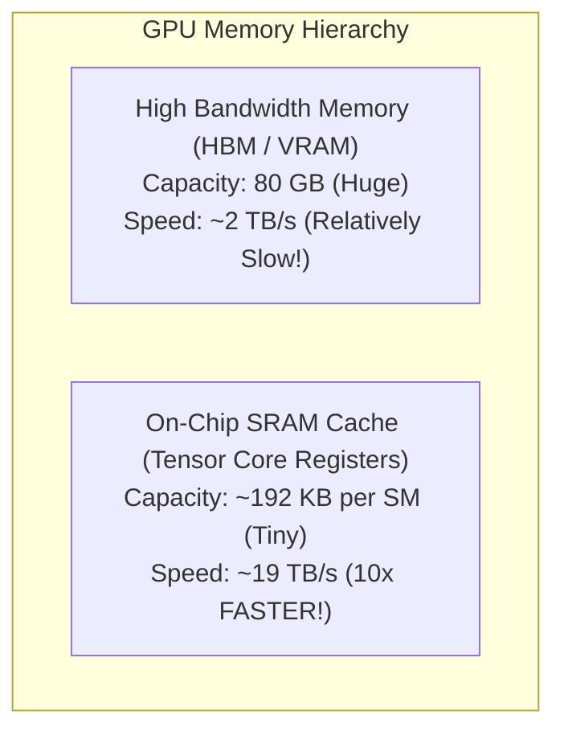
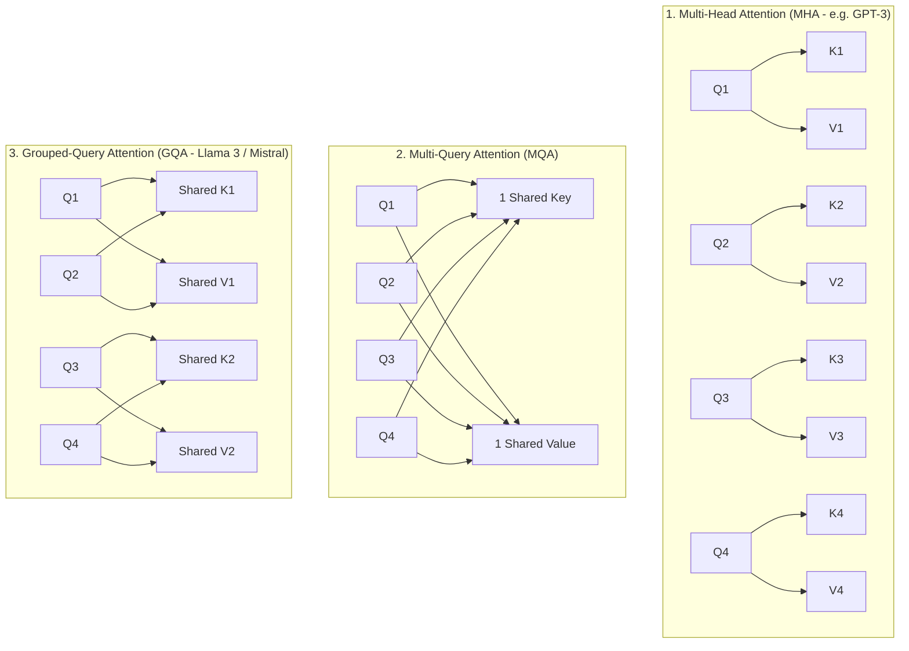

# Chapter 04: Positional Encodings & Attention Foundations (Deep Dive)

> **Welcome to Chapter 04 of the AI Engineer Track!**
> In 2017, Google published the famous research paper: *"Attention Is All You Need"*, which invented the Transformer architecture and powered ChatGPT, Claude, and Gemini.
> 
> But the Transformer had one major mathematical flaw from day one:
> **It has zero understanding of word order!**
> 
> To a raw Transformer, `"The dog bit the man"` and `"The man bit the dog"` produce the exact same mathematical representation.
> 
> In this chapter, we will master how modern models encode word position using **RoPE (Rotary Position Embeddings)**, derive the famous **Query (Q), Key (K), Value (V) Attention Mechanism**, understand **Multi-Head Attention (MHA)**, implement **Causal (Masked) Attention**, and explore hardware breakthroughs like **The KV Cache** and **FlashAttention** with runnable code in both Python and JavaScript.

---

## 1. The Permutation Invariance Problem: Why Transformers Are "Blind" to Order

In the old days of AI, models used **RNNs (Recurrent Neural Networks)**. 
RNNs read text word-by-word like a human:
Word 1 -> Word 2 -> Word 3.
* **Pros**: Naturally understands that Word 1 came before Word 2.
* **Cons**: Horribly slow! Because Word 2 must wait for Word 1, you cannot parallelize computation on a GPU.



### The Transformer's Catch-22:
Because a Transformer processes all 1,000 words in parallel across GPU tensor cores, **it has no concept of time, sequence, or position**.
If you shuffle the words randomly like a bag of marbles, the raw attention calculation outputs the exact same numbers!

To fix this, we must inject an **artificial position signal** into the embeddings.

---

## 2. Sinusoidal Positional Encoding (The 2017 Google Method)

In the original Transformer paper, Google invented **Sinusoidal Positional Encodings**.

For every position `pos = 0, 1, 2, 3 ...`, they generated a unique vector of Sine and Cosine waves of varying frequencies:



* Low dimensions oscillate quickly (like the second hand on a clock).
* High dimensions oscillate slowly (like the hour hand on a clock).
* **The Limitation**: It is an absolute position (`pos = 0, 1, 2`). If you train on documents with 2,048 tokens, the model has never seen position `3000` and fails to generalize to longer text!

---

## 3. The Modern Standard: RoPE (Rotary Position Embeddings)

Look at any state-of-the-art model today—**Llama 3, Mistral, Qwen, or Gemini**—none of them use Sinusoidal addition. They all use **RoPE (Rotary Position Embeddings)**.

### The Breakthrough Intuition:
Instead of *adding* a vector to the word, **RoPE rotates the vector in 2D geometric planes!**



### Why RoPE is Pure Mathematical Genius:
When the model calculates the Dot Product between Query (Q at position m) and Key (K at position n):
$$\text{Rotated } Q_m \cdot \text{Rotated } K_n = Q^T R_{n - m} K$$
* Look at the subscript: **`n - m`**!
* The Dot Product naturally depends **only on the relative distance between words (`n - m`)**, not their absolute positions!
* It allows an LLM trained on 8,000 tokens to easily extrapolate to **128,000 tokens** using simple rotary angle scaling (RoPE frequency interpolation).

---

## 4. The Attention Mechanism: Queries (Q), Keys (K), and Values (V)

This is the most famous formula in modern AI:

$$\text{Attention}(Q, K, V) = \text{Softmax}\left( \frac{Q \cdot K^T}{\sqrt{d_k}} \right) \cdot V$$

Let's understand what Q, K, and V physically represent using a **YouTube Search Analogy**:



1. **Query (Q)**: The token asks: *"What kind of related words am I looking for?"*
2. **Key (K)**: Every other token answers: *"Here is my label / what I contain."*
3. **Dot Product (Q · K^T)**: Measures the relevance between Query and Key.
4. **Value (V)**: The actual information that gets forwarded if the match is high.

---

## 5. Why Do We Divide by $\sqrt{d_k}$? (The Scaling Factor)

Why is the formula `(Q · K^T) / sqrt(d_k)` instead of just `Q · K^T`?

* In modern models, the dimension $d_k$ is large (e.g., $d_k = 128$).
* When you take the Dot Product of two 128-dimensional vectors, the sum can easily reach huge numbers like **`+80`** or **`-95`**.
* Remember what happens when you feed a large number like `80` into **Softmax**?
  $$e^{80} = 5.5 \times 10^{34}$$
* The Softmax output becomes `1.0` for one token and `0.0000` for all others.
* The slope (gradient) in the flat zones of Softmax is **practically ZERO**!
* **Vanishing Gradient Disaster**: The network stops learning completely!
* Dividing by `sqrt(128) ≈ 11.3` shrinks the variance back down to `1.0`, keeping Softmax in its sweet spot where gradients flow cleanly.

---

## 6. Multi-Head Attention (MHA): Why One Head is Not Enough

Why don't models just run a single attention calculation across the entire embedding size?



### The Dimensionality Math:
Let's see how modern LLMs (like Llama or GPT) organize heads:
1. Model embedding dimension: $d_{model} = 4096$.
2. Number of attention heads: $h = 32$.
3. Dimension per head:
   $$d_k = \frac{d_{model}}{h} = \frac{4096}{32} = 128$$
4. Compute cost: Computing 32 heads of dimension 128 costs the **exact same compute and parameters** as 1 head of dimension 4096!
5. After all 32 heads calculate their attention independently, their outputs are concatenated together:
   $$\text{Concatenated Output} = [ \text{Head}_1, \text{Head}_2, \dots, \text{Head}_{32} ] \quad (\text{Shape: } N \times 4096)$$
6. Finally, they are multiplied by an output projection matrix $W_O$ (shape $4096 \times 4096$) to synthesize the multi-head findings into a unified representation.

---

## 7. Causal (Masked) Self-Attention: The Secret of Autoregressive LLMs

In models like **BERT** (Encoder), every word can look forward and backward at all words in the sentence.
In models like **ChatGPT, Claude, and Llama** (Decoder LLMs), text is generated **one token at a time**.

When the model is predicting the next word after `"The cat sat on the"`, it **MUST NOT be allowed to look into the future!** If it could peek ahead at `"mat"`, training would be trivial cheating, and it would fail during live generation.



### How the Math Works:
We add an **Upper-Triangular Mask** of $-\infty$ (negative infinity) to the attention scores *before* applying Softmax:

$$\text{Raw Scores} = \frac{Q \cdot K^T}{\sqrt{d_k}} + \begin{bmatrix} 0 & -\infty & -\infty \\ 0 & 0 & -\infty \\ 0 & 0 & 0 \end{bmatrix}$$

Since $e^{-\infty} = 0$, applying Softmax turns all future positions into **exact 0.0000 probability**, guaranteeing zero leakage from future tokens!

---

## 8. Hands-On Code: Scaled Dot-Product & Causal Attention from Scratch

### 1. Python (NumPy) Implementation:
```python
import numpy as np

def softmax(x):
    e_x = np.exp(x - np.max(x, axis=-1, keepdims=True))
    return e_x / np.sum(e_x, axis=-1, keepdims=True)

def scaled_dot_product_attention(Q, K, V, causal=False):
    seq_len, d_k = Q.shape
    
    # 1. Compute raw scores (Q * K^T)
    scores = np.dot(Q, K.T)
    
    # 2. Scale by sqrt(d_k)
    scaled_scores = scores / np.sqrt(d_k)
    
    # 3. Apply Causal Mask if generating autoregressively
    if causal:
        # Create upper-triangular mask with -infinity above main diagonal
        mask = np.triu(np.full((seq_len, seq_len), -np.inf), k=1)
        scaled_scores += mask
        
    # 4. Softmax turns scores into probabilities (sum to 1.0 per row)
    attention_weights = softmax(scaled_scores)
    
    # 5. Multiply weights by Values (V)
    output = np.dot(attention_weights, V)
    return output, attention_weights

# Demonstration: 3 tokens with embedding size 4
np.random.seed(42)
seq_len, d_k = 3, 4
Q = np.random.randn(seq_len, d_k)
K = np.random.randn(seq_len, d_k)
V = np.random.randn(seq_len, d_k)

out, weights = scaled_dot_product_attention(Q, K, V, causal=True)

print("--- Causal Attention Weights (Notice upper triangle is 0.0!) ---")
print(np.round(weights, 3))
print("\n--- Output Matrix Shape ---")
print(out.shape) # (3, 4)
```

### 2. JavaScript Implementation:
```javascript
// Transpose helper
const transpose = (matrix) => matrix[0].map((_, colIdx) => matrix.map(row => row[colIdx]));

// Matrix multiplication helper
const matmul = (A, B) => A.map(row => 
    transpose(B).map(col => row.reduce((sum, val, i) => sum + val * col[i], 0))
);

function causalSelfAttention(Q, K, V, d_k) {
    const seqLen = Q.length;
    const KT = transpose(K);
    const rawScores = matmul(Q, KT);
    
    // Scale, apply causal mask (-Infinity for col > row), and compute Softmax
    const attentionWeights = rawScores.map((row, i) => {
        const maskedRow = row.map((val, j) => {
            if (j > i) return -Infinity; // Future token masked!
            return val / Math.sqrt(d_k);
        });
        
        // Numerically stable Softmax
        const validValues = maskedRow.filter(v => v !== -Infinity);
        const maxVal = validValues.length > 0 ? Math.max(...validValues) : 0;
        
        const expRow = maskedRow.map(v => v === -Infinity ? 0 : Math.exp(v - maxVal));
        const sumExp = expRow.reduce((a, b) => a + b, 0);
        return expRow.map(v => sumExp === 0 ? 0 : v / sumExp);
    });

    return {
        output: matmul(attentionWeights, V),
        weights: attentionWeights
    };
}

const d_k = 2;
const Q = [[1, 0], [0, 1], [1, 1]];
const K = [[1, 0], [0, 1], [1, 1]];
const V = [[10, 20], [30, 40], [50, 60]];

const { output, weights } = causalSelfAttention(Q, K, V, d_k);
console.log("Causal Attention Weights in JS:", weights);
console.log("Output Matrix in JS:", output);
```

---

## 9. The Inference Secret: The KV Cache (Key-Value Cache)

When you ask ChatGPT a question, it generates text one token at a time.
* Token 1 -> Token 2 -> Token 3 -> ... -> Token 500.

### The Naive Flaw:
At Step 500, to calculate attention for Token 500, naive code recomputes the Query, Key, and Value vectors for all previous 499 tokens!
* That is $O(N^2)$ repetitive, wasteful compute for text generation.



### The Tradeoff:
* **Compute**: Drops from quadratic $O(N^2)$ to linear $O(N)$ total generation time!
* **Memory**: The KV cache consumes massive GPU VRAM!
  For a 70B parameter model with 10 concurrent users at 8,000 tokens, the KV Cache alone can take **over 40 GB of GPU RAM**!

---

## 10. The Hardware Breakthrough: FlashAttention (Tri Dao, 2022)

Why is standard attention slow on GPUs, even with tensor cores?
**The GPU Memory Wall.**



### The Standard Attention Bottleneck:
1. GPU reads $Q$ and $K$ from HBM into SRAM, computes $S = Q K^T$, and **writes the massive $N \times N$ matrix back to HBM**.
2. GPU reads $S$ from HBM back into SRAM, computes $P = \text{Softmax}(S)$, and **writes $P$ back to HBM**.
3. GPU reads $P$ and $V$ from HBM into SRAM, computes $O = P V$, and writes output to HBM.
* Notice: The GPU compute cores spend **90% of their time waiting for data to travel across the slow HBM memory bus**!

### Tri Dao's FlashAttention Solution (Tiling + Online Softmax):
FlashAttention breaks $Q, K, V$ into small **tiles (blocks)** that fit entirely inside the fast **192 KB on-chip SRAM**:
* It computes attention for that block.
* Using the **Online Softmax trick**, it maintains running maximums and running sums of exponents on the fly.
* **It NEVER writes the large $N \times N$ matrix to HBM!**
* **Result**: $2\times$ to $4\times$ faster execution, and intermediate memory drops from $O(N^2)$ to $O(N)$!

---

## 11. Attention Variants: MHA vs. MQA vs. GQA (Grouped-Query Attention)

To combat the massive VRAM footprint of the KV Cache, modern architectures evolve how Keys and Values are shared:



1. **MHA (Multi-Head Attention)**: 1 Key and 1 Value head per Query head. Maximum quality, but KV cache eats maximum VRAM.
2. **MQA (Multi-Query Attention)**: All Query heads share 1 single Key and Value head. Minimal VRAM (saves 95%), but quality slightly degrades.
3. **GQA (Grouped-Query Attention)**: The sweet spot used in **Llama 3 and Mistral**! Groups of 4 or 8 Query heads share 1 Key/Value pair. Preserves MHA quality while slashing KV cache memory by **85%**!

---

## 12. Production Case Studies, Attention Drifts & Interview Traps

### Production Case Study 1: The KV Cache GPU Out-of-Memory (OOM) Meltdown
* **The Incident**: A generative AI enterprise deployed an open-weights 70B parameter model on a cluster of NVIDIA A100 (80GB) GPUs, advertising a 32,000-token context window. During morning peak traffic, multiple users submitted 25,000-word documents simultaneously. Within seconds, worker processes threw `torch.cuda.OutOfMemoryError: CUDA out of memory` and crashed, triggering a cascading restart loop across the entire serving pool.
* **Why it Happened**: The team calculated GPU memory for the **model weights** (70B parameters in FP16 = 140 GB, split across 2 A100s = 70 GB per GPU), leaving 10 GB of VRAM free for inference.
* **The Fatal Miscalculation**: They forgot the **KV Cache growth**!
  The memory formula for the KV Cache is:
  $$\text{KV Cache Bytes} = 2 \times \text{Layers} \times \text{Heads} \times d_k \times \text{Precision (Bytes)} \times \text{Tokens} \times \text{Batch Size}$$
  For an 80-layer model with 64 heads, 25,000 tokens for just 2 concurrent users consumed **over 40 GB of additional VRAM**, instantly blowing past the physical memory limit!
* **The Production Fix**:
  1. Migrate from Multi-Head Attention (MHA) to **Grouped-Query Attention (GQA)**, reducing KV cache size by **$8\times$**.
  2. Implement **PagedAttention (vLLM)**: Partitions the KV cache into non-contiguous virtual memory blocks, eliminating memory fragmentation and saving up to 70% of wasted VRAM.

### Production Case Study 2: The "Lost in the Middle" Retrieval Failure
* **The Incident**: A legal-tech startup built a document analysis system using a 100k-context LLM. When lawyers asked questions about clauses buried in the middle of a 60-page PDF (pages 25–40), the model consistently hallucinated or replied *"The document does not mention this"*, even though the exact clause was present in the prompt.
* **The Root Cause (U-Shaped Attention Curve)**:
  Research by Stanford demonstrated that Transformer attention exhibits a severe **Primacy and Recency bias**. The model attends with high fidelity to the first 10% (prompt instructions) and the last 10% (the question), but attention weights decay significantly in the middle 50% of the context window.
* **The Fix**:
  1. Position critical query instructions and high-priority context at the **very beginning** or **very end** of the context prompt.
  2. Use Chunked RAG with Cross-Encoder reranking to feed only relevant 500-token passages rather than raw 50,000-token documents.

### Attention Drifts to Watch:
1. **The Attention Sink Phenomenon**:
   Researchers discovered that autoregressive models allocate a disproportionately massive amount of attention weight to the **very first token (`Token 0` / `<s>`)**, even if it is just a meaningless newline or whitespace!
   * **Why?** Because Softmax scores must sum to 1.0, the model dumps excess unneeded probability mass onto the first token to act as a numerical "sink" or anchor. If you stream tokens and prune the initial token to save memory, the model's perplexity immediately collapses and it outputs gibberish!
   * **Fix (StreamingLLM)**: Always keep the first 4 tokens (Attention Sinks) permanently pinned in the KV Cache!
2. **RoPE Context Extension Frequency Drift**:
   Taking a model trained on 8k tokens and prompting it with 32k tokens causes attention scores to spiral because the rotation angles $\theta_i$ encounter unseen frequencies.
   * **Fix**: Use **YaRN (Yet another RoPE extensioN)** or NTK-aware frequency scaling to interpolate rotary frequencies rather than naively extrapolating them.

### FAANG Interview Scenarios & Traps:

#### Scenario 1: "Why does FlashAttention calculate exact mathematically identical attention, yet runs 3x faster?"
* **Answer**:
  * FlashAttention makes **zero approximations**; its mathematical output is identical to standard attention down to the float bit.
  * Its speedup comes purely from **bypassing the GPU Memory Wall (I/O optimization)**.
  * Standard attention writes the intermediate $N \times N$ attention matrix to slow GPU High Bandwidth Memory (HBM ~2 TB/s) and reads it back multiple times.
  * FlashAttention tiles $Q, K, V$ into blocks that fit entirely in ultrafast on-chip **SRAM (~19 TB/s)**, computes Softmax incrementally using the Online Softmax trick, and writes *only the final output* back to HBM. It transforms an **I/O-bound** problem into a compute-bound operation.

#### Scenario 2: "What happens if you remove the Causal Mask during autoregressive generation?"
* **Answer**: If you remove the causal mask during generation, token $t$ is allowed to attend to future positions $t+1, t+2, \dots$. During generation, those future tokens haven't been generated yet (or contain uninitialized garbage tokens in the buffer). The attention weights for the valid current token become diluted by random noise, completely breaking grammatical coherence.

---

## Chapter 04 Checklist (Summary)

Before concluding Part 1 of the AI Engineer track, verify that you can answer these:
- [x] Why are Transformers permutation invariant, and why is positional encoding mandatory?
- [x] How does RoPE rotate vectors in 2D planes to encode relative distance (`n - m`)?
- [x] What is the physical role of Queries, Keys, and Values in the YouTube search analogy?
- [x] Why is dividing by $\sqrt{d_k}$ required to prevent vanishing gradients in Softmax?
- [x] How do multiple attention heads divide embedding dimensions (`d_k = d_model / h`) to specialize on different linguistic patterns?
- [x] Why do autoregressive models require an upper-triangular causal mask of $-\infty$?
- [x] How does the KV Cache avoid recomputing past tokens during generation?
- [x] How does FlashAttention use SRAM tiling and Online Softmax to bypass the GPU memory wall?
- [x] What are the tradeoffs between MHA, MQA, and GQA in terms of model quality and KV cache VRAM?

---

### 🎉 Milestone Reached: All Foundational Chapters 01 to 04 are 100% Complete!
You now possess the deep, first-principles knowledge of:
1. **Google SDE Track**: Linux OS, Web/DNS/TLS Architecture, Databases/B-Trees/ACID, and Git Internals.
2. **Python & JS Track**: Package Managers, Cross-Platform File I/O, Serialization/JSON Gotchas, and Debugging Mastery.
3. **AI Engineer Track**: Calculus & Optimization, Neural Networks from Scratch, BPE Tokenization, and Attention Mechanics.
