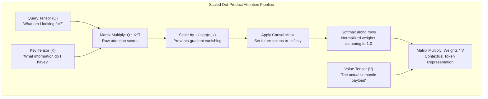
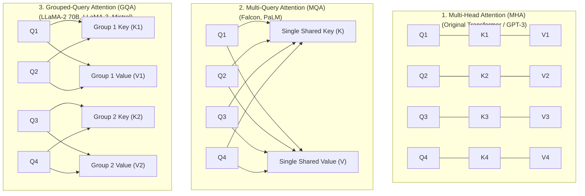
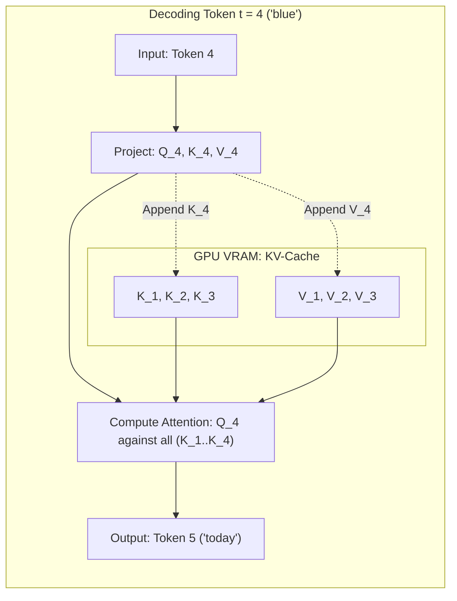

# Chapter 05: Attention Mechanics from Scratch & KV-Cache Deep Dive

> **Welcome to Chapter 05 of the AI Engineer Track!**
> Modern Large Language Models (LLMs)—from GPT-4 to Claude 3.5 and LLaMA 3—depend entirely on the **Attention Mechanism** to understand long-range dependencies across text.
> 
> * What is the exact mathematical proof for dividing by $\sqrt{d_k}$ in Scaled Dot-Product Attention?
> * Why does naive autoregressive text generation re-compute the entire past sequence from scratch ($O(N^2)$), and how does the **KV-Cache** turn it into $O(N)$?
> * What is the difference between **Multi-Head Attention (MHA)**, **Multi-Query Attention (MQA)**, and **Grouped-Query Attention (GQA)**?
> * Why does an 8-billion parameter model like LLaMA-3 run out of 80GB GPU VRAM when serving multiple long contexts, even when the weights only take 16GB?
> * How did **PagedAttention** (vLLM) solve the GPU memory fragmentation crisis?
> 
> In this chapter, we derive attention from first principles with full mathematical rigor, build the KV-cache, and implement production-grade attention in both Python and JavaScript.

---

## 1. Scaled Dot-Product Attention: The Mathematical Derivation

Attention allows every token in an input sequence to dynamically decide how much information to pull from every other token.

$$\text{Attention}(Q, K, V) = \text{softmax}\left(\frac{Q K^T}{\sqrt{d_k}}\right) V$$



### Why Divide by $\sqrt{d_k}$? (The Vanishing Gradient Proof)
Suppose Query vector $q$ and Key vector $k$ are independent random vectors with zero mean ($\mu = 0$) and unit variance ($\sigma^2 = 1$).
Let $d_k$ be the head dimension (e.g. $d_k = 64$ or $128$).
The dot product is:
$$z = q \cdot k = \sum_{i=1}^{d_k} q_i k_i$$

1. **Mean of each term**:
   $$\mathbb{E}[q_i k_i] = \mathbb{E}[q_i] \mathbb{E}[k_i] = 0 \times 0 = 0$$
2. **Variance of each term**:
   $$\text{Var}(q_i k_i) = \mathbb{E}[q_i^2] \mathbb{E}[k_i^2] - (\mathbb{E}[q_i k_i])^2 = (1)(1) - 0 = 1$$
3. **Variance of the sum of $d_k$ independent terms**:
   $$\text{Var}(z) = \text{Var}\left(\sum_{i=1}^{d_k} q_i k_i\right) = \sum_{i=1}^{d_k} \text{Var}(q_i k_i) = d_k \times 1 = \mathbf{d_k}$$
   $$\text{Standard Deviation} = \sqrt{\text{Var}(z)} = \mathbf{\sqrt{d_k}}$$

#### The Catastrophe Without Scaling:
When $d_k = 128$, the standard deviation of raw scores is $\sqrt{128} \approx 11.31$.
Some attention logits become $+35$ while others become $-30$.
When passed into $\text{softmax}(z_i) = \frac{e^{z_i}}{\sum e^{z_j}}$, the largest logit receives a probability of $0.999999$ and all other logits receive $0.000000$.

* **The Softmax Derivative**:
  $$\frac{\partial \text{softmax}(z_i)}{\partial z_j} = \text{softmax}(z_i) (\delta_{ij} - \text{softmax}(z_j))$$
* When $\text{softmax}(z_i) \approx 1$ or $0$, the derivative is:
  $$1 \times (1 - 1) = \mathbf{0} \quad \text{or} \quad 0 \times (0 - 0) = \mathbf{0}$$
* **Result**: Gradients vanish completely to zero! The neural network stops learning during backpropagation.
* **The Fix**: Dividing by $\sqrt{d_k}$ normalizes the variance back to $1.0$, keeping softmax in its active gradient slope!

---

## 2. Causal Masking: Enforcing the Arrow of Time

In autoregressive decoder models (e.g. GPT-4, LLaMA), when the model generates token $t=3$, it is strictly forbidden from "looking into the future" at token $t=4$ or $t=5$.

### How the Mask Works Mathematically
We create an upper triangular mask matrix $M$ where future positions contain $-\infty$:

$$M = \begin{bmatrix}
0 & -\infty & -\infty & -\infty \\
0 & 0 & -\infty & -\infty \\
0 & 0 & 0 & -\infty \\
0 & 0 & 0 & 0
\end{bmatrix}$$

We add $M$ to the scaled attention logits before applying softmax:
$$S = \text{softmax}\left(\frac{Q K^T}{\sqrt{d_k}} + M\right)$$

Because $e^{-\infty} = 0$:
$$\text{softmax}(-\infty) = \mathbf{0.0}$$
Future tokens receive a probability weight of exactly zero, making attention causal!

---

## 3. Attention Evolution: MHA vs MQA vs GQA

As context windows expanded from 2,048 tokens to 128,000+ tokens, the memory occupied by Keys and Values exploded, causing GPU out-of-memory crashes.



| Architecture | Query Heads | Key Heads | Value Heads | Memory Footprint | Quality / Expressivity |
| :--- | :--- | :--- | :--- | :--- | :--- |
| **MHA** (Multi-Head) | $H$ | $H$ | $H$ | $100\%$ (Highest) | Highest baseline |
| **MQA** (Multi-Query) | $H$ | $1$ | $1$ | $\approx 1/H$ (Up to $90\%$ cut) | Slight degradation on long reasoning |
| **GQA** (Grouped-Query)| $H$ | $G$ (e.g. 8) | $G$ (e.g. 8) | $\approx G/H$ ($75-87\%$ cut) | Matches MHA performance! |

**Why GQA is the Modern Standard**: GQA provides the best of both worlds—it cuts KV cache RAM by up to 8x while preserving the reasoning capability of Multi-Head Attention.

---

## 4. The KV-Cache: Eliminating $O(N^2)$ Redundant Inference

### The Problem: Naive Generation is $O(N^2)$
During text generation, tokens are predicted one by one:
* Step 1: Input `"The"` $\to$ predicts `"sky"`.
* Step 2: Input `"The sky"` $\to$ predicts `"is"`.
* Step 3: Input `"The sky is"` $\to$ predicts `"blue"`.

Notice that in Step 3, the model re-projects `"The"`, `"sky"`, and `"is"` into Keys and Values, even though their mathematical vectors **never change**!
* Without cache, generating $N$ tokens requires:
  $$\sum_{i=1}^N i = \frac{N(N+1)}{2} \approx \mathbf{O(N^2) \text{ operations!}}$$

### The Solution: The KV-Cache
* **Prefill Phase**: Process the prompt tokens in parallel. Compute their $K$ and $V$ tensors and store them in GPU VRAM (the **KV-Cache**).
* **Decode Phase (Token-by-Token)**:
  1. For the newly generated single token $t$, compute only its single $Q_t$, $K_t$, $V_t$.
  2. Append $K_t$ and $V_t$ to the KV-Cache.
  3. Compute attention using $Q_t$ against all cached Keys and Values.
  4. Generate the next token.
  * Every new token takes only **$O(1)$ new projection time** and $O(N)$ dot products! Total time for $N$ tokens drops from $O(N^2)$ to **$O(N)$**.



---

## 5. KV-Cache Memory Calculation: The Hidden Memory Hog

Why does an 8B parameter model crash an 80GB GPU? Let's write the exact physical memory equation:

$$\text{KV Memory (bytes)} = 2 \times \text{layers} \times \text{heads}_{kv} \times d_k \times \text{seq\_len} \times \text{batch\_size} \times \text{bytes\_per\_precision}$$

* Factor $2$: One tensor for Keys, one tensor for Values.
* Example for **LLaMA-3 8B**:
  * Layers = $32$
  * KV Heads = $8$ (GQA)
  * Head Dimension $d_k$ = $128$
  * Precision = 16-bit Float (`FP16` / `BF16` = 2 bytes)
  * Memory per token per sequence:
    $$2 \times 32 \times 8 \times 128 \times 2 = \mathbf{131{,}072 \text{ bytes (128 KB per token)}}$$

### When Context Window Scales:
* Context length = 8,192 tokens:
  $$8{,}192 \times 128 \text{ KB} \approx \mathbf{1.0 \text{ GB per user request!}}$$
* Context length = 128,000 tokens:
  $$128{,}000 \times 128 \text{ KB} \approx \mathbf{16.0 \text{ GB per user request!}}$$

If you serve **10 concurrent users** at 128k context on an 80GB GPU:
$$10 \times 16\text{ GB} = 160\text{ GB} \implies \mathbf{GPU \ Out \ of \ Memory \ Crash!}$$
Even though the model weights are only 16GB, the KV-Cache consumes 160GB!

---

## 6. Runnable Implementations: Causal Attention & KV-Cache

### Python (NumPy) Implementation
```python
import numpy as np

def scaled_dot_product_attention_with_cache(
    q_new: np.ndarray,      # Shape: (batch_size, 1, d_k)
    k_new: np.ndarray,      # Shape: (batch_size, 1, d_k)
    v_new: np.ndarray,      # Shape: (batch_size, 1, d_k)
    k_cache: np.ndarray = None, # Shape: (batch_size, past_len, d_k)
    v_cache: np.ndarray = None  # Shape: (batch_size, past_len, d_k)
):
    """
    Simulates one autoregressive decode step using an active KV-Cache.
    """
    # 1. Update KV-Cache
    if k_cache is not None:
        k_all = np.concatenate([k_cache, k_new], axis=1)
        v_all = np.concatenate([v_cache, v_new], axis=1)
    else:
        k_all = k_new
        v_all = v_new

    d_k = q_new.shape[-1]
    
    # 2. Scaled Dot-Product: (batch, 1, d_k) x (batch, d_k, total_len) -> (batch, 1, total_len)
    scores = np.matmul(q_new, k_all.swapaxes(-1, -2)) / np.sqrt(d_k)
    
    # 3. Softmax across the sequence dimension
    exp_scores = np.exp(scores - np.max(scores, axis=-1, keepdims=True))
    weights = exp_scores / np.sum(exp_scores, axis=-1, keepdims=True)
    
    # 4. Weight the values: (batch, 1, total_len) x (batch, total_len, d_k) -> (batch, 1, d_k)
    output = np.matmul(weights, v_all)
    
    return output, k_all, v_all

# Verification
np.random.seed(42)
b, d_k = 1, 64
q_token = np.random.randn(b, 1, d_k)
k_token = np.random.randn(b, 1, d_k)
v_token = np.random.randn(b, 1, d_k)

out, k_cache, v_cache = scaled_dot_product_attention_with_cache(q_token, k_token, v_token)
print(f"Token 1 Out shape: {out.shape}, Cache size: {k_cache.shape[1]}")

# Next token decode step
q_token2 = np.random.randn(b, 1, d_k)
k_token2 = np.random.randn(b, 1, d_k)
v_token2 = np.random.randn(b, 1, d_k)

out2, k_cache, v_cache = scaled_dot_product_attention_with_cache(
    q_token2, k_token2, v_token2, k_cache, v_cache
)
print(f"Token 2 Out shape: {out2.shape}, Cache size: {k_cache.shape[1]}")
```

### JavaScript Implementation
```javascript
function softmax(logits) {
    const maxVal = Math.max(...logits);
    const exp = logits.map(v => Math.exp(v - maxVal));
    const sum = exp.reduce((acc, curr) => acc + curr, 0);
    return exp.map(v => v / sum);
}

class KVCacheLayer {
    constructor(dk) {
        this.dk = dk;
        this.kCache = []; // Stores Array of [dk]
        this.vCache = []; // Stores Array of [dk]
    }

    forwardDecodeStep(q, k, v) {
        // q, k, v: Arrays of length dk for the single new token
        this.kCache.push(k);
        this.vCache.push(v);

        const totalTokens = this.kCache.length;
        const sqrtDk = Math.sqrt(this.dk);

        // Dot product of single q against all cached k
        const rawScores = [];
        for (let i = 0; i < totalTokens; i++) {
            let dot = 0;
            for (let d = 0; d < this.dk; d++) {
                dot += q[d] * this.kCache[i][d];
            }
            rawScores.push(dot / sqrtDk);
        }

        const attentionWeights = softmax(rawScores);

        // Weighted sum of cached values
        const output = new Array(this.dk).fill(0);
        for (let i = 0; i < totalTokens; i++) {
            const w = attentionWeights[i];
            for (let d = 0; d < this.dk; d++) {
                output[d] += w * this.vCache[i][d];
            }
        }

        return { output, totalTokens };
    }
}

// Verification
const layer = new KVCacheLayer(4);
const step1 = layer.forwardDecodeStep([0.5, 0.1, -0.2, 0.8], [0.1, 0.2, 0.3, 0.4], [1, 2, 3, 4]);
console.log(`Step 1 Output: [${step1.output.map(x => x.toFixed(3))}], Tokens in cache: ${step1.totalTokens}`);

const step2 = layer.forwardDecodeStep([0.2, -0.4, 0.9, 0.1], [0.4, 0.3, 0.2, 0.1], [5, 6, 7, 8]);
console.log(`Step 2 Output: [${step2.output.map(x => x.toFixed(3))}], Tokens in cache: ${step2.totalTokens}`);
```

---

## 7. Real-World Production Case Studies

### Case Study 1: The vLLM Revolution & PagedAttention
* **The Problem**: Before vLLM (UC Berkeley, 2023), inference servers allocated contiguous memory chunks for the maximum possible sequence length (e.g. 2048 tokens).
  * 60% to 80% of GPU memory was wasted due to **internal and external memory fragmentation**. Requests that generated only 50 tokens reserved memory for 2048!
* **The Innovation (PagedAttention)**: Inspired by Virtual Memory Paging in Operating Systems, PagedAttention stores the KV-cache in non-contiguous memory blocks (pages) of 16 or 32 tokens.
* **The Impact**: Eliminated memory fragmentation completely, increasing inference throughput by **2x to 4x** across the entire AI industry without changing model weights.

### Case Study 2: FlashAttention (IO-Aware Computing)
* **The Bottleneck**: Standard Attention calculates the full $N \times N$ attention matrix and writes it to High Bandwidth Memory (HBM/GPU VRAM), then reads it back to calculate softmax, and reads it again to multiply by $V$.
  * Reading and writing to HBM is $10\times$ slower than GPU on-chip SRAM cache.
* **Tri Dao's Breakthrough (FlashAttention)**: Uses **tiling** to compute attention block by block inside fast on-chip SRAM without ever materializing the massive $N \times N$ intermediate matrix in GPU VRAM!
  * Achieved a $3\times$ speedup and reduced memory usage from $O(N^2)$ to $O(N)$.

---

## 8. FAANG & AI Lab Commonly Asked Interview Questions

#### Question 1: "Why do we scale the dot product of $Q$ and $K$ by $\frac{1}{\sqrt{d_k}}$ in attention?"
* **Answer**:
  * If components of $Q$ and $K$ are independent random variables with zero mean and unit variance, the variance of their dot product grows linearly with the dimension $d_k$.
  * For large $d_k$ (e.g. 128), large dot product values push the softmax function into regions with near-zero gradients (saturation).
  * Scaling by $\frac{1}{\sqrt{d_k}}$ restores the variance of the dot product to 1.0, preserving healthy gradients during backpropagation.

#### Question 2: "What is the difference between Multi-Head Attention (MHA), Multi-Query Attention (MQA), and Grouped-Query Attention (GQA)?"
* **Answer**:
  * **MHA**: Each query head has an independent key head and value head ($H$ query, $H$ key, $H$ value heads).
  * **MQA**: All query heads share a single key head and a single value head ($H$ query, $1$ key, $1$ value head). Drastically reduces KV-cache memory, but can degrade reasoning.
  * **GQA**: Query heads are divided into $G$ groups, and each group shares 1 key and 1 value head ($H$ query, $G$ key, $G$ value heads). Matches MHA quality while slashing KV-cache size by $H/G$.

#### Question 3: "Explain the difference between the Prefill phase and the Decode phase in LLM inference."
* **Answer**:
  * **Prefill Phase**: Processes the entire input prompt at once in parallel. It is **compute-bound** because matrix multiplications on large prompt sequences fully utilize GPU Tensor Cores.
  * **Decode Phase**: Generates one token at a time sequentially. It is **memory-bandwidth bound** because for every single generated token, the model must read all model weights and the entire KV-cache from GPU memory into compute cores.

#### Question 4: "Derive the exact formula for calculating the memory footprint of the KV-cache."
* **Answer**:
  $$\text{Memory (bytes)} = 2 \times L \times H_{kv} \times d_k \times S \times B \times P$$
  Where:
  * $2$ accounts for both Keys and Values.
  * $L$ = Number of Transformer layers.
  * $H_{kv}$ = Number of Key/Value heads.
  * $d_k$ = Hidden dimension per head.
  * $S$ = Sequence length (number of tokens).
  * $B$ = Batch size (number of concurrent requests).
  * $P$ = Bytes per parameter ($2$ for FP16/BF16, $1$ for INT8).

#### Question 5: "What is Causal Masking, and why is it represented as adding $-\infty$ instead of multiplying by $0$?"
* **Answer**:
  * In autoregressive generation, future tokens must have zero influence on past tokens.
  * We add $-\infty$ to future logits before softmax because $\text{softmax}(x)_i = \frac{e^{x_i}}{\sum e^{x_j}}$.
  * Since $e^{-\infty} = 0$, the corresponding attention probability becomes exactly zero. Multiplying by 0 before softmax would set the logit to 0, which yields $e^0 = 1$, giving future tokens a non-zero probability!

#### Question 6: "What is the computational complexity of Self-Attention with respect to sequence length $N$?"
* **Answer**:
  * Computing $Q K^T$ requires multiplying a $(N \times d)$ matrix by a $(d \times N)$ matrix, which takes $O(N^2 \cdot d)$ floating-point operations (FLOPs).
  * Multiplying the $(N \times N)$ attention weights by $(N \times d)$ Value matrix also takes $O(N^2 \cdot d)$ FLOPs.
  * Hence, self-attention has **quadratic complexity $O(N^2)$** with respect to sequence length in both compute and memory.

#### Question 7: "How does FlashAttention avoid the $O(N^2)$ memory bottleneck?"
* **Answer**:
  * FlashAttention avoids materializing the $N \times N$ attention matrix in GPU High Bandwidth Memory (HBM).
  * It splits input queries, keys, and values into blocks (tiling) that fit entirely inside the GPU's fast on-chip SRAM cache.
  * It incrementally computes softmax using online softmax normalization, fusing the dot product, masking, softmax, and value multiplication into a single GPU kernel, reducing HBM memory read/writes from $O(N^2)$ to $O(N)$.

#### Question 8: "Why does standard LLM decoding suffer from low GPU compute utilization?"
* **Answer**:
  * During token generation (decode phase), the batch size per step is small (e.g. batch size 1 generating 1 token).
  * The GPU must stream gigabytes of model weights and KV-cache through the memory bus just to perform a tiny number of calculations.
  * The Arithmetic Intensity (FLOPs per byte transferred) is very low, making decoding **memory-bound** rather than compute-bound.

#### Question 9: "What is PagedAttention, and how does it prevent GPU Out-of-Memory (OOM) errors?"
* **Answer**:
  * Traditional inference allocators pre-allocated large contiguous VRAM arrays for each request based on max sequence length, causing severe internal and external memory fragmentation.
  * PagedAttention partitions the KV-cache into fixed-size virtual memory pages (e.g. 16 tokens). Pages are dynamically allocated on demand and do not need to be contiguous in physical VRAM.
  * This virtually eliminates memory fragmentation and enables KV-cache sharing for parallel sampling and prompt caching.

#### Question 10: "What is sliding-window attention (local attention), and what is its trade-off?"
* **Answer**:
  * In Sliding-Window Attention (used in Mistral 7B), each token only attends to the most recent $W$ tokens (e.g. $W = 4096$) instead of the full sequence.
  * Computational complexity drops from $O(N^2)$ to $O(N \cdot W)$.
  * Trade-off: While higher layers can still access earlier information via stacked receptive fields, exact direct recall of distant facts located thousands of tokens back is reduced.

#### Question 11: "Explain the difference between Self-Attention and Cross-Attention."
* **Answer**:
  * **Self-Attention**: $Q$, $K$, and $V$ all originate from the **same sequence** (e.g. the decoder attending to its own previously generated tokens).
  * **Cross-Attention**: $Q$ comes from the current sequence (e.g. decoder), while $K$ and $V$ come from an **external source sequence** (e.g. encoder representations in Whisper audio transcription or T5 translation).

#### Question 12: "How does speculative decoding improve decode phase latency?"
* **Answer**:
  * Speculative decoding uses a small, fast "draft model" (e.g. 1B) to generate $K$ candidate tokens quickly.
  * The large target model (e.g. 70B) runs a single parallel forward pass to verify and accept all $K$ candidate tokens in one step.
  * Because verification is run in parallel (compute-bound), multiple tokens are produced per target model memory pass, yielding a $2\times$ to $3\times$ latency speedup with zero loss in output quality.

---

## Chapter 05 Checklist (Summary)

Before moving to Chapter 06, make sure you can answer:
- [x] Why does unscaled attention lead to vanishing gradients?
- [x] How causal masking uses $-\infty$ to enforce autoregressive generation.
- [x] The architectural differences between MHA, MQA, and GQA.
- [x] How the KV-cache reduces inference compute from $O(N^2)$ to $O(N)$.
- [x] How to calculate exact VRAM consumption for KV-cache.
- [x] How PagedAttention and FlashAttention overcome hardware memory limits.

*Chapter 05 is complete! Proceed to [Chapter 06: Transformer Blocks, RMSNorm, Residuals & SwiGLU](./chapter_06.md).*
