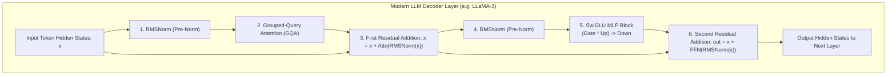
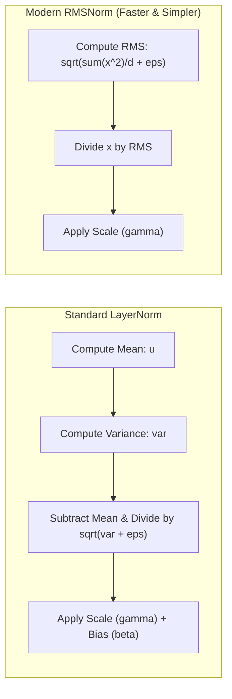
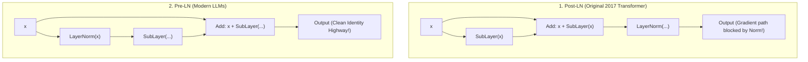
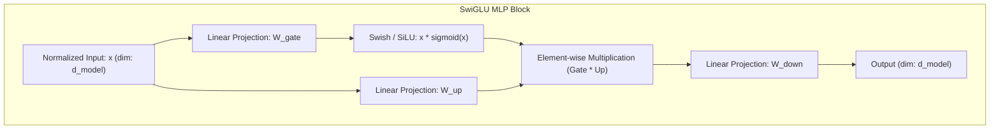

# Chapter 06: Transformer Blocks, RMSNorm, Residuals & SwiGLU (Deep Dive)

> **Welcome to Chapter 06 of the AI Engineer Track!**
> Attention is only half the equation in modern Large Language Models.
> 
> * Where does the actual knowledge of an LLM live? (Over 65% of all parameters reside in the **Feed-Forward / MLP layers**, not attention!)
> * Why did early Transformers crash during training without extensive learning-rate warmups, and how did **Pre-LN** solve this?
> * Why does modern AI like LLaMA-3 use **RMSNorm** instead of standard Layer Normalization?
> * What is **SwiGLU**, and why does it outperform ReLU and GELU?
> * What is the exact mathematical path of gradients through **Residual Skip Connections**?
> 
> In this chapter, we assemble a complete, production-grade modern Transformer Decoder Block from scratch.

---

## 1. Anatomy of a Modern Transformer Block

The original 2017 Transformer used an Encoder-Decoder structure with Post-LayerNorm and ReLU activations. Modern LLMs (LLaMA, Mistral, Gemma, DeepSeek) are **Decoder-only** networks built with **Pre-RMSNorm**, **Rotary Embeddings (RoPE)**, and **SwiGLU MLP blocks**.



---

## 2. Normalization Evolution: BatchNorm $\to$ LayerNorm $\to$ RMSNorm

### Why Batch Normalization (BatchNorm) Fails in LLMs
BatchNorm normalizes activations across the **batch dimension**:
1. It computes mean and variance across different sequences in a mini-batch.
2. In NLP, sentences have variable lengths. Padding tokens distort batch statistics.
3. If batch size is small during inference (e.g., batch size = 1), BatchNorm breaks down.

### Layer Normalization (LayerNorm - Ba et al., 2016)
LayerNorm normalizes across the **feature/channel dimension** for each token independently, making it invariant to batch size:

$$\mu = \frac{1}{d} \sum_{i=1}^d x_i, \quad \sigma^2 = \frac{1}{d} \sum_{i=1}^d (x_i - \mu)^2$$
$$\text{LayerNorm}(x) = \frac{x - \mu}{\sqrt{\sigma^2 + \epsilon}} \odot \gamma + \beta$$

Where:
* $d$ is the hidden dimension.
* $\gamma$ is a learnable scaling vector, $\beta$ is a learnable bias vector.
* $\epsilon$ is a tiny constant ($10^{-5}$ or $10^{-6}$) to prevent division by zero.

### The Breakthrough: RMSNorm (Root Mean Square Normalization - Zhang & Sennrich, 2019)
Researchers discovered that LayerNorm's stabilizing power comes almost entirely from **scaling by the root mean square**, not from subtracting the mean $\mu$.
By dropping the mean calculation and the bias $\beta$, RMSNorm cuts GPU memory access and computational overhead by **7% to 15%**:

$$\text{RMS}(x) = \sqrt{\frac{1}{d} \sum_{i=1}^d x_i^2 + \epsilon}$$
$$\text{RMSNorm}(x) = \frac{x}{\text{RMS}(x)} \odot \gamma$$



---

## 3. Residual Connections: Pre-LN vs. Post-LN

Deep neural networks suffer from **vanishing and exploding gradients**. Residual connections (Skip Connections) provide a clean mathematical bypass:
$$x_{l+1} = x_l + F(x_l)$$

When computing the derivative during backpropagation:
$$\frac{\partial \mathcal{L}}{\partial x_l} = \frac{\partial \mathcal{L}}{\partial x_{l+1}} \frac{\partial x_{l+1}}{\partial x_l} = \frac{\partial \mathcal{L}}{\partial x_{l+1}} \left( \mathbf{I} + \frac{\partial F(x_l)}{\partial x_l} \right)$$

The identity matrix $\mathbf{I}$ guarantees that gradients can flow backwards through 100+ layers without being attenuated by intermediate weight matrices!



### Why Pre-LN Won:
* In **Post-LN**, normalization is placed *after* the residual addition. The gradient flowing through the residual path is scaled by the LayerNorm derivative, causing gradient vanishing at the bottom layers. Training required thousands of warmup steps at microscopic learning rates.
* In **Pre-LN**, normalization is applied *before* the sub-layer. The skip connection remains a pure, untouched addition ($x + F(\text{Norm}(x))$). Gradients flow unimpeded directly from the final layer to the initial token embeddings, allowing stable training of 100B+ parameter models from step 0.

---

## 4. Feed-Forward Networks & The SwiGLU Activation Function

The Feed-Forward Network (FFN) processes token representations individually after attention has mixed contextual information across the sequence. In most LLMs, the FFN contains **$\approx \frac{2}{3}$ of all model weights**!

### Evolution of Activation Functions
1. **ReLU**: $\max(0, x)$ — Fast, but dead neurons occur when inputs are negative.
2. **GELU (Gaussian Error Linear Unit)**: Smooth, probabilistic approximation of ReLU:
   $$\text{GELU}(x) = x \cdot \Phi(x) \approx 0.5x \left(1 + \tanh\left(\sqrt{\frac{2}{\pi}}(x + 0.044715 x^3)\right)\right)$$
3. **Swish / SiLU**:
   $$\text{Swish}(x) = x \cdot \sigma(\beta x) = \frac{x}{1 + e^{-x}}$$

### The SwiGLU Architecture (Noam Shazeer, 2020)
SwiGLU combines the Swish activation with **Gated Linear Units (GLU)**. Instead of 2 weight matrices per MLP, SwiGLU uses **3 weight matrices**:
1. **Gate Matrix ($W_{\text{gate}}$)**: Computes a dynamic multiplicative gate.
2. **Up Matrix ($W_{\text{up}}$)**: Projects features into a higher-dimensional space.
3. **Down Matrix ($W_{\text{down}}$)**: Projects features back to the model hidden dimension.

$$\text{SwiGLU}(x) = \left( \text{Swish}(x W_{\text{gate}}) \otimes (x W_{\text{up}}) \right) W_{\text{down}}$$

Where $\otimes$ denotes element-wise Hadamard multiplication.



### Parameter Parity Dimension Sizing
Standard FFNs expand hidden dimension to $4 \times d_{\text{model}}$ using 2 matrices ($8 d^2$ parameters).
Since SwiGLU uses 3 matrices, expanding to $4 \times d_{\text{model}}$ would consume $12 d^2$ parameters (a 50% parameter inflation).
To preserve the parameter budget:
$$d_{\text{hidden}} = \left\lfloor \frac{8}{3} d_{\text{model}} \right\rfloor \approx 2.67 \times d_{\text{model}}$$
LLaMA rounds this dimension to the nearest multiple of 256 for optimal GPU memory alignment and Tensor Core utilization.

---

## 5. Runnable Implementations: Complete Modern Transformer Block

### Python (PyTorch-Style NumPy) Implementation
```python
import numpy as np

def sigmoid(x):
    return 1.0 / (1.0 + np.exp(-x))

def silu(x):
    return x * sigmoid(x)

class RMSNorm:
    def __init__(self, dim: int, eps: float = 1e-6):
        self.eps = eps
        self.weight = np.ones(dim)  # Learnable gamma scale

    def forward(self, x: np.ndarray) -> np.ndarray:
        # x shape: (batch_size, seq_len, dim)
        rms = np.sqrt(np.mean(x ** 2, axis=-1, keepdims=True) + self.eps)
        return (x / rms) * self.weight

class SwiGLUMLP:
    def __init__(self, d_model: int, d_hidden: int):
        # 3 projection weight matrices
        self.w_gate = np.random.randn(d_model, d_hidden) * 0.02
        self.w_up   = np.random.randn(d_model, d_hidden) * 0.02
        self.w_down = np.random.randn(d_hidden, d_model) * 0.02

    def forward(self, x: np.ndarray) -> np.ndarray:
        # Gate and Up projections
        gate = silu(np.matmul(x, self.w_gate))
        up = np.matmul(x, self.w_up)
        # Element-wise gating, followed by down projection
        return np.matmul(gate * up, self.w_down)

class ModernTransformerBlock:
    def __init__(self, d_model: int, d_hidden: int):
        self.norm1 = RMSNorm(d_model)
        self.norm2 = RMSNorm(d_model)
        self.mlp = SwiGLUMLP(d_model, d_hidden)

    def forward(self, x: np.ndarray, attn_mock_fn) -> np.ndarray:
        # 1. Pre-Norm Attention Residual
        norm_x1 = self.norm1.forward(x)
        attn_out = attn_mock_fn(norm_x1)
        x = x + attn_out  # First skip connection
        
        # 2. Pre-Norm SwiGLU Residual
        norm_x2 = self.norm2.forward(x)
        ffn_out = self.mlp.forward(norm_x2)
        x = x + ffn_out   # Second skip connection
        return x

# Verification
np.random.seed(42)
d_model = 64
d_hidden = int((8 / 3) * d_model)
block = ModernTransformerBlock(d_model, d_hidden)

dummy_tokens = np.random.randn(2, 4, d_model) # (batch=2, seq=4, d=64)
output = block.forward(dummy_tokens, lambda x: x * 0.1) # Mock identity attention

print(f"Input shape:  {dummy_tokens.shape}")
print(f"Output shape: {output.shape}")
print(f"Output sample: {output[0, 0, :3]}")
```

### JavaScript Implementation
```javascript
class RMSNormJS {
    constructor(dim, eps = 1e-6) {
        this.dim = dim;
        this.eps = eps;
        this.gamma = new Array(dim).fill(1.0);
    }

    forward(vec) {
        // vec: Array of numbers of length `dim`
        let sumSq = 0;
        for (let i = 0; i < this.dim; i++) {
            sumSq += vec[i] * vec[i];
        }
        const rms = Math.sqrt(sumSq / this.dim + this.eps);
        return vec.map((v, i) => (v / rms) * this.gamma[i]);
    }
}

class SwiGLUJS {
    constructor(dModel, dHidden) {
        this.dModel = dModel;
        this.dHidden = dHidden;
        // Mock weights
        this.wGate = Array.from({ length: dModel }, () => Array.from({ length: dHidden }, () => (Math.random() - 0.5) * 0.1));
        this.wUp   = Array.from({ length: dModel }, () => Array.from({ length: dHidden }, () => (Math.random() - 0.5) * 0.1));
        this.wDown = Array.from({ length: dHidden }, () => Array.from({ length: dModel }, () => (Math.random() - 0.5) * 0.1));
    }

    silu(x) {
        return x / (1.0 + Math.exp(-x));
    }

    matMul(vec, mat, rows, cols) {
        const out = new Array(cols).fill(0);
        for (let j = 0; j < cols; j++) {
            let sum = 0;
            for (let i = 0; i < rows; i++) {
                sum += vec[i] * mat[i][j];
            }
            out[j] = sum;
        }
        return out;
    }

    forward(x) {
        const gate = this.matMul(x, this.wGate, this.dModel, this.dHidden).map(v => this.silu(v));
        const up = this.matMul(x, this.wUp, this.dModel, this.dHidden);
        const gated = gate.map((g, i) => g * up[i]);
        return this.matMul(gated, this.wDown, this.dHidden, this.dModel);
    }
}

// Verification
const norm = new RMSNormJS(4);
const normalized = norm.forward([2.0, -1.0, 3.0, 0.5]);
console.log("RMSNorm Output:", normalized.map(x => x.toFixed(4)));

const ffn = new SwiGLUJS(4, 8);
const ffnOut = ffn.forward(normalized);
console.log("SwiGLU Output:", ffnOut.map(x => x.toFixed(4)));
```

---

## 6. Real-World Production Case Studies

### Case Study 1: The LLaMA Architecture Revolution
* When Meta released the original **LLaMA** family in early 2023, open-source AI transformed overnight.
* Meta replaced:
  1. Standard LayerNorm with **RMSNorm** to save compute and improve training stability.
  2. Absolute positional encodings with **RoPE (Rotary Position Embeddings)**.
  3. Standard ReLU/GELU with **SwiGLU** with hidden dimension $\approx \frac{8}{3} d_{\text{model}}$ aligned to 256 bytes.
* This standardized the blueprint followed by Mistral, Qwen, DeepSeek, and Gemma.

### Case Study 2: Training Divergence & Loss Spikes at Step 15,000
* **The Incident**: During large-scale pre-training of a 30B parameter Transformer using standard Post-LN, the training loss suddenly exploded from $1.8$ to `NaN` at step 15,400, wasting 2 weeks of cluster GPU compute.
* **Root Cause**: In Post-LN, activations grew in magnitude deeper in the network. A burst of sharp gradients in the attention layers caused weight updates that saturated the subsequent LayerNorm layers, creating numeric overflow under FP16.
* **Resolution**: Migrated the codebase to **Pre-LN with RMSNorm** and adopted **BF16 (Bfloat16)** mixed-precision training. The run completed without a single loss spike.

---

## 7. FAANG & AI Lab Commonly Asked Interview Questions

#### Question 1: "Why does RMSNorm perform as well as LayerNorm despite dropping the mean calculation?"
* **Answer**:
  * LayerNorm performs two operations: mean centering ($x - \mu$) and variance scaling ($/ \sqrt{\sigma^2 + \epsilon}$).
  * Empirical research (Zhang & Sennrich, 2019) demonstrated that the stabilizing effect of normalization in deep networks comes from **rescaling the vector magnitudes**, which bounds the gradient norms.
  * Mean centering contributes negligibly to training stability. RMSNorm eliminates $\mu$, reducing GPU memory trips and boosting training speed by 7–15%.

#### Question 2: "Explain the difference between Pre-LN and Post-LN architectures and why modern LLMs use Pre-LN."
* **Answer**:
  * **Post-LN**: $x_{l+1} = \text{Norm}(x_l + \text{SubLayer}(x_l))$. Normalization occurs on the residual branch, attenuating gradients as they pass through multiple layers. Deep networks suffer from vanishing gradients at early layers and require strict learning-rate warmups.
  * **Pre-LN**: $x_{l+1} = x_l + \text{SubLayer}(\text{Norm}(x_l))$. Normalization is applied only to the sub-layer input. The residual skip connection forms an uninterrupted identity path from output to input, allowing stable training of very deep models without warmups.

#### Question 3: "What is SwiGLU and why does it outperform ReLU and GELU in Transformer MLPs?"
* **Answer**:
  * SwiGLU is a Gated Linear Unit with a Swish activation function:
    $$\text{SwiGLU}(x) = (\text{Swish}(x W_{\text{gate}}) \otimes x W_{\text{up}}) W_{\text{down}}$$
  * Unlike fixed non-linearities (ReLU/GELU), the gate branch allows the network to dynamically control what proportion of each feature passes through via multiplicative gating, enhancing model expressivity and convergence speed.

#### Question 4: "Why is the hidden dimension of SwiGLU set to $\approx \frac{8}{3} d_{\text{model}}$ instead of $4 d_{\text{model}}$?"
* **Answer**:
  * Standard FFNs use 2 matrices of dimension $(d \times 4d)$ and $(4d \times d)$, totaling $8d^2$ parameters.
  * SwiGLU uses 3 matrices ($W_{\text{gate}}, W_{\text{up}}, W_{\text{down}}$).
  * If the hidden dimension remained $4d$, the total parameters would be $3 \times (d \times 4d) = 12d^2$ (a 50% parameter increase).
  * To maintain parameter parity with standard Transformers, the hidden dimension is scaled down:
    $$3 \times (d \times d_{\text{hidden}}) = 8d^2 \implies d_{\text{hidden}} = \frac{8}{3} d \approx 2.67 d$$

#### Question 5: "Where is the factual knowledge of an LLM primarily stored: in attention weights or MLP weights?"
* **Answer**:
  * Research (e.g., Geva et al., "Transformer Feed-Forward Layers Are Key-Value Memories") indicates that **MLP/FFN layers act as associative key-value memory banks** that store facts, world knowledge, and semantic associations.
  * The Attention layers act as routing mechanisms that gather and route information between tokens in context.

#### Question 6: "What is the mathematical role of Residual Connections during backpropagation?"
* **Answer**:
  * For $x_{l+1} = x_l + F(x_l)$, the gradient of loss $\mathcal{L}$ with respect to $x_l$ is:
    $$\frac{\partial \mathcal{L}}{\partial x_l} = \frac{\partial \mathcal{L}}{\partial x_{l+1}} \left( \mathbf{I} + \frac{\partial F(x_l)}{\partial x_l} \right)$$
  * The identity term $\mathbf{I}$ ensures that gradients can propagate directly to earlier layers even if the Jacobian $\frac{\partial F(x_l)}{\partial x_l}$ becomes arbitrarily small, effectively eliminating vanishing gradients.

#### Question 7: "Why do modern LLM architectures round hidden layer dimensions to multiples of 256?"
* **Answer**:
  * NVIDIA GPU Tensor Cores execute matrix multiplications using specialized hardware tiles (e.g. 16x16 or 32x32 tiles on A100/H100).
  * Aligning dimensions to multiples of 64, 128, or 256 prevents memory padding, eliminates warp boundary fragmentation, and maximizes memory bus throughput.

#### Question 8: "Explain the purpose of the $\epsilon$ term in RMSNorm and LayerNorm."
* **Answer**:
  * $\epsilon$ (typically $10^{-5}$ or $10^{-6}$) is a small numerical stabilization constant added to the variance or root mean square before taking the square root.
  * It prevents fatal **division-by-zero errors** if all activation elements in a layer collapse to zero.

#### Question 9: "What is the difference between Encoder-only, Decoder-only, and Encoder-Decoder Transformers?"
* **Answer**:
  * **Encoder-only** (e.g. BERT): Uses bidirectional attention (tokens attend to past and future). Ideal for classification and embeddings.
  * **Decoder-only** (e.g. GPT-4, LLaMA): Uses causal (masked) attention. Optimized for autoregressive generation. Dominates modern generative AI.
  * **Encoder-Decoder** (e.g. T5, Whisper): Encoder processes input bidirectionally; decoder attends to encoder outputs via cross-attention and generates tokens autoregressively.

#### Question 10: "How does the Swish/SiLU activation function differ from standard Sigmoid?"
* **Answer**:
  * Sigmoid squashes values between 0 and 1: $\sigma(x) = \frac{1}{1 + e^{-x}}$.
  * Swish/SiLU multiplies $x$ by its sigmoid: $\text{SiLU}(x) = x \cdot \sigma(x)$.
  * Unlike Sigmoid, SiLU is **non-monotonic**, smooth, and allows small negative gradients for negative inputs ($\approx -0.278$ at $x \approx -1.28$), preventing dying neuron states.

#### Question 11: "What causes activation growth / representation drift across layers in deep Transformers?"
* **Answer**:
  * In Pre-LN Transformers, because each layer adds its sub-layer output to the residual stream ($x_{l+1} = x_l + F(\text{Norm}(x_l))$), the norm of the residual stream $\|x_l\|$ grows monotonically as layer depth increases.
  * This means later layers contribute proportionately less variance relative to the residual magnitude, acting as small refinements rather than drastic transformations.

#### Question 12: "How does DeepSeek-V2 / V3 modify the standard MLP block?"
* **Answer**:
  * DeepSeek replaces the dense MLP block with a **Mixture-of-Experts (MoE)** architecture using fine-grained routed experts and shared experts.
  * Only a subset of active experts (e.g. 6 out of 64 experts) are activated per token, reducing inference compute FLOPs while maintaining massive parameter capacity.

---

## Chapter 06 Checklist (Summary)

Before moving to Chapter 07, make sure you can answer:
- [x] The complete dataflow through a modern Pre-LN Decoder block.
- [x] Why BatchNorm fails in NLP and how RMSNorm optimizes LayerNorm.
- [x] The mathematical derivation of the residual gradient highway.
- [x] Why SwiGLU uses 3 projection matrices and how to calculate its hidden dimension.
- [x] Why knowledge resides primarily in the MLP layers rather than attention.
- [x] How hardware tensor alignment influences architectural dimension choices.

*Chapter 06 is complete! Proceed to [Chapter 07: The 3 Training Stages of Modern LLMs (Pre-training, SFT, RLHF & DPO)](./chapter_07.md).*
