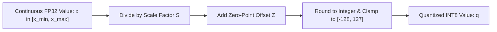
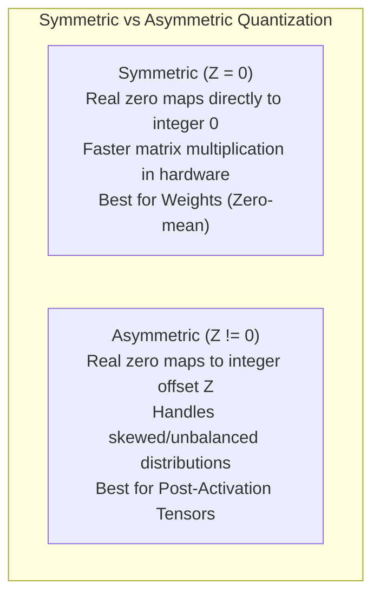
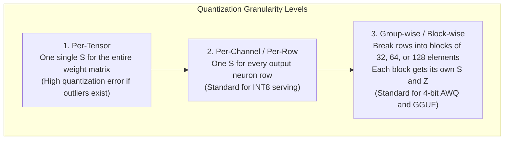
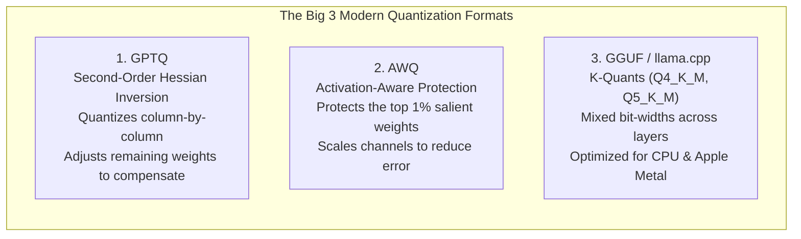

# Chapter 08: Floating-Point Formats & Quantization Mathematics (FP32/FP16/BF16/INT8/INT4, AWQ/GPTQ/GGUF)

> **Welcome to Chapter 08 of the AI Engineer Track!**
> Deploying modern Large Language Models is fundamentally a battle against memory bandwidth and hardware storage constraints.
> 
> * A 70-billion parameter model in 32-bit float requires **280 Gigabytes of VRAM** just to load its weights—requiring four enterprise $10,000 GPUs!
> * How does 4-bit quantization shrink that same 70B model down to **35 Gigabytes**, allowing it to run on a high-end workstation with near-zero loss in reasoning ability?
> * What is the physical difference between **FP16** and **BF16**, and why did BF16 become the universal standard for LLM training?
> * What is the exact mathematical derivation of **Scale ($S$)** and **Zero-Point ($Z$)** in Symmetric vs. Asymmetric Quantization?
> * How do second-order optimization techniques like **GPTQ** and activation-aware techniques like **AWQ** preserve model perplexity at 4-bit precision?
> 
> In this chapter, we master the mathematics of low-precision representations, build quantizers from scratch, and analyze modern serving formats like GGUF, AWQ, and GPTQ.

---

## 1. Floating-Point Formats: The Hardware Layout

Every numerical format represents a trade-off between **Dynamic Range** (controlled by Exponent bits) and **Precision** (controlled by Mantissa bits).

```mermaid
flowchart TD
    subgraph FP32["1. FP32 (Single Precision - 32 bits)"]
        S32["Sign: 1 bit"] --- E32["Exponent: 8 bits (Range: 10^-38 to 10^38)"] --- M32["Mantissa: 23 bits (High Precision)"]
    end
    subgraph FP16["2. FP16 (Half Precision - 16 bits)"]
        S16["Sign: 1 bit"] --- E16["Exponent: 5 bits (Range: ~6.5 x 10^4)"] --- M16["Mantissa: 10 bits"]
    end
    subgraph BF16["3. BF16 (Bfloat16 - 16 bits)"]
        SBF["Sign: 1 bit"] --- EBF["Exponent: 8 bits (Identical Range to FP32!)"] --- MBF["Mantissa: 7 bits"]
    end
    subgraph FP8["4. FP8 (E4M3 / E5M2 - 8 bits)"]
        S8["Sign: 1 bit"] --- E8["Exponent: 4 or 5 bits"] --- M8["Mantissa: 3 or 2 bits"]
    end
```



### Format Comparison Breakdown:

| Format | Total Bits | Sign Bits | Exponent Bits | Mantissa Bits | Dynamic Range | Primary Deep Learning Use Case |
| :--- | :--- | :--- | :--- | :--- | :--- | :--- |
| **FP32** | 32 | 1 | 8 | 23 | $\approx 10^{\pm 38}$ | Master weight copies, optimizer states (Adam) |
| **FP16** | 16 | 1 | 5 | 10 | $\approx 6 \times 10^{-5} \dots 65{,}504$ | Legacy GPU inference (T4, V100); prone to overflow |
| **BF16** | 16 | 1 | 8 | 7 | $\approx 10^{\pm 38}$ | Modern LLM Pre-training & Fine-tuning (A100, H100) |
| **FP8 (E4M3)**| 8 | 1 | 4 | 3 | $[-448, 448]$ | Forward pass activations & weights (H100 Hopper) |
| **FP8 (E5M2)**| 8 | 1 | 5 | 2 | $\approx 5.7 \times 10^4$ | Backward pass gradients (higher dynamic range) |
| **INT8** | 8 | - | - | - | $[-128, 127]$ | Post-training inference quantization |
| **INT4** | 4 | - | - | - | $[-8, 7]$ or $[0, 15]$ | Ultra-compact edge & local inference (GGUF, AWQ) |

### Why BF16 Replaced FP16 in Modern LLM Training:
FP16 allocates only 5 bits to the exponent, giving it a maximum representable value of only **$65{,}504$**.
In deep Transformers, gradients or unscaled dot products frequently spike past $65{,}504$, causing immediate `NaN` (overflow) crashes, requiring delicate **loss scaling** algorithms.
**BF16** keeps the exact same 8-bit exponent as FP32:
* It shares the exact same massive dynamic range ($10^{\pm 38}$) as FP32.
* It completely eliminates overflow and underflow crashes without needing any loss scaling!

---

## 2. Quantization Mathematics: Affine (Asymmetric) vs. Symmetric

Quantization maps continuous 32-bit floating-point numbers $x \in [\alpha, \beta]$ into discrete $b$-bit integer bins $q \in [q_{\min}, q_{\max}]$.



### 1. Affine (Asymmetric) Quantization
Used when the distribution of values is not centered at zero (e.g., activations after ReLU or SiLU where all values are $\ge 0$).

$$\text{Quantize: } q = \text{clamp}\left( \left\lfloor \frac{x}{S} \right\rceil + Z, \; q_{\min}, \; q_{\max} \right)$$
$$\text{Dequantize: } \hat{x} = S \cdot (q - Z)$$

#### Derivation of Scale ($S$) and Zero-Point ($Z$):
We map the real continuous range $[x_{\min}, x_{\max}]$ to the discrete integer range $[q_{\min}, q_{\max}]$:

$$S = \frac{x_{\max} - x_{\min}}{q_{\max} - q_{\min}}$$
$$Z = \left\lfloor \frac{-x_{\min}}{S} \right\rceil + q_{\min}$$

Where:
* $\lfloor \cdot \rceil$ represents the round-to-nearest-integer function.
* $Z$ is guaranteed to be an integer so that a real zero ($0.0$) maps exactly to an integer without any precision loss.

---

### 2. Symmetric Quantization
Used when the distribution is centered around zero (e.g. neural network weights $W$ with zero mean). Here, $Z$ is fixed to **0**, which simplifies hardware calculations:

$$S = \frac{\max(|x_{\min}|, |x_{\max}|)}{q_{\max}}$$
$$q = \text{clamp}\left( \left\lfloor \frac{x}{S} \right\rceil, \; -q_{\max}, \; q_{\max} \right)$$
$$\text{Dequantize: } \hat{x} = S \cdot q$$



---

## 3. Quantization Granularity

Where do we calculate the scale factor $S$?



* **Group-wise Quantization (Block Size 64 or 128)**:
  * Because weights are grouped in small clusters, an extreme outlier value in column 5 only affects its local 64-element block, leaving the remaining weights in that row uncorrupted!

---

## 4. Modern 4-Bit Quantization Algorithms

Naive rounding to 4 bits ($16$ possible integer bins) causes severe accuracy collapse. Modern techniques use sophisticated mathematical optimizations:



### 1. GPTQ (Frantar et al., 2022)
* Evaluates the Taylor expansion of the layer error with respect to weights:
  $$\Delta W = -\frac{W_q - W}{[H^{-1}]_{qq}} \cdot H^{-1}_{:, q}$$
* It quantizes weights column by column. When a column is rounded to 4 bits, it calculates the resulting error and **immediately updates the remaining unquantized weights** using the inverse Hessian matrix $H^{-1}$ to cancel out the error!

### 2. AWQ (Activation-Aware Weight Quantization - Lin et al., 2023)
* Discovered that **not all weights are equally important**:
  * Out of millions of weights, the top **1% salient weights** protect 90% of model perplexity.
  * These salient weights correspond directly to channels that observe large activation magnitudes in the forward pass.
* Instead of keeping salient weights in FP16 (which ruins GPU memory alignment), AWQ multiplies salient weight channels by a per-channel scale factor $s > 1$ before quantization and divides the corresponding activation channel by $s$. This dramatically reduces quantization noise on critical features.

### 3. GGUF & K-Quants (`llama.cpp`)
* Developed by Georgi Gerganov for edge inference.
* Features **K-Quants** (e.g. `Q4_K_M`): Uses a hybrid strategy where critical layers (attention $V$ and down-projection matrices) are allocated 5 or 6 bits, while less critical layers receive 4 bits, achieving the optimal balance between size and quality.

---

## 5. Runnable Implementations: Symmetric & Asymmetric Quantizers

### Python (NumPy) Implementation
```python
import numpy as np

class SymmetricQuantizer:
    @staticmethod
    def quantize(x: np.ndarray, bits: int = 8):
        q_max = (1 << (bits - 1)) - 1  # For 8-bit: 127
        abs_max = np.max(np.abs(x))
        scale = abs_max / q_max if abs_max != 0 else 1.0
        
        # Quantize and clamp
        q = np.clip(np.round(x / scale), -q_max, q_max).astype(np.int8)
        return q, scale

    @staticmethod
    def dequantize(q: np.ndarray, scale: float):
        return (q.astype(np.float32) * scale)

class AsymmetricQuantizer:
    @staticmethod
    def quantize(x: np.ndarray, bits: int = 8):
        q_min = 0
        q_max = (1 << bits) - 1  # For 8-bit unsigned: 255
        x_min, x_max = np.min(x), np.max(x)
        
        scale = (x_max - x_min) / (q_max - q_min) if x_max != x_min else 1.0
        zero_point = int(np.round(-x_min / scale)) + q_min
        
        q = np.clip(np.round(x / scale) + zero_point, q_min, q_max).astype(np.uint8)
        return q, scale, zero_point

    @staticmethod
    def dequantize(q: np.ndarray, scale: float, zero_point: int):
        return (q.astype(np.float32) - zero_point) * scale

# Verification
np.random.seed(42)
original_weights = np.random.normal(loc=0.0, scale=1.0, size=(4, 4)).astype(np.float32)

# Symmetric Test
q_sym, s_sym = SymmetricQuantizer.quantize(original_weights, bits=8)
deq_sym = SymmetricQuantizer.dequantize(q_sym, s_sym)
sym_error = np.mean(np.abs(original_weights - deq_sym))

print(f"Original weight sample: {original_weights[0, :2]}")
print(f"Quantized INT8:         {q_sym[0, :2]}")
print(f"Dequantized weight:     {deq_sym[0, :2]}")
print(f"Mean Abs Error (Sym):   {sym_error:.6f}")

# Asymmetric Test on positive activations
activations = np.maximum(0, original_weights)
q_asym, s_asym, z_asym = AsymmetricQuantizer.quantize(activations, bits=8)
deq_asym = AsymmetricQuantizer.dequantize(q_asym, s_asym, z_asym)
asym_error = np.mean(np.abs(activations - deq_asym))
print(f"Mean Abs Error (Asym):  {asym_error:.6f}")
```

### JavaScript Implementation
```javascript
class QuantizerJS {
    static quantizeSymmetricINT8(arr) {
        let absMax = 0;
        for (const val of arr) {
            const absVal = Math.abs(val);
            if (absVal > absMax) absMax = absVal;
        }

        const qMax = 127;
        const scale = absMax === 0 ? 1.0 : absMax / qMax;

        const quantized = new Int8Array(arr.length);
        for (let i = 0; i < arr.length; i++) {
            let q = Math.round(arr[i] / scale);
            if (q > qMax) q = qMax;
            if (q < -qMax) q = -qMax;
            quantized[i] = q;
        }

        return { quantized, scale };
    }

    static dequantizeSymmetricINT8(quantized, scale) {
        const out = new Float32Array(quantized.length);
        for (let i = 0; i < quantized.length; i++) {
            out[i] = quantized[i] * scale;
        }
        return out;
    }
}

// Verification
const rawData = [1.25, -2.50, 0.05, -0.85, 3.40];
const { quantized, scale } = QuantizerJS.quantizeSymmetricINT8(rawData);
const recovered = QuantizerJS.dequantizeSymmetricINT8(quantized, scale);

console.log("Original:   ", rawData);
console.log("INT8 Bins:  ", Array.from(quantized));
console.log("Recovered:  ", Array.from(recovered).map(x => Number(x.toFixed(3))));
```

---

## 6. Real-World Production Case Studies

### Case Study 1: The Emergence of Outlier Features (LLM.int8())
* **The Incident**: In 2022, researchers discovered that when Transformer models scaled past **6.7B parameters**, standard INT8 quantization suddenly collapsed, producing 100% garbage output.
* **Root Cause (Dettmers et al., 2022)**: At 6.7B+ scale, models develop distinct **systematic outlier feature dimensions**. In 0.1% of channels, activation values spike to $+100$ while 99.9% of values sit between $[-1, +1]$.
* In standard per-tensor quantization, the scale factor $S = 100 / 127 \approx 0.8$. All values between $[-1, 1]$ round to `0` or `1`, destroying the entire representation!
* **The Solution (LLM.int8() Mixed Precision Decomposition)**:
  * Extract the 0.1% outlier channels and process them in pure FP16.
  * Quantize the remaining 99.9% non-outlier channels in standard INT8.
  * Fuses the results back together with zero loss in benchmark perplexity.

### Case Study 2: Serving LLaMA-3 70B on a Single Consumer GPU (RTX 4090)
* **The Hardware Reality**:
  * Unquantized LLaMA-3 70B in 16-bit float requires $\approx 140$ GB of VRAM.
  * Serving requires an 8x A100 node or dual 80GB A100s ($>\$30,000$).
* **The AWQ / EXL2 4-bit Fix**:
  * 4-bit quantization reduces the weight footprint to $\approx 35$ GB.
  * Combined with an 8-bit quantized KV-cache, the model runs on two consumer RTX 3090/4090 GPUs (48GB total VRAM) at 45 tokens per second.

---

## 7. FAANG & AI Lab Commonly Asked Interview Questions

#### Question 1: "What is the physical difference between FP16 and BF16, and why is BF16 preferred for pre-training?"
* **Answer**:
  * Both are 16-bit floating-point numbers.
  * FP16 has 1 sign bit, 5 exponent bits, and 10 mantissa bits.
  * BF16 has 1 sign bit, 8 exponent bits, and 7 mantissa bits (matching FP32's exponent).
  * BF16 has the same broad dynamic range as FP32 ($10^{\pm 38}$ vs. FP16's limit of $65{,}504$). This prevents numerical underflow and gradient overflow during pre-training, eliminating the need for complex loss scaling.

#### Question 2: "Explain the mathematical difference between Symmetric and Asymmetric Quantization."
* **Answer**:
  * **Symmetric**: The scale factor maps $[-\max|x|, +\max|x|]$ symmetrically around zero. The zero-point $Z$ is fixed to 0. Real zero maps directly to integer zero. Hardware matrix multiplications are faster because no zero-point offset cross-terms need to be calculated.
  * **Asymmetric (Affine)**: Maps $[x_{\min}, x_{\max}]$ to $[q_{\min}, q_{\max}]$ using an explicit integer zero-point $Z = \text{round}(-x_{\min}/S) + q_{\min}$. It is essential for skewed distributions (such as activations following ReLU/SiLU).

#### Question 3: "Why does naive per-tensor INT8 quantization fail for models with over 6.7 billion parameters?"
* **Answer**:
  * Models larger than 6.7B parameters spontaneously develop high-magnitude systematic outlier features in a few activation dimensions (magnitudes up to $100\times$ larger than normal).
  * In per-tensor quantization, scaling by the extreme outlier causes 99.9% of normal activations to round to zero.
  * Mitigations include Per-Channel Quantization, Group-wise Quantization, or Mixed-Precision Decomposition (LLM.int8()).

#### Question 4: "How does GPTQ use the second-order Hessian matrix to reduce quantization loss?"
* **Answer**:
  * GPTQ frames quantization as minimizing the squared error of layer outputs: $\arg\min_{\hat{W}} \| W X - \hat{W} X \|_2^2$.
  * Using a second-order Taylor expansion, the Hessian matrix of the error is $H = 2 X X^T$.
  * GPTQ rounds weights column by column. When column $q$ is quantized, it uses the inverse Hessian $H^{-1}$ to update the remaining unquantized columns:
    $$\Delta W = -\frac{w_q - \hat{w}_q}{[H^{-1}]_{qq}} \cdot H^{-1}_{:, q}$$
  * This dynamically compensates for the error introduced by quantization.

#### Question 5: "What is the core insight behind Activation-Aware Weight Quantization (AWQ)?"
* **Answer**:
  * AWQ observed that weights are not equally important: protecting only the top 1% salient weights prevents perplexity degradation.
  * Saliency is determined by observing activation magnitudes: weight channels that interact with large activations are most critical.
  * AWQ applies a per-channel scale factor to protect salient weights without maintaining them in FP16, preserving uniform 4-bit memory layout.

#### Question 6: "What is the difference between Post-Training Quantization (PTQ) and Quantization-Aware Training (QAT)?"
* **Answer**:
  * **PTQ**: The model is quantized after training has completed using a small calibration dataset (e.g. 128 samples) to determine scales and zero points. It requires zero gradient steps and minutes to complete, but can degrade at 2-bit or 3-bit precision.
  * **QAT**: Simulates quantization during training or fine-tuning using the **Straight-Through Estimator (STE)**. The network learns to adjust its weights to accommodate discretization noise, achieving higher accuracy at extreme low precision.

#### Question 7: "What is GGUF, and why did it become the standard format for local inference?"
* **Answer**:
  * GGUF is a binary file format introduced by the `llama.cpp` project to store model architectures, tokenizers, hyperparameters, and quantized tensor weights in a single unified file.
  * It supports fast direct memory mapping (`mmap`), allowing models to load instantaneously and stream weights directly from disk into CPU/GPU memory without deserialization overhead.

#### Question 8: "What are K-quants in `llama.cpp` (e.g. Q4_K_M vs Q4_K_S)?"
* **Answer**:
  * K-quants use block-wise quantization with hierarchical scaling (super-blocks of 256 weights containing smaller blocks of 16 weights).
  * `Q4_K_M` (Medium): Uses 4-bit quantization for most layers, but preserves 6-bit quantization for attention $V$ and feed-forward down-projection layers to safeguard critical reasoning pathways.
  * `Q4_K_S` (Small): Uses uniform 4-bit quantization across all layers to minimize file size at a minor cost to perplexity.

#### Question 9: "Why does 4-bit weight-only quantization improve inference speed even though computations are unpacked back to FP16 in CUDA cores?"
* **Answer**:
  * LLM decoding is **memory-bandwidth bound**, not compute-bound.
  * The GPU spends most of its time waiting to transfer weights from VRAM to compute cores.
  * 4-bit weights reduce the amount of data transferred across the memory bus by $4\times$. Even with the slight compute overhead of dequantizing INT4 to FP16 on the fly in register memory, overall inference throughput increases significantly.

#### Question 10: "Explain the Straight-Through Estimator (STE) used in QAT."
* **Answer**:
  * The rounding operation $q = \lfloor x \rceil$ has a derivative of zero almost everywhere and undefined derivatives at half-integers, making standard gradient descent impossible ($\frac{\partial q}{\partial x} = 0$).
  * The Straight-Through Estimator bypasses this during backpropagation by approximating the rounding derivative as an identity pass-through:
    $$\frac{\partial \lfloor x \rceil}{\partial x} \approx 1$$
  * Gradients flow straight through the rounder to update the underlying floating-point master weights.

#### Question 11: "What is FP8 E4M3 vs. E5M2, and how are they combined in modern hardware like the NVIDIA H100?"
* **Answer**:
  * **E4M3** (1 sign, 4 exponent, 3 mantissa): Higher precision, lower dynamic range (max 448). Ideal for weights and activations in the forward pass.
  * **E5M2** (1 sign, 5 exponent, 2 mantissa): Lower precision, higher dynamic range (matches FP16). Ideal for gradients in the backward pass where dynamic range is critical to prevent underflow.

#### Question 12: "How much VRAM is required to serve a 70B parameter model in FP16 vs INT8 vs INT4?"
* **Answer**:
  * **FP16 (16-bit / 2 bytes per param)**:
    $$70 \times 10^9 \times 2 \text{ bytes} \approx 140 \text{ GB}$$
  * **INT8 (8-bit / 1 byte per param)**:
    $$70 \times 10^9 \times 1 \text{ byte} \approx 70 \text{ GB}$$
  * **INT4 (4-bit / 0.5 bytes per param)**:
    $$70 \times 10^9 \times 0.5 \text{ bytes} \approx 35 \text{ GB}$$
  * *(Note: Additional VRAM is needed for the KV-cache and context activation buffers).*

---

## Chapter 08 Checklist (Summary)

Before completing Track 3, verify that you can explain:
- [x] The bit-allocation differences between FP32, FP16, and BF16.
- [x] Why BF16 eliminates the need for loss scaling in deep model training.
- [x] The mathematical derivations of Symmetric and Asymmetric quantization.
- [x] How Systematic Outlier Features at 6.7B+ parameters break standard INT8 scaling.
- [x] How GPTQ uses second-order Taylor expansions to adjust weights dynamically.
- [x] Why AWQ scales salient channels to protect model perplexity.

*Track 3 (AI Engineer) is complete! All chapters 05 to 08 across all three tracks are now fully completed.*
