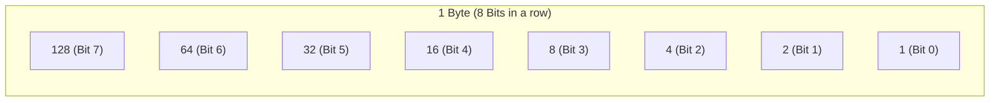
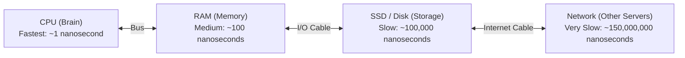
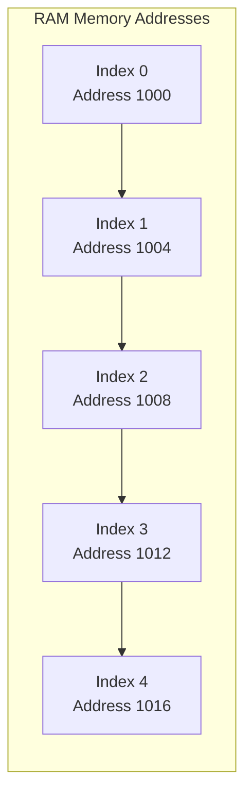
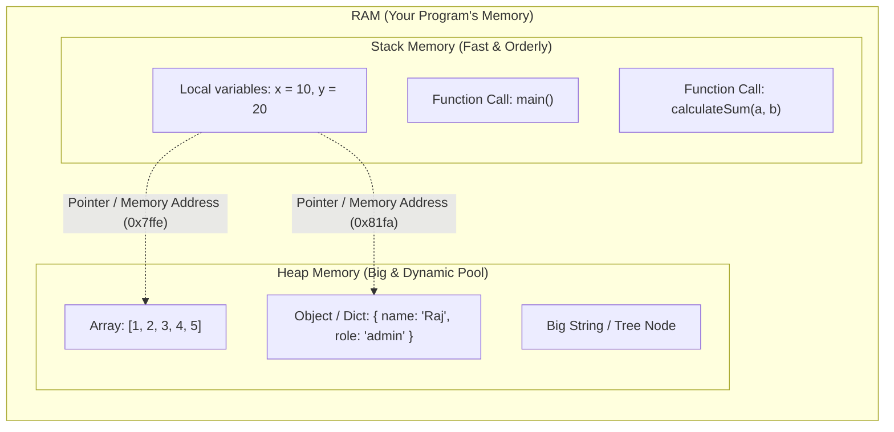
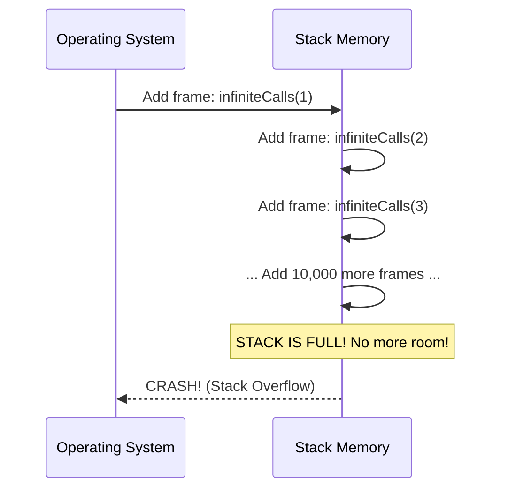
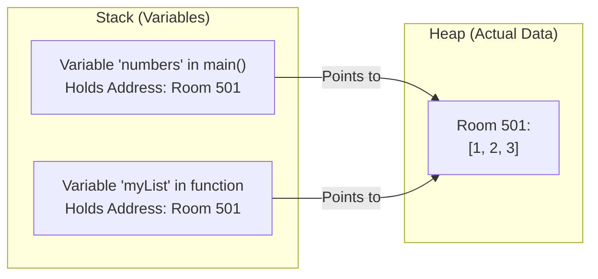
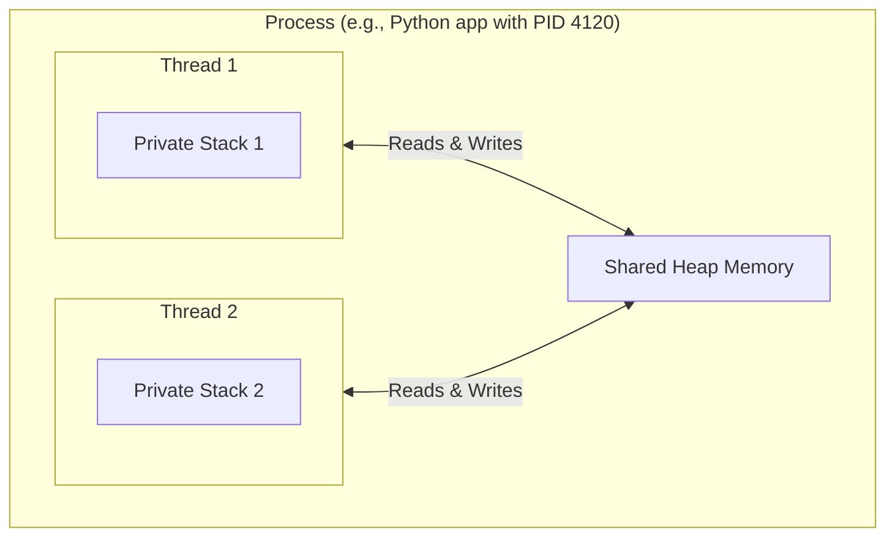

# Chapter 00: Computer Foundations, Memory & Core Jargon (Ground Zero)

> **Welcome!** If you learned coding by copy-pasting from StackOverflow, watching tutorials, or asking AI, you might feel like computer science is full of complicated English words. 
> 
> Don't worry. In this chapter, we will explain **how a computer actually works** using simple language, real-world analogies, and clear diagrams. We will use **Python** and **JavaScript** for all examples.

---

## 0. Bits, Bytes & Binary 101: What is a Computer Made Of?

Before we look at code, let's understand what is physically happening inside your laptop's memory chip.

### 1. What is a Bit?
A computer chip is made of billions of microscopic electric switches called **transistors**.
* Switch is OFF = `0` (No electricity)
* Switch is ON = `1` (Electricity flowing)
* One single switch is called a **Bit** (Binary Digit).

### 2. What is a Byte? (8 Bits)
One single bit can only store `0` or `1`. That is not enough to store numbers or letters.
So, computer scientists grouped **8 bits together** to form **1 Byte**.



* If all 8 switches are OFF (`00000000`), the number is **0**.
* If all 8 switches are ON (`11111111`), the number is:
  $$128 + 64 + 32 + 16 + 8 + 4 + 2 + 1 = \mathbf{255}$$
* That is why in RGB colors (like CSS `rgb(255, 0, 0)`), the maximum number is always **255**! It fits in exactly 1 Byte.

### 3. 32-bit vs. 64-bit Integers (Integer Overflow)
* A **32-bit integer** uses 4 Bytes (32 switches). The maximum positive number it can store is **2,147,483,647** (around 2.14 Billion).
  * *Real-world incident*: In 2014, the YouTube video for "Gangnam Style" got more than 2,147,483,647 views. YouTube's view counter broke because of a **32-bit integer overflow**! They had to upgrade to 64-bit.
* A **64-bit integer** uses 8 Bytes (64 switches). The maximum number is **9,223,372,036,854,775,807** (9 Quintillion—enough to count every grain of sand on Earth).

---

## 1. The Physical Reality: How Your Computer Actually Works

When you run a line of code like `x = 5`, what actually happens inside the computer?

A computer has three main physical parts:
1. **CPU (Central Processing Unit)**: The brain. It does calculations (math) very fast.
2. **RAM (Random Access Memory)**: The short-term memory (scratchpad). It is fast, but when you turn off the computer, everything in RAM is erased.
3. **SSD / Hard Disk**: The permanent storage. It is much slower than RAM, but it keeps your files safe even after a shutdown.



### The Real-World Analogy (The Kitchen & Library)

To understand why some code runs in 1 millisecond and other code takes 5 seconds, look at this table:

| Computer Part | Real-World Equivalent | Real-World Time |
|---|---|---|
| **CPU Register / Cache** | Thought inside your head | **1 second** |
| **RAM (Main Memory)** | Picking up a notebook from your desk | **1.5 minutes** (100x slower) |
| **SSD / Hard Disk** | Walking to a public library across the city | **1 day** (1,000x slower) |
| **Network (Internet Request)** | Traveling by ship from Mumbai to New York | **5 years** (1,500,000x slower) |

### Why Big-O Exists
When interviewers ask for O(1) or O(N), they are not asking math puzzles for fun. 
* If your code has a nested loop of O(N²) with 1,000,000 items, your CPU has to go to RAM **1,000,000,000,000 times**. The computer will freeze.
* If your code makes a database or network call inside a loop, you are sending your computer on a "5-year trip" thousands of times.

---

## 1.5 Why are Arrays O(1) in RAM? (The Pointer Math Formula)

Have you ever wondered why looking up an array item by index (`arr[5]`) is instantaneous (O(1)), but looking up an item in a Linked List takes O(N) time?

In RAM, an Array is stored in **one continuous, unbroken line of memory bytes**.



Because every 32-bit integer takes exactly 4 Bytes, the CPU does not need to scan through elements one by one. It calculates the exact memory address with a **single multiplication formula**:

$$\text{Memory Address} = \text{Base Address} + (\text{Index} \times \text{Item Size})$$

* If `arr` starts at memory address `1000`:
* To find `arr[4]`: Address = $1000 + (4 \times 4) = 1016$.
* The CPU jumps directly to address `1016` in **one single clock cycle (O(1))**!

---

## 2. Memory Anatomy: Stack vs. Heap

When your program runs, the Operating System gives it a block of RAM. That RAM is divided into two main areas: **The Stack** and **The Heap**.



### 1. The Stack Memory (The Pile of Plates)
* **How it works**: Like a pile of plates in a wedding buffet. You put one plate on top, and you take the top plate first (Last-In, First-Out: **LIFO**).
* **What goes here**: Function calls and small local variables (numbers, booleans).
* **Speed**: Extremely fast.
* **Cleanup**: Automatic. When a function finishes (`return`), its plate is immediately removed.

### 2. The Heap Memory (The Big Storage Room)
* **How it works**: A large open warehouse. When you create a large list, object, or dictionary, the computer finds an empty space in the warehouse and stores it there.
* **What goes here**: Objects, Lists, Arrays, Dictionaries, Trees.
* **Pointers**: The variable in your function does **not** hold the whole object. It only holds a **Pointer** (the warehouse shelf number / memory address, e.g., `0x7ffe42`).

---

### Case Study: What actually causes a "Stack Overflow"?

Have you ever wondered where the website name **Stack Overflow** comes from?

Look at this recursive code:

#### Python Example:
```python
def infinite_calls(count):
    print(f"Call number: {count}")
    # The function calls itself without ever stopping!
    infinite_calls(count + 1)

# infinite_calls(1)  # Uncommenting this will crash with RecursionError!
```

#### JavaScript Example:
```javascript
function infiniteCalls(count) {
    console.log("Call number: " + count);
    // Function calls itself forever!
    infiniteCalls(count + 1);
}

// infiniteCalls(1); // Crashes with: RangeError: Maximum call stack size exceeded!
```

#### Why it crashes:

Each function call adds a new "plate" to the Stack. Because the function never returns, the plates pile up until they hit the memory ceiling limit. The operating system kills your program to prevent your computer from freezing.

---

## 3. Pointers & References: Why Code Changes Other Code

One of the most confusing things for beginners is: *"Why did modifying a list inside a function change my original list outside?"*

Look at this code:

#### Python:
```python
def add_item(my_list):
    my_list.append(99)  # Mutating the list

numbers = [1, 2, 3]
add_item(numbers)
print(numbers)  # Output: [1, 2, 3, 99]  <-- The original changed!
```

#### JavaScript:
```javascript
function addItem(myList) {
    myList.push(99); // Mutating the array
}

let numbers = [1, 2, 3];
addItem(numbers);
console.log(numbers); // Output: [1, 2, 3, 99] <-- The original changed!
```

### Why did this happen?
`numbers` does **not** hold `[1, 2, 3]`. `numbers` holds a **ticket** with memory address `Room 501`.



When you passed `numbers` into `add_item`, you gave the function a photocopy of the ticket `Room 501`. When the function added `99` inside Room 501, anyone visiting Room 501 sees `[1, 2, 3, 99]`.

---

## 4. Linux & Operating System Fundamentals

When you deploy backend code to AWS, Google Cloud, or Docker, your code runs on **Linux**. You must understand three basic Linux concepts:

### 1. Process vs. Thread
* **Process**: A whole apartment. It has its own private memory. If one process crashes, other processes do not die.
* **Thread**: A person living inside the apartment. Multiple threads share the same kitchen and fridge (they share the same Heap memory).
  * *Danger*: If two people try to write in the same diary at the same exact second, they mess up the page. This is called a **Race Condition**.



### 2. Standard Streams & File Descriptors (0, 1, 2)
In Linux, everything is treated like a file:
* `0` = **stdin** (Standard Input): Where your app reads keyboard or input text from.
* `1` = **stdout** (Standard Output): Where normal `print()` or `console.log()` text goes.
* `2` = **stderr** (Standard Error): Where crash logs and error messages go.

When you use a Pipe (`|`) in your terminal:
```bash
cat access.log | grep "404"
```
Linux connects the `stdout` (1) of the first process directly into the `stdin` (0) of the second process inside memory. No temporary file is saved on disk!

### 3. Signals: How Linux Talks to Your App
* **`SIGINT`** (Signal Interrupt): Sent when you press `Ctrl + C` in terminal. It asks your app to stop.
* **`SIGTERM`** (Signal Terminate): Sent by Kubernetes or Docker when stopping your container. It politely tells your app: *"Finish your current database requests, close connections, and exit within 30 seconds."*
* **`SIGKILL`** (`kill -9`): The axe. Linux immediately destroys the process. The app cannot clean up, cannot close database connections, and cannot save files.

---

## 5. The Essential CS Vocabulary (Plain-English Glossary)

Here are the words that senior engineers and Google interviewers use every day, explained simply:

### 1. State
* **Meaning**: What data is stored in memory right now.
* **Analogy**: If you pause a video game, the current score, player health, and position is the "State".

### 2. Side Effect
* **Meaning**: When a function changes something outside of its own function body.
* **Code Example**:
```python
# BAD: Has a side effect (modifies a global variable)
total_users = 0
def register_bad():
    global total_users
    total_users += 1

# GOOD: No side effect (returns a clean value)
def register_good(current_count):
    return current_count + 1
```

### 3. Pure Function
* **Meaning**: A function that has **zero side effects**, and if you pass it the same inputs, it **always** returns the exact same output.
```javascript
// Pure Function: 2 + 3 will ALWAYS be 5. No surprises.
function add(a, b) {
    return a + b;
}

// Impure Function: Output changes depending on the time of day!
function getGreeting(name) {
    return "Hello " + name + " at " + new Date().toLocaleTimeString();
}
```

### 4. Invariant
* **Meaning**: A rule that must **never be broken** during the entire execution of an algorithm.
* **Example**: In a Binary Search Tree (BST), the invariant rule is: *"Every number in the left subtree must be smaller than the root number."* If that rule breaks, binary search stops working.

### 5. Idempotent (Eye-dem-po-tent)
* **Meaning**: Doing an action **one time** or **ten times** produces the exact same result.
* **Real-world analogy**: 
  * Pressing the elevator button for "Floor 3": Idempotent. Whether you press it once or 10 times, the elevator goes to Floor 3.
  * Pressing "Pay $10": NOT idempotent. If you press it 3 times, you lose $30!
* **Code Example**:
```python
# Idempotent: Running this 100 times leaves the user active
def activate_user(user):
    user["status"] = "ACTIVE"
    return user

# NOT Idempotent: Running this 3 times adds 3 items!
def add_bonus_points(user):
    user["points"] += 10
    return user
```

### 6. Amortized Time
* **Meaning**: An operation is very fast most of the time, but occasionally does something expensive. When you average the cost out, it is still considered fast.
* **Analogy**: You buy a 25kg bag of rice once every month for $30 (expensive day). But on daily dinners, you cook a small bowl for $1 (cheap). On average, your dinner cost is low.
* **In Code**: Dynamic array resizing (like Python `list.append()` or JS `array.push()`). It is O(1) almost every time, and only occasionally copies elements to a bigger array in O(N) time.

---

## 6. Production Case Studies & System Drifts

### Case Study 1: The 32-Bit Integer Overflow Outages
* **The YouTube "Gangnam Style" Outage (2014)**:
  YouTube originally stored video view counts as a **32-bit signed integer** (maximum value $2^{31}-1 = 2,147,483,647$). When the music video *"Gangnam Style"* surpassed 2.14 billion views, the counter overflowed to $-2,147,483,648$, causing view counts to display negative numbers and breaking recommendation sorting. Google had to hurriedly upgrade the counter to a 64-bit integer ($2^{63}-1 \approx 9.22 \times 10^{18}$).
* **The Boeing 787 248-Day Generator Control Bug (FAA Airworthiness Directive 2015-09-07)**:
  The generator control units (GCUs) on the Boeing 787 Dreamliner tracked operating time using an internal 32-bit signed counter in hundredths of a second ($0.01$s). After continuous power for $2^{31}-1$ centiseconds ($\approx 248.55$ days), the counter overflowed into negative numbers, causing software fault protection to trip and simultaneously cut all electrical power mid-flight! The mitigation required rebooting the airplanes' main electrical systems before reaching 248 days of uptime.

### Case Study 2: The Cache Locality 12x Latency Spike
A team observed their matrix image processing service suddenly slowing down by $1,200\%$ after a refactor:
```python
# SLOW: Column-Major Traversal (Cache Thrashing)
# Jumps 1,000,000 bytes in memory on every step, causing constant L1/L2 cache misses!
total = 0
for col in range(cols):
    for row in range(rows):
        total += matrix[row][col]

# FAST (12x Faster!): Row-Major Traversal (Spatial Locality)
# Sequential memory access fetches contiguous 64-byte Cache Lines into CPU L1 cache!
total = 0
for row in range(rows):
    for col in range(cols):
        total += matrix[row][col]
```
* **Lesson**: Hardware reads memory in **64-byte Cache Lines**, not individual bytes. Sequential access stays in ultrafast L1 cache (~1 ns), while random or column jumps stall on main RAM (~100 ns).

### Production Drifts to Watch:
1. **Memory Drift (Virtual Memory Swapping)**:
   When applications slowly leak heap memory, the OS runs out of physical RAM and begins **swapping pages to disk**. Memory access latency instantly shifts from **100 ns (RAM)** to **10,000,000 ns (10 ms on disk)**—a $100,000\times$ performance collapse known as **Thrashing**.
2. **Clock Drift (Wall-Clock vs. Monotonic Time)**:
   Servers periodically synchronize time with NTP (Network Time Protocol). When NTP adjusts for clock drift, **system wall-clock time can jump backwards**! If your rate limiter or timeout logic calculates duration using `Date.now()` or `time.time()`, `end_time - start_time` can evaluate to a **negative number**, causing infinite loops or bypassed rate limits.
   * **Fix**: Always measure durations using **Monotonic Clocks** (`time.monotonic()` in Python, `process.hrtime()` in Node.js).

---

## 7. FAANG Interview Scenarios & Traps (Ground Zero)

### Scenario 1: "Can a Memory Leak happen in a language with an automatic Garbage Collector like Python or JavaScript?"
* **Answer**: **YES!** A garbage collector only frees objects that have **zero reachable references** from the root scope. If an object is accidentally retained in a global array, a singleton cache without an eviction policy (e.g. unbounded dict), or a forgotten event listener (`window.addEventListener`), the GC considers it "in use" forever. Memory will steadily climb until the process crashes with `OOM (Out Of Memory)`.

### Scenario 2: "Why is allocating memory on the Stack orders of magnitude faster than the Heap?"
* **Answer**: 
  1. **Stack allocation is a single CPU instruction**: The CPU simply shifts the Stack Pointer register (`SP`) down by $N$ bytes (pointer arithmetic in 1 clock cycle $\approx 0.3$ ns).
  2. **Heap allocation requires complex OS searching**: The runtime allocator must traverse free-memory link lists to find a contiguous block of memory, handle fragmentation, update metadata tables, and acquire thread locks in multi-threaded environments (~50–200 ns).

### Scenario 3: "Why does array lookup `arr[i]` take O(1) time while linked list lookup takes O(N)?"
* **Answer**: An array is a **contiguous block of memory**. The CPU calculates the exact memory address in a single multiplication step: $\text{Address} = \text{Base} + (i \times \text{Element Size})$. In contrast, linked list nodes are scattered across random Heap memory locations; to find the $i$-th element, the CPU must physically follow $i$ pointers sequentially, jumping through random RAM addresses.

---

## Checkpoint Exercise (Test Your Understanding)

Before moving to Chapter 01, answer these questions in your head:
1. If your code is running slow because it loops 10,000 times and makes an HTTP network call inside each loop, why is it slow? *(Hint: Think of the ship traveling from Mumbai to New York).*
2. What is the difference between a variable holding a number (`x = 5`) and a variable holding an object (`obj = { name: "Aman" }`)?
3. Why does the CPU calculate an array lookup `arr[4]` in one single step (O(1)) without looping? *(Hint: Address formula).*
4. Why is an infinite recursive function called a "Stack Overflow" and not a "Heap Overflow"?

*Now you have the foundational mental model! Proceed to [Chapter 01](./google_sde_study_plan.md).*
