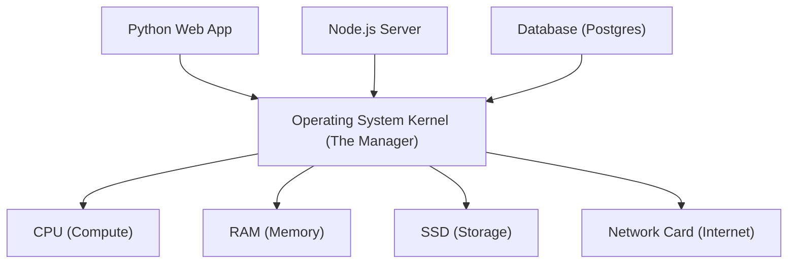
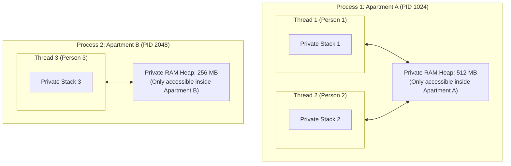
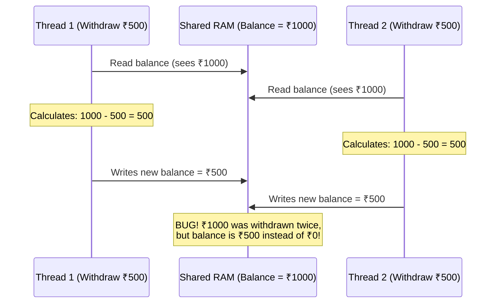
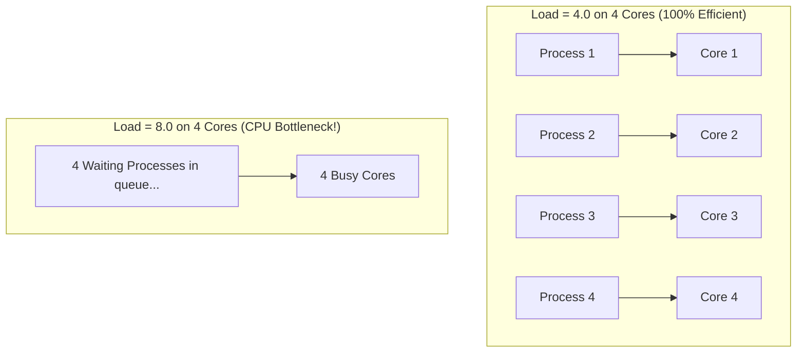
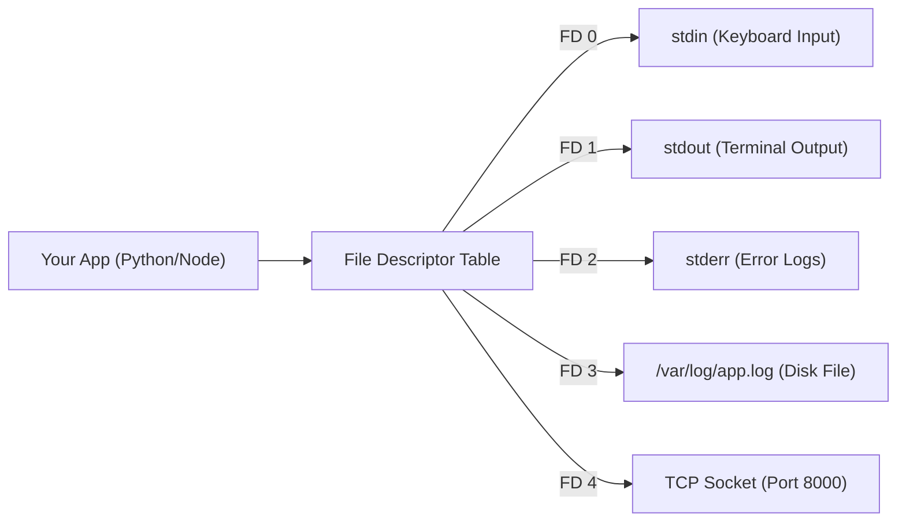
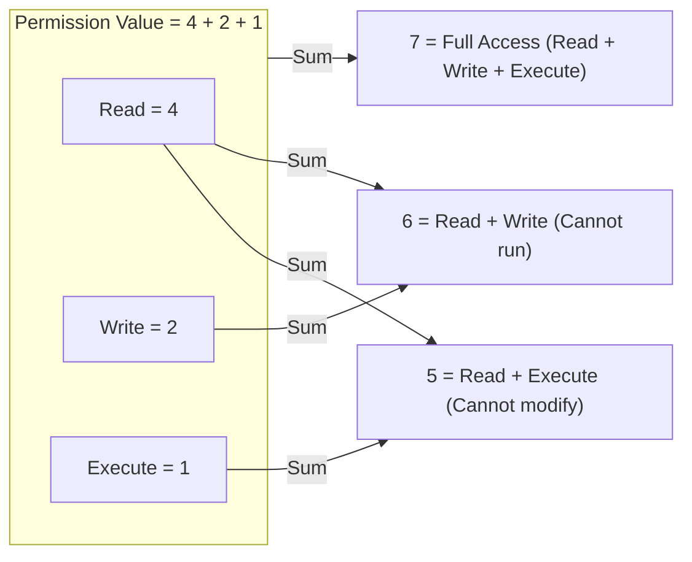
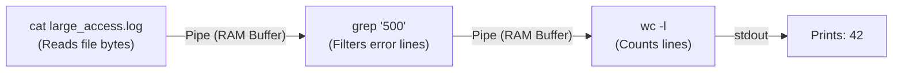
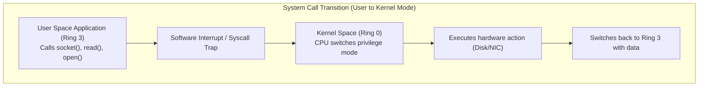

# Chapter 01: Linux OS & Command-Line Primitives (Deep Dive)

> **Welcome to Chapter 01!**
> When you deploy a backend app, a database, or an AI agent, it runs on a remote Linux server (in AWS, Google Cloud, or Docker). In Google and FAANG interviews, interviewers expect you to know what happens at the operating system level.
> 
> Once you finish this chapter, you will never need to read another Linux basics tutorial again. Everything is covered from first principles.

---

## 1. What is an Operating System? (The Hotel Manager)

Think of your computer hardware (CPU, RAM, Hard Disk, Network Card) as a **big luxury hotel**.
* The **CPU** is the kitchen.
* The **RAM** is the dining tables.
* The **Hard Disk** is the cold storage room in the basement.

If every guest (every software program) ran into the kitchen and grabbed ingredients whenever they wanted, there would be fire, fights, and chaos.



The **Operating System (OS Kernel)** is the **Hotel General Manager**:
1. It sits between software apps and physical hardware.
2. It gives each app a fair share of CPU time.
3. It prevents App A from spying on or stealing memory from App B.
4. It controls who can read or write files to disk.

---

## 2. Processes vs. Threads: The Apartment & The Family

This is one of the top 5 questions asked in Google SDE interviews: *"What is the exact difference between a Process and a Thread?"*

Let's use an analogy that makes it 100% clear.



### 1. What is a Process? (The Private Apartment)
* A **Process** is an independent running program (e.g., when you run `python app.py` or `node server.js`).
* The OS gives each process its own **Process ID (PID)** and its own **isolated virtual memory**.
* Process A **cannot** see or touch Process B's memory. If Process A crashes, Process B keeps running happily.
* **Creating a new process is heavy**: The OS has to allocate a whole new virtual memory space, page tables, and file descriptor tables.

### 2. What is a Thread? (A Family Member in the Apartment)
* A **Thread** is a lightweight worker *inside* a process.
* All threads inside the same process **share the exact same Heap memory and files**.
* Each thread gets its own private **Stack** (for its own function calls and local variables).
* **Creating a thread is fast**: It doesn't need new memory; it just starts working in the shared apartment.
* **The Danger**: If Thread 1 crashes with a fatal error (like a segmentation fault), the **entire process crashes**, killing Thread 2 as well!

### Comparison Summary Table

| Feature | Process | Thread |
|---|---|---|
| **Memory** | Completely isolated private memory. | Shares Heap memory with sibling threads. |
| **Creation Cost** | Heavy (slow to create, uses more RAM). | Lightweight (fast to create, small RAM). |
| **Crash Safety** | Safe (if one process dies, others survive). | Risky (if one thread crashes, whole process dies). |
| **Communication** | Difficult (needs IPC: Sockets, Pipes, Queues). | Very easy (just read/write shared variables). |
| **Synchronization** | No locks needed between processes. | **Locks / Mutexes mandatory** to prevent race conditions. |

---

## 3. The Nightmare: Race Conditions in Threads

Because threads share the same Heap memory, look at what happens when two threads try to update a bank balance at the exact same millisecond:



### The Fix: Mutex (Mutual Exclusion Lock)
A **Mutex** is like a bathroom key in a cafe.
1. Thread 1 grabs the key and locks the door.
2. Thread 1 reads the balance, subtracts money, and writes the new balance.
3. Thread 2 arrives, sees the door is locked, and **waits outside**.
4. Thread 1 unlocks the door. Thread 2 enters and now reads the correct updated balance (₹500).

#### Python Mutex Example:
```python
import threading
import time

balance = 1000
lock = threading.Lock()  # The bathroom key!

def withdraw(amount):
    global balance
    # With 'lock', only ONE thread can execute this block at a time
    with lock:
        current = balance
        time.sleep(0.001)  # Simulating tiny delay
        balance = current - amount

threads = [
    threading.Thread(target=withdraw, args=(500,)),
    threading.Thread(target=withdraw, args=(500,))
]

for t in threads: t.start()
for t in threads: t.join()

print(f"Correct Final Balance: ₹{balance}") # Output: ₹0
```

#### JavaScript Note:
> In standard Node.js, your JavaScript code runs on a **single thread with an Event Loop**. You don't have to worry about two JS threads touching the same variable at the exact same millisecond! However, if you use Node.js `worker_threads` with `SharedArrayBuffer`, you must use `Atomics` locks.

---

## 3.5 CPU Load Average & Context Switching: What Does `4.5` Mean?

When you run `uptime` or `top` on a Linux server, you will see something like this:
```text
load average: 4.52, 2.10, 1.05
```
What do these three numbers mean?

They represent the average CPU load over the last **1 minute**, **5 minutes**, and **15 minutes**.

### The Toll Booth Analogy (How to Read Load Average)
Think of a highway with toll booths. Each toll booth is a **CPU Core**:
* If your server has **4 CPU Cores**:
  * **Load = 1.0**: Only 1 core is busy. 3 cores are sitting idle.
  * **Load = 4.0**: All 4 cores are working at 100% capacity. Zero traffic jam.
  * **Load = 8.0**: All 4 cores are working, and **4 more processes are waiting in line**! You have a massive CPU bottleneck!



### What is Context Switching?
When you have 50 active processes on a 4-core CPU, the CPU core cannot run all 50 at once.
Every few milliseconds, the OS pauses Process A, saves its register values to memory, and loads Process B.
* This is called a **Context Switch**.
* If you create 5,000 threads, the CPU spends 90% of its time doing context switches instead of real work! This is called **CPU Thrashing**.

---

## 4. Everything in Linux is a File: File Descriptors (0, 1, 2)

In Linux, whether you are talking to a hard disk file, a network WiFi socket, a terminal keyboard, or a webcam, Linux treats it as a **stream of bytes**.

When a process opens any connection, the Linux kernel gives the process a simple non-negative integer called a **File Descriptor (FD)**.



Every single Linux process starts with three default open file descriptors:
* **`0` = `stdin`** (Standard Input): Where user keyboard input comes from.
* **`1` = `stdout`** (Standard Output): Where normal `print()` or `console.log()` goes.
* **`2` = `stderr`** (Standard Error): Where error messages and crash tracebacks go.

### Terminal Redirection Tricks:
```bash
# 1. Redirect stdout (1) to a file (overwrite)
python app.py > output.txt

# 2. Redirect stdout (1) to a file (append)
python app.py >> output.txt

# 3. Redirect stderr (2) to an error log file
python app.py 2> errors.txt

# 4. Redirect BOTH stdout and stderr to the same file
python app.py > all_logs.txt 2>&1
```

---

## 5. Linux Permissions Demystified: The Octal Math (`chmod 755`)

Have you ever typed `chmod 755 script.sh` without knowing what the numbers mean?

In Linux, every file has permissions for three categories of people:
1. **User (u)**: The owner who created the file.
2. **Group (g)**: Users in the owner's group.
3. **Others (o)**: Everyone else in the world.

### The 3 Permission Bits:
* **Read (r)** = **4**
* **Write (w)** = **2**
* **Execute (x)** = **1**



### Breaking Down `chmod 755`:
* **7** (User): $4 + 2 + 1 = 7$ (Owner can read, write, and run).
* **5** (Group): $4 + 1 = 5$ (Group can read and run, but cannot modify).
* **5** (Others): $4 + 1 = 5$ (Others can read and run).

### The Security Trap: SSH Keys and `chmod 600`
If you download an AWS SSH key (`id_rsa.pem`) and try to connect:
```text
@@@@@@@@@@@@@@@@@@@@@@@@@@@@@@@@@@@@@@@@@@@@@@@@@@@@@@@@@@@
@         WARNING: UNPROTECTED PRIVATE KEY FILE!          @
@@@@@@@@@@@@@@@@@@@@@@@@@@@@@@@@@@@@@@@@@@@@@@@@@@@@@@@@@@@
Permissions 0777 for 'id_rsa.pem' are too open.
```
* **Why**: Permission `777` means anyone on your computer can read your private key!
* **The Fix**: `chmod 600 id_rsa.pem` (User has Read + Write = 6; Group has 0; Others have 0). Only YOU can touch it!

---

## 6. Linux Pipes (`|`): Zero-Disk Streaming

In Linux, the **Pipe operator (`|`)** connects programs together without saving files to disk.

Look at this command:
```bash
cat large_access.log | grep "500" | wc -l
```



1. `cat` streams file bytes to its `stdout`.
2. Linux connects that `stdout` directly to the `stdin` of `grep` inside an **in-memory RAM buffer**.
3. No intermediate file is saved on disk.
4. Even if `large_access.log` is **500 Gigabytes**, this command uses **less than 10 Megabytes of RAM**!

---

## 7. Linux Signals: How the OS Controls Your App

When your backend runs in production, how does the OS or Docker tell your program to stop or restart? It sends a **Signal**.

| Signal | Number | What triggers it | Can your app catch it? | What should your app do? |
|---|---|---|---|---|
| **`SIGINT`** | `2` | You press `Ctrl + C` in the terminal | **YES** | Stop loops and exit cleanly. |
| **`SIGTERM`** | `15` | Kubernetes/Docker stopping a container | **YES** | **Graceful Shutdown**: finish ongoing payments, close DB connections, exit. |
| **`SIGKILL`** | `9` | You run `kill -9 <PID>` | **NO (Impossible)** | Instant execution death by kernel. Leaves unclosed connections and half-written files. |

### Case Study: How to Write a "Graceful Shutdown"

#### Python Graceful Shutdown:
```python
import signal
import time
import sys

keep_running = True

def handle_sigterm(signum, frame):
    global keep_running
    print("\n[!] Received SIGTERM signal from OS!")
    print("[*] Finishing active database transactions...")
    time.sleep(1)  # Simulating finishing work
    print("[+] All clean! Exiting safely.")
    keep_running = False

signal.signal(signal.SIGTERM, handle_sigterm)
signal.signal(signal.SIGINT, handle_sigterm)

print("Server started. Press Ctrl+C to stop.")
while keep_running:
    print("Serving requests...")
    time.sleep(2)
```

#### Node.js Graceful Shutdown:
```javascript
const http = require('http');

const server = http.createServer((req, res) => {
    res.writeHead(200);
    res.end("Payment processed successfully!");
});

server.listen(3000, () => console.log("Server listening on port 3000"));

process.on('SIGTERM', () => {
    console.log("\n[!] SIGTERM received. Closing server gracefully...");
    server.close(() => {
        console.log("[+] Closed all active connections. Safe exit.");
        process.exit(0);
    });
});
```

---

## 8. Network Diagnostic Commands Every SDE Must Know

When an API fails or a database won't connect, how do you debug the network?

```bash
# 1. Check what ports are currently listening on your machine
ss -tulpn
# or older command:
netstat -tulpn

# 2. Test if a remote server port is open and accepting TCP traffic
nc -zv 192.168.1.50 5432
# or
curl -v https://google.com

# 3. Check the route of network hops between your server and the destination
traceroute google.com

# 4. Check DNS resolution for a domain
dig google.com +short
```

---

## 9. Production Case Studies, System Drifts & Interview Traps

### Production Case Study 1: The "Too Many Open Files" Outage (`EMFILE` Crash)
* **The Incident**: A high-traffic payment microservice ran smoothly for 48 hours after deployment. Suddenly at 2 AM, all incoming requests failed with `OSError: [Errno 24] Too many open files` in Python, or `Error: EMFILE: too many open files` in Node.js. The server completely stopped accepting new TCP connections.
* **Root Cause**: An outgoing HTTP client request to a fraud detection API did not close the connection response body inside error handling blocks. Every failed call left an active TCP socket open in the Linux OS.
* **The Limit**: In Linux, every process has a default soft limit of open file descriptors (often `ulimit -n = 1024`). Once the leaked sockets hit 1024, the Linux kernel rejected all calls to `open()`, `accept()`, and `socket()`.
* **The Fix**:
  1. Temporary emergency fix: Raised process limits using `ulimit -n 65535` and system limits in `/etc/security/limits.conf`.
  2. Permanent fix: Enforced proper context managers (`with` / `try...finally`) on all outbound HTTP streams.
  3. Monitoring: Configured Prometheus alerts on `/proc/<PID>/fd` count reaching 70% of max limit.

### Production Case Study 2: The Kubernetes 30-Second `SIGKILL` Data Corruption
* **The Incident**: During a rolling Kubernetes deployment, a message-processing worker pod was terminated. When the new version deployed, users reported hundreds of incomplete, corrupted order records in the database.
* **Root Cause**:
  1. Kubernetes sent a `SIGTERM` signal to the pod.
  2. The application ignored `SIGTERM` and continued pulling new messages from Kafka while processing a 45-second batch job.
  3. After the default `terminationGracePeriodSeconds` (30 seconds), Kubernetes issued an uncatchable `SIGKILL` (Signal 9).
  4. The process was abruptly terminated mid-write, leaving raw half-committed state in the database.
* **The Fix**:
  ```python
  import signal, sys

  def graceful_shutdown(signum, frame):
      print("SIGTERM received! Stopping new job intake and draining active queue...")
      stop_consuming_from_kafka()
      finish_in_flight_work()
      db_connection_pool.close()
      sys.exit(0)

  signal.signal(signal.SIGTERM, graceful_shutdown)
  ```

### Production System Drifts to Watch:
1. **File Descriptor Leak Drift**: Unlike memory leaks which trigger OOM alerts quickly, FD leaks can slowly accumulate over 5 to 7 days before crossing the kernel threshold. Inspect using:
   ```bash
   ls -l /proc/<PID>/fd | wc -l
   ```
2. **Context Switching Thrashing Drift**:
   Spawning 5,000 OS threads instead of using an asynchronous event loop causes CPU cores to spend **80% of their cycles saving and restoring CPU registers** between threads (`cs` metric in `vmstat 1`) rather than executing actual business logic.

### FAANG Interview Scenarios & Traps:



#### Scenario 1: "Your server has 100% CPU usage and is frozen. How do you diagnose it step-by-step?"
1. I will SSH into the server and run `htop` to identify the specific Process ID (PID) consuming 100% CPU.
2. If it is a multi-threaded app, I'll press `H` in htop to inspect which specific thread is stuck.
3. I will run `strace -p <PID>` to see what system calls the stuck process is executing (e.g., spinning on a locked mutex or stuck in an infinite read loop).
4. I will inspect `/proc/<PID>/status` and `/proc/<PID>/fd` to check for leaked file descriptors or unclosed sockets.

#### Scenario 2: "What is a Zombie Process vs. an Orphan Process?"
* **Orphan Process**: A child process whose parent process died. The Linux init process (`PID 1`) adopts the child and cleans it up.
* **Zombie Process**: A child process that has **finished executing**, but its parent hasn't called `wait()` to read its exit code. It holds no RAM or CPU, but it occupies an entry in the OS Process Table. If too many accumulate, the OS cannot allocate new PIDs!

#### Scenario 3: "If a process is killed with `kill -9 <PID>`, can it write a goodbye log or close its database connection?"
* **Answer**: **NO, NEVER!** `SIGKILL` (Signal 9) is received and processed directly by the **Linux OS Kernel**, not the application runtime. The kernel immediately removes the process from the CPU scheduler and destroys its page tables. The process does not execute a single instruction after `SIGKILL`.

#### Scenario 4: "What is the difference between CPU Utilization (100%) and Linux Load Average (10.0)?"
* **Answer**:
  * **CPU Utilization** measures the percentage of CPU clock cycles actively executing user or kernel instructions.
  * **Load Average** counts the number of processes that are **runnable (using or waiting for CPU)** PLUS processes waiting in **Uninterruptible Disk Sleep (`D` state)**.
  * If your disk is failing or saturated with slow I/O, CPU utilization can be **2%**, while the Load Average reaches **50.0** because 50 threads are blocked waiting for disk blocks!

#### Scenario 5: "What happens under the hood when you run a program in Linux? (The `fork()` and `execve()` dance)"
* **Answer**:
  1. The shell executes the `fork()` system call: The kernel creates an exact clone of the parent process with a new PID. Thanks to **Copy-On-Write (CoW)**, it does not copy physical RAM; it shares memory pages read-only until either process writes.
  2. The child process calls `execve()`: The kernel purges the cloned memory, loads the binary executable from disk, maps new code/data/heap/stack segments, and begins executing `main()`.

#### Scenario 6: "What is a Context Switch, and why is a Thread switch cheaper than a Process switch?"
* **Answer**: A context switch saves the CPU register state (Program Counter, Stack Pointer) of a running task and restores another.
  * **Process Switch**: The CPU must change memory page tables by reloading the `CR3` register. This **invalidates the hardware TLB cache**, causing thousands of subsequent memory instructions to suffer slow TLB misses!
  * **Thread Switch**: Threads share the exact same virtual address space and page tables. The `CR3` register does not change; the TLB remains valid, making thread switches orders of magnitude cheaper.

#### Scenario 7: "What is the difference between User Space (Ring 3) and Kernel Space (Ring 0)?"
* **Answer**: Hardware CPU protection rings enforce security boundaries.
  * **User Space (Ring 3)**: Where user applications (Python, Node.js, databases) run. Restricted instructions (accessing raw hard drives, network cards, memory tables) are blocked by the CPU hardware.
  * **Kernel Space (Ring 0)**: Unrestricted access to hardware and physical memory.
  * To read a file or send a network packet, user programs must trigger a **System Call (`syscall`)** interrupt, asking the kernel to perform the action safely on their behalf.

#### Scenario 8: "How does the Linux Out-Of-Memory (OOM) Killer select which process to kill?"
* **Answer**: When physical RAM and swap are exhausted, the kernel cannot allocate pages. Rather than kernel panic, the **OOM Killer** assigns every process a penalty score (`/proc/<PID>/oom_score`) based on:
  1. Percentage of physical RAM consumed.
  2. Short-lived processes vs long-lived system daemons.
  * The process with the highest score is sent `SIGKILL`. Engineers can protect critical databases by adjusting `/proc/<PID>/oom_score_adj` to `-1000` (immune to OOM killer).

#### Scenario 9: "Why does `epoll` handle 100,000 connections (C10K Problem) while `select` fails?"
* **Answer**:
  * **`select()` / `poll()`**: Takes an array of 100,000 file descriptors. Every time data arrives, the OS must iterate $O(N)$ through all 100,000 descriptors to find which one has bytes ready.
  * **`epoll()` (Linux)**: Uses an internal kernel **Red-Black Tree** to track sockets and a **Ready List (Linked List)** populated by hardware network interrupts. When bytes arrive, `epoll_wait()` returns in $O(1)$ time containing *only* the active sockets that are ready for reading!

#### Scenario 10: "What happens when a pipe's reader terminates early while the writer is still writing? (The `SIGPIPE` signal)"
* **Answer**: If you run `cat large.txt | head -n 5`:
  `head` reads 5 lines and exits, closing the read end of the pipe. The kernel detects that `cat` is writing to a pipe with zero readers and sends `cat` a **`SIGPIPE` (Signal 13)**, which by default terminates the writer. If a backend web app ignores `SIGPIPE` when writing to a dropped client socket, the entire web server can unexpectedly crash!

---

## Chapter 01 Checklist (Summary)

Before moving to Chapter 02, verify that you can answer these:
- [x] Can you explain the difference between a Process and a Thread to a beginner?
- [x] What does a Linux Load Average of `4.0` mean on a 4-core CPU vs. a 1-core CPU?
- [x] How does the octal math of `chmod 755` and `chmod 600` work?
- [x] What are File Descriptors `0`, `1`, and `2`?
- [x] What is the difference between `SIGTERM` and `SIGKILL`, and how do you implement a graceful shutdown?

*Chapter 01 is complete! Proceed to [Chapter 02: Web Architecture 101](./chapter_02.md).*
