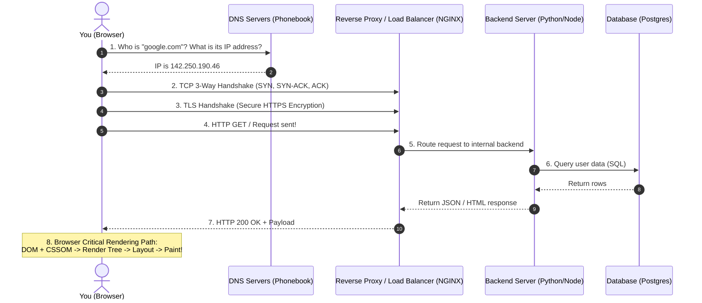
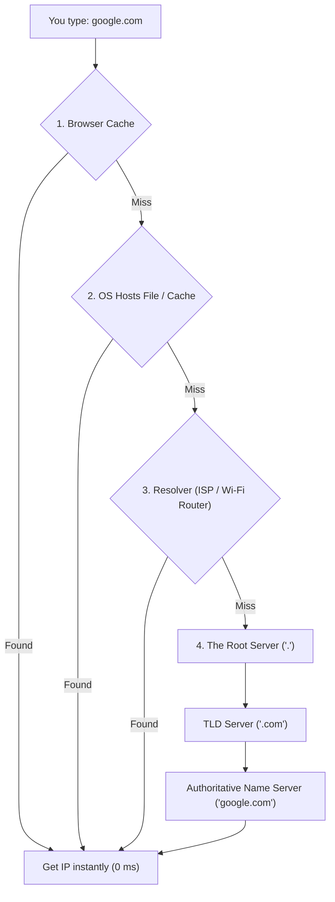
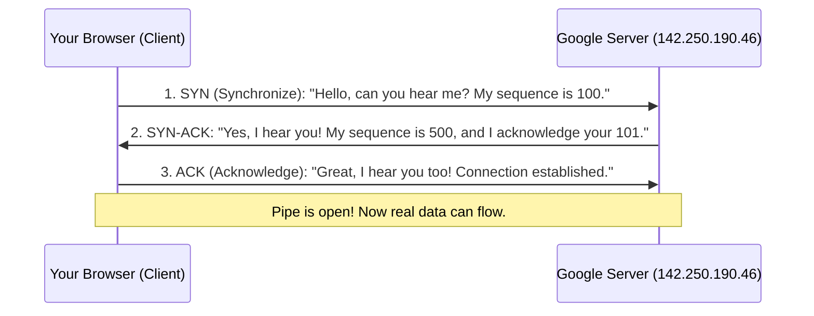
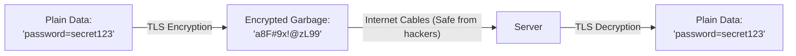
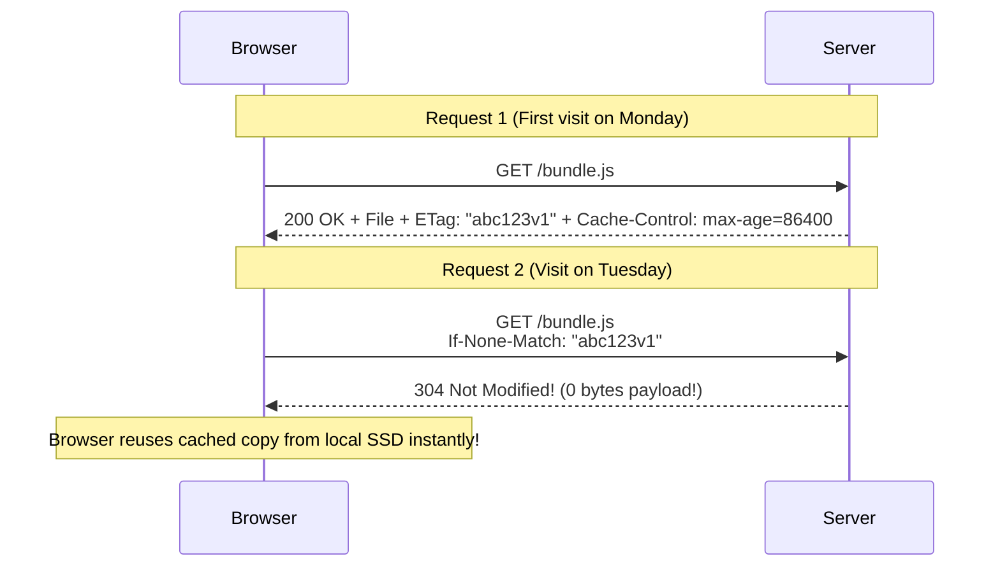
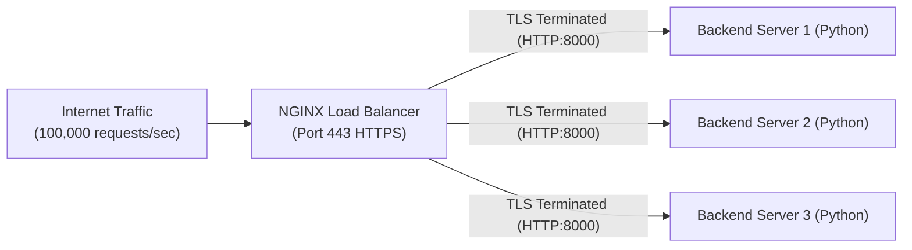
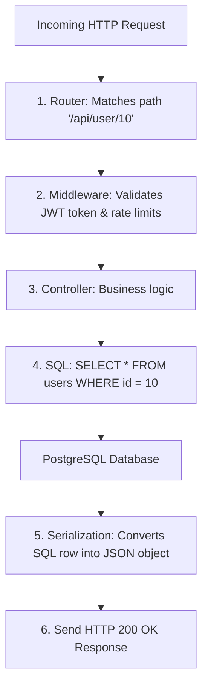
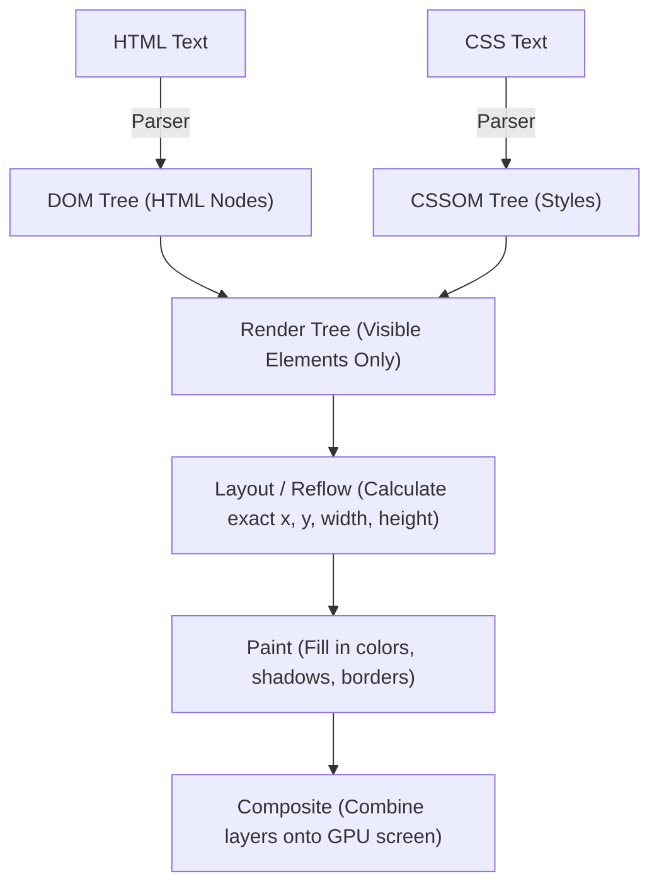

# Chapter 02: Web Architecture 101 — "What Happens When You Type a URL?"

> **Welcome to Chapter 02!**
> "What happens when you type `https://google.com` in your browser and press Enter?" is the single most famous interview question in the entire software industry.
> 
> Interviewers at Google, Amazon, and Microsoft ask this question because it tests whether you truly understand how the internet connects computers together across physical cables, operating systems, networking protocols, and browser rendering engines.
> 
> In this chapter, we will walk through the entire journey from your keyboard to the server and onto your screen pixels, explained in simple English with clear diagrams.

---

## 1. High-Level Map of the Journey

Before diving into details, look at the big picture of what happens in less than **200 milliseconds**:



---

## 2. Step 1: DNS Resolution (Finding the Phone Number)

Computers on the internet do not understand names like `google.com` or `amazon.in`. They only understand numeric **IP Addresses** (e.g., `142.250.190.46`).

The **DNS (Domain Name System)** is simply the **global phonebook of the internet**.

### The 4-Level Lookup Hierarchy
When you type `google.com`, your computer searches in 4 levels of caches:



1. **Browser Cache**: Chrome or Firefox checks if you visited this site in the last 5 minutes.
2. **OS Cache & Hosts File**: Your computer checks its local operating system memory and `/etc/hosts` file.
3. **Recursive DNS Resolver**: Your local Wi-Fi router or ISP (e.g., Airtel, Jio, or Google DNS `8.8.8.8`).
4. **The Global Chain**:
   * **Root Server (`.`)**: Points to the `.com` manager.
   * **TLD (Top-Level Domain) Server (`.com`)**: Points to Google’s registered nameservers.
   * **Authoritative Nameserver**: The final authority. It returns the exact IP address: `142.250.190.46`.

### The 4 Common DNS Record Types Every Engineer Must Know:
* **`A` Record**: Maps a domain name directly to an **IPv4 address** (`google.com` $\to$ `142.250.190.46`).
* **`AAAA` Record**: Maps to an **IPv6 address** (`2404:6800:4009:830::200e`).
* **`CNAME` (Canonical Name)**: An alias that points one name to another name (e.g., `api.mysite.com` $\to$ `my-loadbalancer.aws.com`).
* **`MX` Record**: Specifies which mail servers handle incoming emails for `@company.com`.

---

## 3. Step 2: The TCP 3-Way Handshake (Establishing the Call)

Now your browser knows the server's IP address. But before sending data, it must establish a reliable connection.

Websites use **TCP (Transmission Control Protocol)** because it guarantees that **no data is lost**.

### The 3-Step Handshake:
Think of TCP like two people calling each other on a mobile phone:



### TCP Slow Start (Why Downloads Start Slow and Speed Up)
When a TCP connection opens, it doesn't immediately blast 100 Megabytes at full speed:
1. It sends 10 packets. If acknowledged without packet loss, it doubles to 20 packets.
2. Then 40 packets, then 80 packets (**Exponential Growth**).
3. This is called **TCP Slow Start** (Congestion Control). It tests how much bandwidth your Wi-Fi/cable can handle without dropping packets.

---

## 4. Step 3: TLS 1.3 Handshake (HTTPS Encryption)

If you only use plain HTTP, anyone sitting in the same Starbucks Wi-Fi can open Wireshark and read your passwords and credit cards in plain text!

**HTTPS** is simply **HTTP running over an encrypted TLS (Transport Layer Security) tunnel**.



### How the TLS Handshake Works:
1. **Asymmetric Encryption (Heavy but secure)**:
   * The server shares its **Public SSL Certificate** (verified by trusted authorities like DigiCert or Let's Encrypt).
   * Your browser verifies that the certificate actually belongs to `google.com` and hasn't expired.
2. **Key Exchange (Diffie-Hellman)**:
   * Both sides combine mathematical keys to calculate a temporary shared **Symmetric Session Key** without sending the key itself over the wire.
3. **Symmetric Encryption (Fast)**:
   * For the rest of the session, all messages are encrypted with this shared key because symmetric encryption is $1,000\times$ faster for the CPU than asymmetric encryption!

---

## 5. Step 4: HTTP Caching & Conditional Requests (`ETag` & `304`)

Before your browser requests a 5MB JavaScript file from the server, it checks its local disk cache.

How does HTTP caching save millions of dollars in bandwidth?



### The 3 Critical Cache Headers:
* **`Cache-Control: max-age=3600`**: Cache this file on the user's laptop for 1 hour. Do not ask the server again during this time!
* **`Cache-Control: no-cache`**: You can cache the file, but you **must ask the server (`ETag`)** before using it to confirm it hasn't changed.
* **`Cache-Control: no-store`**: **NEVER save to disk or cache** (used for bank account balances, medical records, and credit card pages).
* **`ETag` & `If-None-Match`**: An `ETag` is a hash of the file. If the file hasn't changed, the server returns **`304 Not Modified`** with zero payload bytes!

### Hands-on Code: How Servers Handle `ETag` and `304 Not Modified`

#### 1. Python (`http.server`):
```python
from http.server import HTTPServer, BaseHTTPRequestHandler
import hashlib

DATA = b"console.log('Bundle v1.0');"
FILE_ETAG = f'"{hashlib.md5(DATA).hexdigest()}"'

class ETagHandler(BaseHTTPRequestHandler):
    def do_GET(self):
        client_etag = self.headers.get("If-None-Match")
        if client_etag == FILE_ETAG:
            # 304 Not Modified: Browser uses local cache, 0 bytes body transferred!
            self.send_response(304)
            self.end_headers()
            return

        self.send_response(200)
        self.send_header("ETag", FILE_ETAG)
        self.send_header("Cache-Control", "no-cache")
        self.send_header("Content-Length", str(len(DATA)))
        self.end_headers()
        self.wfile.write(DATA)
```

#### 2. JavaScript (Node.js `http`):
```javascript
const http = require('http');
const crypto = require('crypto');

const DATA = "console.log('Bundle v1.0');";
const FILE_ETAG = `"${crypto.createHash('md5').update(DATA).digest('hex')}"`;

const server = http.createServer((req, res) => {
    if (req.headers['if-none-match'] === FILE_ETAG) {
        // 304 Not Modified: Tell client to reuse its local copy!
        res.writeHead(304);
        res.end();
        return;
    }

    res.writeHead(200, {
        'ETag': FILE_ETAG,
        'Cache-Control': 'no-cache',
        'Content-Type': 'application/javascript',
        'Content-Length': Buffer.byteLength(DATA)
    });
    res.end(DATA);
});
```

---

## 6. Step 5: Reverse Proxy & Load Balancer (NGINX)

When your request arrives at Google or Amazon, it doesn't hit a Python or Node.js server directly. It hits a **Reverse Proxy / Load Balancer** (like **NGINX**, **Envoy**, or **HAProxy**).



### What does the Reverse Proxy do?
1. **TLS Termination**: It does the heavy math of decrypting HTTPS once, passing cheap unencrypted HTTP to internal backend servers inside the private network.
2. **Load Balancing**: It distributes traffic among hundreds of internal servers using algorithms like **Round Robin** or **Least Connections**.
3. **DDoS Protection**: It drops bad requests before they ever reach your database.
4. **Static File Caching**: It serves images, CSS, and JavaScript files directly from RAM without bothering the Python/Node.js app.

---

## 7. Step 6: Application Server & Database Execution

Now your backend code receives the request:



---

## 8. Step 7: Browser Critical Rendering Path (Painting Pixels)

Once the browser receives the HTML document, how does it turn text into visual buttons and images on your screen?



### Why `<script>` Tags at the Top Freeze the Page (Parser-Blocking):
When the browser's HTML parser encounters a `<script src="bundle.js">`:
1. It **halts the HTML parser completely**!
2. It waits for the network to download the JavaScript file.
3. It executes the JavaScript before parsing the rest of the HTML.
4. **Result**: A blank white screen for 2 seconds!

#### The Fix: `async` vs. `defer`
```html
<!-- BAD: Freezes HTML parser -->
<script src="app.js"></script>

<!-- GOOD (defer): Downloads in background, executes ONLY after HTML is parsed! -->
<script src="app.js" defer></script>

<!-- ASYNC: Downloads in background, executes immediately when ready (great for Google Analytics) -->
<script src="analytics.js" async></script>
```

---

## 9. Production Case Studies, System Drifts & Interview Traps

### Production Case Study 1: The DNS TTL "Thundering Herd" Outage
* **The Incident**: An e-commerce engineering team lowered their DNS TTL (Time To Live) to `0 seconds` (or `1s`) before a planned data center migration so traffic would switch instantly. When their flash sale went live at 10 AM (500,000 users/minute), their Authoritative DNS servers crashed under query volume. The domain stopped resolving globally for 3 hours.
* **Why it Happened**: Setting TTL to 0 bypassed all recursive caching at local ISPs and Google DNS (`8.8.8.8`). Every single user HTTP request forced a recursive lookup to the authoritative nameservers, generating millions of redundant DNS queries per second.
* **The Rule**: In production, never set TTL to 0. Lower TTL to 300 seconds (5 minutes) 24 hours *before* migration, execute migration, and restore TTL to 86400 seconds (24 hours).

### Production Case Study 2: The TLS Certificate HSTS Blackout
* **The Incident**: A fintech company's website stopped loading for all users worldwide on a Sunday morning. The browser displayed `NET::ERR_CERT_DATE_INVALID` with no "Proceed Anyway" button.
* **Root Cause**: An automated Certbot cron renewal job failed silently due to an unhandled HTTP challenge timeout. Because the site used **HSTS (HTTP Strict Transport Security)**, browsers strictly refused to let users bypass the security warning.
* **The Fix**: 
  1. Automated multi-provider alert at 30 days, 14 days, and 3 days before expiration.
  2. Implement dual automated ACME validation via DNS TXT records rather than HTTP webroot challenges.

### Production System Drifts to Watch:
1. **Cache Invalidation Drift (Asset Desynchronization)**:
   Deploying new frontend assets with fixed filenames (e.g. `bundle.js`) and `Cache-Control: max-age=86400` means existing users run old JavaScript code for 24 hours. If the backend API changes schema simultaneously, the old frontend sends deprecated payloads, throwing fatal exceptions for thousands of users.
   * **The Industry Standard**: Never rely on `max-age` for mutable filenames. Use **Content Hashing** (`bundle.a8f9c1.js`) with `Cache-Control: max-age=31536000, immutable`.
2. **TCP Slow Start Drift on Mobile/Satellite Networks**:
   On high-latency networks (e.g., mobile 4G with 150ms RTT), TCP Slow Start limits initial throughput to 10 packets (~14 KB). Even if the user has 100 Mbps bandwidth, downloading a 200 KB initial payload requires multiple round-trips, taking over 1.2 seconds just for TCP window expansion!
   * **Fix**: Keep the critical initial HTML payload under **14 KB** so it arrives in the very first TCP burst window!

### FAANG Interview Scenarios & Traps:

#### Scenario 1: "What is the difference between 502 Bad Gateway and 504 Gateway Timeout?"
* **502 Bad Gateway**: The reverse proxy (NGINX) reached out to the backend (Python/Node app), but the backend was **dead, not running, or refused the connection immediately** (`Connection Refused`).
* **504 Gateway Timeout**: The reverse proxy successfully opened a TCP connection to the backend, but the backend **hung waiting for a slow SQL query or third-party API** and failed to respond before NGINX's `proxy_read_timeout` expired.

#### Scenario 2: "What is the difference between HTTP/1.1, HTTP/2, and HTTP/3?"
* **HTTP/1.1**: Suffered from **Head-of-Line (HoL) Blocking** at the application layer. Browsers had to open up to 6 separate TCP connections per domain to download assets in parallel.
* **HTTP/2**: Introduced **Multiplexing over a single TCP connection**. Multiple requests and responses interleave concurrently using binary framing.
* **HTTP/3 (QUIC)**: Replaced TCP with **UDP-based QUIC protocol**. Eliminates TCP transport-level head-of-line blocking when packet loss occurs on mobile networks!

#### Scenario 3: "Why does HTTPS use asymmetric encryption during handshake, but switches to symmetric encryption for data transport?"
* **Answer**: **CPU Computational Cost!** Asymmetric algorithms (RSA, ECDHE) use complex modular exponentiation and elliptic curve point multiplication, which are roughly **$1,000\times$ slower** than symmetric block ciphers like AES-GCM. Asymmetric keys are used only once during the TLS handshake to safely agree upon a shared session secret; from then on, hardware-accelerated AES encrypts streaming data at gigabit speeds with minimal CPU usage.

#### Scenario 4: "What triggers a Browser Reflow (Layout) vs. Repaint, and what is Layout Thrashing?"
* **Answer**:
  * **Repaint**: Changing visual appearance without changing geometry (e.g. `color`, `background-color`, `visibility`). Fast!
  * **Reflow (Layout)**: Changing geometric properties (e.g. `width`, `height`, `margin`, `font-size`) forces the browser to recalculate the coordinates of every element on the entire page. Expensive!
  * **Layout Thrashing**: Alternating between writing DOM styles and reading layout dimensions in a loop:
    ```javascript
    // DANGEROUS: Forces synchronous reflow on EVERY iteration!
    for (let i = 0; i < cards.length; i++) {
        cards[i].style.width = box.offsetWidth + 'px'; // Read forces reflow!
    }
    ```

#### Scenario 5: "What is the difference between a Forward Proxy and a Reverse Proxy?"
* **Answer**:
  * **Forward Proxy (Protects/Represents the Client)**: Sits in front of client devices (e.g., corporate office proxy or VPN). The server sees the proxy's IP address, not the client's. Used to bypass geo-restrictions or filter outbound corporate traffic.
  * **Reverse Proxy (Protects/Represents the Server)**: Sits in front of backend servers (e.g., NGINX, Cloudflare). Clients send requests to the proxy without knowing which internal backend server processes it. Used for load balancing, TLS termination, and DDoS protection.

#### Scenario 6: "What is SNI (Server Name Indication) and why is it crucial for modern HTTPS hosting?"
* **Answer**: Before SNI, the TLS handshake occurred *before* the HTTP request headers were transmitted. If a server hosted 10 different domains (`siteA.com`, `siteB.com`) on a single IP address, the server had no idea which certificate to present during the handshake, throwing certificate mismatch warnings.
  * **SNI**: Sends the target hostname in cleartext inside the initial `ClientHello` TLS packet, enabling a single reverse proxy IP to host thousands of independent secure domains.

#### Scenario 7: "How does a TCP SYN Flood DDoS attack work, and how do SYN Cookies defend against it?"
* **Answer**:
  * **The Attack**: An attacker sends millions of TCP `SYN` packets from spoofed fake IPs. The server allocates a connection block in the kernel's **SYN Backlog Queue** and waits with `SYN-ACK`. Because the IPs are fake, the final `ACK` never arrives; the backlog queue fills up, causing the server to reject legitimate users.
  * **SYN Cookies**: The server **allocates ZERO memory** upon receiving a `SYN`! Instead, it encodes the client's IP, port, and timestamp into a cryptographic hash embedded directly into the initial sequence number of the `SYN-ACK`. Memory is only allocated when the client sends back the final `ACK` containing that verified cookie!

#### Scenario 8: "What is HSTS (HTTP Strict Transport Security) Preloading?"
* **Answer**: When a user types `mybank.com`, the browser initially attempts an insecure `http://` request, waiting for the server to send an HTTP `301 Redirect` to `https://`. An attacker executing a Man-In-The-Middle (MITM) attack can intercept that initial HTTP request (SSL Stripping).
  * **HSTS Preload**: Browsers (Chrome, Firefox, Safari) ship with a hardcoded list of domains that **must NEVER use unencrypted HTTP**. Even on the very first visit, the browser converts the URL to `https://` internally before sending a single network packet.

#### Scenario 9: "What is the difference between `Cache-Control: no-cache` and `Cache-Control: no-store`?"
* **Answer**:
  * **`no-cache`**: The browser **CAN store the response on disk**, but it **MUST revalidate with the server (`ETag`)** before serving it. If unchanged, the server returns `304 Not Modified` with zero payload.
  * **`no-store`**: The response **MUST NEVER be written to disk, cache, or temporary storage under any circumstances**. Mandatory for banking statements, payment tokens, and medical records.

#### Scenario 10: "Why is CORS (Cross-Origin Resource Sharing) enforced by the Browser and NOT the Server?"
* **Answer**:
  * CORS is an **in-browser security mechanism designed to protect the user, not the server**.
  * If you are logged into your bank (`bank.com`) in Tab 1, your session cookie is stored in the browser. If you open a malicious website (`evil.com`) in Tab 2, evil JavaScript can execute `fetch('https://bank.com/api/transfer')`.
  * The browser automatically attaches your bank cookie! To prevent `evil.com` from reading your bank balance, the browser blocks the response unless `bank.com` explicitly sends the header:
    `Access-Control-Allow-Origin: https://evil.com`.
  * Note: The server still processes the request; the **browser simply prevents malicious JavaScript from reading the returned data**!

---

## Chapter 02 Checklist (Summary)

Before moving to Chapter 03, verify that you can answer these:
- [x] What are the 4 layers of DNS resolution?
- [x] Why does TCP use a 3-way handshake, and what is TCP Slow Start?
- [x] How do `ETag` and `If-None-Match` return a `304 Not Modified` to save bandwidth?
- [x] What are the steps of the Browser Critical Rendering Path (DOM + CSSOM $\to$ Render Tree $\to$ Layout $\to$ Paint)?
- [x] What is the difference between `<script defer>` and `<script async>`?

*Chapter 02 is complete! Proceed to [Chapter 03: Databases 101](./chapter_03.md).*
