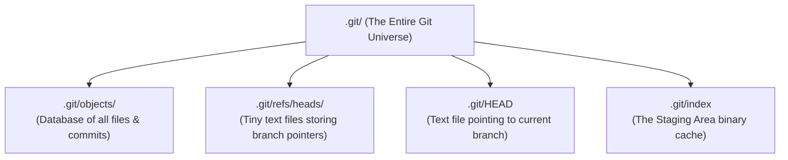
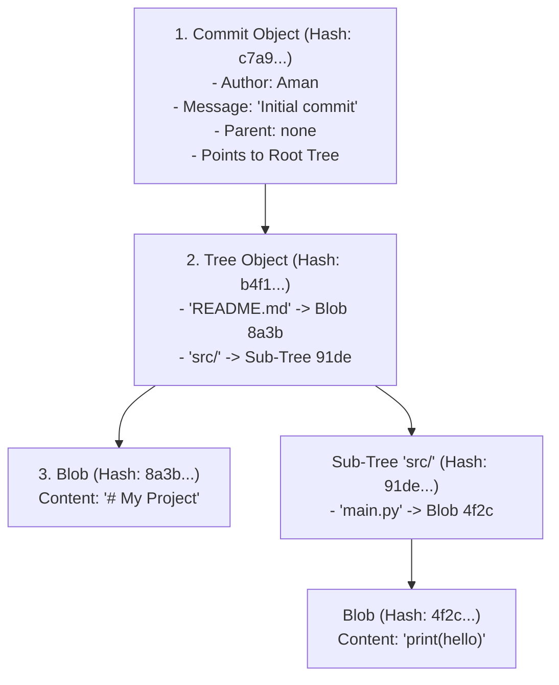
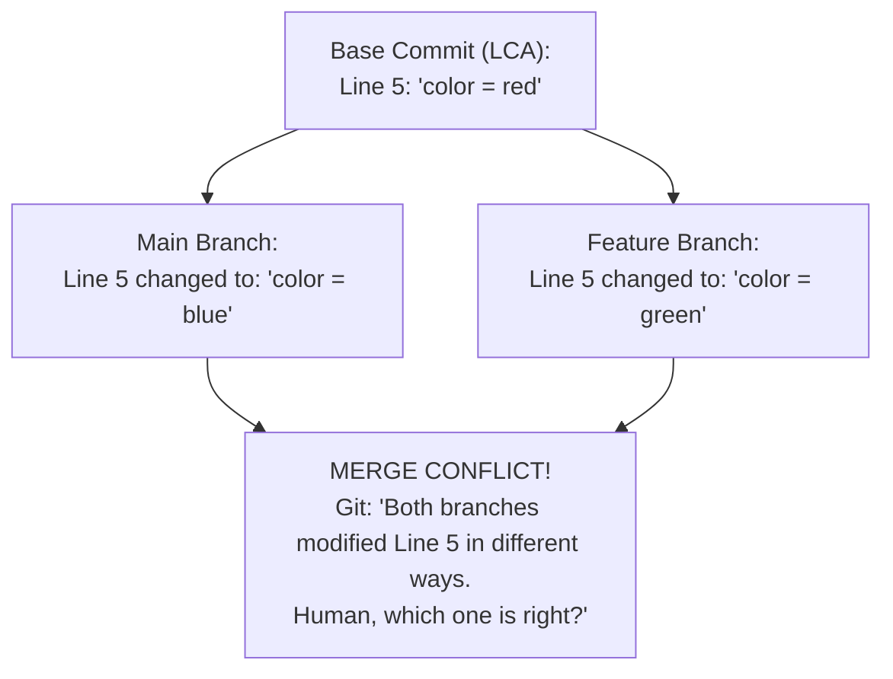
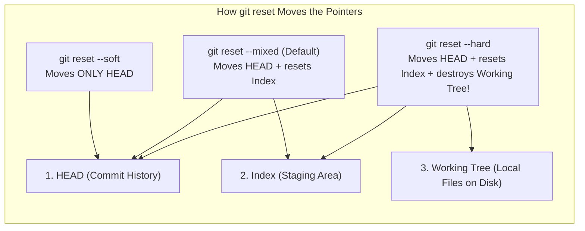

# Chapter 04: Git Under the Hood — The Content-Addressable Graph (Deep Dive)

> **Welcome to Chapter 04!**
> Most developers treat Git like black magic. They memorize four commands: `git add .`, `git commit -m "update"`, `git pull`, and `git push`. And whenever a merge conflict or detached HEAD happens, they panic and delete the folder!
> 
> In this chapter, we will open the hood of the hidden `.git` folder and look at the actual engine.
> 
> You will discover that **Git is one of the simplest and most elegant data structures ever invented: a Directed Acyclic Graph (DAG) of cryptographically hashed files.** Once you understand how Git stores objects on disk, merge conflicts, interactive rebasing, and stashing will make complete sense.

---

## 1. What is Inside the Hidden `.git` Folder?

When you type `git init` in an empty folder, Git creates a hidden directory called `.git/`.

Everything Git knows about your repository—all your branches, your entire 5-year commit history, every deleted line of code—is stored inside this single folder!



---

## 2. The 3 Core Objects in Git: Blobs, Trees & Commits

Git only has **three fundamental building blocks**:



### 1. The Blob (Binary Large Object)
* A **Blob** stores the **raw text content of a file**.
* *Important Gotcha*: **A Blob does NOT store the filename, folder path, or creation date!** It only stores the file content bytes.
* Git takes your file content, calculates its **SHA-1 / SHA-256 hash**, compresses it with `zlib`, and saves it under `.git/objects/`.

#### How Git Hashes Blobs in Python & JavaScript:
Git calculates the hash using the exact header: `blob <size>\0<content>`.

```python
# Python
import hashlib

def git_blob_hash(text: str) -> str:
    content = text.encode('utf-8')
    header = f"blob {len(content)}\0".encode('utf-8')
    return hashlib.sha1(header + content).hexdigest()

print("Python Git Hash:", git_blob_hash("hello world\n"))
# Output: 3b18e512dba79e4c8300dd08aeb99f0e73ac883c
```

```javascript
// JavaScript (Node.js)
const crypto = require('crypto');

function gitBlobHash(text) {
    const content = Buffer.from(text, 'utf-8');
    const header = Buffer.from(`blob ${content.length}\0`, 'utf-8');
    return crypto.createHash('sha1').update(Buffer.concat([header, content])).digest('hex');
}

console.log("JS Git Hash:", gitBlobHash("hello world\n"));
// Matches `echo "hello world" | git hash-object --stdin` exactly!
```

### 2. The Tree (The Directory Listing)
* A **Tree** represents a **directory/folder**.
* A Tree object maps filenames and permissions to Blob hashes or other sub-Tree hashes.

### 3. The Commit (The History Milestone)
* A **Commit** points to:
  1. The top-level **Root Tree**.
  2. Pointer to the **Parent Commit(s)**.
  3. Author name, email, and timestamp.
  4. The commit message.

---

## 3. What is a Branch? (The 41-Byte Secret)

**A Git branch is literally just a 41-byte plain text file!**

Run this command in any Git repo:
```bash
cat .git/refs/heads/main
# Output: c7a9e102f928e4a98b1a3d0498b9e18239a04f21
```
It is simply a single line holding the 40-character commit hash where the branch currently points!
* When you run `git branch new-feature`, Git simply creates a new text file `.git/refs/heads/new-feature` with that hash. It takes **0.001 milliseconds (O(1))**.

---

## 4. How Merge Conflicts Actually Work (The 3-Way Merge Base)

Why do merge conflicts happen, and how does Git know there is a conflict?

Git performs a **3-Way Merge**. It finds the **LCA (Lowest Common Ancestor)** commit where the two branches originally split:



### Reading Conflict Markers:
```text
<<<<<<< HEAD (Current branch: main)
color = blue
=======
color = green
>>>>>>> feature-branch
```
* Everything between `<<<<<<< HEAD` and `=======` is what was on your current branch.
* Everything between `=======` and `>>>>>>>` is what was on the incoming branch.
* To resolve it: Delete the markers, choose the correct code, save, and run `git add .` and `git commit`!

---

## 5. Merge vs. Rebase vs. Interactive Rebase (`git rebase -i`)

### 1. Merge (Preserves True History)
Creates a merge commit with **two parents**. Preserves exact timeline history.

### 2. Rebase (Linear History)
Replays your commits on top of `main` without creating a merge commit.

### 3. Interactive Rebase (`git rebase -i`): The Clean PR Secret
Before creating a Pull Request, senior engineers clean up their commit history using interactive rebase:

```bash
git rebase -i HEAD~4
```
An editor opens with commands:
```text
pick 8a3b2f1 Add login API
squash 9c1d4a2 Fix typo in login
squash b4e12c9 Forgot to import bcrypt
squash d1f23a0 Add tests for login
```
* **`pick`**: Keep the commit.
* **`squash` (or `s`)**: Melts the commit into the previous one!
* **Result**: Turns 4 messy, embarrassing commits into **1 clean, professional commit** before review!

---

## 6. Git Stash & Cherry-Pick

### What does `git stash` actually do?
When you want to switch branches without committing unfinished work, you run `git stash`.
Under the hood, Git creates **two hidden commits**:
1. One commit storing your staged changes.
2. One commit storing your unstaged working directory changes.
When you run `git stash pop`, Git merges those hidden commits back into your files!

### What is `git cherry-pick`?
Imagine your teammate fixed a critical bug in commit `94b1ef2` on their private branch, but you need that single fix on `main` right now without merging their whole branch:
```bash
git cherry-pick 94b1ef2
```
Git extracts the diff of that single commit and applies it cleanly as a new commit onto your current branch!

---

## 7. The `.gitignore` Gotcha: "Why is Git Still Tracking My File?"

A common problem: You add `.env` to `.gitignore`, but Git continues to track it!

### Why?
`.gitignore` **only ignores untracked files**. 
If you previously committed `.env` to Git, Git has already indexed it! Adding it to `.gitignore` does not delete it from Git's tracking index.

### The Fix:
```bash
# Untrack the file from Git index without deleting your local copy on disk!
git rm --cached .env

# Commit the removal
git commit -m "Stop tracking .env file"
```

---

## 8. Disaster Recovery: `git reflog`

If you accidentally run `git branch -D feature` or `git reset --hard HEAD~5`:
Your commits are **NOT deleted**! Git retains unreferenced commits in `.git/objects/` for at least 30 days before garbage collection (`git gc`).

Run **`git reflog`** to find the lost commit hash:
```bash
git reflog
# Finds: 91b4f2a HEAD@{1}: commit: My important work
```
Recover it instantly:
```bash
git checkout -b my-recovered-branch 91b4f2a
```

---

## 9. Production Case Studies, System Drifts & Interview Traps

### Production Case Study 1: The $30,000 AWS Secret Leak in Git History
* **The Incident**: A junior engineer accidentally committed an `.env` file containing AWS root credentials. Recognizing the mistake, they ran:
  ```bash
  rm .env
  git add .env
  git commit -m "Remove secret .env file"
  git push origin main
  ```
  Within 90 seconds, public scraping bots discovered the secret and spawned dozens of GPU instances for cryptocurrency mining, racking up a $30,000 AWS bill overnight.
* **Why the "Removal" Failed**: Git is an append-only directed acyclic graph (DAG). The second commit simply created a new Tree that didn't list `.env`. **The original commit and its underlying Blob object containing the secret still existed in Git history!** Anyone running `git log` or viewing past commits on GitHub could view the credentials with one click.
* **The Fix**:
  1. Immediately rotate the leaked credentials in AWS IAM.
  2. Rewrite repository history using `git-filter-repo` (or BFG Repo-Cleaner) to purge the blob hash from all commits:
     ```bash
     git filter-repo --invert-paths --path .env
     git push origin --force --all
     ```

### Production Case Study 2: The Staging Branch Overwrite (`git push --force`)
* **The Incident**: An engineer rebasing their feature branch locally typed `git push --force origin staging` instead of their feature branch. Three weeks of merged pull requests from 12 engineers vanished from the staging environment, breaking active QA testing.
* **The Root Cause**: `git push --force` tells the remote server: *"Set your branch pointer to my exact commit, no matter what."* Any commits on remote that weren't in the local engineer's tree were instantly orphaned.
* **The Guardrails**:
  1. **Branch Protection Rules**: Enable branch protection on `main`, `master`, and `staging` in GitHub/GitLab to block force-pushes entirely.
  2. **`--force-with-lease`**: If force-pushing a personal branch, always use `git push --force-with-lease`. This checks if anyone else has pushed commits to the remote branch since your last fetch; if so, it aborts the push!

### Production System Drifts to Watch:
1. **The Detached HEAD Drift**:
   Running `git checkout <commit_hash>` puts Git in **Detached HEAD** mode—HEAD points directly to a commit, not a named branch pointer. If you write code, stage files, and make 5 commits in this state, and then run `git checkout main`, your 5 new commits are detached! They won't appear on any branch and will be purged by `git gc` after 30 days unless rescued via `git reflog`.
2. **Submodule SHA Desynchronization Drift**:
   Git submodules do not track a branch; they track a **specific commit SHA**. If teammate A updates the submodule and pushes code, but forgets to push the commit inside the submodule repository, teammate B's CI/CD build crashes with `fatal: reference is not a tree`.

### FAANG Interview Scenarios & Traps:



#### Scenario 1: "What is the difference between `git merge` and `git rebase`?"
* **Answer**:
  * **Merge**: Preserves complete historical context by creating a new **Merge Commit** with two parents ($P_1$ and $P_2$). It is non-destructive and safe for shared team branches.
  * **Rebase**: Takes the commits from your branch, finds the common ancestor, and **replays each commit on top of the target branch**, assigning brand-new SHA commit hashes. It creates a clean linear history without merge bubbles, but rewrites history!

#### Scenario 2: "What is the 3-Way Merge Base, and when does a Merge Conflict happen?"
* **Answer**: A 3-way merge compares three states: the **Common Ancestor (LCA)**, your **Local Branch (HEAD)**, and the **Incoming Branch (MERGE_HEAD)**.
  * If file line 10 was changed by local, but untouched by incoming relative to LCA $\to$ Git auto-merges local's change.
  * If file line 10 was changed by incoming, but untouched by local relative to LCA $\to$ Git auto-merges incoming's change.
  * **Merge Conflict**: Only occurs when **BOTH branches modified the exact same lines differently** compared to the LCA! Git cannot guess which human's intention is correct, so it halts and asks the developer.

#### Scenario 3: "What does `git cherry-pick` do under the hood?"
* **Answer**: It calculates the **diff** between the target commit and its immediate parent, and attempts to apply that exact diff as a brand new commit on top of the current `HEAD`.

#### Scenario 4: "What is the exact difference between `git reset --soft`, `--mixed`, and `--hard`?"
* **Answer**: Git tracks three areas: `HEAD`, `Index (Staging)`, and `Working Tree (Disk)`.
  * **`--soft HEAD~1`**: Moves the branch pointer back 1 commit. Leaves the **Index and Working Tree untouched**. Your changes remain staged, ready to commit.
  * **`--mixed HEAD~1` (Default)**: Moves `HEAD` back 1 commit and **resets the Index**. Your changes remain on disk in your working tree as unstaged modifications.
  * **`--hard HEAD~1`**: Moves `HEAD`, resets the Index, and **overwrites your local files on disk** to match the target commit! Any uncommitted local work is permanently destroyed.

#### Scenario 5: "What is an Annotated Tag vs. a Lightweight Tag in Git?"
* **Answer**:
  * **Lightweight Tag (`git tag v1.0`)**: A plain text pointer file stored in `.git/refs/tags/v1.0` that contains only a 40-character commit SHA (identical to a branch pointer, except it never moves).
  * **Annotated Tag (`git tag -a v1.0 -m "Release"`)**: Creates a full **Tag Object** in `.git/objects/`. It stores its own SHA hash, tagger name, email, timestamp, GPG signature, and release message, pointing to the commit. Used for official production releases.

#### Scenario 6: "What is the Git Index (Staging Area), and why is it stored as a single binary file `.git/index`?"
* **Answer**: The Index is not a directory; it is a compact binary cache listing every file in the project, its file permissions, its modification timestamp, and its corresponding SHA-1 Blob hash.
  * When you run `git status`, Git does not scan all commit trees; it compares disk file timestamps against the binary `.git/index` in milliseconds, making status lookups instantaneous even in repositories with 100,000 files!

#### Scenario 7: "What is a Fast-Forward Merge vs. a Non-Fast-Forward (`--no-ff`) Merge?"
* **Answer**:
  * **Fast-Forward Merge**: If `main` has had no new commits since you branched `feature`, Git simply moves the `main` pointer forward to point to the latest commit on `feature`. Zero merge commits are created.
  * **Non-Fast-Forward (`git merge --no-ff feature`)**: Forces Git to create a dedicated **Merge Commit** even if a fast-forward was possible. This preserves the historical record that a distinct feature branch existed and was merged at that point in time.

#### Scenario 8: "Why does Git use Content-Addressable Hashes instead of filenames to store objects?"
* **Answer**:
  * In Git, a file's name and directory location are completely separated from its contents.
  * If you rename `app.py` to `server.py`, or copy a 50 MB image into 10 different folders, Git hashes the bytes once.
  * Because the content produces the exact same SHA hash, **Git stores only ONE physical Blob on disk**, referencing it 10 times in directory Tree objects. This deduplication saves gigabytes of repository storage.

#### Scenario 9: "What does `git stash` do behind the scenes in the DAG?"
* **Answer**: `git stash` creates **two (or three) distinct commits** that are not attached to any named branch:
  1. A commit storing your staged changes (Index).
  2. A commit storing your unstaged working tree changes (pointing to the current HEAD and the staged commit).
  * The stash reference (`refs/stash`) points to this commit pair. Running `git stash pop` merges those commit diffs back into your working tree.

#### Scenario 10: "Why is `git pull --rebase` preferred over standard `git pull` in collaborative teams?"
* **Answer**:
  * Standard `git pull` runs `git fetch + git merge origin/branch`. Every time a teammate pushes code before you, pulling creates an ugly **"Merge branch 'main' of github.com"** merge bubble commit in history.
  * `git pull --rebase` runs `git fetch + git rebase origin/branch`. It temporarily lifts your local unpushed commits, advances your branch to match the remote, and replays your commits linearly on top. The result is a clean, linear commit history without redundant merge noise.

---

## Chapter 04 Checklist (Summary)

Before concluding Part 0, verify that you can answer these:
- [x] What are the 3 core Git objects (Blob, Tree, Commit), and how does Git deduplicate files?
- [x] How does a 3-Way Merge find the Lowest Common Ancestor (LCA)?
- [x] How do you squash 5 messy commits into 1 clean commit using `git rebase -i`?
- [x] How does `git cherry-pick` copy a single commit across branches?
- [x] Why doesn't `.gitignore` work on already-tracked files, and how does `git rm --cached` fix it?
- [x] How does `git reflog` recover deleted branches?

*Chapter 04 is complete! Proceed to [Chapter 05: Complexity Analysis & Theoretical Foundations](./google_sde_study_plan.md).*
