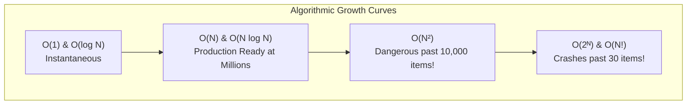
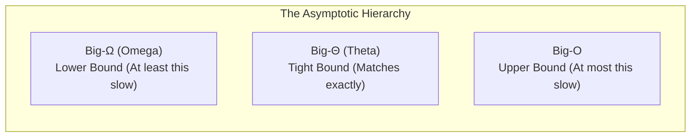
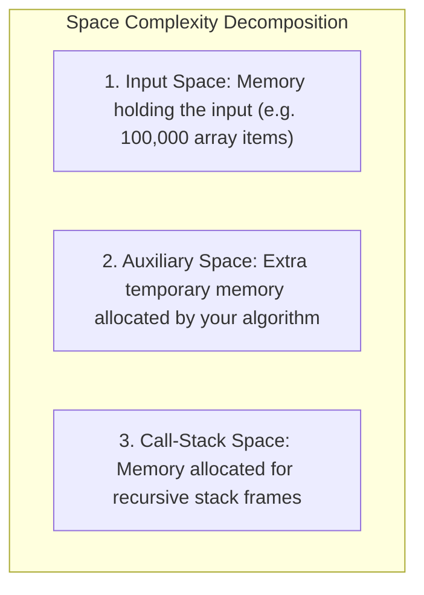
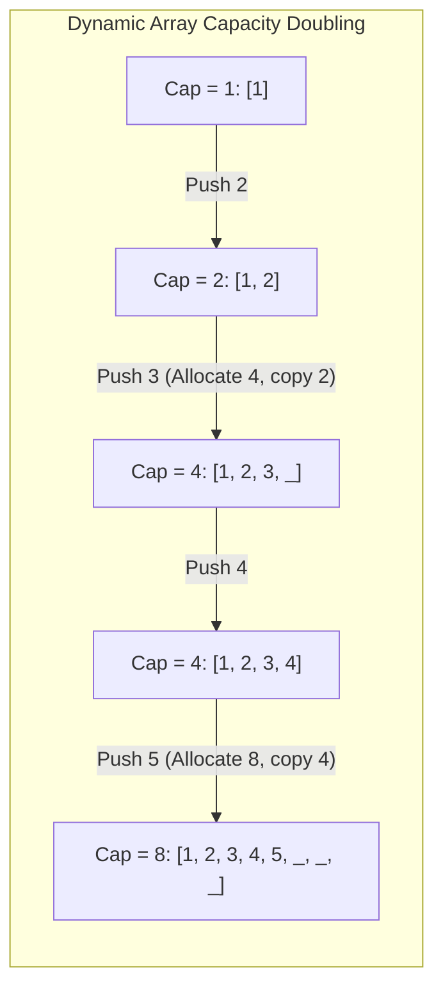
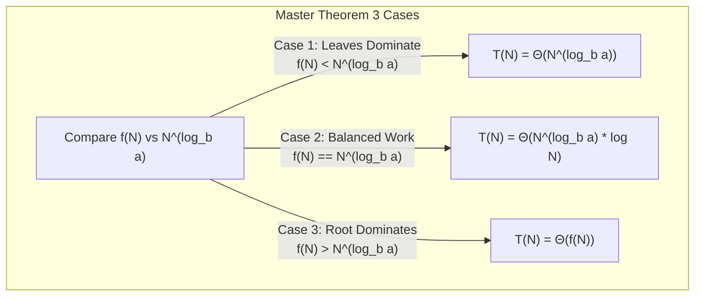
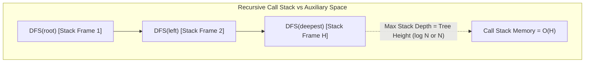

# Chapter 05: Complexity Analysis & Theoretical Foundations (Deep Dive)

> **Welcome to Chapter 05 of the Google SDE Track!**
> Many software engineers think Big-O notation is just an academic test asked in college exams.
> 
> In reality, **Big-O is the language of production scalability**. 
> An algorithm that runs in $O(N^2)$ might take **0.001 milliseconds** on your laptop with 10 test items, but when deployed to production with 1,000,000 active users, it will take **11.5 DAYS** of pure CPU calculation, completely freezing your cloud cluster!
> 
> In this chapter, we will master Big-O, Big-$\Omega$, Big-$\Theta$, Master Theorem, Amortized Analysis (Aggregate, Accounting, and Potential methods), and Cache-Aware complexity from absolute first principles with code in both Python and JavaScript.

---

## 1. Why Complexity Analysis Matters: The Production Scale Reality

Let's look at how CPU operations scale when input $N$ increases from 10 to 1,000,000 items (assuming a modern CPU executing $10^8$ operations per second):

| Complexity | Name | $N = 10$ | $N = 100$ | $N = 1,000$ | $N = 100,000$ | $N = 1,000,000$ |
|---|---|---|---|---|---|---|
| **$O(1)$** | Constant | 1 op (~10 ns) | 1 op (~10 ns) | 1 op (~10 ns) | 1 op (~10 ns) | **1 op (~10 ns)** |
| **$O(\log N)$** | Logarithmic | ~3 ops | ~7 ops | ~10 ops | ~17 ops | **~20 ops (0.0002 ms)** |
| **$O(N)$** | Linear | 10 ops | 100 ops | 1,000 ops | 100,000 ops | **1,000,000 ops (10 ms)** |
| **$O(N \log N)$** | Linearithmic | 33 ops | 664 ops | 9,965 ops | 1,660,000 ops | **20,000,000 ops (0.2 s)** |
| **$O(N^2)$** | Quadratic | 100 ops | 10,000 ops | 1,000,000 ops | 10,000,000,000 ops | **$10^{12}$ ops (~2.8 HOURS!)** |
| **$O(2^N)$** | Exponential | 1,024 ops | $1.2 \times 10^{30}$ ops | *Heat death of universe* | *Impossible* | *Impossible* |



---

## 2. Asymptotic Notations Demystified: $O$, $\Omega$, $\Theta$, $o$, $\omega$

Interviewers at Google frequently test if you understand the mathematical difference between Big-O, Big-$\Omega$, and Big-$\Theta$:



### 1. Big-O ($O$): The Upper Bound (Worst-Case Ceiling)
* **Meaning**: *"My code will never be slower than this function for large $N$."*
* **Mathematical Definition**: $f(N) = O(g(N))$ if there exist positive constants $c > 0$ and $N_0 \ge 0$ such that:
  $$f(N) \le c \cdot g(N) \quad \text{for all } N \ge N_0$$
* **Example**: If an algorithm takes $3N^2 + 5N + 12$ operations, as $N \to \infty$, $N^2$ dominates. We say it is $O(N^2)$. It is also technically $O(N^3)$ (since $N^3$ is also an upper ceiling), though we always look for the tightest upper bound.

### 2. Big-$\Omega$ (Omega): The Lower Bound (Best-Case Floor)
* **Meaning**: *"My code will take AT LEAST this many steps."*
* **Definition**: $f(N) = \Omega(g(N))$ if there exist $c > 0$ and $N_0 \ge 0$ such that:
  $$f(N) \ge c \cdot g(N) \quad \text{for all } N \ge N_0$$
* **Example**: Searching an unsorted array of size $N$ has a best-case lower bound of $\Omega(1)$ (if the target happens to be the very first element).

### 3. Big-$\Theta$ (Theta): The Tight Bound (The Gold Standard)
* **Meaning**: *"My code is both an upper bound and a lower bound; it behaves EXACTLY like this function."*
* **Definition**: $f(N) = \Theta(g(N))$ if and only if $f(N) = O(g(N))$ **AND** $f(N) = \Omega(g(N))$.
* **Example**: Merge Sort always takes $c_1 \cdot N \log N$ in the best case and $c_2 \cdot N \log N$ in the worst case. Therefore, Merge Sort's time complexity is strictly $\mathbf{\Theta(N \log N)}$.

### 4. Little-o ($o$) vs. Little-$\omega$ ($\omega$)
* **Little-o ($o$)**: Strict upper bound. $f(N) = o(g(N))$ means $f(N)$ grows **strictly slower** than $g(N)$ ($\lim_{N \to \infty} \frac{f(N)}{g(N)} = 0$). For example, $2N = o(N^2)$, but $2N^2 \ne o(N^2)$.
* **Little-$\omega$ ($\omega$)**: Strict lower bound ($\lim_{N \to \infty} \frac{f(N)}{g(N)} = \infty$).

---

## 3. Space Complexity: Auxiliary Space vs. Call-Stack Space

Beginners frequently confuse **Total Space** with **Auxiliary Space**:

$$\text{Total Space Complexity} = \text{Input Space} + \text{Auxiliary Space} + \text{Call-Stack Space}$$



* **Auxiliary Space**: Extra memory allocated by the algorithm itself (e.g., temporary hash tables, cloned arrays).
* **Call-Stack Space**: Every recursive function call pushes a new frame onto the OS call stack.
  * In-order DFS traversal on a balanced binary tree: Auxiliary space is $O(1)$, but Call-Stack space is **$O(\log N)$** (tree height).
  * In the worst-case skewed tree: Call-Stack space degrades to **$O(N)$**, risking a **Stack Overflow**!

---

## 4. Amortized Analysis Deep Dive: Why `array.push()` is $O(1)$

When you append an element to a dynamic array (Python `list.append()`, JS `array.push()`, or C++ `std::vector`), how can it be $O(1)$ if the array occasionally has to double its size and copy all elements?



To analyze operations that are very cheap most of the time but occasionally very expensive, we use **Amortized Analysis**. There are 3 formal methods:

### 1. The Aggregate Method
Compute the total cost of a sequence of $N$ operations and divide by $N$:
* Suppose we start with an array of capacity 1 and insert $N$ items.
* Doubling occurs at insertions: $1, 2, 4, 8, 16, \dots, 2^k$.
* Total copying cost:
  $$\text{Total Copies} = 1 + 2 + 4 + 8 + \dots + \frac{N}{2} = \sum_{i=0}^{\log_2 N - 1} 2^i = N - 1$$
* Total insertion cost for $N$ appends:
  $$\text{Total Cost} = \text{Raw Inserts } (N) + \text{Copies } (N - 1) = 2N - 1$$
* Amortized cost per operation:
  $$\text{Amortized Cost} = \frac{2N - 1}{N} \approx 2 = \mathbf{O(1)}$$

### 2. The Accounting (Banker's) Method
Assign an artificial "charge" (amortized cost) to each operation:
* Charge **\$3** for every regular append operation:
  * **\$1** pays for the immediate write into the empty slot.
  * **\$1** is stored as "credit" on the newly added element.
  * **\$1** is stored as "credit" on an older element that already used up its credit.
* When the array becomes full, **every single element has \$1 of credit saved in the bank**!
* When capacity must double, copying $N$ elements is paid for 100% by the saved bank credit! The bank balance never drops below zero. Thus, the amortized cost per append is constant **$O(1)$** (\$3).

### 3. The Potential (Physicist's) Method
Define a potential function $\Phi(D)$ representing the "stored energy" of data structure state $D$:
$$\text{Amortized Cost } a_i = c_i + \Phi(D_i) - \Phi(D_{i-1})$$
* Let $\Phi(D) = 2 \times \text{Size} - \text{Capacity}$.
* Immediately after doubling, $\text{Capacity} = 2 \times \text{Size}$, so $\Phi = 0$ (energy discharged).
* Just before doubling, $\text{Size} = \text{Capacity}$, so $\Phi = \text{Size}$ (maximum energy stored).
* When doubling happens: actual cost $c_i = \text{Size} + 1$, but $\Delta \Phi = -\text{Size} + 2$.
* $a_i = (\text{Size} + 1) + (-\text{Size} + 2) = 3 = \mathbf{O(1)}$.

---

## 5. The Master Theorem for Divide-and-Conquer Recurrences

When analyzing recursive divide-and-conquer algorithms, recurrences typically take the form:

$$T(N) = a \cdot T\left(\frac{N}{b}\right) + f(N)$$

Where:
* $a \ge 1$: Number of recursive subproblems.
* $b > 1$: Factor by which subproblem size is divided.
* $f(N) = O(N^d)$: Time spent dividing the problem and combining the subproblem results.



### The 3 Master Theorem Cases:

1. **Case 1 (Work dominated by subproblem leaves)**:
   If $f(N) = O(N^c)$ where $c < \log_b a$:
   $$T(N) = \mathbf{\Theta\left(N^{\log_b a}\right)}$$
   * *Example*: Strassen's Matrix Multiplication ($a=7, b=2, f(N)=O(N^2)$). Here $\log_2 7 \approx 2.81 > 2$. $T(N) = \Theta(N^{2.81})$.

2. **Case 2 (Work evenly split across all tree levels)**:
   If $f(N) = \Theta\left(N^{\log_b a} \log^k N\right)$ where $k \ge 0$:
   $$T(N) = \mathbf{\Theta\left(N^{\log_b a} \log^{k+1} N\right)}$$
   * *Example (Merge Sort)*: $a=2, b=2, f(N)=O(N)$. Here $\log_2 2 = 1$. Since $c = 1$ and $k = 0$:
     $$T(N) = \mathbf{\Theta(N \log N)}$$
   * *Example (Binary Search)*: $a=1, b=2, f(N)=O(1)$. Here $\log_2 1 = 0$. Since $c = 0, k = 0$:
     $$T(N) = \mathbf{\Theta(\log N)}$$

3. **Case 3 (Work dominated by root divide/combine step)**:
   If $f(N) = \Omega(N^c)$ where $c > \log_b a$ and regularity condition $a \cdot f(N/b) \le k \cdot f(N)$ holds for $k < 1$:
   $$T(N) = \mathbf{\Theta(f(N))}$$

---

## 6. Cache-Aware Complexity & The External Memory Model

In modern systems architecture, counting pure CPU instructions is only half the battle. **Memory hierarchy latency dominates performance**:
* L1 Cache access: ~1 ns ($O(1)$)
* Main RAM access: ~100 ns ($100\times$ slower)
* NVMe SSD access: ~10,000 ns ($10,000\times$ slower)

### The External Memory (I/O) Model:
* Let $M$ be the size of fast internal memory (RAM/Cache).
* Let $B$ be the block size (Cache Line = 64 bytes; Disk Block = 4 KB).
* **Scanning an array of size $N$**: Takes $O(N)$ CPU operations, but only $\mathbf{O(N / B)}$ I/O operations.
* **Binary Search on disk**: Takes $O(\log_2 N)$ CPU operations, which incurs $\mathbf{O(\log_2(N/B))}$ disk block reads.
* **B-Tree Search on disk**: By setting node size equal to disk block $B$, node fanout is $B$. Depth drops to:
  $$\text{I/O Complexity} = \mathbf{O(\log_B N)}$$
  For $N = 1,000,000,000$ and $B = 1000$, search takes just **3 disk block reads** instead of 30!

---

## 7. Hands-on Code: Measuring Amortized Append in Python & JS

### 1. Python Measurement Script:
```python
import sys
import time

# Demonstrate dynamic array reallocation in CPython
arr = []
prev_capacity = 0

print("Length | Bytes in RAM | Capacity Doubling Jump")
print("-" * 45)

for i in range(25):
    size_bytes = sys.getsizeof(arr)
    # Estimate capacity from bytes (CPython list over-allocation formula)
    if size_bytes != prev_capacity:
        print(f"{len(arr):<6} | {size_bytes:<12} | Reallocation triggered!")
        prev_capacity = size_bytes
    arr.append(i)
```

### 2. JavaScript Measurement Script:
```javascript
// Measure performance of pre-allocated array vs dynamic push in Node.js
const N = 10_000_000;

// Method 1: Dynamic growth (Repeated capacity doubling)
console.time("Dynamic push()");
const dynamicArr = [];
for (let i = 0; i < N; i++) {
    dynamicArr.push(i);
}
console.timeEnd("Dynamic push()");

// Method 2: Pre-allocated capacity (Zero reallocations)
console.time("Pre-allocated Array(N)");
const preAllocArr = new Array(N);
for (let i = 0; i < N; i++) {
    preAllocArr[i] = i;
}
console.timeEnd("Pre-allocated Array(N)");
// Result: Pre-allocated array is 2x to 3x faster because it avoids reallocation and memory copies!
```

---

## 8. Production Case Studies & System Drifts

### Production Case Study 1: The Cloudflare $O(N^2)$ ReDoS Global Outage (2019)
* **The Incident**: On July 2, 2019, Cloudflare suffered a global outage that dropped 52% of all HTTP traffic worldwide for 27 minutes.
* **Root Cause**: An engineer deployed a regular expression rule to block XSS attacks containing:
  `.*.*=.*`
  Due to catastrophic backtracking in non-deterministic finite automaton (NFA) regex engines, input containing non-matching characters triggered **$O(2^N)$ and $O(N^2)$ combinatorial evaluation states**. CPU cores across all edge proxy servers hit 100% utilization, dropping client TCP connections globally.
* **The Fix**: Transitioned to linear-time deterministic finite automaton (DFA) engines (Google's `re2`), which strictly guarantee **$O(N)$ matching time**.

### Production Case Study 2: The Array Resizing Latency Spike in High-Frequency Trading
* **The Incident**: A financial trading engine occasionally breached its 50-microsecond SLA, causing orders to execute late with financial slippage.
* **Root Cause**: The order book used dynamic array appends. While 99.9% of appends were $O(1)$ (taking 15 nanoseconds), the 10,000th append triggered a capacity resize from 8,192 to 16,384 elements. Copying 8,192 pointers to new memory stalled the thread for **120 microseconds** (P99 latency spike).
* **The Fix**: Pre-allocate ring buffers with fixed upper-bound capacity at system startup (`std::vector::reserve()` / circular arrays), ensuring **zero dynamic reallocations** in the critical path.

---

## 9. 12 FAANG & Google Interview Scenarios & Traps



#### Scenario 1: "What is the difference between Big-O and Big-Theta? When is it incorrect to say QuickSort is $O(N \log N)$?"
* **Answer**:
  * **Big-O** is an upper bound ceiling. Saying QuickSort is $O(N^2)$ is mathematically true because its worst-case never exceeds $N^2$.
  * **Big-Theta ($\Theta$)** is a tight bound (both upper and lower).
  * Saying QuickSort is $\Theta(N \log N)$ is **strictly false** because in the worst-case (already sorted array with naive pivot), QuickSort degrades to $\Theta(N^2)$! QuickSort's average case is $\Theta(N \log N)$, but its worst-case upper bound is $O(N^2)$.

#### Scenario 2: "Can an algorithm have an $O(1)$ space complexity if it creates a new output array of size $N$?"
* **Answer**:
  * If the problem asks for **Auxiliary Space Complexity**: **YES** (if the output array is strictly the requested return value and the algorithm uses only a few loop variables).
  * If the problem asks for **Total Space Complexity**: **NO** (it is $O(N)$ because the returned data structure occupies $N$ slots in memory).
  * *Interview Tip*: Always explicitly clarify with the interviewer: *"Are you asking for auxiliary space excluding the returned output, or total space?"*

#### Scenario 3: "Why does multiplying array capacity by $2.0$ achieve $O(1)$ amortized append, while incrementing capacity by $+100$ fails?"
* **Answer**:
  * **Multiplicative Expansion ($\times 2$)**: The number of reallocations over $N$ items is $\log_2 N$. Total copy work is $\sum 2^i \approx 2N$. Divided by $N$, amortized cost is $O(1)$.
  * **Additive Expansion ($+K$, e.g. $+100$)**: To insert $N$ items, the array must resize $\frac{N}{K}$ times. Total copying work is:
    $$\text{Work} = K + 2K + 3K + \dots + \left(\frac{N}{K}\right)K = K \cdot \frac{(N/K)^2}{2} = \mathbf{O(N^2)}$$
    Divided by $N$, each append costs **$O(N)$ amortized time**—a catastrophic performance disaster!

#### Scenario 4: "Why does Java's `ArrayList` grow by $1.5\times$ and Python by $\sim 1.125\times$ instead of $2.0\times$?"
* **Answer**: In memory allocators, doubling capacity ($\times 2.0$) guarantees that the newly requested memory chunk is **always strictly larger than the sum of all previously freed chunks**! The allocator can never reuse the memory address space it just vacated. Growing by $1.5\times$ allows future allocations to reuse previously freed contiguous memory slots, minimizing heap fragmentation.

#### Scenario 5: "What is the Time and Space complexity of recursive Fibonacci without memoization?"
* **Answer**:
  * Recurrence: $T(N) = T(N-1) + T(N-2) + O(1)$.
  * **Time Complexity**: The recursion forms a binary tree of height $N$. Total nodes $\approx 2^N$. Exact complexity is $\mathbf{\Theta(\phi^N)}$ where $\phi = \frac{1 + \sqrt{5}}{2} \approx 1.618$ (The Golden Ratio).
  * **Space Complexity**: Only **$O(N)$**! The CPU does not execute all branches simultaneously; it traverses depth-first. At any point, the call stack contains at most $N$ active stack frames.

#### Scenario 6: "Solve the recurrence $T(N) = 2T(N/2) + N \log N$ using Master Theorem."
* **Answer**:
  * Here $a = 2, b = 2, f(N) = N \log N$.
  * Check $\log_b a = \log_2 2 = 1$, so $N^{\log_b a} = N^1$.
  * Notice that $f(N) = N \log N = N^1 \log^1 N$.
  * This matches **Case 2 of the Extended Master Theorem** ($f(N) = \Theta(N^{\log_b a} \log^k N)$ with $k = 1$).
  * The solution is:
    $$T(N) = \mathbf{\Theta(N \log^{k+1} N) = \Theta(N \log^2 N)}$$

#### Scenario 7: "What is the difference between Amortized Complexity and Average-Case Complexity?"
* **Answer**:
  * **Average-Case**: Depends on **probabilistic input distributions** (e.g. QuickSort is $O(N \log N)$ on average assuming random inputs; but an adversarial input can force $O(N^2)$).
  * **Amortized**: A **guaranteed mathematical ceiling** over any arbitrary sequence of operations, with **zero probability or randomness assumed**! Even if an adversary designs the worst possible inputs, $N$ sequential appends to a dynamic array will NEVER exceed $O(N)$ total operations.

#### Scenario 8: "Why is Binary Search $O(\log N)$ on an Array, but $O(N)$ on a Singly Linked List?"
* **Answer**:
  * Binary search requires jumping to the midpoint in $O(1)$ time: `mid = (low + high) // 2`.
  * An array supports $O(1)$ random indexing via pointer math: $\text{Base} + (\text{mid} \times 4)$.
  * A linked list does not support pointer arithmetic; reaching the midpoint requires traversing $\frac{N}{2}$ sequential pointers in $O(N)$ time.
  * Recurrence on linked list: $T(N) = T(N/2) + O(N) = \mathbf{O(N)}$.

#### Scenario 9: "What is Space-Time Tradeoff, and can you provide two production examples?"
* **Answer**:
  * Trading increased memory consumption to drastically reduce CPU execution time (or vice versa).
  * *Example 1*: **Hash Maps vs. Linear Search**: Storing an auxiliary hash table takes $O(N)$ RAM, but slashes lookup time from $O(N)$ to $O(1)$.
  * *Example 2*: **Dynamic Programming (Memoization)**: Storing Fibonacci results in an array takes $O(N)$ space, but reduces runtime from $O(2^N)$ to $O(N)$.

#### Scenario 10: "What is the Time Complexity of checking if two Strings are Anagrams?"
* **Answer**:
  * **Sorting Approach**: Sort both strings and compare: $O(N \log N)$ time, $O(1)$ or $O(N)$ space.
  * **Frequency Array Approach**: Use a fixed-size integer array of length 26 (for lowercase English) or 256 (ASCII) to count character frequencies:
    * Time: $O(N)$ to increment and decrement counts.
    * Space: $O(1)$! The frequency array size is constant ($26$ or $256$), which does NOT scale with $N$.

#### Scenario 11: "What is the Master Theorem breakdown of Binary Search vs. Merge Sort?"
* **Answer**:
  * **Binary Search**: $T(N) = 1 \cdot T(N/2) + O(1)$. Here $a=1, b=2, c=0$. $\log_2 1 = 0 = c$. Case 2 applies with $k=0 \to \mathbf{\Theta(\log N)}$.
  * **Merge Sort**: $T(N) = 2 \cdot T(N/2) + O(N)$. Here $a=2, b=2, c=1$. $\log_2 2 = 1 = c$. Case 2 applies with $k=0 \to \mathbf{\Theta(N \log N)}$.

#### Scenario 12: "Why do comparison-based sorting algorithms have a theoretical lower bound of $\Omega(N \log N)$?"
* **Answer**:
  * An array of $N$ distinct items has $N!$ (factorial) possible permutations.
  * Any comparison sort can be modeled as a **Binary Decision Tree**, where each comparison (`A[i] < A[j]`) branches left or right.
  * To distinguish between all $N!$ permutations, the decision tree must have at least $N!$ leaf nodes.
  * The height $H$ of a binary tree with $L$ leaves is at least $\log_2(L)$:
    $$H \ge \log_2(N!)$$
  * By Stirling's Approximation ($\ln(N!) \approx N \ln N - N$):
    $$H \ge \Omega(N \log N)$$
  * Therefore, **no comparison-based sort (Merge Sort, QuickSort, HeapSort) can ever beat $\Omega(N \log N)$ in the worst case**. Non-comparison sorts (Counting Sort, Radix Sort) bypass this bound by using direct array indexing rather than pairwise comparisons!

---

## Chapter 05 Checklist (Summary)

Before moving to Chapter 06, verify that you can answer these:
- [x] What is the strict mathematical difference between Big-O, Big-$\Omega$, and Big-$\Theta$?
- [x] What is Auxiliary Space vs. Call-Stack Space in recursive tree traversals?
- [x] How do the Aggregate, Accounting, and Potential methods prove that dynamic array append is $O(1)$ amortized?
- [x] How do you apply the 3 cases of Master Theorem to recurrences like $T(N) = 2T(N/2) + O(N)$?
- [x] Why does additive capacity growth ($+100$) lead to $O(N^2)$ quadratic disaster?
- [x] Why is comparison-based sorting mathematically bounded by $\Omega(N \log N)$?

*Chapter 05 is complete! Proceed to [Chapter 06: Bit Manipulation, Number Theory & Discrete Math](./chapter_06.md).*
