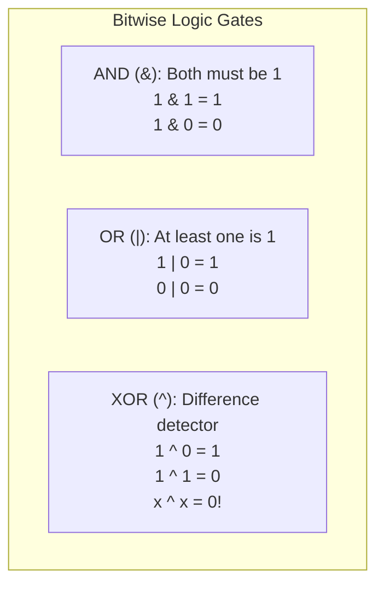
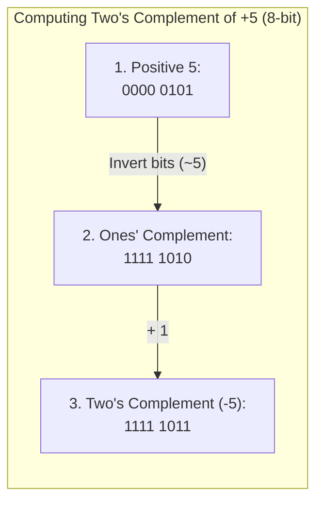
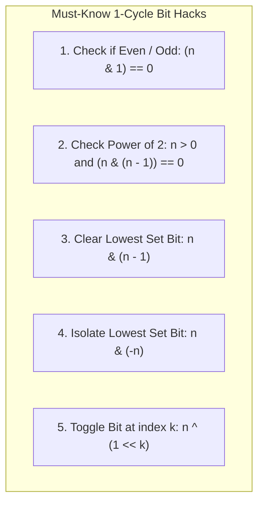
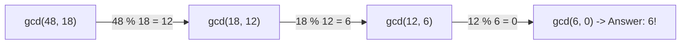
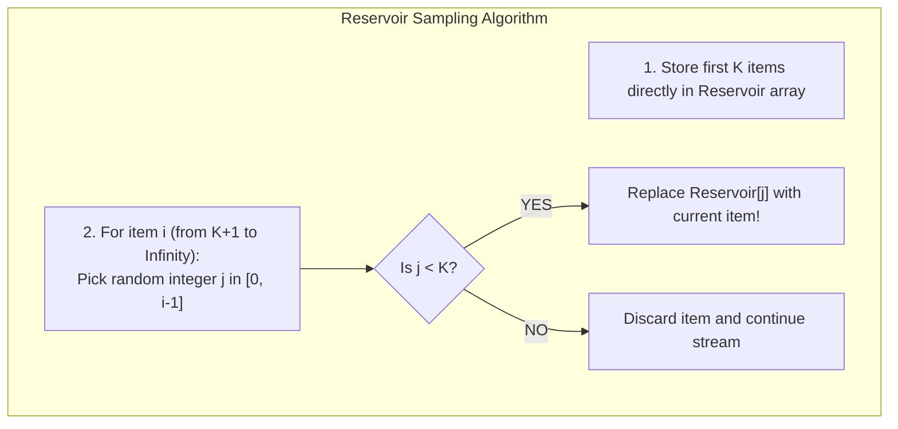
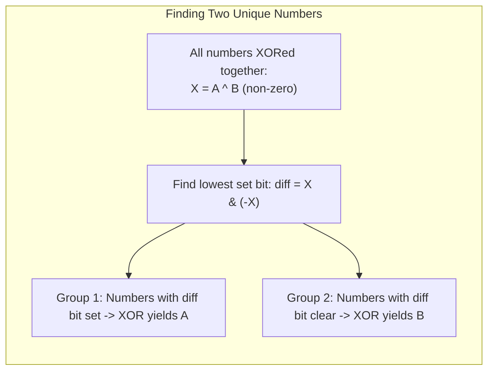

# Chapter 06: Bit Manipulation, Number Theory & Discrete Math (Deep Dive)

> **Welcome to Chapter 06 of the Google SDE Track!**
> At Google, Meta, and top algorithmic labs, interviewers love Bit Manipulation and Number Theory because **it tests whether you understand how hardware actually computes numbers at the register level**.
> 
> High-level code hides binary bits behind variable names, but at scale:
> * A bitmask can compress a 32-element boolean state into a single **4-byte integer**.
> * Bitwise tricks like `n & (n - 1)` execute in a **single CPU clock cycle (0.3 ns)**, running $50\times$ faster than loops.
> * Modular arithmetic and Fermat's Little Theorem power modern **cryptography, hashing, and distributed sharding**.
> 
> In this chapter, we will master bitwise operators, Two's Complement, bitmasks, Euclidean GCD, Fast Modular Exponentiation, and Reservoir Sampling with runnable code in both Python and JavaScript.

---

## 1. Bitwise Primitives: How the CPU Thinks

At the hardware level, the CPU operates on electrical voltage highs (1) and lows (0). There are 6 fundamental bitwise operators:

| Operator | Name | Syntax | Behavior | Example (`A = 5 (0101_2), B = 3 (0011_2)`) |
|---|---|---|---|---|
| **AND** | `&` | `A & B` | 1 if **both** bits are 1 | `0101 & 0011 = 0001` (1) |
| **OR** | `\|` | `A \| B` | 1 if **either** bit is 1 | `0101 \| 0011 = 0111` (7) |
| **XOR** | `^` | `A ^ B` | 1 if bits are **different**; 0 if same | `0101 ^ 0011 = 0110` (6) |
| **NOT** | `~` | `~A` | Inverts all bits (0 $\to$ 1, 1 $\to$ 0) | `~0101 = ...1010` (-6 in Two's Complement) |
| **Left Shift** | `<<` | `A << k` | Shifts bits left by $k$, fills with 0 | `5 << 1 = 1010_2` (10, equivalent to $A \times 2^k$) |
| **Right Shift** | `>>` | `A >> k` | Shifts bits right by $k$ (preserves sign) | `5 >> 1 = 0010_2` (2, equivalent to $\lfloor A / 2^k \rfloor$) |



### The Superpowers of XOR (`^`):
XOR has three mathematical properties that solve dozens of FAANG interview problems:
1. **Self-Inverse**: $x \oplus x = 0$ (Any number XORed with itself cancels out to zero).
2. **Identity Element**: $x \oplus 0 = x$.
3. **Commutative & Associative**: Order does not matter ($A \oplus B \oplus A = (A \oplus A) \oplus B = 0 \oplus B = B$).

---

## 2. Two's Complement & The Negative Number Secret

How does a CPU store negative numbers like `-5` using only 1s and 0s?
Modern hardware uses **Two's Complement**.



### The Golden Rule of Two's Complement:
$$-x = \sim x + 1$$

### Why Two's Complement is Brilliant:
The CPU hardware doesn't need a separate subtraction circuit! To calculate `A - B`, the ALU simply computes:
$$\text{Addition: } A + (-B) = A + (\sim B + 1)$$
The exact same silicon adder circuit handles both addition and subtraction!

---

## 3. Essential Bitwise Hacks Every SDE Must Memorize



### 1. Isolate the Lowest Set Bit (LSB): `n & (-n)`
* Suppose $n = 12$ (`0000 1100`).
* In Two's complement: $-n = -12 = \sim 12 + 1 = 1111 0011 + 1 = \mathbf{1111 0100}$.
* Now compute $n \ \& \ (-n)$:
  ```text
    0000 1100  (12)
  & 1111 0100  (-12)
  ------------
    0000 0100  (= 4, the lowest set bit!)
  ```

### 2. Clear the Lowest Set Bit: `n & (n - 1)` (Brian Kernighan's Trick)
* When you subtract 1 from $n$, the lowest set bit turns to `0`, and all bits to its right flip from `0` to `1`.
* Computing $n \ \& \ (n - 1)$ strips that lowest bit away!
* **Applications**:
  * **Counting 1-bits (`popcount`) in $O(K)$ time** (where $K$ is the number of set bits, rather than looping 32 or 64 times):
    ```python
    def count_set_bits(n: int) -> int:
        count = 0
        while n > 0:
            n &= (n - 1) # Erases one set bit each step!
            count += 1
        return count
    ```
  * **Check if Power of 2**: If $n$ is a power of 2 (e.g. $16 = 10000_2$), it has exactly one `1` bit. Therefore:
    $$n > 0 \quad \text{and} \quad (n \ \& \ (n - 1)) == 0$$

---

## 4. Bitmasks & Submask Iteration

A **Bitmask** is an integer where each bit represents a boolean flag or set membership.
* A 32-bit integer can track membership of up to 32 elements.
* Element $k$ is present if `(mask & (1 << k)) != 0`.
* Add element $k$: `mask |= (1 << k)`.
* Remove element $k$: `mask &= ~(1 << k)`.
* Toggle element $k$: `mask ^= (1 << k)`.

### How to Iterate Through All Submasks of a Mask in $O(3^N)$ Total Time:
A frequent interview trap: How do you iterate through all subsets of a bitmask without checking all $2^N$ integers?

```python
# Iterate through all submasks of 'mask'
submask = mask
while submask > 0:
    # Process current submask...
    submask = (submask - 1) & mask

# Handles the empty set (submask = 0)
print("Finished all submasks!")
```
* **Why it works**: `submask - 1` decrements the number, and `& mask` forces it to keep only bits that were originally present in `mask`.
* Across all $2^N$ masks, the total number of submasks evaluated is:
  $$\sum_{k=0}^N \binom{N}{k} 2^k = (1 + 2)^N = \mathbf{3^N} \quad (\text{Far faster than } 2^N \times 2^N = 4^N!)$$

---

## 5. Number Theory: Euclidean GCD & Modular Arithmetic

### 1. The Euclidean Algorithm for Greatest Common Divisor (GCD)
$$\gcd(a, b) = \gcd(b, a \pmod b)$$
Base case: $\gcd(a, 0) = a$.



* **Time Complexity**: **$O(\log(\min(a, b)))$**. By Lamé's Theorem, the worst-case inputs for the Euclidean algorithm are consecutive Fibonacci numbers!

### 2. Fast Modular Exponentiation (Binary Exponentiation)
How do you compute $A^B \pmod M$ when $B = 10^{18}$ without calculating a 1-billion-digit number that crashes RAM?

We use **Binary Exponentiation**:
* If $B$ is even: $A^B = (A^2)^{B / 2}$.
* If $B$ is odd: $A^B = A \times A^{B - 1}$.

```python
def modular_pow(base: int, exp: int, mod: int) -> int:
    result = 1
    base = base % mod
    while exp > 0:
        if exp & 1: # If exp is odd, multiply result
            result = (result * base) % mod
        base = (base * base) % mod # Square the base!
        exp >>= 1 # Divide exp by 2
    return result
```
* **Complexity**: Drops runtime from $O(B)$ down to **$O(\log B)$** (just 60 operations for $B = 10^{18}$)!

### 3. Modular Multiplicative Inverse & Fermat's Little Theorem
In modular arithmetic, division does NOT exist: $\frac{A}{B} \pmod M$ is invalid.
Instead, we multiply by the **Modular Multiplicative Inverse** $B^{-1}$:
$$A / B \equiv A \cdot B^{-1} \pmod M$$

**Fermat's Little Theorem**: If $M$ is a prime number, then for any integer $a$ not divisible by $M$:
$$a^{M - 1} \equiv 1 \pmod M \implies a \cdot a^{M - 2} \equiv 1 \pmod M$$
Therefore, the modular inverse of $a$ modulo prime $M$ is simply:
$$\mathbf{a^{-1} \equiv a^{M - 2} \pmod M}$$
You can compute the modular inverse in $O(\log M)$ using `modular_pow(a, M - 2, M)`!

---

## 6. Reservoir Sampling: Sampling from an Infinite Stream

A classic Google interview problem:
> *"You are given a streaming data source of unknown, infinite size (e.g. live search queries or Twitter tweets). You can only make ONE pass over the data, and memory is strictly $O(K)$. How do you select $K$ elements uniformly at random so that every single element has the exact same probability of being chosen?"*



### The Mathematical Proof of Uniform Fairness:
For a reservoir of size $k = 1$:
* The $i$-th item is selected with probability $\frac{1}{i}$.
* For it to survive until step $n$, it must NOT be replaced by any subsequent item $i+1, i+2, \dots, n$:
  $$P(\text{Survives}) = \frac{1}{i} \times \left(1 - \frac{1}{i+1}\right) \times \left(1 - \frac{1}{i+2}\right) \times \dots \times \left(1 - \frac{1}{n}\right)$$
  $$P(\text{Survives}) = \frac{1}{i} \times \frac{i}{i+1} \times \frac{i+1}{i+2} \times \dots \times \frac{n-1}{n} = \mathbf{\frac{1}{n}}$$
Every single element in the stream has an **exact equal probability $\frac{1}{n}$** of remaining in the reservoir!

---

## 7. Hands-on Code: Bitwise & Math Algorithms in Python & JS

### 1. Python Implementation:
```python
import random

# 1. Single Number: Array where every element appears twice except ONE
def find_single_number(nums):
    unique = 0
    for n in nums:
        unique ^= n # Duplicates cancel out: x ^ x = 0!
    return unique

# 2. Euclidean GCD
def gcd(a, b):
    while b:
        a, b = b, a % b
    return a

# 3. Reservoir Sampling for stream
def reservoir_sample(stream, k):
    reservoir = []
    for i, item in enumerate(stream):
        if i < k:
            reservoir.append(item)
        else:
            j = random.randint(0, i)
            if j < k:
                reservoir[j] = item
    return reservoir

print("Single Number:", find_single_number([4, 1, 2, 1, 2])) # 4
print("GCD(48, 18):", gcd(48, 18)) # 6
```

### 2. JavaScript Implementation:
```javascript
// 1. Single Number via XOR
function findSingleNumber(nums) {
    return nums.reduce((acc, curr) => acc ^ curr, 0);
}

// 2. Fast Modular Exponentiation: (base^exp) % mod using BigInt
function modularPow(base, exp, mod) {
    let res = 1n;
    base = BigInt(base) % BigInt(mod);
    exp = BigInt(exp);
    const m = BigInt(mod);

    while (exp > 0n) {
        if (exp & 1n) res = (res * base) % m;
        base = (base * base) % m;
        exp >>= 1n;
    }
    return Number(res);
}

console.log("Single Number in JS:", findSingleNumber([4, 1, 2, 1, 2])); // 4
console.log("3^13 % 1000:", modularPow(3, 13, 1000)); // 547
```

---

## 8. Production Case Studies & Systems Drifts

### Production Case Study 1: The Linux File Permission Mask Drift (`umask 027`)
* **The Incident**: A health-tech backend service deployed to production created temporary PDF export files. Due to an uninitialized default `umask` (user file-creation mode mask), files were created with permissions `0666` (`-rw-rw-rw-`), allowing any unprivileged local process on the server to read patient medical records.
* **Root Cause**: In POSIX systems, file creation modes are bitwise filtered:
  $$\text{Effective Mode} = \text{Requested Mode} \ \& \ (\sim \text{umask})$$
  The service omitted setting an explicit process umask.
* **The Fix**: Enforce restrictive bitmasks on process startup:
  `os.umask(0o077)` (ensures files are created with mode `0600` `-rw-------`, accessible strictly by the owner).

### Production Case Study 2: JavaScript 32-Bit Bitwise Coercion Bug
* **The Incident**: A financial analytics tool used bitwise OR `| 0` as a clever hack to truncate floats to integers (`12.34 | 0 === 12`). When processing high-value cryptocurrency balances (e.g. `3,000,000,000.50`), the balance suddenly turned into **`-1,294,967,296`**, displaying negative balances to wealthy clients!
* **Root Cause**: The ECMAScript specification dictates that **all bitwise operators (`|`, `&`, `^`, `<<`) coerce numbers into 32-bit signed Two's Complement integers**!
  * Any number $> 2^{31} - 1$ ($2,147,483,647$) overflows into negative numbers!
* **The Fix**: Never use bitwise operators to floor large numbers in JavaScript. Always use `Math.trunc()` or `Math.floor()`.

---

## 9. 12 FAANG & Google Interview Scenarios & Traps



#### Scenario 1: "Given an array where every element appears twice except TWO unique numbers, find both in $O(N)$ time and $O(1)$ space."
* **Answer**:
  1. XOR all numbers in the array. Duplicates cancel, leaving $X = A \oplus B$.
  2. Because $A \ne B$, $X$ must have at least one set bit. Find the lowest set bit: `diff = X & (-X)`.
  3. This bit is `1` in $A$ and `0` in $B$ (or vice versa).
  4. Partition all array numbers into two groups based on whether this bit is set. XORing each group independently cancels out duplicates, isolating $A$ and $B$ in $O(N)$ time and $O(1)$ auxiliary space!

#### Scenario 2: "How do you count the number of 1-bits in a 32-bit integer in $O(1)$ without any loops?"
* **Answer**: Use **Parallel Bit Counting (SWAR - SIMD Within A Register)** or hardware CPU intrinsic:
  ```c
  int popcount(uint32_t n) {
      n = n - ((n >> 1) & 0x55555555);
      n = (n & 0x33333333) + ((n >> 2) & 0x33333333);
      n = (n + (n >> 4)) & 0x0F0F0F0F;
      return (n * 0x01010101) >> 24;
  }
  ```
  On x86 CPUs, this compiles down to a single hardware instruction: `POPCNT` (0.3 ns)!

#### Scenario 3: "Why is `x & (-x)` guaranteed to isolate the lowest set bit in Two's Complement?"
* **Answer**:
  * Let $x$ in binary end with `1` followed by $k$ zeros: `...1000`.
  * Inverting bits ($\sim x$) flips the ending to `...0111`.
  * Adding 1 ($\sim x + 1 = -x$) propagates a carry through all $k$ ones, turning them to zeros and setting the original bit back to `1`: `...1000`.
  * All bits to the left of the lowest set bit are inverted; all bits to the right are zeros. ANDing $x$ with $-x$ zeroes out all bits to the left and right, leaving **only that single bit**!

#### Scenario 4: "Given an array of size $N$ containing numbers from $0$ to $N$, with exactly one missing number, find it in $O(N)$ time and $O(1)$ space."
* **Answer**:
  * **Method 1 (Math)**: Compute expected sum $\frac{N(N+1)}{2}$ and subtract array sum. Flaw: Can overflow 32-bit integer limits if $N$ is large!
  * **Method 2 (XOR - Overflow Proof)**: XOR all indices $0 \dots N$ together with all array elements. Duplicate numbers cancel out, leaving strictly the missing number!

#### Scenario 5: "How does the Sieve of Eratosthenes find all prime numbers up to $N$, and what is its Time Complexity?"
* **Answer**:
  * Allocate a boolean array `is_prime` of size $N+1$, initialized to true.
  * Starting from $p = 2$, mark multiples $2p, 3p, 4p, \dots$ as composite.
  * Optimization: Start marking multiples from $p^2$ because smaller multiples have already been marked by smaller prime factors!
  * **Time Complexity**: $\mathbf{O(N \log(\log N))}$ (The sum of reciprocals of primes $\sum \frac{1}{p} = \ln(\ln N)$ by Mertens' Second Theorem). Space is $O(N)$.

#### Scenario 6: "What is the difference between `>>` (Arithmetic Right Shift) and `>>>` (Logical Right Shift) in JavaScript?"
* **Answer**:
  * **`>>` (Arithmetic)**: Preserves the sign bit. If the number is negative, it shifts in `1`s on the left (`-8 >> 1 === -4`).
  * **`>>>` (Logical / Zero-fill)**: Ignores the sign bit; **always shifts in `0`s from the left**. Treats negative numbers as unsigned 32-bit positive integers (`-8 >>> 1 === 2147483644`)!

#### Scenario 7: "What is Fermat's Primality Test, and what are Carmichael Numbers?"
* **Answer**:
  * Fermat's Primality Test picks random base $a$ and checks if $a^{N-1} \equiv 1 \pmod N$. If not, $N$ is composite.
  * **Carmichael Numbers (Fermat Pseudoprimes)**: Composite numbers (like $561 = 3 \times 11 \times 17$) that satisfy Fermat's condition $a^{N-1} \equiv 1 \pmod N$ for ALL coprime bases $a$! They fool naive Fermat tests into declaring them prime.
  * **Modern Fix**: Use the **Miller-Rabin Primality Test**, which tests intermediate square roots of 1 to detect Carmichael numbers deterministically.

#### Scenario 8: "Why does `(a + b) / 2` risk integer overflow in Binary Search, and how do you write it cleanly using bitwise shifts?"
* **Answer**: If $a$ and $b$ are large integers (e.g. $2 \times 10^9$), their sum $a + b = 4 \times 10^9$, exceeding the 32-bit signed integer maximum ($2.14 \times 10^9$) and overflowing into negative numbers, causing an out-of-bounds array crash!
  * Standard Fix: `mid = a + (b - a) / 2`.
  * **Bitwise Fix**: `mid = (a + b) >>> 1` (In languages with unsigned shifts, `>>> 1` treats the 32-bit sum as unsigned, safely computing the correct midpoint in 1 CPU cycle).

#### Scenario 9: "How do you reverse the bits of a 32-bit unsigned integer in $O(\log(\text{bits}))$?"
* **Answer**: Using **Divide-and-Conquer bit swapping masks**:
  ```python
  def reverse_bits(n: int) -> int:
      n = ((n >> 1) & 0x55555555) | ((n & 0x55555555) << 1) # Swap adjacent bits
      n = ((n >> 2) & 0x33333333) | ((n & 0x33333333) << 2) # Swap 2-bit pairs
      n = ((n >> 4) & 0x0F0F0F0F) | ((n & 0x0F0F0F0F) << 4) # Swap nibbles (4-bit)
      n = ((n >> 8) & 0x00FF00FF) | ((n & 0x00FF00FF) << 8) # Swap bytes
      n = (n >> 16) | (n << 16)                              # Swap 16-bit halves
      return n
  ```
  Runs in exactly 5 bitwise steps instead of a 32-iteration loop!

#### Scenario 10: "Explain why Reservoir Sampling works when selecting $K$ items instead of 1."
* **Answer**: When stream item $i$ arrives (where $i > K$):
  1. Generate random integer $j \in [0, i-1]$.
  2. If $j < K$, replace `reservoir[j]` with the new item.
  * Probability item $i$ enters the reservoir is $\frac{K}{i}$.
  * Probability an existing item survives step $i$ is:
    $$P(\text{Survives}) = 1 - \left(\frac{K}{i} \times \frac{1}{K}\right) = 1 - \frac{1}{i} = \frac{i - 1}{i}$$
  * Multiplying across all steps from $K+1$ to $N$:
    $$P(\text{Final Survival}) = \frac{K}{K+1} \times \frac{K+1}{K+2} \times \dots \times \frac{N-1}{N} = \mathbf{\frac{K}{N}}$$
  Every element in the stream is selected with exact uniform probability $\frac{K}{N}$!

#### Scenario 11: "What is the Extended Euclidean Algorithm, and when is it required?"
* **Answer**: The standard Euclidean algorithm calculates $\gcd(a, b)$. The **Extended Euclidean Algorithm** also calculates integer coefficients $x$ and $y$ (Bézout's identity) such that:
  $$a \cdot x + b \cdot y = \gcd(a, b)$$
  * It is required to compute the **Modular Multiplicative Inverse** when the modulus $M$ is NOT a prime number (where Fermat's Little Theorem cannot be applied). As long as $\gcd(a, M) = 1$, the coefficient $x \pmod M$ is the modular inverse!

#### Scenario 12: "How do you swap two numbers without using a temporary variable, and why should you avoid it in production?"
* **Answer**:
  * Using XOR:
    ```python
    a ^= b
    b ^= a # b now has original a
    a ^= b # a now has original b
    ```
  * **Why avoid in production?**:
    1. If `a` and `b` reference the **exact same memory location** (e.g. `swap(&arr[i], &arr[j])` where `i == j`), $a \oplus a = 0$, corrupting the variable to **zero**!
    2. Modern compiler optimizers recognize standard `temp = a; a = b; b = temp;` and register-rename it with zero memory copying; the XOR trick confuses CPU instruction pipelines and prevents pipelining optimizations.

---

## Chapter 06 Checklist (Summary)

Before moving to Chapter 07, verify that you can answer these:
- [x] Why does $x \oplus x = 0$ make XOR the premier tool for cancellation problems?
- [x] How does Two's Complement represent negative numbers as $\sim x + 1$?
- [x] How do `n & (n - 1)` and `n & (-n)` operate at the hardware bit level?
- [x] How do you iterate through all submasks of a bitmask in $O(3^N)$ time?
- [x] How does Binary Exponentiation calculate $A^B \pmod M$ in $O(\log B)$?
- [x] How does Reservoir Sampling achieve provably uniform random sampling on infinite streams in $O(1)$ auxiliary space?

*Chapter 06 is complete! Proceed to [Chapter 07: Two Pointers & Sliding Window](./chapter_07.md).*
