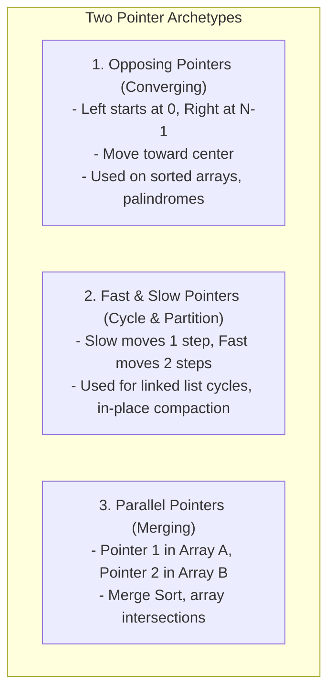
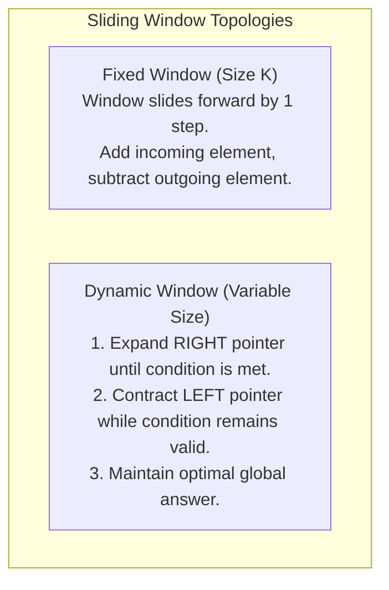
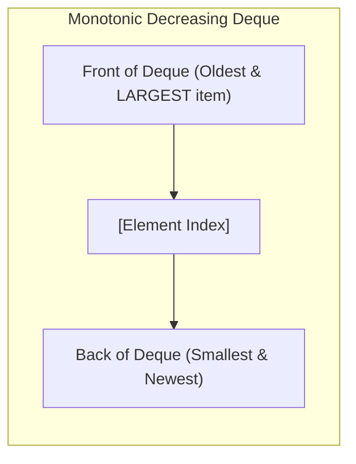
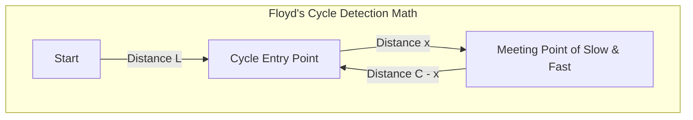

# Chapter 07: Two Pointers & Sliding Window (Deep Dive)

> **Welcome to Chapter 07 of the Google SDE Track!**
> If you ask senior Google and Meta interviewers which pattern appears most frequently in medium-to-hard coding interviews, the answer is overwhelmingly: **Two Pointers and Sliding Window**.
> 
> Why? Because naive solutions to sequence and subarray problems almost always take $O(N^2)$ or $O(N^3)$ by testing all pairs and subarrays with nested loops.
> 
> Two Pointers and Sliding Window leverage **monotonicity and window invariants** to reduce execution time from **$O(N^2)$ down to strictly $O(N)$ linear time**, visiting each element at most twice!
> 
> In this chapter, we will master Opposing Pointers, Fast & Slow Pointers, Fixed Windows, Dynamic Windows, and the Monotonic Deque optimization with runnable code in both Python and JavaScript.

---

## 1. The Core Mental Model: Eliminating Redundant Work

Imagine you are looking for two numbers in a sorted array that sum to `Target = 18`:
`nums = [2, 4, 7, 11, 15, 19]`

* **The Naive Approach ($O(N^2)$)**: Test every single pair using two nested loops.
* **The Two Pointers Approach ($O(N)$)**: Place one pointer at the start (`left = 0`) and one at the end (`right = 5`):
  1. Current sum: $2 + 19 = 21$. Since $21 > 18$, **increasing the left pointer is useless** because all numbers to the right of `2` are even larger! We MUST decrease `right`.
  2. Next sum: $2 + 15 = 17 < 18$. We MUST increase `left`.
  3. Next sum: $4 + 15 = 19 > 18$. Decrease `right`.
  4. Next sum: $7 + 11 = 18$! Match found in just 4 steps!

```mermaid
flowchart LR
    subgraph TwoPointersVisual["Opposing Pointers on Sorted Array"]
        direction LR
        L["Left Pointer (Increases sum)"] --> Array["[2,  4,  7,  11,  15,  19]"] <-- R["Right Pointer (Decreases sum)"]
    end
```

By taking advantage of the **sorted invariant**, every comparison eliminates an entire row or column of the search space, reducing quadratic work to linear time!

---

## 2. The 3 Fundamental Two-Pointer Archetypes



### 1. Opposing Pointers (Converging)
* **Invariant**: Left pointer strictly increases; right pointer strictly decreases.
* **Termination**: When `left >= right`.
* **Classic Problems**: 2-Sum Sorted, Container With Most Water, 3-Sum ($O(N^2)$), Valid Palindrome.

### 2. Fast & Slow Pointers (Floyd's Tortoise and Hare)
* **Mental Model**: Two runners on a circular race track. If a loop exists, the fast runner ($2\times$ speed) is mathematically guaranteed to lap and collide with the slow runner!
* **Applications**:
  * Linked List cycle detection ($O(N)$ time, $O(1)$ space).
  * Finding the exact middle node of a linked list in a single pass.
  * In-place array deduplication (Slow pointer tracks clean write index; Fast pointer scans for new elements).

### 3. Parallel Pointers (Two Sequences)
* Compare elements at `p1` in Array A and `p2` in Array B, advancing whichever pointer has the smaller element.

---

## 3. Sliding Window: Fixed vs. Dynamic Windows

While Two Pointers typically operate on general indices or pairs, **Sliding Window operates strictly on contiguous subarrays or substrings**.



### 1. Fixed-Size Window Pattern
* **Rule**: Window size $K$ never changes.
* **Algorithm**:
  1. Pre-calculate sum/hash of the first $K$ elements.
  2. Loop from index $K$ to $N-1$:
     * Add `nums[i]` (entering the window).
     * Subtract `nums[i - K]` (leaving the window).
     * Update global metric in $O(1)$!
  3. Total time: strictly $O(N)$.

### 2. Dynamic (Variable-Size) Window Pattern (The Universal Template)
Every dynamic sliding window problem follows this exact four-phase template:

```python
def dynamic_sliding_window(s):
    window_state = {}
    left = 0
    best_answer = 0

    # Phase 1: Expand RIGHT pointer
    for right in range(len(s)):
        char = s[right]
        # Update window state with incoming element
        window_state[char] = window_state.get(char, 0) + 1

        # Phase 2: Contract LEFT pointer when window condition is violated
        while window_invalid(window_state):
            leaving_char = s[left]
            window_state[leaving_char] -= 1
            left += 1 # Shrink window from the left

        # Phase 3: Update global optimal answer
        best_answer = max(best_answer, right - left + 1)

    return best_answer
```

### Why is Dynamic Sliding Window Strictly $O(N)$?
Beginners see the nested `while` loop inside the `for` loop and falsely guess $O(N^2)$.
* **The Proof**: The `right` pointer moves from $0$ to $N-1$ (at most $N$ increments). The `left` pointer moves forward and **never moves backward** (at most $N$ increments across the entire runtime).
* Total pointer movements: at most $2N$. Amortized time is strictly **$O(N)$**!

---

## 4. Advanced Sliding Window: The Monotonic Deque ($O(N)$ Maximum)

What if you need to find the **Maximum element in every sliding window of size $K$**?
* Naive scanning inside window: $O(N \times K)$ (If $K = 50,000$, code times out).
* Max-Heap inside window: $O(N \log K)$ (Inserting and deleting from heap).
* **The Monotonic Deque**: Solves it in strictly **$O(N)$ linear time**!



### The Invariant:
We maintain a Double-Ended Queue (`deque`) storing element **indices** in **strictly decreasing order of values**:
1. When element `nums[i]` arrives: Evict all smaller elements from the *back* of the deque (`while deque and nums[deque[-1]] <= nums[i]: deque.pop()`). A smaller, older element can NEVER be the window maximum again!
2. Push `i` to the back.
3. Remove outdated indices from the *front* if they fall outside the window (`deque[0] <= i - K`).
4. The maximum element of the current window is **always at the front of the deque (`deque[0]`) in $O(1)$**!

---

## 5. Hands-on Code: Two Pointers & Sliding Window in Python & JS

### 1. Python: Minimum Window Substring ($O(N)$ Hard Problem)
Given strings `s` and `t`, find the minimum window in `s` containing all characters of `t`:

```python
from collections import Counter

def min_window(s: str, t: str) -> str:
    if not s or not t:
        return ""

    target_counts = Counter(t)
    window_counts = {}
    required = len(target_counts)
    formed = 0

    left = 0
    min_len = float("inf")
    min_window_indices = (0, 0)

    for right, char in enumerate(s):
        window_counts[char] = window_counts.get(char, 0) + 1
        if char in target_counts and window_counts[char] == target_counts[char]:
            formed += 1

        # Contract window from left as long as all characters are satisfied
        while left <= right and formed == required:
            if (right - left + 1) < min_len:
                min_len = right - left + 1
                min_window_indices = (left, right)

            left_char = s[left]
            window_counts[left_char] -= 1
            if left_char in target_counts and window_counts[left_char] < target_counts[left_char]:
                formed -= 1
            left += 1

    return "" if min_len == float("inf") else s[min_window_indices[0]:min_window_indices[1] + 1]

print("Min Window:", min_window("ADOBECODEBANC", "ABC")) # Output: "BANC"
```

### 2. JavaScript: Sliding Window Maximum via Monotonic Deque ($O(N)$)
```javascript
function maxSlidingWindow(nums, k) {
    const deque = []; // Stores indices
    const result = [];

    for (let i = 0; i < nums.length; i++) {
        // 1. Remove elements outside the current window
        if (deque.length > 0 && deque[0] <= i - k) {
            deque.shift();
        }

        // 2. Maintain monotonic decreasing order (evict smaller elements from back)
        while (deque.length > 0 && nums[deque[deque.length - 1]] <= nums[i]) {
            deque.pop();
        }

        // 3. Add current element index
        deque.push(i);

        // 4. Record maximum once the first window of size k is formed
        if (i >= k - 1) {
            result.push(nums[deque[0]]);
        }
    }
    return result;
}

console.log("Max in Windows:", maxSlidingWindow([1, 3, -1, -3, 5, 3, 6, 7], 3));
// Output: [3, 3, 5, 5, 6, 7]
```

---

## 6. Production Case Studies & System Drifts

### Production Case Study 1: The Sliding Window Rate-Limiter Redis Memory Meltdown
* **The Incident**: A fintech API implemented a "Sliding Window Log" rate limiter in Redis to restrict users to 100 requests per minute. Under a distributed DDoS attack, Redis memory exploded by 60 GB, triggering OOM and dropping all authentications globally.
* **Root Cause**: The **Sliding Window Log** algorithm stores every single request timestamp as a separate element in a Redis Sorted Set (`ZADD`). When attackers sent 10,000,000 requests, Redis attempted to store 10,000,000 float timestamps in RAM.
* **The Fix**: Switched to the **Sliding Window Counter** algorithm. The current minute is divided into fixed buckets (e.g. 10-second blocks), and request counts are weighted dynamically:
  $$\text{Current Rate} = \text{Current Count} + \text{Previous Count} \times \left(1 - \frac{\text{Current Second}}{60}\right)$$
  Requires only **2 integer keys in Redis** instead of 10,000,000 timestamps, using 99.99% less memory!

### Production Case Study 2: TCP Sliding Window Flow Control & Buffer Bloat
* **The Incident**: A cloud storage sync service observed catastrophic throughput collapse on cross-region file uploads across the Atlantic (120ms RTT).
* **Root Cause**: The application used naive 64 KB TCP socket buffers. In TCP flow control, the sender cannot send more data than the receiver's **Sliding Window Size (Receive Window - `rwnd`)**:
  $$\text{Max Throughput} = \frac{\text{Window Size}}{\text{RTT}} = \frac{64 \text{ KB}}{0.120 \text{ s}} \approx 4.2 \text{ Mbps}$$
  Even though the physical fiber bandwidth was 1 Gbps, TCP's sliding window artificially throttled throughput to 4.2 Mbps because the window filled up before ACKs returned!
* **The Fix**: Enabled **TCP Window Scaling (RFC 1323)**, allowing sliding window sizes up to 1 GB, unlocking full 1 Gbps line speed.

---

## 7. 12 FAANG & Google Interview Scenarios & Traps



#### Scenario 1: "Prove mathematically why Floyd's Tortoise and Hare algorithm detects the exact start of a Linked List cycle."
* **Answer**:
  * Let $L$ be the distance from the head to the cycle start.
  * Let $C$ be the circumference of the cycle.
  * When slow and fast meet, slow has traveled $d_{\text{slow}} = L + x$.
  * Fast moves twice as fast: $d_{\text{fast}} = 2(L + x)$.
  * Fast is ahead of slow by an exact multiple of the cycle length $kC$:
    $$2(L + x) - (L + x) = kC \implies L + x = kC \implies \mathbf{L = kC - x = (k - 1)C + (C - x)}$$
  * Notice: The distance from the head to the cycle start ($L$) is mathematically identical to the distance from the meeting point to the cycle start ($(C - x)$)!
  * **The Algorithm**: Move `slow` back to `head`, keep `fast` at the meeting point. Advance both **1 step at a time**. They will collide **at the exact cycle start node**!

#### Scenario 2: "In 'Container With Most Water', why is it mathematically safe to advance the pointer pointing to the shorter line?"
* **Answer**:
  * Area is $\text{Area} = \min(h_L, h_R) \times (R - L)$.
  * Suppose $h_L < h_R$. If we move the taller line $R$ inwards, the width $(R - L)$ *decreases*. The new height can never exceed $h_L$. Thus, moving $R$ can NEVER produce a larger area than current!
  * The only possibility of finding a larger area is moving the shorter line $L$ in search of a taller boundary that compensates for the lost width. Moving the shorter pointer safely prunes the search space without missing the global maximum.

#### Scenario 3: "How does 3-Sum solve `A + B + C = 0` in $O(N^2)$ time and $O(1)$ space, and how do you skip duplicates?"
* **Answer**:
  1. Sort array in $O(N \log N)$.
  2. Outer loop fixes $A = \text{nums}[i]$ from $i = 0 \dots N-3$. If `nums[i] > 0`, break immediately (three positive numbers cannot sum to 0).
  3. Inner loop runs Two Pointers on the remaining subarray from `left = i + 1` to `right = N - 1` targeting $-A$.
  4. **Skipping Duplicates**:
     * For outer loop: `if i > 0 and nums[i] == nums[i-1]: continue`.
     * For inner loop: after finding a valid triplet, advance `left` while `nums[left] == nums[left-1]`, and decrease `right` while `nums[right] == nums[right+1]`.

#### Scenario 4: "Why does the Two Pointers approach fail on 2-Sum if the array is unsorted, and what is the optimal solution?"
* **Answer**: On an unsorted array, moving pointers does not provide a monotonic guarantee (increasing `left` does not reliably increase the sum). Sorting takes $O(N \log N)$.
  * **Optimal Solution**: Use a **Hash Map** storing `{target - num: index}`. Runs in strictly **$O(N)$ time** and $O(N)$ space in a single pass without sorting!

#### Scenario 5: "How do you solve 'Subarray Sum Equals K' where numbers can be NEGATIVE?"
* **Answer**:
  * **The Trap**: Sliding Window **FAILS completely** on arrays with negative numbers because expanding the window does not monotonically increase the sum (adding a negative number decreases the sum).
  * **The Solution (Prefix Sums + Hash Map)**:
    Let $\text{Sum}(i, j) = \text{Prefix}[j] - \text{Prefix}[i-1] = K \implies \text{Prefix}[i-1] = \text{Prefix}[j] - K$.
    Store running prefix sum frequencies in a hash map:
    ```python
    prefix_counts = {0: 1}
    curr_sum = 0
    ans = 0
    for n in nums:
        curr_sum += n
        ans += prefix_counts.get(curr_sum - k, 0)
        prefix_counts[curr_sum] = prefix_counts.get(curr_sum, 0) + 1
    ```
    Solves the problem in strictly **$O(N)$ time**!

#### Scenario 6: "In 'Longest Substring with At Most K Distinct Characters', how does the sliding window maintain its state?"
* **Answer**: Use a hash map `char_counts`. Expand `right`, inserting characters. When `len(char_counts) > K`, contract `left`, decrementing `char_counts[s[left]]`. When a character count drops to 0, **delete the key from the map**. Window length is `right - left + 1`.

#### Scenario 7: "What is the difference between a Monotonic Queue and a Monotonic Stack?"
* **Answer**:
  * **Monotonic Stack**: Elements are pushed and popped strictly from the **top** (LIFO). Optimal for finding the **Next Greater / Smaller Element** for each item in an array.
  * **Monotonic Queue (Deque)**: Elements are evicted from the *back* based on value, but expired elements are evicted from the *front* based on index/time (FIFO). Optimal for **Sliding Window Range Minimum / Maximum** queries.

#### Scenario 8: "How do you reverse a string or array in-place using Two Pointers?"
* **Answer**: Set `left = 0, right = len - 1`. While `left < right`: swap `arr[left]` with `arr[right]`, increment `left`, decrement `right`. Takes $O(N)$ time and strictly **$O(1)$ auxiliary space**.

#### Scenario 9: "How does the 'Trapping Rain Water' Two Pointers algorithm achieve $O(N)$ time and $O(1)$ space?"
* **Answer**:
  * Water trapped at index $i$ depends on $\min(\text{max\_left}, \text{max\_right}) - \text{height}[i]$.
  * Instead of pre-computing prefix and suffix max arrays in $O(N)$ space, maintain two pointers `left` and `right` with running `max_left` and `max_right`.
  * If `max_left < max_right`: Water is strictly bounded by `max_left`! We calculate trapped water at `left` (`max_left - height[left]`) and increment `left`.
  * Otherwise, water is bounded by `max_right`, and we decrement `right`. Runs in $O(N)$ time and $O(1)$ auxiliary space!

#### Scenario 10: "Given a circular array, how do you simulate a sliding window that wraps around the end?"
* **Answer**:
  * **Virtual Array Doubling**: Use modulo operator `% N` on indices! A window of size $K$ starting at index $i$ accesses elements via `nums[(i + j) % N]` for $j = 0 \dots K-1$.
  * Loop from $i = 0$ to $2N - 1$, eliminating the need to physically clone the array.

#### Scenario 11: "How do you remove duplicates from a sorted array in-place without extra space?"
* **Answer**: Fast and Slow pointers:
  ```python
  slow = 0
  for fast in range(1, len(nums)):
      if nums[fast] != nums[slow]:
          slow += 1
          nums[slow] = nums[fast]
  return slow + 1
  ```
  `slow` tracks the boundary of unique elements; `fast` scans ahead. Runs in $O(N)$ time, $O(1)$ space.

#### Scenario 12: "Why does the Dutch National Flag algorithm (Sort Colors: 0s, 1s, 2s) require Three Pointers?"
* **Answer**:
  * Partition array into four zones: `[0 ... low-1]` is 0s, `[low ... mid-1]` is 1s, `[mid ... high]` is unexamined, and `[high+1 ... N-1]` is 2s.
  * If `nums[mid] == 0`: Swap with `nums[low]`, increment both `low` and `mid`.
  * If `nums[mid] == 1`: Increment `mid`.
  * If `nums[mid] == 2`: Swap with `nums[high]`, decrement `high` (do NOT increment `mid` because the swapped element from `high` has not been examined yet!).
  * Runs in a **single pass ($O(N)$)** and strictly **$O(1)$ space**.

---

## Chapter 07 Checklist (Summary)

Before moving to Chapter 08, verify that you can answer these:
- [x] Why does Two Pointers reduce search space from $O(N^2)$ to $O(N)$ on sorted arrays?
- [x] How does Floyd's Tortoise and Hare algorithm prove where a cycle begins?
- [x] What is the universal 4-phase template for Dynamic Sliding Window?
- [x] Why does Sliding Window fail when negative numbers are introduced, and why do Prefix Sums succeed?
- [x] How does a Monotonic Deque find the maximum element in every sliding window in $O(N)$ time?
- [x] How does the Dutch National Flag algorithm partition three colors in a single pass?

*Chapter 07 is complete! Proceed to [Chapter 08: Intervals & Sweep-Line Algorithms](./chapter_08.md).*
