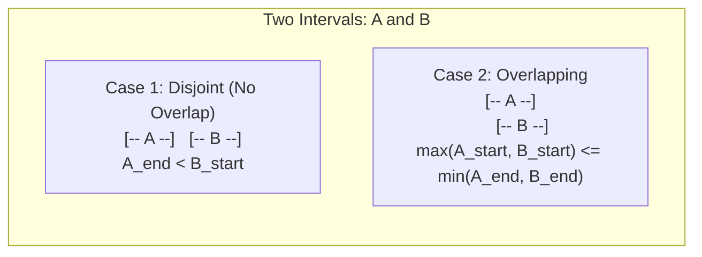
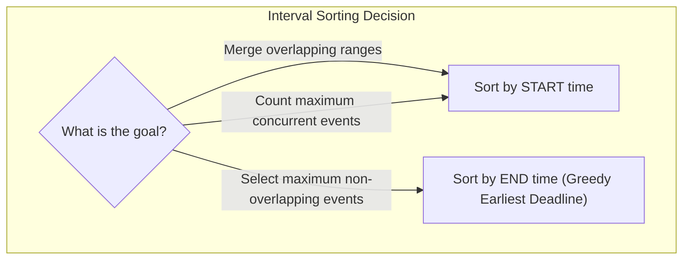
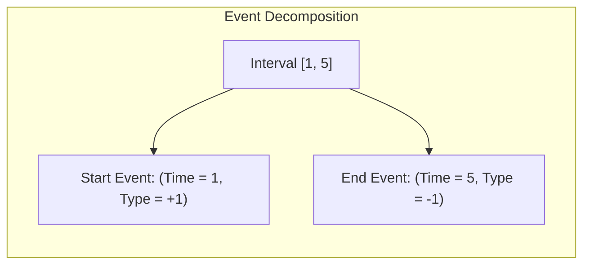
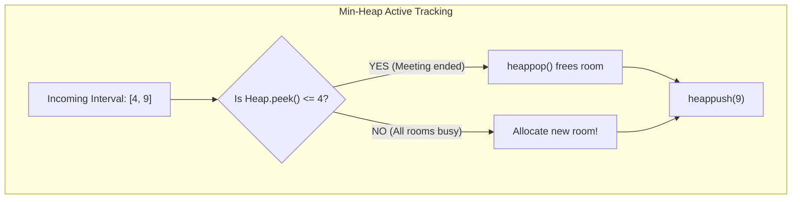
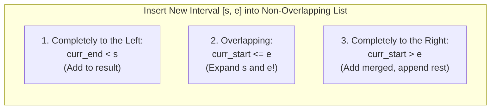

# Chapter 08: Intervals & Sweep-Line Algorithms (Deep Dive)

> **Welcome to Chapter 08 of the Google SDE Track!**
> At Google, systems manage time and resource scheduling across massive fleets of servers (Borg, Google Calendar, YouTube live streams, and database transaction locks).
> 
> In technical interviews, **Intervals and Sweep-Line algorithms** are staple Google questions because they test your ability to convert continuous 1D geometric ranges into sorted discrete mathematical events.
> 
> In this chapter, we will master Interval Overlap Math, Sorting Invariants, the Sweep-Line Event Transformation technique, and Priority Queue tracking with runnable code in both Python and JavaScript.

---

## 1. The Mathematical Foundation of Interval Overlap

An interval is defined as a contiguous range $[start, end]$ where $start \le end$.



### The Universal Overlap Formula:
Two intervals $A = [A_s, A_e]$ and $B = [B_s, B_e]$ overlap **if and only if**:

$$\mathbf{\max(A_s, B_s) \le \min(A_e, B_e)}$$

* If overlapping, the **Intersection** is: $[\max(A_s, B_s), \min(A_e, B_e)]$.
* The **Merged Union** is: $[\min(A_s, B_s), \max(A_e, B_e)]$.

---

## 2. The Two Core Sorting Strategies: By Start vs. By End

When solving interval problems, the very first decision is: **Should I sort by Start Time or End Time?**

| Sorting Strategy | Invariant Established | When to Use (Problem Archetypes) |
|---|---|---|
| **Sort by Start Time** (`x[0]`) | Process intervals in chronological appearance. If current start $\le$ previous end, they MUST overlap! | **Merge Intervals**, **Insert Interval**, **Meeting Rooms II** (Minimum resources required) |
| **Sort by End Time** (`x[1]`) | The interval that finishes earliest frees up resources first (Greedy choice). | **Non-Overlapping Intervals** (Max events scheduled / Min removals), **Activity Selection** |



---

## 3. The Sweep-Line Algorithm (Event Transformation)

How do you find the **Maximum number of concurrent overlapping intervals** (e.g. Meeting Rooms II)?
* Naive approach: Compare all pairs ($O(N^2)$).
* **The Sweep-Line Approach**: Convert intervals into discrete **Point Events** on a 1D timeline!



### The Algorithm:
1. For each interval $[start, end]$:
   * Create start event: `(start, +1)`.
   * Create end event: `(end, -1)`.
2. Sort all events by time.
3. Walk a vertical "sweep-line" from left to right, maintaining a running counter of active overlapping intervals:
   $$\text{active\_rooms} += \text{event.type}$$
   $$\text{max\_rooms} = \max(\text{max\_rooms}, \text{active\_rooms})$$
4. **Time Complexity**: **$O(N \log N)$** (sorting events) and strictly **$O(N)$ space**.

### The Critical Tie-Breaking Trap:
What if one meeting ends at 10:00 AM and another starts at 10:00 AM?
* If the problem states that a meeting ending and starting at the same minute can share the same room:
  **End events (`-1`) MUST be processed BEFORE Start events (`+1`)**!
* Tie-breaking sort key: `events.sort(key=lambda x: (x[0], x[1]))` (Since `-1 < +1`, end events naturally process first!).

---

## 4. Tracking Active Intervals via Min-Heap (Priority Queue)

Another powerful approach for online interval streaming is using a **Min-Heap**:
* Sort intervals by start time.
* Maintain a Min-Heap storing the **end times of currently ongoing meetings**.
* For each interval:
  * If `heap[0] <= current.start`: The earliest meeting has finished! Pop it (`heappop()`).
  * Push `current.end` onto the heap.
  * The size of the heap `len(heap)` at any point is the exact number of active rooms!



---

## 5. Hands-on Code: Intervals in Python & JavaScript

### 1. Python: Merge Intervals ($O(N \log N)$)
```python
def merge_intervals(intervals):
    if not intervals:
        return []

    # 1. Sort strictly by start time
    intervals.sort(key=lambda x: x[0])
    merged = [intervals[0]]

    for current in intervals[1:]:
        prev_start, prev_end = merged[-1]
        curr_start, curr_end = current

        # Check overlap: current start <= previous end
        if curr_start <= prev_end:
            # Merge by extending end boundary
            merged[-1][1] = max(prev_end, curr_end)
        else:
            # Disjoint: start a new interval
            merged.append(current)

    return merged

print("Merged:", merge_intervals([[1, 3], [2, 6], [8, 10], [15, 18]]))
# Output: [[1, 6], [8, 10], [15, 18]]
```

### 2. JavaScript: Meeting Rooms II via Sweep-Line ($O(N \log N)$)
```javascript
function minMeetingRooms(intervals) {
    const events = [];

    // 1. Transform intervals into discrete start (+1) and end (-1) events
    for (const [start, end] of intervals) {
        events.push([start, 1]);  // Room occupied
        events.push([end, -1]);   // Room freed
    }

    // 2. Sort events: by time ascending; if tied, -1 (end) comes before +1 (start)
    events.sort((a, b) => {
        if (a[0] !== b[0]) return a[0] - b[0];
        return a[1] - b[1];
    });

    let activeRooms = 0;
    let maxRooms = 0;

    // 3. Sweep across timeline
    for (const [time, type] of events) {
        activeRooms += type;
        maxRooms = Math.max(maxRooms, activeRooms);
    }

    return maxRooms;
}

console.log("Min Rooms in JS:", minMeetingRooms([[0, 30], [5, 10], [15, 20]]));
// Output: 2
```

---

## 6. Production Case Studies & Systems Drifts

### Production Case Study 1: PostgreSQL Range Locks & Temporal Booking Overlaps
* **The Incident**: A hotel reservation platform suffered double-booking bugs during high-concurrency flash sales. Two guests simultaneously booked the exact same room for overlapping dates (`[2026-11-05, 2026-11-10]` and `[2026-11-08, 2026-11-12]`).
* **Root Cause**: The application performed naive validation:
  `SELECT count(*) FROM bookings WHERE room_id = 101 AND ...` followed by `INSERT`.
  Under high concurrency, both transactions executed the `SELECT` before either committed the `INSERT` (Race Condition under Read Committed isolation).
* **The Fix**: Used PostgreSQL's native **Temporal Range Types (`daterange`)** and **GiST Exclusion Constraints**:
  ```sql
  CREATE EXTENSION btree_gist;
  CREATE TABLE reservations (
      room_id INT,
      during DATERANGE,
      EXCLUDE USING gist (room_id WITH =, during WITH &&) -- '&&' enforces NO OVERLAPS at DB engine level!
  );
  ```
  PostgreSQL enforces interval overlap checks atomically in the B-Tree/GiST index, rendering double-bookings mathematically impossible.

### Production Case Study 2: Cloud Fleet Autoscaling "Meeting Rooms" Failure
* **The Incident**: A batch video transcoding service scheduled rendering jobs on cloud GPU instances. Due to naive FIFO scheduling, 20 GPU jobs were spawned on 20 separate on-demand GPU nodes, incurring $10,000 in redundant cloud bills.
* **Root Cause**: The scheduler treated jobs as isolated tasks rather than modeling job execution intervals on a timeline.
* **The Fix**: Applied the **Sweep-Line / Min-Heap Interval Coloring algorithm**. The scheduler packed jobs tightly onto the minimum number of GPU nodes needed to satisfy deadlines, reducing active cloud instance count from 20 to 4 ($80\%$ cost reduction).

---

## 7. 12 FAANG & Google Interview Scenarios & Traps



#### Scenario 1: "How do you solve 'Insert Interval' in $O(N)$ time on an already sorted, non-overlapping list?"
* **Answer**:
  * Because the original list is sorted and non-overlapping, **do NOT re-sort in $O(N \log N)$**!
  * Three sequential phases in a single $O(N)$ pass:
    1. **Add all intervals ending before `newInterval` starts**: `while i < N and intervals[i][1] < newInterval[0]: add(intervals[i])`.
    2. **Merge all overlapping intervals**: `while i < N and intervals[i][0] <= newInterval[1]: newInterval = [min(newInterval[0], intervals[i][0]), max(newInterval[1], intervals[i][1])]`.
    3. **Add the merged `newInterval`**, then append all remaining intervals.

#### Scenario 2: "In 'Non-overlapping Intervals' (Minimum removals), why MUST you sort by END time instead of START time?"
* **Answer**:
  * This is the classic **Greedy Activity Selection Problem**.
  * To leave as much room as possible for future intervals, we must greedily pick the interval that **finishes earliest (smallest end time)**!
  * If we sorted by start time: An interval like $[0, 100]$ starting early would block 10 smaller intervals $[1, 2], [3, 4], \dots, [9, 10]$. Sorting by end time ensures short, early-finishing intervals are chosen first, minimizing total removals in $O(N \log N)$ time and $O(1)$ space.

#### Scenario 3: "How do you find the Intersection of Two Lists of Sorted Intervals in $O(M + N)$ time?"
* **Answer**: Two Pointers `i` and `j` in parallel:
  1. Calculate overlap: `start = max(A[i][0], B[j][0])`, `end = min(A[i][1], B[j][1])`.
  2. If `start <= end`: Append `[start, end]` to intersection results!
  3. **Pointer advancement**: Advance the pointer whose interval **finishes earlier** (`if A[i][1] < B[j][1]: i += 1 else: j += 1`). The interval with the earlier end time cannot overlap with any subsequent intervals in the other list.

#### Scenario 4: "What is 'Employee Free Time', and how do you solve it in $O(N \log K)$ using a Heap?"
* **Answer**:
  * Given $K$ employees with lists of working intervals, find common free gaps.
  * **Heap Solution**:
    1. Initialize a Min-Heap with the first interval of each of the $K$ employees (`heap size = K`).
    2. Maintain `prev_end` tracking the latest end time seen so far.
    3. Pop the earliest interval: If `curr.start > prev_end`, the gap `[prev_end, curr.start]` is **free time for all employees**!
    4. Push the next interval from the employee whose interval was just popped.
    5. Runs in $O(N \log K)$ time (where $N$ is total intervals and $K$ is number of employees) and $O(K)$ space.

#### Scenario 5: "How does the Sweep-Line algorithm solve the 'Skyline Problem' (Building Silhouettes)?"
* **Answer**:
  * Building $[L, R, H]$ splits into two events: Left edge $(L, -H)$ and Right edge $(R, +H)$.
  * Use a **Max-Heap** tracking current active building heights (with a baseline height 0).
  * Sweep events from left to right:
    * Left edge: Add height to Max-Heap.
    * Right edge: Remove height from Max-Heap.
    * If `heap.max()` changes after processing an event, the skyline has changed! Record `[x, new_max_height]`.
  * *Tip*: Using negative height for left edge ensures taller buildings process before shorter buildings at the same $X$ coordinate.

#### Scenario 6: "What is the difference between Open Intervals $(a, b)$ and Closed Intervals $[a, b]$ in Sweep-Line sorting?"
* **Answer**:
  * **Closed Interval $[a, b]$**: Includes endpoints. If interval 1 is $[1, 5]$ and interval 2 is $[5, 10]$, they overlap at point 5! Start events must be processed BEFORE end events on ties.
  * **Open Interval $(a, b)$**: Excludes endpoints. At point 5, interval 1 has ended before interval 2 starts. End events must be processed BEFORE start events on ties.

#### Scenario 7: "How do you detect if any two meetings overlap in 'Meeting Rooms I' in $O(N \log N)$?"
* **Answer**: Sort by start time. Iterate through the array from $1 \dots N-1$:
  `if intervals[i][0] < intervals[i - 1][1]: return False` (Overlap detected!). If loop finishes without violations, return True. Strictly $O(N \log N)$ time and $O(1)$ space.

#### Scenario 8: "Can 'Meeting Rooms II' be solved without sorting if timestamps are within a known small range?"
* **Answer**: **YES!** If meeting times are integer minutes within a 24-hour day ($0 \dots 1440$):
  * Use a **Difference Array** of size 1441 initialized to 0.
  * For each interval: `diff[start] += 1` and `diff[end] -= 1`.
  * Compute running prefix sums from $0 \dots 1440$.
  * Max prefix sum is the answer! Runs in strictly **$O(N + 1440) = O(N)$ linear time**!

#### Scenario 9: "How do you find the Minimum Number of Arrows to Burst Balloons?"
* **Answer**:
  * Each balloon is an interval $[x_{start}, x_{end}]$. An arrow shot at $X$ bursts all balloons where $x_{start} \le X \le x_{end}$.
  * Sort balloons by **end coordinate**.
  * Shoot the first arrow at the end of the first balloon: `arrow_pos = balloons[0][1]`.
  * Iterate through remaining balloons: If `balloon[i][0] > arrow_pos`, the current arrow cannot reach it! Shoot a new arrow at `arrow_pos = balloon[i][1]`.
  * Greedy choice guarantees minimum arrows in $O(N \log N)$ time and $O(1)$ space.

#### Scenario 10: "Given a set of intervals, how do you find the interval that overlaps with the maximum number of other intervals?"
* **Answer**:
  * Run Sweep-Line on all intervals to identify the time point $T_{peak}$ with maximum overlap count.
  * Scan all original intervals: any interval containing $T_{peak}$ ($start \le T_{peak} \le end$) shares that maximum overlap count!

#### Scenario 11: "How does the Segment Tree / Interval Tree optimize dynamic interval stabbing queries?"
* **Answer**:
  * If intervals are added/deleted dynamically, and we need to query *"Which intervals contain point $P$?"*:
  * A static sweep-line takes $O(N)$ per query.
  * An **Interval Tree** (augmented Red-Black Tree storing subtree maximum end times) solves point queries in **$O(\log N + K)$** time (where $K$ is the number of overlapping intervals returned).

#### Scenario 12: "How do you find the maximum length of a chain of pairs where `pair[i][1] < pair[j][0]`?"
* **Answer**:
  * Sort pairs by **end time** (`x[1]`).
  * Initialize `count = 1, curr_end = pairs[0][1]`.
  * For each subsequent pair:
    `if pair[0] > curr_end: count += 1; curr_end = pair[1]`.
  * Equivalent to Longest Increasing Subsequence (LIS) on end coordinates, but solvable greedily in **$O(N \log N)$** time instead of $O(N^2)$ DP!

---

## Chapter 08 Checklist (Summary)

Before concluding Part 1 of the Google SDE track, verify that you can answer these:
- [x] What is the mathematical overlap condition: $\max(A_s, B_s) \le \min(A_e, B_e)$?
- [x] When must you sort by start time vs. sort by end time?
- [x] How does the Sweep-Line event transformation (+1/-1) solve Meeting Rooms II in $O(N \log N)$?
- [x] How do tie-breaking rules alter event processing for open vs. closed intervals?
- [x] How do Min-Heaps track active ongoing intervals in streaming environments?
- [x] How does PostgreSQL enforce zero double-booking overlap using GiST range constraints?

*Part 1 of the Google SDE Track is complete! Proceed to [Part 2: Low-Level Design & Concurrency](./google_sde_study_plan.md).*
