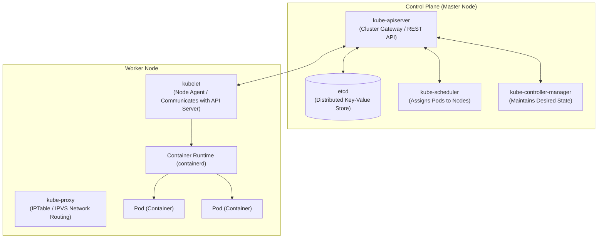
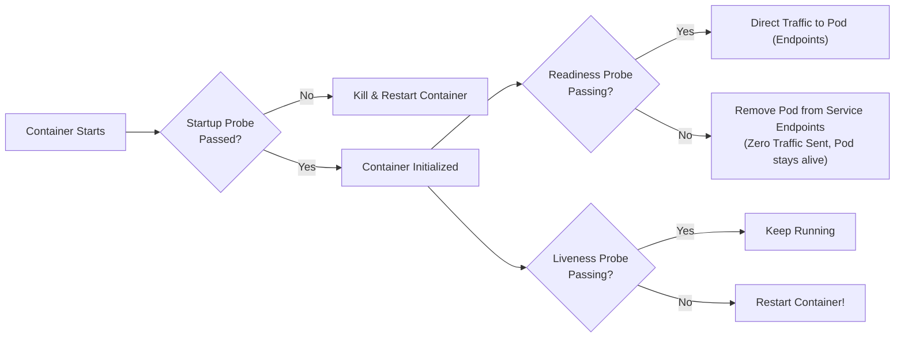
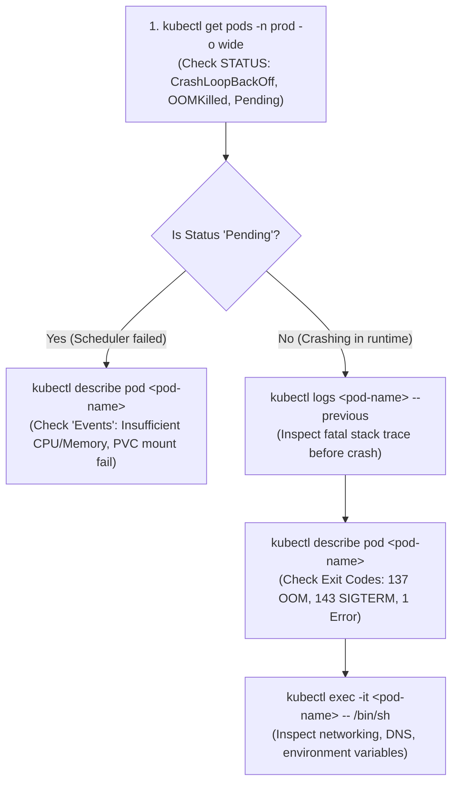
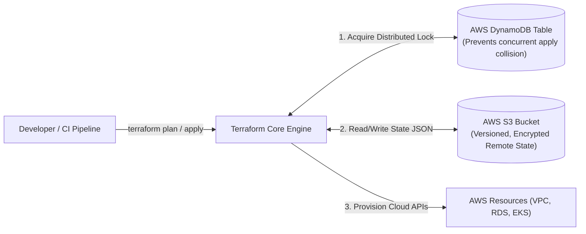
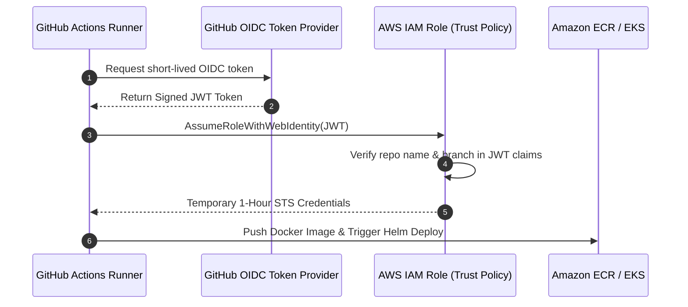
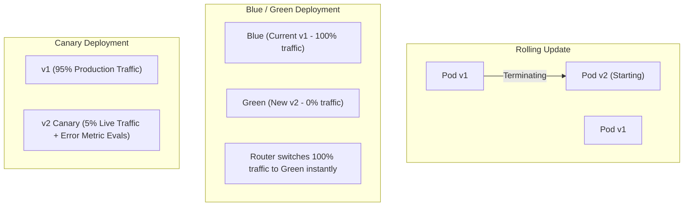

# Operational DevOps Cheatsheet: Kubernetes, Terraform & GitHub Actions CI/CD

> **Fast-Track Interview Sprint Module**  
> **Target Roles**: Senior Backend Engineer, SRE, Platform Engineer (Cutshort, Instahyre, Naukri SRE suggestions).  
> **Key Focus**: Pod lifecycle failure modes (OOMKilled 137, probe death spirals), Helm deployment automation, Terraform S3/DynamoDB remote state locking, AWS OIDC GitHub Actions, and incident debugging commands.

---

## 1. Kubernetes Architecture & The Pod Lifecycle

Kubernetes (K8s) is a container orchestrator that bridges physical server hardware with declarative container deployments.



---

## 2. Container Probes & The "Probe Death Spiral" Trap

Kubernetes relies on three distinct health probes to manage container lifecycles:



| Probe Type | Purpose | What Happens When It Fails | Senior Best Practice |
| :--- | :--- | :--- | :--- |
| **Startup Probe** | Gives slow-starting apps (e.g. AI models loading weights, JVM cold starts) time to initialize. | Kills and restarts the container if it doesn't boot within `failureThreshold * periodSeconds`. | Mandatory for ML/AI serving or apps taking $>30$ seconds to boot. |
| **Readiness Probe** | Determines if the container is currently able to accept network traffic. | **Removes pod from the Service load balancer.** Traffic stops, but container is NOT killed. | Check if local cache is warmed and DB pool has available connections. |
| **Liveness Probe** | Detects deadlocks where the process is running but cannot recover. | **Kills the container and restarts it.** | **NEVER check external dependencies (like Postgres or Redis) in a Liveness Probe!** |

### The Catastrophic "Liveness Probe Death Spiral"
* **Scenario**: Your backend checks PostgreSQL inside its `livenessProbe`.
* **Incident**: The database experiences a temporary latency spike.
* **The Disaster**: Every single pod's liveness probe fails simultaneously. Kubernetes kills all 50 backend pods at once. When they restart, all 50 pods hammer the database with 50 new connection handshakes simultaneously, causing total infrastructure collapse!
* **Rule**: Liveness probes should only check **internal process health** (e.g. is the event loop responsive?), never downstream services.

---

## 3. Pod Resource Sizing: Requests, Limits & Exit Code 137

```yaml
resources:
  requests:
    cpu: "500m"        # 0.5 CPU core guaranteed
    memory: "512Mi"    # 512 MB RAM guaranteed
  limits:
    cpu: "1000m"       # Throttled via CFS if exceeded
    memory: "1Gi"      # OOMKilled (Exit Code 137) if exceeded!
```

### CPU vs. Memory Violation Mechanics
1. **CPU is a Compressible Resource**:
   * If a container exceeds its CPU limit (`1000m`), Linux **does not kill the container**.
   * It throttles the container using the Linux Completely Fair Scheduler (CFS) quota. Latency spikes, but the process lives.
2. **Memory is an INCOMPRESSIBLE Resource**:
   * If a container exceeds its Memory limit (`1Gi`), the Linux kernel cannot "throttle" RAM.
   * The kernel Out-Of-Memory Killer immediately sends `SIGKILL` (`kill -9`) to the container.
   * Kubernetes marks the container as **`OOMKilled` (Exit Code 137: 128 + 9)**.

---

## 4. The 5-Minute Pod Debugging Playbook

When an incident occurs in production, run these commands in strict sequence:



### Critical Exit Codes to Memorize
* **Exit Code `0`**: Clean exit (process completed successfully).
* **Exit Code `1`**: Application exception / uncaught crash (check application logs).
* **Exit Code `137`**: `128 + 9 (SIGKILL)` $\to$ **OOMKilled** (Memory limit exceeded or OS killed process).
* **Exit Code `143`**: `128 + 15 (SIGTERM)` $\to$ Graceful termination request from Kubernetes (e.g. during rollout, scaling down, or eviction).

---

## 5. Helm Templating & Package Management

Helm is the package manager for Kubernetes that turns hardcoded YAML manifests into reusable, parameter-driven templates.

### Standard Helm Chart Structure
```text
my-backend-chart/
├── Chart.yaml          # Chart metadata (name, version, appVersion)
├── values.yaml         # Default configuration values
└── templates/          # Jinja-like parameterized YAML templates
    ├── deployment.yaml
    ├── service.yaml
    └── hpa.yaml
```

### Parameterization in `templates/deployment.yaml`
```yaml
apiVersion: apps/v1
kind: Deployment
metadata:
  name: {{ .Release.Name }}-backend
spec:
  replicas: {{ .Values.replicaCount }}
  template:
    spec:
      containers:
        - name: app
          image: "{{ .Values.image.repository }}:{{ .Values.image.tag | default .Chart.AppVersion }}"
          resources:
            {{- toYaml .Values.resources | nindent 12 }}
```

### Essential Helm Commands
```bash
# Lint chart syntax
helm lint ./my-backend-chart

# Dry-run template generation
helm template my-release ./my-backend-chart --values ./values-prod.yaml

# Deploy / Upgrade with rollback safeguard
helm upgrade --install my-release ./my-backend-chart -n prod --atomic --timeout 5m

# Instant rollback to previous working revision
helm rollback my-release 3 -n prod
```

---

## 6. Terraform: Remote State, S3 Locking & Module Structure

Terraform is an open-source Infrastructure as Code (IaC) tool that manages cloud resources declaratively.



### The Remote State Backend Pattern
Never store `terraform.tfstate` in Git (it contains unencrypted database passwords and cloud tokens). Always use remote backends with distributed state locking:

```hcl
terraform {
  required_version = ">= 1.5.0"
  
  backend "s3" {
    bucket         = "mycompany-terraform-states"
    key            = "prod/vpc-and-eks/terraform.tfstate"
    region         = "ap-south-1"
    encrypt        = true
    dynamodb_table = "terraform-state-locks" # Prevents two devs applying simultaneously
  }
}
```

### Module Reusability Best Practice
```text
infra/
├── modules/
│   └── vpc/
│       ├── main.tf
│       ├── variables.tf
│       └── outputs.tf
└── environments/
    ├── staging/
    │   └── main.tf   # Calls module.vpc with staging CIDR
    └── production/
        └── main.tf   # Calls module.vpc with production multi-AZ CIDR
```

---

## 7. GitHub Actions CI/CD with AWS OIDC (Zero Static Keys)

Storing static `AWS_ACCESS_KEY_ID` and `AWS_SECRET_ACCESS_KEY` in GitHub Secrets is a major security vulnerability. If credentials leak, attackers can compromise your AWS account.

### The Modern Standard: OpenID Connect (OIDC) Federation
GitHub Actions authenticates directly with AWS IAM using short-lived cryptographic JWT tokens.



### Production GitHub Actions Workflow (`.github/workflows/deploy.yml`)
```yaml
name: Build & Deploy to Production EKS

on:
  push:
    branches: [ main ]

permissions:
  id-token: write   # Required for requesting OIDC JWT
  contents: read

jobs:
  deploy:
    runs-on: ubuntu-latest
    steps:
      - name: Checkout code
        uses: actions/checkout@v4

      - name: Configure AWS Credentials via OIDC
        uses: aws-actions/configure-aws-credentials@v4
        with:
          role-to-assume: arn:aws:iam::123456789012:role/github-actions-eks-deployer
          aws-region: ap-south-1

      - name: Log in to Amazon ECR
        id: login-ecr
        uses: aws-actions/amazon-ecr-login@v2

      - name: Build, tag, and push Docker image with Buildx Cache
        uses: docker/build-push-action@v5
        with:
          context: .
          push: true
          tags: ${{ steps.login-ecr.outputs.registry }}/backend-api:${{ github.sha }}
          cache-from: type=gha
          cache-to: type=gha,mode=max

      - name: Deploy to EKS with Helm
        run: |
          aws eks update-kubeconfig --region ap-south-1 --name prod-cluster
          helm upgrade --install backend-api ./helm/backend-api \
            --namespace production \
            --set image.tag=${{ github.sha }} \
            --atomic \
            --timeout 5m
```

---

## 8. Deployment Strategies: Rolling vs. Blue/Green vs. Canary



* **Rolling Update**: Replaces pods one by one. Zero downtime, but runs mixed versions simultaneously (database migrations must be backwards-compatible).
* **Blue/Green Deployment**: Two identical environments. Switch router to Green once validated. Instant rollback, but requires $2\times$ infrastructure cost during deployment.
* **Canary Deployment**: Directs 1% to 5% of traffic to the new version. Prometheus evaluates error rates and latency. If error threshold is breached, the canary automatically rolls back before all users are affected.

---

## 9. 10 FAANG & Senior SRE Interview Questions

#### Q1: "What is the difference between a Pod status of `CrashLoopBackOff` and `OOMKilled`?"
* **Answer**:
  * `OOMKilled` (Exit code 137): The container exceeded its configured memory `limits` (or the host node ran out of RAM). The Linux kernel forcefully terminated the process with `SIGKILL`.
  * `CrashLoopBackOff`: The application started, crashed (or threw an uncaught runtime exception), and exited with a non-zero code. Kubernetes restarts it, but because it keeps crashing repeatedly, Kubernetes introduces an exponential backoff delay (10s, 20s, 40s... up to 5 minutes) before the next restart to avoid saturating node resources.

#### Q2: "Why must you never include external database checks in a Kubernetes `livenessProbe`?"
* **Answer**:
  * The purpose of a liveness probe is to restart a deadlocked or hung local process.
  * If the database encounters a brief latency spike or network blip, all pod liveness probes will fail simultaneously.
  * Kubernetes will terminate and restart all backend pods across the entire cluster.
  * When the pods restart, they will all flood the database with simultaneous connection handshakes, amplifying the outage (**Thundering Herd / Cascading Collapse**).
  * External dependencies should only be checked in a `readinessProbe` (which temporarily stops routing traffic without killing the process).

#### Q3: "What happens when a container exceeds its CPU limit vs. its Memory limit?"
* **Answer**:
  * **CPU (Compressible)**: Exceeding CPU limits results in OS CPU throttling via Linux CFS (Completely Fair Scheduler) quotas. The process is slowed down, but it is never killed.
  * **Memory (Incompressible)**: The OS cannot "throttle" physical RAM. If the container allocates more memory than its `resources.limits.memory`, the kernel OOM killer immediately fires `SIGKILL` (`kill -9`) and the pod is marked `OOMKilled` (Exit 137).

#### Q4: "How does Terraform state locking work, and what happens if two developers run `terraform apply` concurrently?"
* **Answer**:
  * When configured with an AWS S3 backend and a DynamoDB table, Terraform generates a unique MD5 lock ID and writes an item to DynamoDB upon initiating `plan` or `apply`.
  * If Developer B runs `apply` while Developer A is executing, Developer B's Terraform run queries DynamoDB, detects the active lock, and aborts immediately with `Error: Error acquiring the state lock`.
  * This prevents race conditions, state corruption, and partial overwrites of cloud infrastructure.

#### Q5: "How does OpenID Connect (OIDC) improve security in GitHub Actions deployments to AWS?"
* **Answer**:
  * Traditional deployments require storing static `AWS_ACCESS_KEY_ID` and `AWS_SECRET_ACCESS_KEY` in GitHub Secrets. These long-lived keys do not expire and represent a catastrophic vulnerability if leaked.
  * With OIDC, GitHub issues a short-lived, cryptographically signed JWT token containing claims (such as repository name, branch, and commit).
  * AWS IAM validates the token signature and exchanges it for temporary STS credentials valid for only 1 hour. Zero static secrets are ever stored in GitHub.

#### Q6: "What is the difference between Kubernetes Horizontal Pod Autoscaler (HPA) and KEDA?"
* **Answer**:
  * **Standard HPA**: Scales pods based purely on node-level resource metrics (CPU and Memory utilization) queried from the Metrics Server.
  * **KEDA (Kubernetes Event-driven Autoscaling)**: Extends HPA to scale based on **external event metrics**, such as the number of unconsumed messages in a Kafka topic partition or RabbitMQ queue length. KEDA can also scale deployments down to **zero** pods when the queue is empty, saving substantial cloud compute costs.

#### Q7: "What is the function of the Kubernetes `kubelet` component?"
* **Answer**:
  * The `kubelet` is the primary node agent running on every worker node.
  * It registers the node with the `kube-apiserver` and receives PodSpecifications (PodSpecs).
  * It talks to the local container runtime (`containerd`) via the Container Runtime Interface (CRI) to pull images and start/stop containers.
  * It monitors pod health via probes and reports pod status and node resource metrics back to the control plane.

#### Q8: "How does `kubectl logs --previous` help debug pod crashes?"
* **Answer**:
  * When a pod is in `CrashLoopBackOff`, running `kubectl logs <pod-name>` only prints the logs of the *currently running (or newly spawned)* container instance, which often shows only the initial boot banner.
  * Running `kubectl logs <pod-name> --previous` instructs the container runtime to retrieve the stdout/stderr stream of the **immediately preceding container instance that died**, exposing the fatal unhandled stack trace or panic that caused the crash.

#### Q9: "What is the purpose of Kubernetes `PDB` (PodDisruptionBudget) during cluster upgrades?"
* **Answer**:
  * When cloud providers or engineers drain nodes during K8s version upgrades or node maintenance, all pods on the node are evicted.
  * Without a PodDisruptionBudget, an automated drain could evict all replicas of a service simultaneously, causing production downtime.
  * A `PDB` declares the minimum number of available replicas (`minAvailable: 2` or `maxUnavailable: 10%`). Kubernetes will block node drain operations until new replacement pods are running and ready on another node.

#### Q10: "Explain the difference between `terraform refresh` and `terraform plan`."
* **Answer**:
  * `terraform refresh`: Queries the real-world cloud provider APIs (e.g. AWS) to reconcile and update the state file with the current physical reality of your infrastructure, identifying out-of-band manual changes (drift).
  * `terraform plan`: Reads the current state file, compares it against the local declarative HCL code, and generates an execution diff showing what resources will be created, modified, or destroyed to bring real-world infrastructure into alignment with code. In modern Terraform, `plan` automatically runs a refresh in-memory before computing the diff.

---

## Chapter Checklist
- [x] Master probe behavior and know why liveness probes must never check databases.
- [x] Memorize Exit Code 137 (`OOMKilled`) vs Exit Code 143 (`SIGTERM`).
- [x] Execute the 5-minute `kubectl` debugging triage for production outages.
- [x] Configure Terraform remote state with S3 encryption and DynamoDB locking.
- [x] Secure CI/CD pipelines using GitHub Actions AWS IAM OIDC federation.