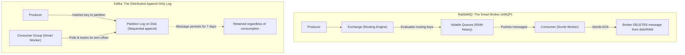
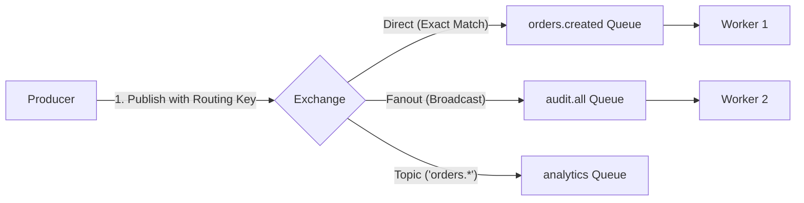
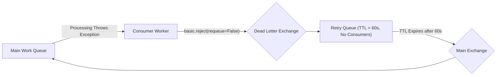
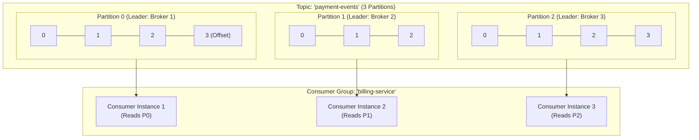
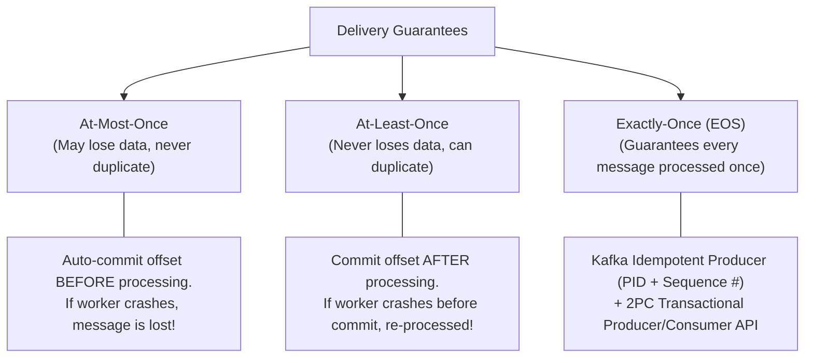
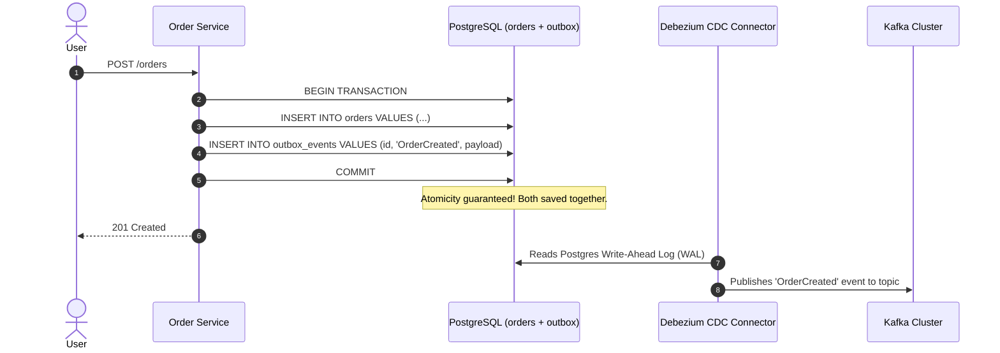

# Message Queues Deep Dive: Kafka vs. RabbitMQ — Partition-Based Streaming vs. AMQP Broker Queues

> **Fast-Track Interview Sprint Module**  
> **Target Roles**: Senior Backend & Distributed Systems Engineer (PocketFM, Medanta, 1digitalstack, Linkrunner, Cutshort, Instahyre).  
> **Key Focus**: Architectural divergence (Smart Broker/Dumb Consumer vs. Dumb Broker/Smart Consumer), Kafka Zero-Copy OS mechanics, RabbitMQ DLX topologies, and handling scale bottlenecks.

---

## 1. The Fundamental Architectural Divide

Engineers often ask: *"Should I use Kafka or RabbitMQ?"*  
The answer starts by recognizing they were built to solve fundamentally different problems:



| Metric | RabbitMQ (Smart Broker / Dumb Consumer) | Apache Kafka (Dumb Broker / Smart Consumer) |
| :--- | :--- | :--- |
| **Primary Abstraction** | FIFO Mailbox Queues | Distributed, Partitioned Append-Only Commit Log |
| **Message Lifecycle** | Deleted immediately upon Consumer ACK | Retained on disk for days/months based on retention policy |
| **Communication Style** | Broker **pushes** to consumer (`basic.consume`) | Consumer **pulls** at its own pace (`poll()`) |
| **Replayability** | **Impossible** (Once acknowledged, message is destroyed) | **Effortless** (Rewind consumer offset to any timestamp) |
| **Routing Capability** | Extremely rich (Wildcards, Topic, Direct, Header matching) | Simple key-based hashing to partition |
| **Peak Throughput** | $20,000 - 100,000$ messages/sec per node | $1,000,000+$ messages/sec per cluster (Zero-Copy) |
| **Ideal Use Cases** | Complex task distribution, RPC, background jobs, per-message priority | Event sourcing, high-throughput stream processing, activity tracking, audit logs |

---

## 2. RabbitMQ Architecture Deep Dive (AMQP 0-9-1)

RabbitMQ separates the *destination where producers send messages* from the *queues where consumers receive them*.



### The 4 Exchange Types
1. **Direct Exchange**: Matches the message's `routing_key` with the queue's `binding_key` with exact string equality.
2. **Fanout Exchange**: Ignores routing keys completely. Clones and broadcasts every incoming message to *every single queue bound to it*.
3. **Topic Exchange**: Matches routing keys using wildcard patterns:
   * `*` (star) matches exactly one word (`orders.us.created` matches `orders.*.created`).
   * `#` (hash) matches zero or more words (`orders.#` matches `orders.us.retail.completed`).
4. **Headers Exchange**: Routes based on message header attributes instead of a routing key string.

### Dead Letter Exchanges (DLX) & Exponential Backoff
When a message fails processing in a worker, you cannot afford to drop it, nor can you immediately re-queue it indefinitely (which creates an infinite CPU loop).



1. Worker fails to process message.
2. Worker calls `basic.nack(requeue=False)` or `basic.reject(requeue=False)`.
3. RabbitMQ detects the rejection and forwards the message to a configured **Dead Letter Exchange (DLX)**.
4. The DLX routes the message to a `retry_queue` with a 60-second message TTL (Time-To-Live) and **no active consumers**.
5. When the 60 seconds expire, RabbitMQ "dead-letters" the expired message *back* to the main exchange, which re-delivers it to the main queue for retry.

### The Slow Consumer Memory Trap
* RabbitMQ queues store message indices and metadata directly in RAM.
* If consumers are slow or offline, and queues grow to millions of messages, RabbitMQ begins paging messages from RAM to disk (**queue paging**).
* During disk paging, broker throughput drops by $90\%$, blocking incoming publisher connections. **RabbitMQ is not meant to be a storage database.**

---

## 3. Apache Kafka Architecture Deep Dive

Kafka is not a queue; it is a **distributed, immutable, append-only commit log**.



### Partitioning & Strict Ordering
* **Kafka only guarantees strict ordering within a SINGLE partition.** It does **NOT** guarantee global ordering across a topic.
* When a producer sends a record with a `key` (e.g., `user_id="user_123"`), Kafka hashes the key:
  $$\text{Partition} = \text{murmur2}(\text{key}) \pmod{\text{Total Partitions}}$$
* All events for `user_123` are guaranteed to land on the exact same partition, ensuring that User 123's actions are processed in strict sequential order.

### Consumer Groups & The Scaling Ceiling Rule
* **Rule**: You cannot have more active consumers in a consumer group than there are partitions in the topic!
* If a topic has **4 partitions**:
  * 2 consumers $\to$ Each consumer reads 2 partitions.
  * 4 consumers $\to$ Each consumer reads 1 partition.
  * 6 consumers $\to$ 4 consumers read 1 partition each; **2 consumers sit completely idle as warm backups**.
* **Interview Golden Rule**: To scale Kafka consumer parallelism, you **must** increase the partition count of the topic!

### Consumer Group Rebalancing
When a consumer crashes or a new one joins, the group coordinator triggers a **Rebalance**:
1. **Eager Rebalance**: All consumers stop consuming, revoke all partition assignments, and wait for re-assignment. Can cause noticeable latency spikes (stop-the-world).
2. **Incremental Cooperative Rebalance** (Modern standard): Consumers only give up the specific partitions that are being migrated, continuing to process other partitions with zero downtime.

---

## 4. How Kafka Achieves Millions of Events/Sec: Zero-Copy & Page Cache

How does Kafka written in Java easily outperform C++ or Erlang message brokers?

```mermaid
flowchart TD
    subgraph Traditional["Traditional Broker File Transfer (4 Context Switches, 3 Copies)"]
        Disk1["Disk File"] -->|"1. DMA Copy"| Kernel1["OS Kernel Buffer"]
        Kernel1 -->|"2. CPU Copy (Switch to User Mode)"| App1["Application Memory (JVM Heap)"]
        App1 -->|"3. CPU Copy (Switch to Kernel Mode)"| Socket1["Socket Buffer"]
        Socket1 -->|"4. DMA Copy"| NIC1["Network Interface Card (NIC)"]
    end

    subgraph ZeroCopy["Kafka Zero-Copy sendfile() (2 Context Switches, 0 CPU Copies!)"]
        Disk2["Disk File"] -->|"1. DMA Copy"| Kernel2["OS Kernel Page Cache"]
        Kernel2 -->|"2. Direct DMA Copy via sendfile() syscall"| NIC2["Network Interface Card (NIC)"]
    end
```



### The 3 Architectural Secrets of Kafka's Speed
1. **Sequential Disk I/O**: Kafka never does random disk writes. It always appends to the end of the log file. Sequential disk access on modern SSDs reaches $>1\text{ GB/sec}$, rivaling random memory access.
2. **OS Page Cache Utilization**: Kafka does not cache messages in the JVM heap (which would trigger devastating Garbage Collection pauses). Instead, it leaves all caching to the **Linux OS Page Cache**. When a producer writes a message, it goes straight to the kernel page cache. When consumers read recent messages, Kafka serves them directly from kernel RAM without touching the physical SSD platter!
3. **The `sendfile()` Zero-Copy Syscall**: Kafka uses the Linux kernel's `sendfile()` system call. Data is transferred directly from the OS page cache to the Network Interface Card (NIC) via Direct Memory Access (DMA), completely bypassing JVM user memory. Zero CPU cycles are wasted copying bytes into application RAM.

---

## 5. Message Delivery Guarantees

In distributed systems, network partitions and server crashes are inevitable. Understanding delivery guarantees is essential for interview questions on financial systems.



### Making At-Least-Once Systems Idempotent
Because building pure "Exactly-Once" distributed systems across external databases is expensive and complex, **95% of production systems run on At-Least-Once delivery paired with Idempotent Consumer processing**:
```python
async def process_payment_event(event: PaymentEvent, session: AsyncSession):
    # 1. Deduplication check using unique event_id
    stmt = select(ProcessedEvent).where(ProcessedEvent.id == event.event_id)
    existing = await session.execute(stmt)
    if existing.scalar_one_or_none():
        print(f"Duplicate event {event.event_id} ignored.")
        return

    # 2. Atomic state update + record event in single ACID transaction
    await session.execute(
        update(Account)
        .where(Account.id == event.account_id)
        .values(balance=Account.balance + event.amount)
    )
    session.add(ProcessedEvent(id=event.event_id, processed_at=datetime.utcnow()))
    await session.commit()
```

---

## 6. Real-World Architecture Patterns

### The Transactional Outbox Pattern with Kafka (Debezium CDC)
How do you update PostgreSQL and notify Kafka without distributed 2-Phase Commit (2PC)?



1. The service never writes directly to Kafka in the HTTP handler.
2. It writes both the business entity (`orders`) and an event record (`outbox_events`) to the local PostgreSQL database in a **single ACID transaction**.
3. **Debezium** tail-reads PostgreSQL's physical **Write-Ahead Log (WAL)** using Change Data Capture (CDC) and streams the events to Kafka with zero application-level dual-write bugs.

---

## 7. 10 FAANG & High-Scale System Design Interview Questions

#### Q1: "How does Kafka guarantee message order, and can you maintain ordering if you need to scale up consumers?"
* **Answer**:
  * Kafka guarantees message ordering strictly within a single partition, not globally across a topic.
  * To guarantee that related events (e.g. all transactions for a specific user) are processed in order, the producer must assign a deterministic partition key (e.g., `user_id`). Kafka hashes this key to ensure all matching events land on the exact same partition.
  * To scale up consumer processing while preserving per-user order, you must increase the number of partitions in the topic and assign one consumer per partition.
  * If a single partition has a hot key, you can implement an in-process worker pool inside the single consumer that routes events to sub-worker queues keyed by `user_id`.

#### Q2: "What happens during a Kafka Consumer Group Rebalance, and how do you prevent consumer churn during long processing times?"
* **Answer**:
  * A rebalance occurs when a consumer joins, leaves, or fails to send heartbeats within `session.timeout.ms`.
  * If a consumer takes longer to process a batch of records than `max.poll.interval.ms`, Kafka assumes the consumer is dead, kicks it out of the group, and triggers a rebalance.
  * The remaining consumers re-assign the abandoned partitions. When the original worker finally finishes its batch, its offset commit is rejected with `CommitFailedException`.
  * **The Fix**: Decrease `max.poll.records` (process smaller batches per loop) or offload heavy processing to an internal thread pool so the main polling loop never misses its heartbeat interval.

#### Q3: "Explain Kafka's Zero-Copy optimization and why it makes Kafka significantly faster than traditional brokers."
* **Answer**:
  * In traditional brokers, transferring data from disk to network requires 4 context switches between user/kernel space and 3 data copies (Disk $\to$ OS buffer $\to$ JVM memory $\to$ Socket buffer $\to$ NIC).
  * Kafka leverages the Linux `sendfile()` system call.
  * Data is read directly from the OS Page Cache into the Network Interface Card (NIC) buffer via Direct Memory Access (DMA).
  * Zero bytes are copied into the JVM application space, eliminating both CPU copying overhead and JVM Garbage Collection pauses.

#### Q4: "Why does RabbitMQ performance collapse when a queue accumulates 10 million unconsumed messages?"
* **Answer**:
  * RabbitMQ was designed for transient message queuing where messages are consumed almost immediately.
  * It maintains message indices in RAM for sub-millisecond routing.
  * When a backlog builds up, RAM fills up, reaching the high watermark threshold.
  * RabbitMQ is forced to page in-flight messages out of RAM and write them to disk.
  * During paging, the broker pauses processing to flush dirty pages, creating a cascade of publisher throttling and severe throughput degradation.

#### Q5: "How would you design a distributed retry mechanism with exponential backoff using RabbitMQ?"
* **Answer**:
  * Configure a chain of retry queues with dead-letter forwarding:
    1. Main queue processes messages.
    2. On failure, reject message to Dead Letter Exchange (DLX) `retry_exchange`.
    3. `retry_exchange` routes to `retry_queue_1m` (TTL = 60s, no consumers).
    4. When TTL expires, RabbitMQ forwards message back to `main_exchange` for Retry #1.
    5. On second failure, forward to `retry_queue_5m` (TTL = 300s).
    6. After max retries (e.g. 3 attempts), forward to a permanent `failed_dlq` for manual inspection and alerting.

#### Q6: "What is Kafka Log Compaction, and when would you use it?"
* **Answer**:
  * Standard Kafka retention deletes segments older than a given time (e.g. 7 days).
  * In **Log Compaction**, Kafka retains at least the **last known value for each message key** within the partition log.
  * Background cleaner threads purge older records with duplicate keys, leaving only the latest state.
  * **Use Case**: Restoring state caches after crashes (e.g. an account balance table or user profile snapshot) where you only need the latest state per entity rather than complete transaction history.

#### Q7: "What is the difference between RabbitMQ's `basic.nack` with `requeue=True` vs `requeue=False`?"
* **Answer**:
  * `requeue=True`: Tells the broker to place the failed message immediately back at the head of the queue. If the failure was caused by a systemic bug (like invalid JSON or DB downtime), the message will be redelivered in an infinite loop within milliseconds, consuming 100% CPU.
  * `requeue=False`: Drops the message from the queue. If a Dead Letter Exchange (DLX) is configured on the queue, RabbitMQ automatically routes the rejected message to the DLX for retry or quarantine.

#### Q8: "How does Kafka handle split-brain and controller election?"
* **Answer**:
  * In modern Kafka (KRaft mode, removing ZooKeeper), Kafka uses an event-driven consensus protocol based on Raft.
  * The metadata quorum elects an active Controller from a designated set of broker nodes.
  * Every metadata change is committed as an internal log record replicated across the quorum before being applied.
  * If the active controller disconnects, the remaining quorum nodes notice the missing heartbeats and elect a new leader using standard Raft leader election.

#### Q9: "What is RabbitMQ's `prefetch_count` (QoS), and why is setting it to 1 an antipattern for high throughput?"
* **Answer**:
  * `prefetch_count` limits how many unacknowledged messages RabbitMQ will push to a single consumer worker before waiting for ACKs.
  * Setting `prefetch_count=1` guarantees fair distribution across workers, but severely hurts throughput because the worker spends network round-trip time waiting for the next message after every ACK.
  * Setting it too high (e.g., 10,000) causes a single fast worker to starve other workers and risk running out of memory.
  * **Production Standard**: Set `prefetch_count` between 50 and 200 depending on task execution duration to balance network pipelining with fair distribution.

#### Q10: "In Kafka, what are the trade-offs of `acks=0`, `acks=1`, and `acks=all` (`-1`)?"
* **Answer**:
  * `acks=0`: Producer does not wait for any acknowledgment from the broker. Maximum throughput, but highest risk of data loss if the broker crashes before writing to disk.
  * `acks=1`: Producer waits for the partition Leader broker to write to its local log. Protects against client-to-leader network loss, but if the leader dies before replicating to In-Sync Replicas (ISR), data is lost.
  * `acks=all` (paired with `min.insync.replicas=2`): Producer waits for the Leader AND all required ISR followers to acknowledge receipt. Highest durability guarantee with slightly higher latency. Mandatory for financial and mission-critical workflows.

---

## Chapter Checklist
- [x] Explain the fundamental trade-off: RabbitMQ (Smart Broker) vs. Kafka (Dumb Broker / Commit Log).
- [x] Master Kafka's Zero-Copy architecture (`sendfile`, OS Page Cache, Sequential I/O).
- [x] Know how Kafka consumer groups scale and why partition count is the hard ceiling.
- [x] Implement Dead Letter Exchanges (DLX) with message TTL retry loops in RabbitMQ.
- [x] Detail the Transactional Outbox Pattern with Debezium CDC to prevent dual-write bugs.