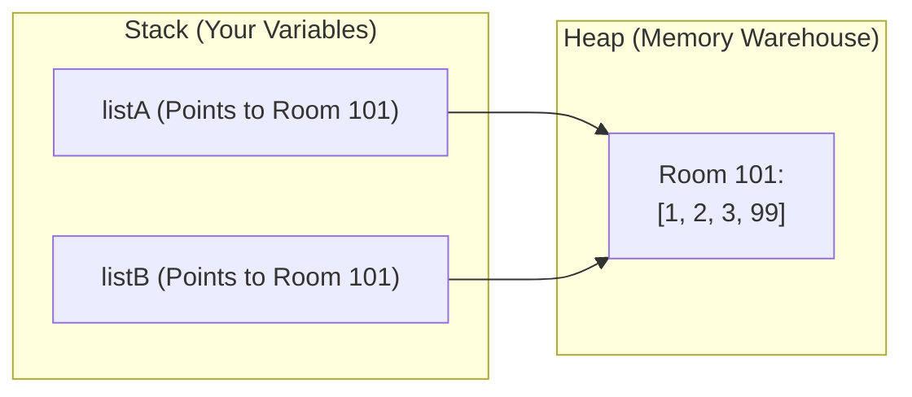
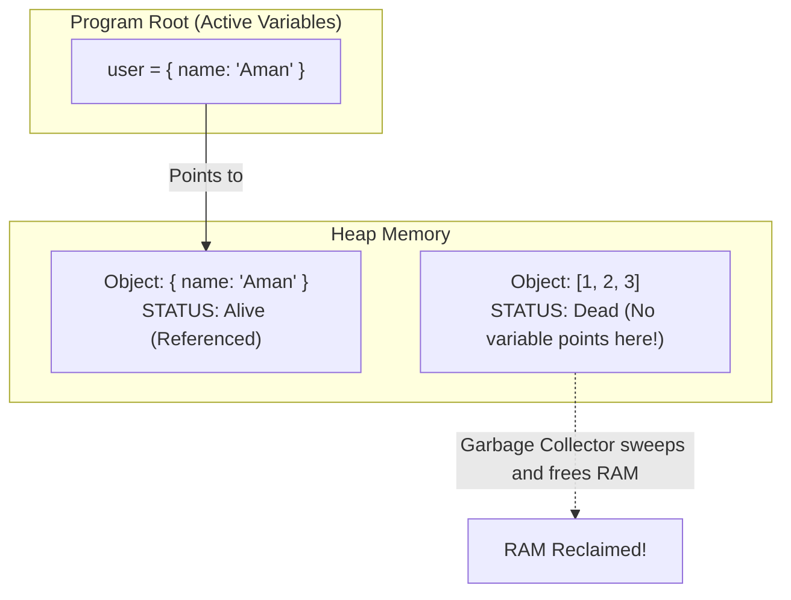
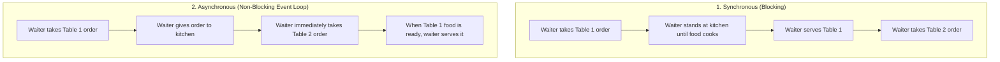
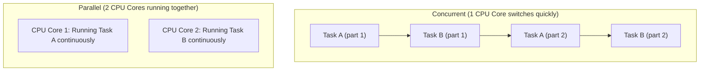
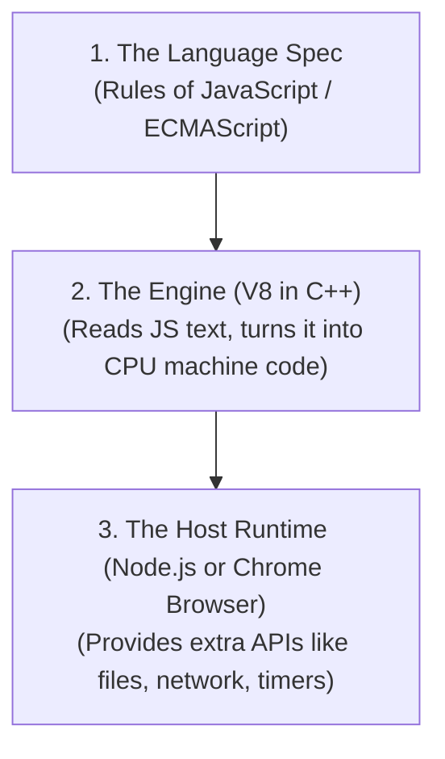
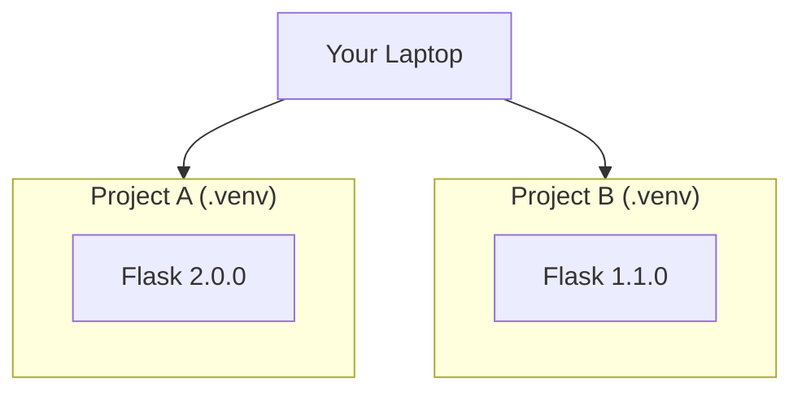

# Chapter 00: Python & JavaScript Core Mental Models (Ground Zero)

> **Welcome!** Many developers learn Python or JavaScript by writing code until it works. But when strange bugs happen—like changing one array accidentally modifying another, or async code executing out of order—they get stuck.
> 
> In this chapter, we will explain **the exact mental models** behind Python and JavaScript using simple everyday English, side-by-side code comparisons, and visual diagrams.

---

## 1. The Biggest Trap: Mutation vs. Reassignment (Pass-by-Sharing)

When beginners ask: *"Is Python / JavaScript pass-by-value or pass-by-reference?"*
The correct computer science answer is: **Call-by-Sharing (Pass-by-Assignment)**.

Let's understand what this means without fancy words.

### The Two Types of Data

In both Python and JavaScript, data is split into two categories:

| Category | Python Types | JavaScript Types | Where It Lives | How It Behaves |
|---|---|---|---|---|
| **Primitives** (Simple Values) | `int`, `float`, `str`, `bool`, `tuple` | `number`, `string`, `boolean`, `null`, `undefined`, `symbol`, `bigint` | Stored directly | **Immutable** (Cannot be changed inside memory) |
| **Collections** (Objects / Containers) | `list`, `dict`, `set`, custom class objects | `Array`, `Object`, `Map`, `Set` | Stored on the **Heap** | **Mutable** (Can be modified in place) |

---

### The Experiment: Numbers vs. Lists

#### Experiment A: Numbers (Primitives)
```python
# Python
x = 10
y = x      # y gets a copy of the number 10
y = 20     # Reassigning y does NOT affect x
print(x)   # Output: 10 (x is unchanged!)
```

```javascript
// JavaScript
let x = 10;
let y = x;      // y gets a copy of the number 10
y = 20;         // Reassigning y does NOT affect x
console.log(x); // Output: 10 (x is unchanged!)
```

#### Experiment B: Lists / Arrays (Collections)
```python
# Python
list_a = [1, 2, 3]
list_b = list_a     # list_b does NOT make a copy! It copies the POINTER.

list_b.append(99)   # MUTATING the shared list!
print(list_a)       # Output: [1, 2, 3, 99] <-- list_a CHANGED!
```

```javascript
// JavaScript
let listA = [1, 2, 3];
let listB = listA;   // listB copies the memory POINTER, not the array!

listB.push(99);      // MUTATING the shared array!
console.log(listA);  // Output: [1, 2, 3, 99] <-- listA CHANGED!
```

### Visualizing the Memory: What Happened?



### Mutation vs. Reassignment: The Magic Difference
Notice what happens if we **reassign** instead of **mutating**:

```python
list_a = [1, 2, 3]
list_b = list_a

# REASSIGNMENT: Creating a brand new list with the '=' sign
list_b = [9, 9, 9]

print(list_a)  # Output: [1, 2, 3] (list_a did NOT change!)
```

* **Mutation** (`list.append()`, `arr.push()`, `obj.key = val`): Modifies the shared room on the Heap.
* **Reassignment** (`list = [9, 9, 9]`): Moves the variable's ticket to point to a completely new room!

---

## 1.5 Truthiness & Falsiness: The Empty Array Trap

One of the most frequent bugs in JavaScript for developers coming from Python (or vice versa) is how **empty lists/arrays** behave inside `if` statements!

### The Big Difference:
* In **Python**: An empty list `[]` or empty dict `{}` is considered **False**!
* In **JavaScript**: An empty array `[]` or empty object `{}` is considered **TRUE**!

```python
# Python
items = []
if items:
    print("Has items")
else:
    print("List is empty!")  # <-- This prints! (Empty list is False)
```

```javascript
// JavaScript
let items = [];
if (items) {
    console.log("Has items!"); // <-- BUG! This prints! Empty array is TRUE in JS!
}

// In JavaScript, you MUST check the length:
if (items.length > 0) {
    console.log("Has items!");
} else {
    console.log("Array is empty!"); // Correct!
}
```

### The "Falsy" Values Cheat Sheet:

| Value | Python evaluates to: | JavaScript evaluates to: |
|---|---|---|
| `0` | **False** | **False** |
| `""` (empty string) | **False** | **False** |
| `[]` (empty list / array) | **False** | **TRUE (Gotcha!)** |
| `{}` (empty dict / object) | **False** | **TRUE (Gotcha!)** |
| `None` / `null` | **False** | **False** |
| `undefined` | *(Does not exist in Python)* | **False** |
| `NaN` (Not a Number) | *(Does not exist natively)* | **False** |

---

## 1.6 The `None` vs. `null` vs. `undefined` Mystery

Why does JavaScript have both `null` and `undefined`, while Python only has `None`?

* **Python `None`**: Represents the intentional absence of a value.
* **JavaScript `undefined`**: *"The computer looked for a value, but nobody has assigned anything yet."*
  ```javascript
  let age;
  console.log(age); // undefined (declared, but not given a value)
  ```
* **JavaScript `null`**: *"A programmer intentionally set this value to be completely empty."*
  ```javascript
  let currentUser = null; // Deliberately empty (no user is logged in yet)
  ```

---

## 2. Garbage Collection: Who Cleans Up Your Memory?

When you create objects in RAM, you don't manually type `free(memory)` like C/C++ programmers. A background cleaner called the **Garbage Collector (GC)** does it for you.

How do Python and JavaScript know when an object is no longer needed?



### 1. Python's Method: Reference Counting
* Every object in Python has a hidden counter: *"How many variables are pointing to me right now?"*
* When you do `a = [1, 2]`, count = 1.
* When `a` goes out of scope or is set to `None`, count = 0.
* When count hits **0**, Python immediately deletes it from RAM!

### 2. JavaScript's Method: Mark-and-Sweep
* V8 periodically starts at the "root" (the `window` object in browsers, or `global` in Node.js).
* It follows every pointer like a web crawler. Every object it can reach gets a virtual **"Mark"** sticker.
* Any object in Heap memory that has no mark is unreachable. The engine **"Sweeps"** it into the trash!

### What is a Memory Leak?
A memory leak is when an object is **never marked as trash** because an unused global variable or forgotten event listener still points to it:
```javascript
// MEMORY LEAK EXAMPLE IN JS:
const cache = [];
setInterval(() => {
    // This array grows bigger every second forever and is NEVER cleaned up!
    cache.push(new Array(1000000).fill("data"));
}, 1000);
```

---

## 3. The 4 Concurrency Buzzwords Demystified

People often mix up: **Synchronous**, **Asynchronous**, **Concurrent**, and **Parallel**. 
Let's use a simple **Restaurant Analogy** so you will never forget them.



### 1. Synchronous (Line-by-Line / Blocking)
* **What it means**: Code runs line-by-line. Line 2 **cannot start** until Line 1 is 100% finished.
* **Problem**: If Line 1 downloads a 1GB file, your entire program stops and freezes for 10 seconds.

### 2. Asynchronous (Non-blocking)
* **What it means**: Start a slow task (like downloading a file or querying a database), tell the system *"call me back when it's done"*, and immediately move on to the next line.
* **Crucial Rule**: **Asynchronous does NOT mean multi-threaded!** 
  * In Node.js and Python `asyncio`, there is still only **ONE** main thread (one waiter). But because the waiter does not stand idle in the kitchen waiting for the oven, one waiter can handle 100 tables!

### 3. Concurrent vs. Parallel
* **Concurrent**: Managing multiple tasks at the same time by switching back and forth quickly (juggling 3 balls with 2 hands).
* **Parallel**: Actually doing multiple tasks at the exact same physical millisecond (requires multiple CPU cores; 2 people juggling separately).



---

## 4. How Async Code Looks in Python vs. JavaScript

Both languages use the exact same mental model: `async` and `await`.

### JavaScript Example:
```javascript
// Function marked 'async' returns a Promise
async function fetchUserData(userId) {
    console.log("1. Starting network request...");
    
    // 'await' pauses this function and lets other code run while waiting for network
    let response = await fetch(`https://jsonplaceholder.typicode.com/users/${userId}`);
    let data = await response.json();
    
    console.log("2. Data received for: " + data.name);
    return data;
}

console.log("A. Before calling function");
fetchUserData(1);
console.log("B. After calling function");

// OUTPUT ORDER:
// A. Before calling function
// 1. Starting network request...
// B. After calling function  <-- Notice this ran BEFORE the data arrived!
// 2. Data received for: Leanne Graham
```

### Python Example:
```python
import asyncio

# Function marked 'async def' returns a Coroutine
async def fetch_user_data(user_id):
    print("1. Starting simulated network request...")
    
    # 'await' yields control to the event loop while waiting
    await asyncio.sleep(2)  # Simulating a 2-second network delay
    
    print("2. Data received for user:", user_id)
    return {"id": user_id, "name": "Aman"}

async def main():
    print("A. Starting main")
    # Schedule both tasks to run concurrently!
    await asyncio.gather(
        fetch_user_data(1),
        fetch_user_data(2)
    )
    print("B. All tasks finished")

asyncio.run(main())
```

---

## 5. Runtimes, Engines & Tooling Demystified

When people talk about Node.js, V8, CPython, or npm, it sounds confusing. Let's make it crystal clear:

### 1. Language vs. Engine vs. Runtime



* **The Engine (V8)**: The C++ program written by Google. It only knows pure JavaScript (loops, variables, functions). V8 does **not** know what a file or a web camera is!
* **The Runtime (Node.js or Browser)**:
  * **Browser Runtime** adds: `window`, `document`, `fetch()`, DOM buttons.
  * **Node.js Runtime** adds: `fs` (file system), `http` (web server), `process` (operating system).
* **Python Equivalent**:
  * **CPython**: The standard Python engine written in C. It compiles Python text into bytecode (`.pyc`) and executes it in a virtual machine loop.

---

### 2. Why Global `pip install` Breaks Things (Virtual Environments)

If you install Python packages globally:
```bash
pip install flask==2.0.0
```
This installs Flask in your system's global Python folder.
Next month, you clone an old project that needs `flask==1.1.0`. If you upgrade it, your first project crashes!

#### The Solution: Virtual Environments (`.venv`)
A virtual environment is simply a **local folder** that contains its own private copy of Python and packages.



Always create a virtual environment for every Python project:
```bash
# 1. Create the local environment folder named '.venv'
python3 -m venv .venv

# 2. Activate it (Linux/Mac)
source .venv/bin/activate

# 3. Now anything you install stays ONLY inside this project!
pip install requests
```

---

### 3. JavaScript: `package.json` vs. `package-lock.json`
* **`package.json`**: A wishlist. It says: `"I want express version ^4.18.0"` (the `^` symbol means: *"give me 4.18.0 or any newer minor version"*).
* **`package-lock.json`**: The exact recipe. It locks the exact version, download URL, and SHA-512 cryptographic hash of every single dependency.
  * *Rule*: Always commit `package-lock.json` to Git! Otherwise, when your teammate runs `npm install`, they might get a newer sub-dependency that breaks the app.

---

## 6. Debugging Mastery: Stop Guessing with `print()`

Beginners debug by adding 20 `print()` or `console.log()` lines. When you have large async apps, this becomes impossible.

### 1. How to Read a Python Traceback (Bottom-to-Top)
Python prints errors from **top to bottom**, meaning the **actual crash is at the very bottom**!

```text
Traceback (most recent call last):
  File "main.py", line 14, in <module>
    process_user()
  File "main.py", line 8, in process_user
    calculate_tax(user["salary"])
  File "main.py", line 3, in calculate_tax
    return salary * 0.18
TypeError: can't multiply sequence by non-int of type 'float'   <-- LOOK HERE FIRST!
```
1. Look at the **last line first**: `TypeError`. It tried to multiply a string (`"50000" * 0.18`).
2. Look at the line above it: `File "main.py", line 3`.
3. You immediately know: `user["salary"]` was passed as a string instead of an integer.

### 2. How to Read a JavaScript Stack Trace (Top-to-Bottom)
V8 JavaScript prints errors in reverse: the **actual crash is at the very top**!

```text
TypeError: Cannot read properties of undefined (reading 'salary')  <-- LOOK HERE FIRST!
    at calculateTax (index.js:3:22)                               <-- Exact line of crash!
    at processUser (index.js:8:5)
    at Object.<anonymous> (index.js:14:1)
```
1. Look at the **first line**: You tried to do `user.salary`, but `user` was `undefined`!
2. Line 2 tells you the exact file and line number: `index.js:3:22`.

### 3. Setting Real Breakpoints (No `print` statements!)

#### In Python:
Put this single line anywhere in your code where you want to pause:
```python
breakpoint()  # Built into Python 3.7+
```
When you run your program, it will pause right there and open an interactive prompt:
* Type `p variable_name` to see what is inside any variable.
* Type `n` to step to the next line.
* Type `c` to continue running.

#### In JavaScript:
Put this single line in your code:
```javascript
debugger;
```
Run Node.js with the inspect flag:
```bash
node --inspect-brk index.js
```
Open Chrome browser, type `chrome://inspect`, click "Inspect", and you have a full visual debugger with variable inspection!

---

## 7. Production Case Studies, Runtime Drifts & Interview Traps

### Production Case Study 1: The Python Cyclic Reference Memory Leak
* **The Incident**: A high-throughput FastAPI service gradually consumed 4 GB of RAM over 3 days until the Linux kernel OOM-killer terminated the pod. Profiling showed memory was dominated by `RequestContext` objects.
* **Root Cause**: The application created a circular reference: a parent `RequestContext` held a reference to a child `DatabaseSession`, while the child held a reference back to the parent:
  ```python
  class RequestContext:
      def __init__(self):
          self.session = DatabaseSession(self) # Cyclic reference!
  ```
  Python's primary **Reference Counter** could never drop to zero because each object had a refcount of 1! Although Python's cyclic Garbage Collector (GC) eventually runs, high allocation rates outpaced the cyclic collection thresholds (`gc.get_threshold()`).
* **The Fix**: Use `weakref` to break the cycle without preventing cleanup:
  ```python
  import weakref
  class DatabaseSession:
      def __init__(self, context):
          self.context = weakref.ref(context) # Non-owning weak pointer!
  ```

### Production Case Study 2: The Node.js Event Loop Freeze via Synchronous Hashing
* **The Incident**: An authentication service handling 2,000 requests/sec suffered a 99% drop in throughput. All health check endpoints failed with HTTP 504 gateway timeouts.
* **Root Cause**: A developer used `bcrypt.hashSync(password, 12)` inside a login endpoint. Computing bcrypt with 12 rounds is CPU-bound and takes ~250ms of pure computation. Because Node.js is **single-threaded**, computing 4 simultaneous logins froze the entire Node.js event loop for 1 full second, blocking all other 2,000 incoming network I/O requests!
* **The Fix**: Always use the asynchronous non-blocking version (`await bcrypt.hash(password, 12)`), which delegates the CPU work to the background `libuv` threadpool.

### Runtime Drifts to Watch:
1. **The Truthiness Drift (`0` vs. `null` in validation)**:
   In JavaScript, `0`, `""`, and `false` are all falsy:
   ```javascript
   function setDiscount(percentage) {
       // BUG: If percentage is 0 (valid zero discount), it defaults to 10%!
       const discount = percentage || 10; 
   }
   // FIX: Use Nullish Coalescing (??) which only triggers on null or undefined!
   const discount = percentage ?? 10;
   ```
2. **IEEE 754 Floating-Point Precision Drift**:
   Computers store decimal numbers in binary floating point. `0.1 + 0.2 === 0.30000000000000004`. If your financial app calculates currency balances using floats, penny rounding errors accumulate into thousands of dollars of ledger mismatch.
   * **Fix**: In financial systems, store money in **integer cents** (e.g. `$10.50` stored as `1050`), or use specialized decimal libraries (`decimal.Decimal` in Python, `decimal.js` in JS).

### FAANG Interview Scenarios & Traps:

#### Scenario 1: "Why does `def append_to(item, target_list=[])` share items across calls in Python?"
* **Answer**: In Python, **default arguments are evaluated ONCE at function definition time**, not each time the function is invoked! The list `[]` is created when the module is imported into memory; subsequent calls modify that same shared heap object.
  ```python
  # The Mandatory Idiom:
  def append_to(item, target_list=None):
      if target_list is None:
          target_list = []
      target_list.append(item)
      return target_list
  ```

#### Scenario 2: "What is the difference between Microtasks and Macrotasks in the Node.js Event Loop?"
* **Answer**:
  * **Macrotasks**: `setTimeout`, `setInterval`, `setImmediate`, I/O callbacks.
  * **Microtasks**: `process.nextTick`, `Promise.then/catch/finally`, `queueMicrotask`.
  * **The Execution Priority**: After *every single macrotask* completes, Node.js **completely drains the entire Microtask queue** before picking up the next macrotask! If microtasks continuously schedule more microtasks, macrotasks (and network I/O) are starved indefinitely!

---

## Checkpoint Exercise

1. In JavaScript, if you write `if (my_array)` where `my_array = []`, will the condition evaluate to `true` or `false`? How does Python treat an empty list?
2. What is the difference between `null` and `undefined` in JavaScript?
3. How does Python's Garbage Collector know when to delete a list from memory? *(Hint: Reference counting).*
4. Does `await fetch()` cause your whole computer or CPU to freeze while waiting for the response? Why or why not?

*Now you understand the core mechanics! Proceed to [Chapter 01](./python_javascript_study_plan.md).*
