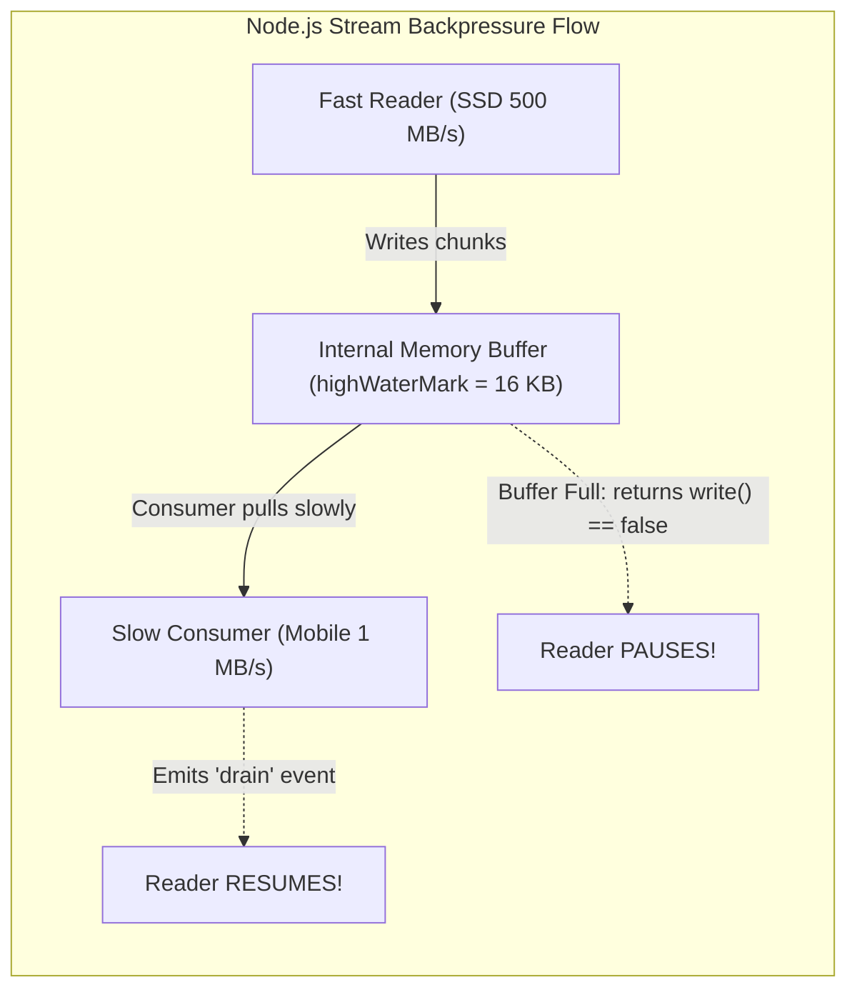

# Chapter 02: File Systems, Paths & OS Interfaces (Deep Dive)

> **Welcome to Chapter 02 of the Python & JavaScript Track!**
> Reading and writing files sounds simple: `open("data.txt")`.
> 
> But in real-world production systems, file I/O is where major bugs happen:
> * Windows apps crashing with `UnicodeDecodeError: 'charmap'` because UTF-8 was not explicitly specified.
> * Invisible Byte Order Marks (BOM) breaking JSON parsers.
> * Servers running out of memory (OOM) because someone read a 5GB file with `file.read()`.
> * Node.js servers freezing all incoming user traffic because someone used `fs.readFileSync()`.
> * The operating system throwing `EMFILE: too many open files` and refusing to take new web requests.
> 
> In this chapter, we will master file systems, path resolutions, file encodings, and streaming I/O in both Python and JavaScript.

---

## 1. The Cross-Platform Path Trap: Windows (`\`) vs. Linux (`/`)

* **Windows** uses backslashes: `C:\Users\Tinesh\project\data.txt`
* **Linux and macOS** use forward slashes: `/home/tinesh/project/data.txt`

Never hardcode string concatenation like `folder + "/" + file`!

#### Python (`pathlib` - Modern Object-Oriented):
```python
from pathlib import Path

# Automatically uses '/' on Linux/Mac, and '\' on Windows!
data_dir = Path("my_folder") / "sub_folder" / "data.txt"
```

#### JavaScript / Node.js (`node:path`):
```javascript
const path = require('node:path');

// Safe cross-platform path joining
const dataDir = path.join("my_folder", "sub_folder", "data.txt");
```

---

## 2. Absolute vs. Relative Paths & The "CWD Trap"

When you write a relative path like `"data/users.json"`, Python and Node.js do **NOT** look relative to where the code file lives! 
They look relative to **where your terminal was standing when you typed the run command** (the **CWD: Current Working Directory**)!

### The Bulletproof Fix: Resolving Relative to `__file__` or `__dirname`
Always build paths anchored to the location of the running script file itself:

#### Python:
```python
from pathlib import Path

BASE_DIR = Path(__file__).resolve().parent
file_path = BASE_DIR / "data" / "users.json"
```

#### Node.js:
```javascript
const path = require('node:path');
const filePath = path.join(__dirname, 'data', 'users.json');
```

---

## 2.5 File Encodings: The UTF-8 and BOM Trap

### The Windows `charmap` Crash
On Linux/macOS, Python defaults to opening files as **UTF-8**.
On Windows, Python historically defaulted to the legacy Windows ANSI encoding (e.g., `cp1252` or `charmap`)!

If your file contains an emoji or an Indian rupee symbol (`₹`), running this code on Windows crashes:
```python
# CRASHES ON WINDOWS!
with open("data.txt", "r") as f:
    text = f.read()
# UnicodeDecodeError: 'charmap' codec can't decode byte 0x9d...
```

> **The Golden Rule**: **ALWAYS explicitly pass `encoding='utf-8'` in Python!**
> ```python
> with open("data.txt", "r", encoding="utf-8") as f:
>     text = f.read()
> ```

### The Invisible Byte Order Mark (BOM: `\ufeff`)
Sometimes, files saved from Microsoft Excel or Windows Notepad contain an invisible 3-byte prefix at the very beginning of the file: `\xef\xbb\xbf` (UTF-8 BOM).
* When you pass this text to `json.loads()`, it crashes with `JSONDecodeError: Unexpected UTF-8 BOM`!
* **The Python Fix**: Use `encoding='utf-8-sig'`. It automatically detects and strips the invisible BOM prefix!

---

## 3. Python File I/O: Why the `with` Statement is Mandatory

```python
# TERRIBLE CODE (Memory & File Descriptor Leak!)
f = open("log.txt", "w")
f.write("System online")
# What if an exception happens here? f.close() will NEVER run!
f.close()
```

### The File Descriptor Leak
Linux has a hard limit per process (usually 1,024 open files).
* If your web app opens files without closing them, after 1,024 requests, Linux throws:
  ```text
  OSError: [Errno 24] Too many open files
  ```
* Your server can no longer open files, connect to databases, or accept incoming user HTTP sockets!

### The Solution: Context Managers (`with`)
The `with` statement guarantees that `f.close()` is **always executed**, even if the code crashes!

```python
# CLEAN & SAFE:
with open("log.txt", "w", encoding="utf-8") as f:
    f.write("System online")
# File is 100% guaranteed closed here automatically!
```

---

## 4. Chunked File Reading: Processing a 10GB File with 50MB RAM

### The Deadly Mistake:
```python
# DISASTER! Tries to load 10GB into RAM at once!
with open("huge_access.log", "r") as f:
    data = f.read() # Crash! Out-Of-Memory (OOM Killed by Linux kernel)
```

### The Solution: Chunked Streaming (Iterators)
In Python, a file object is an **iterator**. It reads lines one by one from disk into a tiny buffer:

```python
# USES LESS THAN 10MB OF RAM!
error_count = 0

with open("huge_access.log", "r", encoding="utf-8") as f:
    for line in f:
        if "500 Internal Server Error" in line:
            error_count += 1
```

For binary files, read in fixed chunk buffers (e.g., 64KB blocks):
```python
CHUNK_SIZE = 64 * 1024 # 64 Kilobytes

with open("large_video.mp4", "rb") as f_in, open("copy.mp4", "wb") as f_out:
    while True:
        chunk = f_in.read(CHUNK_SIZE)
        if not chunk:
            break
        f_out.write(chunk)
```

---

## 5. Temporary Files: Safe Creation & Auto-Cleanup

When your app processes user uploads (like converting an image or generating a PDF), you need a temporary file that automatically deletes itself after processing:

#### Python (`tempfile` module):
```python
import tempfile

# Automatically deletes file from disk when the with-block exits!
with tempfile.NamedTemporaryFile(mode="w+", delete=True) as temp_file:
    temp_file.write("Temporary payload")
    temp_file.seek(0)
    print("Reading temp file:", temp_file.read())
# File is gone from disk!
```

#### Node.js (`os.tmpdir()`):
```javascript
const os = require('node:os');
const path = require('node:path');
const fs = require('node:fs/promises');

async function handleTemp() {
    // Creates a unique temporary folder in /tmp or C:\Users\AppData\Local\Temp
    const tempDir = await fs.mkdtemp(path.join(os.tmpdir(), 'upload-'));
    const tempFilePath = path.join(tempDir, 'data.tmp');
    await fs.writeFile(tempFilePath, 'Temporary payload');
    
    // Clean up when done
    await fs.rm(tempDir, { recursive: true, force: true });
}
```

---

## 6. Node.js Streams: The Sins of `fs.readFileSync()`

In Node.js:
* **`fs.readFileSync()`**: BLOCKS the single main thread! If it takes 2 seconds, all 5,000 active users freeze for 2 seconds. Never use in web servers!
* **`fs.promises.readFile()`**: Non-blocking async/await for small files.
* **Streams (`createReadStream()`)**: Streams chunks like water for massive files.

```javascript
const fs = require('node:fs');

// Copies a 5GB file using less than 20MB of RAM!
const readStream = fs.createReadStream('input_huge.csv');
const writeStream = fs.createWriteStream('output_huge.csv');

// pipe() automatically handles Backpressure (pauses reading if writing is slow)
readStream.pipe(writeStream);
```

---

## 7. Production Case Studies, I/O Drifts & Interview Traps

### Production Case Study 1: The 5GB CSV Ingest V8 Heap OOM Crash
* **The Incident**: A financial analytics portal offered a feature to export quarterly transaction statements. A client requested their annual ledger (a 4.8 GB CSV file). Seconds after triggering the download, the backend Node.js worker crashed with:
  `FATAL ERROR: Ineffective mark-compacts near heap limit Allocation failed - JavaScript heap out of memory`
* **Root Cause**: The API endpoint used `const data = await fs.promises.readFile(filePath)`. By default, the V8 JavaScript engine caps maximum heap allocation at ~1.4 GB on 64-bit systems. Reading a 4.8 GB file attempted to allocate an array buffer far exceeding the heap ceiling, crashing the process immediately.
* **The Fix**: Switch to streaming response pipelines:
  ```javascript
  app.get('/download/ledger', (req, res) => {
      res.setHeader('Content-Type', 'text/csv');
      res.setHeader('Content-Disposition', 'attachment; filename="ledger.csv"');
      const stream = fs.createReadStream(largeFilePath);
      stream.pipe(res); // Streams chunks directly to network with 25MB RAM!
  });
  ```

### Production Case Study 2: The Windows Backslash Path Separator CI Failure
* **The Incident**: A developer implemented a document indexing feature on their Windows laptop. All unit tests passed locally. When merged to `main` and deployed to an Ubuntu production cluster, every document indexing job threw: `FileNotFoundError: [Errno 2] No such file or directory: 'temp\\docs\\report.pdf'`.
* **Root Cause**: The code used string interpolation: `file_path = f"temp\\docs\\{filename}"`. Windows treats both `\` and `/` as valid path separators. However, Linux treats `\` as a literal character in the file name! Linux searched for a single file named `"temp\docs\report.pdf"` inside the root folder instead of navigating into subdirectories.
* **The Rule**: Never concatenate paths with raw string slashes! Always use `pathlib.Path` or `os.path.join()` in Python, and `path.join()` in Node.js.

### I/O Drifts to Watch:
1. **Encoding Drift (The Windows Charmap Trap)**:
   In Python on Windows, omitting `encoding="utf-8"` in `open("data.txt")` causes Python to default to the legacy OS codepage (e.g. `cp1252` or `charmap`). As long as test data contains basic English ASCII, tests pass. The moment an international customer enters an emoji (`🚀`) or European accented letter (`é`), production throws `UnicodeDecodeError: 'charmap' codec can't decode byte 0x9d`.
   * **Fix**: Always enforce `encoding="utf-8"` on every file operation.
2. **File Descriptor Leak Drift via Exception Jumps**:
   If an exception occurs between opening a file handle and calling `.close()`, the descriptor remains held by the OS until the garbage collector runs. Under high traffic, this rapidly exhausts the process `ulimit -n`, dropping incoming network sockets.
   * **Fix**: Context managers (`with` in Python) and `try...finally` in JS are mandatory.

### FAANG Interview Scenarios & Traps:



#### Scenario 1: "What is the difference between `path.join('/a', '/b')` and `path.resolve('/a', '/b')` in Node.js?"
* **Answer**:
  * `path.join('/a', '/b')`: Simply concatenates path segments using the platform separator, returning `'/a/b'`.
  * `path.resolve('/a', '/b')`: Processes arguments from right to left like a series of `cd` shell commands until an absolute path is formed. Because `'/b'` begins with a leading root slash, `resolve` treats it as the absolute root and discards `'/a'`, returning `'/b'`!

#### Scenario 2: "What is Stream Backpressure in Node.js, and what happens if you ignore it?"
* **Answer**: Backpressure occurs when the **data source (Readable Stream)** produces data faster than the **destination (Writable Stream)** can write (e.g., fast SSD reading at 500 MB/s sending data to a slow 1 MB/s mobile client).
  * If you ignore `writeStream.write(chunk) === false`, the unwritten chunks accumulate in the internal Node.js memory buffer.
  * In minutes, buffer consumption explodes to gigabytes of RAM, causing process OOM crashes!
  * Using `.pipe()` or `stream.pipeline()` automatically monitors backpressure, pausing the reader when the buffer fills and resuming when the `'drain'` event fires.

#### Scenario 3: "What is a Path Traversal Attack, and how do you protect file download endpoints?"
* **Answer**: If an endpoint accepts a user filename: `GET /download?file=report.pdf`:
  * An attacker supplies: `file=../../../../etc/passwd` or `file=../../.env`.
  * Naive `open(f"/var/www/uploads/{filename}")` traverses up to the root directory and leaks server secrets!
  * **Fix**: Validate that the resolved absolute path starts strictly with the base directory:
    ```javascript
    const safePath = path.resolve(BASE_DIR, userFilename);
    if (!safePath.startsWith(BASE_DIR)) {
        throw new Error("Access Denied: Path Traversal Detected");
    }
    ```

#### Scenario 4: "What is the CWD Trap, and why does `open('config.json')` fail in systemd/cron?"
* **Answer**: Relative paths are resolved against the **Current Working Directory (`os.getcwd()`)**, which is the directory where the terminal command was executed, NOT where the script file lives!
  * If cron executes `/usr/bin/python /var/app/cron.py` from `/root/`, `open('config.json')` looks in `/root/config.json` and crashes!
  * **Fix**: Always anchor relative paths to the file's own location:
    * Python: `Path(__file__).resolve().parent / "config.json"`
    * Node.js: `path.join(__dirname, 'config.json')`

#### Scenario 5: "How does Python's `with` statement implement Context Managers under the hood?"
* **Answer**: It invokes the **Context Manager Protocol**:
  1. Calls `obj.__enter__()` before entering the block (acquires file handle, socket, or DB lock).
  2. Executes code inside the block.
  3. Calls `obj.__exit__(exc_type, exc_val, exc_tb)` when leaving the block, **even if an unhandled exception or crash occurred**!
  4. Guarantees file descriptors and locks are 100% safely closed without manual `finally` boilerplate.

#### Scenario 6: "What is the difference between Buffered I/O and Direct/Unbuffered I/O?"
* **Answer**:
  * **Unbuffered I/O**: Every single `write("a")` call triggers an expensive kernel system call (`write()`), crossing the CPU protection ring boundary. Writing 10,000 bytes one-by-one requires 10,000 syscalls, taking 50 milliseconds!
  * **Buffered I/O (Default)**: The runtime collects bytes into an in-memory 8 KB buffer in user space. It only triggers a kernel syscall when the buffer fills or when `.flush()` is called, doing the work in a single $0.05$ ms operation ($1000\times$ faster).

#### Scenario 7: "What is a UTF-8 BOM (`\ufeff`), and why does CSV parsing fail with `KeyError: '\ufeffid'`?"
* **Answer**: Microsoft Excel prepends a 3-byte invisible **Byte Order Mark** (`EF BB BF`) to CSV files to identify them as UTF-8.
  * Standard UTF-8 readers treat those 3 bytes as text character `\ufeff`.
  * The first column header `"id"` becomes `"\ufeffid"`, causing `row["id"]` to throw a `KeyError`!
  * **Fix**: In Python, open with `encoding="utf-8-sig"` (which automatically detects and strips the BOM). In Node.js, strip `\ufeff` using regex.

#### Scenario 8: "Why does `fs.readFileSync()` freeze an entire production Node.js cluster?"
* **Answer**: Node.js executes JavaScript on a **single main thread**. When `fs.readFileSync()` runs, the thread is blocked waiting for disk hardware (which can take 50–500ms on loaded cloud disks). During those 500ms, the event loop cannot process incoming network packets, health checks, or timeouts. All other 2,000 concurrent user requests stall!

#### Scenario 9: "What is the difference between a Hard Link and a Soft Link (Symlink)?"
* **Answer**:
  * **Hard Link**: Points directly to the **underlying physical inode** on the filesystem. Deleting the original filename does NOT delete the file data; data persists until all hard link references are deleted. Cannot cross filesystem partitions.
  * **Soft Link (Symlink)**: A small special file that contains only a text path string pointing to another filename. If the target file is deleted, the symlink breaks ("dangling link"). Can cross partitions and network drives.

#### Scenario 10: "How do you safely create temporary files without leaking disk storage?"
* **Answer**:
  * In Python: Use `tempfile.NamedTemporaryFile()` as a context manager:
    ```python
    import tempfile
    with tempfile.NamedTemporaryFile(delete=True) as tmp:
        tmp.write(b"sensitive intermediate data")
        tmp.flush()
        # File is automatically unlinked from disk upon exiting with block!
    ```
  * In Node.js: Use `fs.mkdtemp(path.join(os.tmpdir(), 'prefix-'))` and register cleanup hooks on `process.on('exit')`.

---

## Chapter 02 Checklist (Summary)

Before moving to Chapter 03, verify that you can answer these:
- [x] Why does hardcoding forward slashes (`/`) break cross-platform compatibility on Windows?
- [x] What is the CWD trap, and how does `__dirname` or `Path(__file__)` fix it?
- [x] Why should you always explicitly pass `encoding='utf-8'` in Python to prevent Windows charmap crashes?
- [x] What is an invisible UTF-8 BOM (`\ufeff`), and how does `utf-8-sig` fix it?
- [x] Why does forgetting a `with open(...)` block cause `Too many open files` errors under load?
- [x] Why is `fs.readFileSync()` forbidden in production Node.js servers?

*Chapter 02 is complete! Proceed to [Chapter 03: Data Formats & Serialization 101](./chapter_03.md).*
