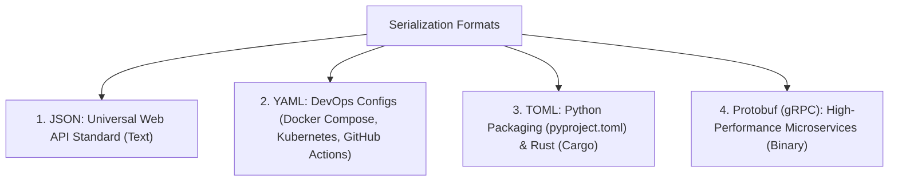
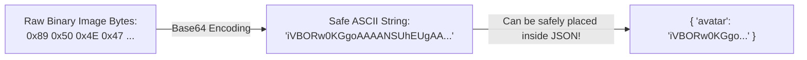

# Chapter 03: Data Formats & Serialization 101 (Deep Dive)

> **Welcome to Chapter 03 of the Python & JavaScript Track!**
> Modern software rarely lives in isolation. Your Python backend talks to your JavaScript frontend, which talks to an external payment API, which writes records to a database.
> 
> But computers cannot send live Python objects or JavaScript class instances over network cables! Network cables only carry raw bytes.
> 
> In this chapter, we will master **Serialization** (converting memory objects into transportable text) and **Deserialization** (parsing text back into objects), along with JSON gotchas, YAML security traps, Base64 encoding, and Google's Protocol Buffers (Protobuf).

---

## 1. What is Serialization vs. Deserialization?

```mermaid
flowchart LR
    subgraph RAM1["Your App's RAM"]
        Obj["In-Memory Object / Dict:<br/>{ name: 'Aman', age: 26 }"]
    end
    
    subgraph Wire["Network Cable / Disk Storage"]
        Text["Serialized Text (JSON / Bytes):<br/>'{\"name\":\"Aman\",\"age\":26}'"]
    end
    
    subgraph RAM2["Remote Server's RAM"]
        Obj2["Reconstructed Object / Dict:<br/>{ name: 'Aman', age: 26 }"]
    end
    
    Obj -->|"Serialization (dumps / stringify)"| Text
    Text -->|"Deserialization (loads / parse)"| Obj2
```

* **Serialization** (Marshalling / Encoding): Taking a complex in-memory object (which contains memory pointers and heap references) and flattening it into a plain text string or byte stream.
* **Deserialization** (Unmarshalling / Decoding): Reading that text string and reconstructing a live object in the new computer's Heap memory.

---

## 2. JSON in Python & JavaScript: The Essential APIs

| Task | Python (`import json`) | JavaScript (`JSON`) |
|---|---|---|
| **Object $\to$ String** | `json.dumps(obj)` | `JSON.stringify(obj)` |
| **String $\to$ Object** | `json.loads(text)` | `JSON.parse(text)` |
| **Object $\to$ File Stream** | `json.dump(obj, file)` | *(Use `stringify` + `fs.writeFile`)* |
| **File Stream $\to$ Object** | `json.load(file)` | *(Use `fs.readFile` + `parse`)* |

> **Memory Trick for Python**:
> * `dumps` / `loads` with an **'s'** stands for **String** (`json.dumps` = dump to string).
> * `dump` / `load` without an 's' operates directly on a **File** stream.

---

## 3. The 4 Deadly JSON Gotchas Every Developer Hits

### Trap 1: The JavaScript Date Trap
When you serialize a JavaScript `Date` object, `JSON.stringify` converts it into an ISO timestamp string.
* `JSON.parse` does **NOT** turn it back into a Date object! It remains a plain string.
* If you call `.getFullYear()`, your code crashes! You must do `new Date(parsed.createdAt)`.

### Trap 2: JavaScript Drops `undefined` and Functions Silently!
In JSON, there is **no concept of `undefined`**! Only `null` is valid.
* If an object has `{ bio: undefined }`, `JSON.stringify` **silently deletes the `bio` key entirely**!

### Trap 3: The Circular Reference Crash
If `nodeA.neighbor = nodeB` and `nodeB.neighbor = nodeA`:
* `JSON.stringify(nodeA)` crashes with `TypeError: Converting circular structure to JSON`!

### Trap 4: The Python `datetime` Serialization Error
Python's `json.dumps()` crashes on `datetime.now()` with `TypeError: Object of type datetime is not JSON serializable`.
* **Fix**: Use `json.dumps(data, default=str)`.

---

## 4. Beyond JSON: YAML, TOML & Protocol Buffers (Protobuf)

In modern engineering, JSON is not the only format you will use:



### 1. YAML & The Security Pitfall (`yaml.safe_load`)
YAML is human-readable and indentation-based.
* **The Dangerous Mistake**: In Python, using `yaml.load(untrusted_input)` allows arbitrary Python code execution (just like `pickle`)!
* **The Rule**: **ALWAYS use `yaml.safe_load()`** in Python!

### 2. Protocol Buffers (Protobuf) vs. JSON: Why Google Uses Protobuf
In microservices handling 1,000,000 requests per second (like Uber, Netflix, or Google):
* JSON is **plain text**: It repeats key names (`"first_name": "Raj"`) millions of times, wasting network bandwidth.
* **Protobuf** is a **binary serialization format**:
  1. You define a strict schema in a `.proto` file:
     ```protobuf
     message User {
       int32 id = 1;
       string name = 2;
     }
     ```
  2. Over the wire, it transmits field numbers (`1`, `2`) instead of string names!
  3. **Result**: Protobuf payloads are **$5\times$ to $10\times$ smaller** and serialize **$10\times$ faster** than JSON!

---

## 5. Binary Base64 Encoding: Embedding Images in JSON

JSON can only store text. What if you need to send a user's avatar image or PDF inside a JSON payload?

You cannot put raw binary bytes into JSON!

### The Solution: Base64 Encoding
Base64 converts raw binary bytes into a safe set of **64 printable ASCII characters** (`A-Z`, `a-z`, `0-9`, `+`, `/`):



#### Python:
```python
import base64

# Encoding image/bytes to Base64 string
raw_bytes = b"Hello Binary World!"
b64_string = base64.b64encode(raw_bytes).decode('utf-8')
print("Base64 Encoded:", b64_string)

# Decoding back to bytes
original_bytes = base64.b64decode(b64_string)
```

#### JavaScript:
```javascript
// In Node.js / Browser:
const rawText = "Hello Binary World!";
const b64String = Buffer.from(rawText).toString('base64');
console.log("Base64 Encoded:", b64String);

const originalText = Buffer.from(b64String, 'base64').toString('utf8');
```

---

## 6. Query Strings & URLs: Handling Parameters

When you query an API:
`https://api.com/users?search=Rahul+Sharma&role=admin&page=2`

Characters like `&`, `=`, and spaces must be **percent-encoded** (`%26` for `&`, `%20` for space).

### Safe URL Building in JavaScript (`URLSearchParams`):
```javascript
const params = new URLSearchParams({
    search: "Rock & Roll",
    page: 1
});
console.log(params.toString()); // search=Rock+%26+Roll&page=1
```

### Safe URL Building in Python (`urllib.parse`):
```python
from urllib.parse import urlencode, parse_qs

params = {"search": "Rock & Roll", "page": 1}
query_string = urlencode(params)
print(query_string) # search=Rock+%26+Roll&page=1
```

---

## 7. Working with CSV Data (Why `line.split(",")` Fails)

Never use naive `line.split(",")` on CSV files because addresses often contain commas inside quotes:
`101,"Sharma, Vikram","Bangalore, India",50000`

### The Proper Way (Python `csv.DictReader`):
```python
import csv

with open("users.csv", mode="r", encoding="utf-8") as f:
    reader = csv.DictReader(f)
    for row in reader:
        print(f"User: {row['name']} | City: {row['city']}")
```

---

## 8. The Major Security Vulnerability: Python `pickle` RCE

In Python, `pickle` does not just store data; **it stores executable bytecode instructions**.
* Never run `pickle.loads()` on untrusted files or data from network requests!
* An attacker can craft a pickle payload that executes arbitrary terminal commands (`rm -rf /` or stealing environment variables). Always use JSON or Protocol Buffers for untrusted data!

---

## Chapter 03 Checklist (Summary)

Before moving to Chapter 04, verify that you can answer these:
- [x] What is Serialization vs. Deserialization?
- [x] Why does `JSON.parse` convert `Date` objects into plain strings in JavaScript?
- [x] Why does `JSON.stringify` delete `undefined` values and throw errors on circular references?
- [x] Why should you always use `yaml.safe_load()` instead of `yaml.load()` in Python?
- [x] Why do Google and Netflix use Protocol Buffers (Protobuf) instead of JSON for microservices?
- [x] What is Base64 encoding, and why is it used to put images inside JSON?
- [x] Why is Python's `pickle` module considered a dangerous security vulnerability for web APIs?

*Chapter 03 is complete! Proceed to [Chapter 04: Debugging Mastery & Reading Stack Traces](./chapter_04.md).*
