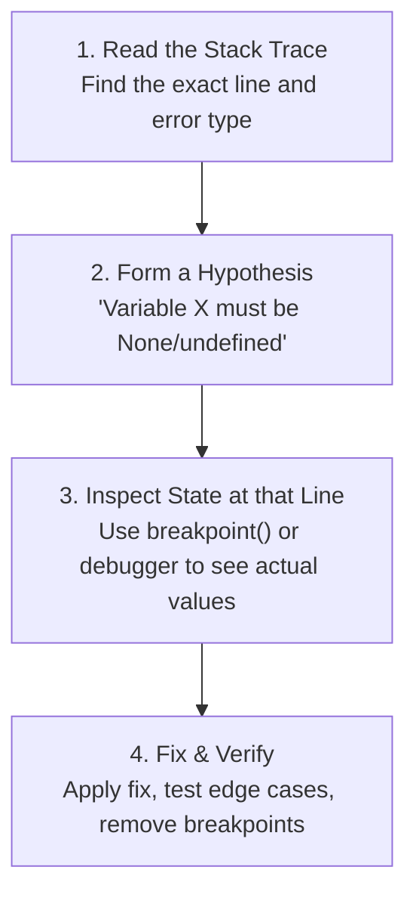

# Chapter 04: Debugging Mastery & Reading Stack Traces (Deep Dive)

> **Welcome to Chapter 04 of the Python & JavaScript Track!**
> Anyone can write code when everything is going well. But what separates junior developers from senior engineers is **what they do when the application crashes in production at 2:00 AM**.
> 
> Junior developers panic, add 50 `print()` or `console.log()` statements, and randomly change lines of code hoping the error goes away.
> Senior engineers treat debugging like a doctor diagnosing a patient: they read the symptoms (the stack trace), isolate the cause using scientific tools (debuggers), analyze heap snapshots for memory leaks, and configure structured production logs.
> 
> In this chapter, we will master reading stack traces, using interactive debuggers, unhandled promise traps, and solving production bugs.

---

## 1. The Scientific Method of Debugging

Never guess when debugging. Follow this 4-step loop:



---

## 2. Anatomy of a Python Traceback (Bottom-to-Top)

Python tracebacks are printed in chronological order (from the first function called down to the exact line that exploded).

Look at this real-world production traceback:

```text
Traceback (most recent call last):
  File "server.py", line 45, in <module>
    app.run()
  File "server.py", line 32, in run
    self.process_order(order_payload)
  File "services/order.py", line 18, in process_order
    user_discount = self.calculate_discount(order["user_id"])
  File "services/discount.py", line 9, in calculate_discount
    return user_points * 0.05
TypeError: unsupported operand type(s) for *: 'NoneType' and 'float'   <-- 1. START HERE!
```

### How to Read It in 10 Seconds:
1. **Look at the very last line first**:
   `TypeError: unsupported operand type(s) for *: 'NoneType' and 'float'`
   * What happened? The program tried to multiply `None * 0.05`.
2. **Look at the line immediately above it**:
   `File "services/discount.py", line 9, in calculate_discount`
   `return user_points * 0.05`
   * Now you know: `user_points` was `None` instead of a number!
3. **Trace one level up to see who passed `None`**:
   `order["user_id"]` in `services/order.py` line 18 had no loyalty points in the database.

---

### Python Exception Chaining (`raise ... from err`)
In modern Python, you often see **two tracebacks** separated by:
```text
The above exception was the direct cause of the following exception:
```
This is called **Exception Chaining**. It happens when an engineer catches a low-level error (like a database connection failure) and wraps it in a clean business error (like `PaymentProcessingError`):

```python
try:
    connect_to_postgres()
except psycopg2.OperationalError as db_err:
    # Preserves the original database error while raising clean error
    raise PaymentProcessingError("Could not process order") from db_err
```
* **Rule**: When you see chained exceptions, the **first (top) exception** is usually the true technical root cause!

---

## 3. Anatomy of a V8 JavaScript Stack Trace (Top-to-Bottom)

Unlike Python, V8 JavaScript prints errors in **reverse order**: the **actual crash is at the very top**!

```text
TypeError: Cannot read properties of undefined (reading 'length')    <-- 1. CRASH REASON!
    at validateCart (services/cart.js:14:27)                        <-- 2. EXACT CRASH LINE!
    at checkout (services/order.js:35:5)
    at handleRequest (server.js:82:12)
    at Layer.handle [as handle_request] (express/lib/router/layer.js:95:5)
```

### The Top 3 JavaScript Errors:
1. **`TypeError: Cannot read properties of undefined / null`**:
   * You tried to access `user.profile.photo`, but `user.profile` was `undefined`!
   * **The Modern Fix (Optional Chaining)**:
     ```javascript
     // Safe navigation: returns undefined instead of crashing!
     const photo = user?.profile?.photo;
     ```
2. **`ReferenceError: x is not defined`**:
   * You tried to use a variable that was never declared with `let`, `const`, or `var`.
3. **`SyntaxError: Unexpected token in JSON at position 42`**:
   * You passed malformed text into `JSON.parse()`.

---

## 3.5 Node.js Crashes: Unhandled Promise Rejections

In modern Node.js (Node 15+), if a Promise rejects and there is no `.catch()` or `try/catch` block, **Node.js immediately terminates and crashes the entire server process**!

```javascript
// DANGEROUS CODE (Crashes entire server on error!):
app.get('/user', async (req, res) => {
    // If fetchUser() throws an error, the whole Node process dies!
    const user = await fetchUser(req.query.id);
    res.json(user);
});
```

### Catching Unhandled Errors Globally:
```javascript
// In your server entry file (index.js):
process.on('unhandledRejection', (reason, promise) => {
    console.error('[CRITICAL] Unhandled Promise Rejection:', reason);
    // Log to Datadog or Sentry before graceful restart
});

process.on('uncaughtException', (err) => {
    console.error('[CRITICAL] Uncaught Synchronous Exception:', err);
    process.exit(1); // Exit safely so Docker/Kubernetes restarts a fresh container
});
```

---

## 4. Production Logging Best Practices (Structured JSON Logs)

In production apps running across 20 Docker containers, plain text logs like `print("user logged in")` are useless.

Why? Because log aggregation tools (like Datadog, Elasticsearch, or CloudWatch) cannot search or filter plain strings easily!

### The Standard: Structured JSON Logging
Every log line should be a single JSON object with metadata:

```json
{
  "timestamp": "2026-11-01T06:30:00.123Z",
  "level": "ERROR",
  "message": "Database query timed out after 5000ms",
  "service": "payment-api",
  "trace_id": "c7a9e102f928e4a9",
  "user_id": 41208,
  "endpoint": "/api/checkout"
}
```

* Now, in Datadog, you can write: `level:ERROR AND user_id:41208` and find the exact bug in 1 second among 100 million logs!

---

## 5. Interactive Debugging: Leaving `print()` Behind

### Python: The Built-In `breakpoint()` (PDB)

Put this single line anywhere in your code where you want the program to pause:
```python
def calculate_tax(salary, deductions):
    taxable_income = salary - deductions
    breakpoint()  # <-- Program PAUSES execution right here!
    return taxable_income * 0.20
```

#### The 5 PDB Commands You Must Know:
* **`p <variable>`** (Print): Displays the current value of any variable in RAM.
* **`n`** (Next): Executes the current line and moves to the next line.
* **`s`** (Step Into): If the line is a function call, steps *inside* the function.
* **`c`** (Continue): Resumes normal execution until the next breakpoint.
* **`q`** (Quit): Immediately terminates the program.

---

### JavaScript: Chrome DevTools & The `debugger` Statement

```javascript
function calculateTax(salary, deductions) {
    const taxableIncome = salary - deductions;
    debugger; // <-- Execution freezes here!
    return taxableIncome * 0.20;
}
```

1. Run: `node --inspect-brk app.js`
2. Open Chrome: `chrome://inspect`
3. Click **"Open dedicated DevTools for Node"** to visually step through lines!

---

## 6. Case Study: The "Heisenbug" (Debugging Race Conditions)

A **Heisenbug** is a bug that **disappears as soon as you add a `print()` or `console.log()` statement**, and reappears when you delete it.

### Why does this happen?
`print()` and `console.log()` are **I/O operations**. Printing text takes **1 to 5 milliseconds** of CPU time.
* If your bug was caused by a **race condition** between two asynchronous tasks, adding a log slows down Task 1, accidentally allowing Task 2 to finish first!
* As soon as you remove the log, the timing changes, and the crash returns!

---

## 7. Production Case Studies, Observability Drifts & Interview Traps

### Production Case Study 1: The Silent Node.js Unhandled Rejection Crash
* **The Incident**: A high-traffic payment processing service crashed abruptly during peak sales hours. The container restarted repeatedly, but no error appeared in the standard application error logs.
* **Root Cause**: An asynchronous background fire-and-forget task inside an Express route failed:
  ```javascript
  app.post('/checkout', async (req, res) => {
      res.json({ status: "Processing" });
      // BUG: Fire-and-forget async call without await or .catch()!
      sendAnalyticsEvent(req.body);
  });
  ```
  When the analytics service timed out, `sendAnalyticsEvent` threw an unhandled rejected promise. Starting in Node.js 16+, **unhandled promise rejections terminate the process with exit code 1**!
* **The Fix**:
  1. Always handle promise rejections at the callsite: `sendAnalyticsEvent(req.body).catch(err => logger.error("Analytics failed", { err }))`.
  2. Implement global process safety hooks:
     ```javascript
     process.on('unhandledRejection', (reason, promise) => {
         logger.error('CRITICAL: Unhandled Rejection at:', { promise, reason });
     });
     ```

### Production Case Study 2: The Log Volume Disk-Full Server Blackout
* **The Incident**: An entire production Kubernetes node went into `NotReady` status. Sshing into the node revealed disk utilization was at 100%. Databases, Redis caches, and backend services hosted on the node all died simultaneously.
* **Root Cause**: A third-party payment gateway had a minor network blip. A retry loop in a backend service logged the full request/response body of every failed retry without exponential backoff or rate-limiting. It generated **80,000 log lines per second**, creating a 60 GB log file in `/var/log` within 18 minutes, completely starving the Linux kernel of disk blocks.
* **The Guardrails**:
  1. Always configure OS-level **Log Rotation** (`logrotate`) with maximum file size limits and automatic compression.
  2. Implement log sampling and circuit breakers in your logger to drop duplicate logs when error rates surge above normal thresholds.

### Observability Drifts to Watch:
1. **Trace Context Propagation Loss**:
   When Service A calls Service B over HTTP, forgetting to copy the incoming `X-Request-ID` or W3C `traceparent` header into the outgoing HTTP request breaks the trace chain. The log aggregator sees two completely unrelated requests, making it impossible to diagnose distributed latencies across microservice hops.
2. **Synchronous `console.log()` Event Loop Starvation**:
   In Node.js, writing to `process.stdout` is synchronous when redirected to files or pipes on many platforms. Emitting thousands of `console.log()` statements per second blocks the single event loop thread, introducing 200–500ms of artificial latency to active user HTTP requests.
   * **Fix**: Use asynchronous, buffered structured loggers like **Pino** or **Winston** with stream workers.

### FAANG Interview Scenarios & Traps:

#### Scenario 1: "How do you diagnose a production Python service consuming 100% CPU without restarting it or attaching a debugger?"
* **Answer**: You cannot add `breakpoint()` or restart because the stuck state would be lost. Instead, use non-intrusive sampling profilers like **`py-spy`**:
  ```bash
  # Instantly displays a live top-like view of active Python functions!
  py-spy top --pid <PID>
  
  # Or generate an SVG Flame Graph of running threads without stopping the process:
  py-spy record -o profile.svg --pid <PID>
  ```
  `py-spy` reads process memory directly via Linux `process_vm_readv` syscalls with negligible (< 1%) CPU overhead.

#### Scenario 2: "What is the difference between Error Logging and Distributed Tracing?"
* **Answer**:
  * **Logging**: Records discrete events at a specific point in time (*"User 42 failed to purchase ticket"*). Logs are unstructured or structured text files tied to a single process.
  * **Distributed Tracing**: Follows the end-to-end journey of a single user request across 20 different microservices, databases, and message queues. Uses a unique **Trace ID** and nested **Span IDs** to measure latency per service boundary.

---

## Chapter 04 Checklist (Summary)

Before concluding Part 0 of the Python & JavaScript track, verify that you can answer these:
- [x] Why do you read Python tracebacks bottom-to-top, but JavaScript stack traces top-to-bottom?
- [x] What is an Unhandled Promise Rejection in Node.js, and why does it crash modern servers?
- [x] Why do production systems log structured JSON instead of plain `print()` text?
- [x] How do you pause a Python app using `breakpoint()` and inspect variables using `p`?
- [x] How do you debug a Node.js app visually inside Chrome DevTools using `node --inspect`?
- [x] What is a Heisenbug, and why does `console.log()` sometimes hide race-condition bugs?

*Chapter 04 is complete! Proceed to [Chapter 05: Runtimes, Compilation Pipelines & Execution Engines](./python_javascript_study_plan.md).*
