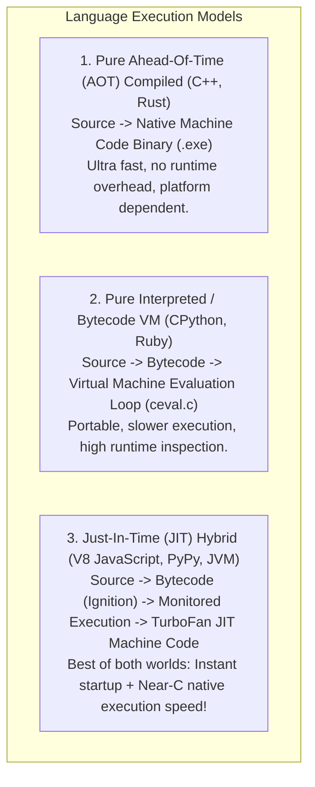
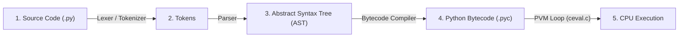
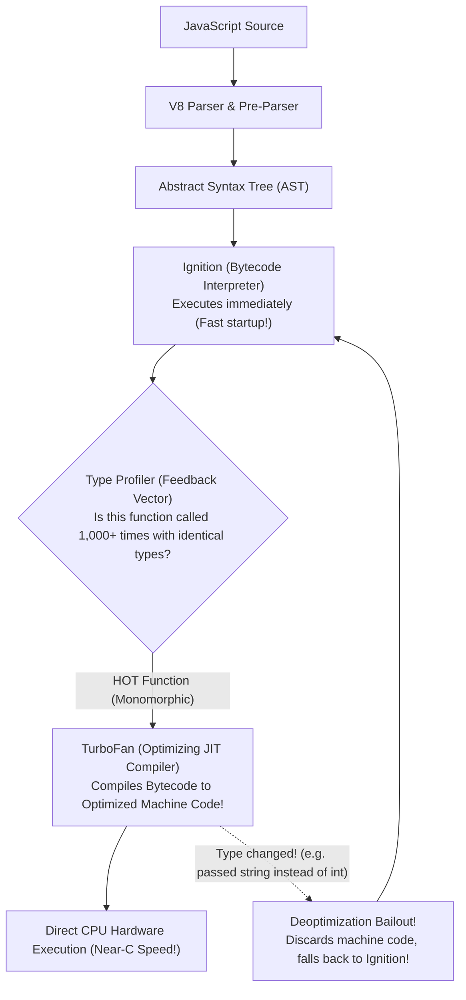
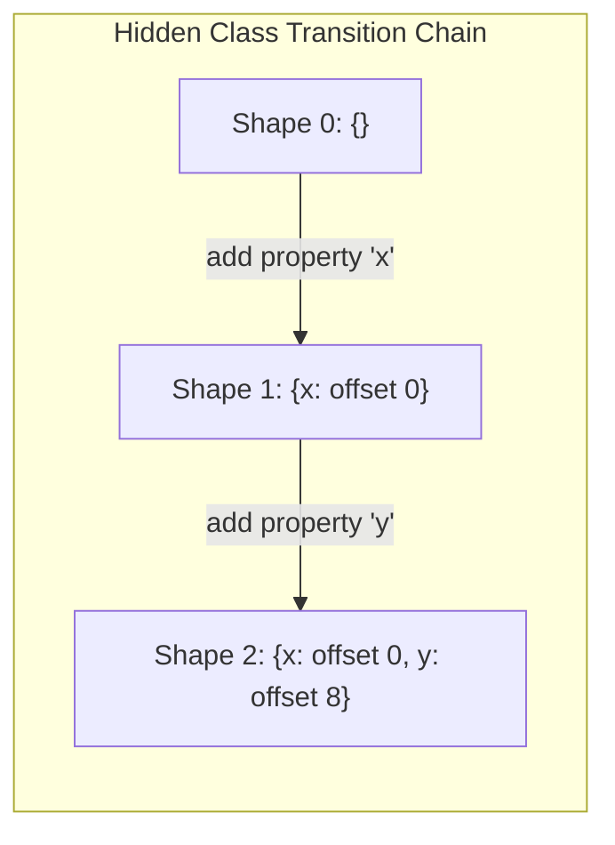
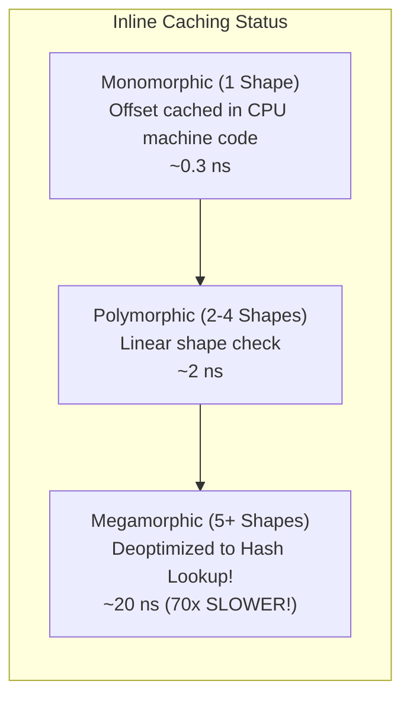

# Chapter 05: Runtimes, Compilation Pipelines & Execution Engines (Deep Dive)

> **Welcome to Chapter 05 of the Python & JavaScript Track!**
> Most software engineers write code assuming the computer directly reads their `.py` or `.js` text files.
> 
> In reality, **your code never touches hardware directly**. It is digested, parsed, transformed into abstract syntax trees, compiled into bytecode, executed inside virtual machines, and in JavaScript's case, dynamically recompiled into raw CPU assembly at runtime!
> 
> In this chapter, we will master **CPython's internal bytecode pipeline (`ceval.c`)**, **the GIL mechanics**, **V8's Ignition interpreter and TurboFan JIT compiler**, and **Hidden Classes & Inline Caching** with code and bytecode inspection in both Python and JavaScript.

---

## 1. Compiler vs. Interpreter vs. JIT: The Mental Model



---

## 2. Python / CPython Internals: From Text to `ceval.c`

When you run `python main.py`, CPython executes a 4-stage pipeline:



### 1. Lexing & AST Generation
* The **Lexer** converts raw text into tokens: `x = 5 + 2` becomes `NAME('x')`, `EQUAL`, `NUMBER(5)`, `PLUS`, `NUMBER(2)`.
* The **Parser** (a PEG parser introduced in Python 3.9) organizes tokens into a hierarchical **Abstract Syntax Tree (AST)**.

### 2. Bytecode Generation
* The compiler walks the AST and emits a linear stream of **1-byte or 2-byte opcodes** (Python Bytecode).
* Bytecode is cached on disk in `__pycache__/*.pyc` files to skip lexing and parsing on subsequent runs.

### 3. The PVM Loop (`ceval.c`)
* The **Python Virtual Machine (PVM)** is a giant `switch/case` loop written in C inside `Python/ceval.c`:
  ```c
  // Simplified view of CPython's ceval.c:
  for (;;) {
      opcode = *next_instr++;
      switch (opcode) {
          case TARGET(LOAD_FAST): ...
          case TARGET(BINARY_OP): ...
          case TARGET(RETURN_VALUE): ...
      }
  }
  ```
* Every instruction runs inside this virtual CPU loop, which is why raw Python is $20\times$ to $50\times$ slower than native C.

### 4. The Global Interpreter Lock (GIL) Under the Hood
* CPython's memory manager relies on **Reference Counting** (`ob_refcnt`).
* To prevent multi-threaded race conditions where two threads increment/decrement the same object's refcount simultaneously, CPython uses the **GIL**—an OS-level mutex.
* Only **ONE OS thread can execute Python bytecode inside `ceval.c` at any given millisecond**, even on a 128-core CPU!
* *Python 3.13 Breakthrough (PEP 703)*: Introduced optional **Free-Threaded CPython** (`--disable-gil`), replacing the global lock with fine-grained per-object locks and biased reference counting.

---

## 3. JavaScript / V8 Engine: Ignition & TurboFan

Google's **V8 Engine** (powers Chrome, Node.js, and Deno) uses a two-tier architecture:



### 1. Ignition (The Bytecode Interpreter)
* JavaScript cannot afford a 5-second compilation delay when a user visits a webpage.
* **Ignition** generates register-based bytecode and begins execution **within milliseconds**!

### 2. TurboFan (The Optimizing JIT Compiler)
* While Ignition runs code, V8 collects type feedback in a **Feedback Vector**.
* If a function is called thousands of times with the exact same data types (e.g. `add(a, b)` always called with integers), V8 marks it as **"HOT"**.
* **TurboFan** takes the bytecode, assumes types will never change, and compiles it directly into **raw x86/ARM machine code instructions**!

### 3. Hidden Classes (Shapes / Maps) & Inline Caching (IC)
In JavaScript, objects are dynamic dictionaries: you can add or delete properties at runtime (`obj.x = 10; obj.y = 20;`).
* Searching a dynamic hash table on every property access (`obj.x`) is slow.
* **V8's Secret: Hidden Classes**:
  Whenever you instantiate an object, V8 assigns it an internal hidden class (a **Shape** or **Map**):



* **Inline Caching (IC)**:
  * **Monomorphic (Fastest)**: A function only ever sees objects of **one single Shape**. TurboFan hardcodes the memory offset (`offset 0`), executing property lookups in **0.3 ns (1 CPU instruction)**!
  * **Polymorphic (Medium)**: A function sees 2 to 4 different Shapes. Checks shapes via small switch-case.
  * **Megamorphic (Performance Disaster)**: A function sees 5+ different Shapes. V8 gives up optimizing and falls back to slow dynamic hash table lookups!

---

## 4. Hands-on Code: Inspecting Bytecode & JIT Compilation

### 1. Python: Inspecting CPython Bytecode with `dis`
```python
import dis

def calculate(a, b):
    result = (a + b) * 2
    return result

print("--- CPython Bytecode Disassembly ---")
dis.dis(calculate)
```
**Output Breakdown**:
```text
  4           0 RESUME                   0
              2 LOAD_FAST                0 (a)       # Push 'a' onto evaluation stack
              4 LOAD_FAST                1 (b)       # Push 'b' onto evaluation stack
              6 BINARY_OP                0 (+)       # Pop both, add, push sum
             10 LOAD_CONST               1 (2)       # Push constant 2
             12 BINARY_OP                5 (*)       # Multiply
             16 STORE_FAST               2 (result)  # Store in local variable
  5          18 LOAD_FAST                2 (result)
             20 RETURN_VALUE                         # Return to caller
```

### 2. JavaScript: Tracing V8 Optimization & Deoptimization
Create `jit_test.js`:
```javascript
function add(point) {
    return point.x + point.y;
}

// 1. Warm up TurboFan with Monomorphic Shape {x, y}
for (let i = 0; i < 100000; i++) {
    add({ x: 10, y: 20 });
}

// 2. Trigger Megamorphic Deoptimization by passing different shapes!
add({ x: 10, y: 20, z: 30 }); // Different shape!
add({ y: 20, x: 10 });        // Different property order = Different shape!
```
Run with Node.js V8 flags:
```bash
node --trace-opt --trace-deopt jit_test.js
```
You will see TurboFan print: `[marking add for optimization to TurboFan]` followed by `[deoptimizing add: reason = wrong shape]`!

---

## 5. Production Case Studies & Systems Drifts

### Production Case Study 1: The Megamorphic Deoptimization Node.js API Meltdown
* **The Incident**: A high-throughput fintech microservice experienced an unexplainable **$400\%$ surge in latency** after adding a new analytics logging middleware.
* **Root Cause**: The analytics middleware enriched request objects by adding fields dynamically in random order:
  * Route 1 added: `req.user_id = 42; req.ip = "1.2.3.4";`
  * Route 2 added: `req.ip = "1.2.3.4"; req.user_id = 42;`
  Because property insertion order was inconsistent, V8 generated **dozens of different Hidden Classes for the `req` object**.
  The main request handler function transitioned from **Monomorphic** to **Megamorphic**, causing TurboFan to bail out and deoptimize. The function dropped back to slow bytecode interpretation!
* **The Fix**: Always initialize object properties in the **exact same order**, or use formal TypeScript classes/constructors with fixed schemas.

### Production Case Study 2: The Python Multi-Threaded GIL Convoy Effect
* **The Incident**: A data processing pipeline running on a 32-core AWS server replaced a single-threaded loop with 16 Python threads (`threading.Thread`) to process image tensors. Counter-intuitively, total processing time **increased from 10 seconds to 28 seconds** ($nearly 3\times$ slower!).
* **Root Cause**: Python's GIL. The 16 threads were strictly CPU-bound. Because only one thread can hold the GIL, 15 threads constantly went to sleep and woke up, fighting for the GIL mutex. The CPU spent 70% of its time in kernel context switching (**GIL Convoy effect**).
* **The Fix**: Switched from `threading.Thread` to `multiprocessing.Pool` (or `concurrent.futures.ProcessPoolExecutor`). Spawning independent OS processes bypasses the GIL, dropping execution time from 28 seconds down to **0.8 seconds on 32 cores**!

---

## 6. 12 FAANG & Top Tech Interview Scenarios & Traps



#### Scenario 1: "Why does adding a property to an existing JavaScript object change its performance characteristics?"
* **Answer**: In V8, objects point to a **Hidden Class (Shape)** describing memory offsets.
  * Adding a new property (`obj.z = 10`) triggers a **Shape Transition**.
  * If different objects have properties added in different orders, they possess different Shapes.
  * Functions operating on those objects degrade from **Monomorphic** (ultrafast cached offset) to **Megamorphic** (slow dictionary lookup), causing TurboFan to deoptimize.

#### Scenario 2: "Can you bypass the Python GIL without using `multiprocessing`?"
* **Answer**:
  1. **C Extensions (NumPy / Cython / PyTorch)**: Heavy numerical computations release the GIL using `Py_BEGIN_ALLOW_THREADS` and `Py_END_ALLOW_THREADS`. Matrix multiplication runs on raw C/Fortran/CUDA threads in true parallel hardware.
  2. **Free-Threaded CPython (Python 3.13+)**: Running with `--disable-gil` eliminates the global lock using mimalloc thread-local heaps and biased reference counting.

#### Scenario 3: "What is the difference between an AST and Bytecode?"
* **Answer**:
  * **AST (Abstract Syntax Tree)**: A hierarchical tree representing grammatical code relationships (parent-child nodes like `BinaryOp(Add, Left, Right)`). Optimal for static analysis, linting, and compile-time optimization.
  * **Bytecode**: A compact, sequential, linear stream of numeric opcodes (e.g. `LOAD_FAST 0, BINARY_OP 1`) designed to be executed efficiently by a virtual machine stack loop (`ceval.c` or Ignition).

#### Scenario 4: "Why does `delete obj.property` create a massive performance penalty in V8?"
* **Answer**: `delete` alters the object's structural shape unpredictably, breaking the Hidden Class transition tree. V8 completely strips the object of its optimized Shape and converts it into a **Dictionary Mode (Slow Mode)** object backed by a raw hash table, degrading all future property accesses.
  * *Production Tip*: Set `obj.property = undefined` instead of `delete obj.property`!

#### Scenario 5: "What is the difference between Stack-Based and Register-Based Virtual Machines?"
* **Answer**:
  * **Stack-Based (CPython, Java JVM)**: Instructions push and pop operands onto an evaluation stack (e.g. `LOAD a`, `LOAD b`, `ADD`). Instructions are compact (1 byte), but require many instructions per operation.
  * **Register-Based (V8 Ignition, LuaJIT)**: Instructions operate on virtual registers (e.g. `Add r1, r2, r0`). Bytecode instructions are slightly larger, but require **$30\%$ fewer instruction dispatches**, running significantly faster in software interpreters.

#### Scenario 6: "What is Dead Code Elimination and Tree Shaking in compilation pipelines?"
* **Answer**:
  * **Dead Code Elimination (DCE)**: The compiler analyzes the Control Flow Graph (CFG) and deletes code paths that can never execute (e.g. `if (false) { ... }`).
  * **Tree Shaking (ESM)**: Because ES Modules use static `import/export`, the bundler builds an export-usage dependency tree. Unreferenced functions are stripped out of the final bundle, reducing download payloads.

#### Scenario 7: "What is an Inline Cache (IC), and what happens when an IC becomes Megamorphic?"
* **Answer**:
  * An Inline Cache remembers the type and memory offset of recent property accesses directly at the call site.
  * When a call site encounters more than 4 distinct Hidden Classes, it exceeds the polymorphic threshold and becomes **Megamorphic**.
  * The JIT compiler bails out of optimized machine code, falling back to a global stub or generic hash table lookup, dropping access throughput by $10\times$ to $50\times$.

#### Scenario 8: "Why does Python 3.11 run $25\%$ faster than Python 3.10? (The Faster CPython Project)"
* **Answer**:
  * **Specializing Adaptive Interpreter (PEP 659)**: CPython now inspects bytecodes at runtime. If an opcode `BINARY_SUBSCR` is repeatedly called on a list, CPython overwrites the opcode in RAM with a specialized `BINARY_SUBSCR_LIST` instruction, bypassing generic dictionary type dispatch!
  * Zero-overhead exception handling and memory-compact object layouts.

#### Scenario 9: "What is JIT Deoptimization (Bailout), and what triggers it?"
* **Answer**: JIT compilers make **optimistic assumptions** (speculative optimizations).
  * If TurboFan assumes parameter `x` is always a 31-bit integer, it generates raw CPU assembly without type checks.
  * If the program suddenly passes a floating-point number or a string: the speculative assumption fails!
  * The CPU executes a **Deoptimization Bailout**: it reconstructs the interpreter's stack frame in RAM and safely switches execution back to the slow Ignition bytecode interpreter mid-function.

#### Scenario 10: "Why is `eval()` or `with` in JavaScript considered a performance catastrophe for V8?"
* **Answer**:
  * `eval()` and `with` introduce dynamic, unpredictable variable bindings at runtime.
  * The V8 parser cannot statically determine which variables belong to which scope during lexical compilation.
  * V8 is forced to disable scope optimization, heap-allocate all local variables instead of keeping them in CPU registers, and bail out of TurboFan optimization.

#### Scenario 11: "What is Tail Call Optimization (TCO), and does Python or JavaScript support it?"
* **Answer**:
  * **TCO**: If the final statement of a function is a recursive call (`return f(n - 1)`), the runtime can overwrite the current stack frame rather than pushing a new frame, turning $O(N)$ recursion into $O(1)$ stack space.
  * **Python**: Guido van Rossum explicitly rejected TCO in Python because it destroys stack traces during debugging.
  * **JavaScript**: Part of the ES6 specification, but only implemented by Safari's JavaScriptCore engine. V8 disabled TCO due to debugging and error tracking complexities.

#### Scenario 12: "How does CPython's Garbage Collector interact with the GIL?"
* **Answer**:
  * Reference counting updates occur inline with bytecode execution under the GIL.
  * The secondary **Generational Cyclic GC** runs periodically when allocation counters exceed thresholds.
  * When cyclic collection runs, it must freeze all thread execution, walk generational linked lists, and decrement trial reference counts. The GIL ensures no thread modifies object pointers while the GC audits cyclic graphs.

---

## Chapter 05 Checklist (Summary)

Before moving to Chapter 06, verify that you can answer these:
- [x] How does source code transition through Lexing, AST, and Bytecode to CPU execution?
- [x] What is CPython's `ceval.c` virtual machine evaluation loop?
- [x] Why does CPython require a Global Interpreter Lock (GIL) for reference counting safety?
- [x] How do V8's Ignition interpreter and TurboFan JIT compiler collaborate?
- [x] What are Hidden Classes (Shapes) and why does property insertion order matter?
- [x] What causes an Inline Cache (IC) to become Megamorphic and deoptimize?

*Chapter 05 is complete! Proceed to [Chapter 06: Scoping, Variable Lifetimes & Environment Records](./chapter_06.md).*
