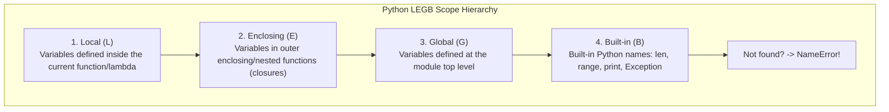
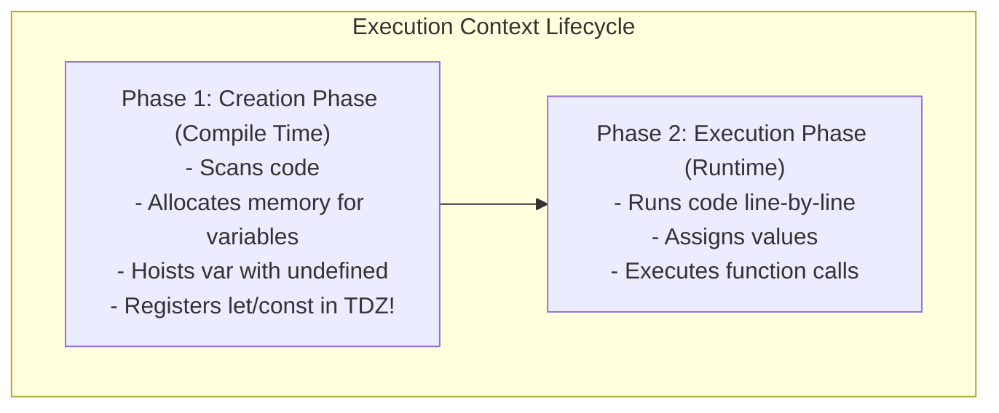
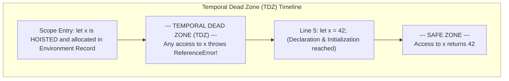
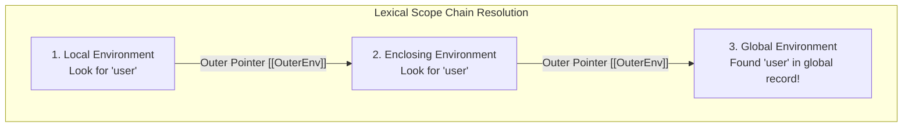

# Chapter 06: Scoping, Variable Lifetimes & Environment Records (Deep Dive)

> **Welcome to Chapter 06 of the Python & JavaScript Track!**
> Few topics generate more subtle production bugs and interview traps than **Scoping and Variable Lifetimes**.
> 
> * Why does Python throw `UnboundLocalError` even when a global variable clearly exists with the same name?
> * Why does JavaScript's `for (var i = 0; i < 3; i++)` print `3, 3, 3` instead of `0, 1, 2`?
> * What physically happens in RAM when a closure retains access to an outer variable?
> 
> In this chapter, we will master Python's **LEGB Rule**, `global` vs. `nonlocal`, JavaScript's **Execution Contexts**, **Environment Records**, **Hoisting**, and the **Temporal Dead Zone (TDZ)** with runnable code in both Python and JavaScript.

---

## 1. Python Scoping: The LEGB Rule

In Python, when a variable name is referenced, the interpreter searches four scopes in strict hierarchical order: **LEGB**.



### The Compile-Time Binding Trap: `UnboundLocalError`
Look at this code that crashes thousands of junior Python developers:

```python
count = 10

def increment():
    print(count)  # Crashes here!
    count = count + 1

increment()
# UnboundLocalError: cannot access local variable 'count' where it is not associated with a value
```

#### Why Did it Crash on the `print(count)` line?
* Beginners assume Python executes line-by-line and will read global `count = 10` for `print()`.
* **The Reality (Compile-Time Lexical Binding)**:
  1. During compilation to bytecode, Python scans the entire function body.
  2. Because it sees an assignment (`count = ...`), Python statically marks `count` as a **LOCAL variable** for the entire function scope!
  3. When `print(count)` runs, Python looks strictly in the **Local Scope**. Because `count` has not been assigned yet, it throws `UnboundLocalError`!

#### The Fix: `global` vs. `nonlocal`
* **`global count`**: Tells the compiler: *"Do not create a local variable; bind `count` directly to the module-level Global Scope."*
* **`nonlocal count`**: Used in nested functions. Tells the compiler: *"Bind `count` to the nearest outer Enclosing Scope, skipping local but not touching global."*

---

## 2. JavaScript Scoping: Execution Contexts & Environment Records

When JavaScript runs inside V8, it creates an **Execution Context** with a two-phase lifecycle:



### Environment Records Under the Hood:
Every Execution Context has an associated **Lexical Environment** consisting of:
1. **Environment Record**: The internal dictionary storing variable and function bindings in RAM.
2. **Outer Reference (`[[OuterEnv]]`)**: A pointer to the parent lexical scope (forming the **Scope Chain**).

### `var` vs. `let` vs. `const` Comparison:

| Feature | `var` (Pre-ES6) | `let` (ES6+) | `const` (ES6+) |
|---|---|---|---|
| **Scope Boundary** | **Function Scope** (ignores `if`/`for` blocks) | **Block Scope** (`{ ... }`) | **Block Scope** (`{ ... }`) |
| **Hoisting Behavior** | Hoisted and initialized to `undefined` | Hoisted, but **uninitialized (TDZ)** | Hoisted, but **uninitialized (TDZ)** |
| **Re-declaration** | Allowed in same scope | Throws `SyntaxError` | Throws `SyntaxError` |
| **Re-assignment** | Allowed | Allowed | Throws `TypeError` |
| **Global Object** | Attaches to `window` / `global` | Does NOT attach to global object | Does NOT attach to global object |

---

## 3. Hoisting & The Temporal Dead Zone (TDZ)

A classic interview question: *"Are `let` and `const` hoisted?"*
* **The Common Misconception**: *"No, only `var` is hoisted."*
* **The Senior Engineer Truth**: **YES, `let` and `const` ARE hoisted!** However, unlike `var`, they are placed in the **Temporal Dead Zone (TDZ)**.



### The Proof that `let` is Hoisted:
```javascript
let x = "global";

function test() {
    // If let was NOT hoisted, this would print "global" from outer scope!
    console.log(x); // ReferenceError: Cannot access 'x' before initialization
    let x = "local";
}
test();
```
The fact that it throws a `ReferenceError` instead of reading `"global"` proves that the local `let x` **was hoisted and shadowed the outer scope**, locking the identifier into the TDZ until its declaration line!

---

## 4. The Classic Loop Closure Bug (`var` vs. `let`)

```javascript
// The Famous Bug:
for (var i = 0; i < 3; i++) {
    setTimeout(() => console.log(i), 100);
}
// Output after 100ms: 3, 3, 3!
```

### Why did it print `3, 3, 3`?
1. `var` is **function-scoped**. There is **only ONE single variable `i` allocated in memory** for the entire loop!
2. When the `setTimeout` callbacks execute 100ms later, the loop has already finished, and `i` has reached `3`.
3. All 3 closures reference that same memory slot in RAM!

```mermaid
flowchart TD
    subgraph VarScope["var: 1 Shared Memory Slot"]
        Single_i["Memory Slot i = 3"]
        C1["Closure 1"] --> Single_i
        C2["Closure 2"] --> Single_i
        C3["Closure 3"] --> Single_i
    end
    subgraph LetScope["let: New Lexical Environment Per Iteration!"]
        i0["Iteration 0: i = 0"] <-- CL1["Closure 1"]
        i1["Iteration 1: i = 1"] <-- CL2["Closure 2"]
        i2["Iteration 2: i = 2"] <-- CL3["Closure 3"]
    end
```

### The Fix with `let`:
```javascript
for (let i = 0; i < 3; i++) {
    setTimeout(() => console.log(i), 100);
}
// Output: 0, 1, 2!
```
* Under the ECMAScript specification, **`let` creates a brand-new Environment Record for EVERY iteration of the loop**!
* Each callback captures its own isolated copy of `i`.

---

## 5. Closures Under the Hood: Heap Promotion

When a function returns an inner function that references an outer variable:

### In Python (`cell` objects):
```python
def make_counter():
    count = 0
    def increment():
        nonlocal count
        count += 1
        return count
    return increment

counter = make_counter()
print(counter()) # 1
print(counter.__closure__[0].cell_contents) # Inspects the heap cell: 1!
```
CPython promotes `count` from the stack to a heap-allocated **`cell` object**. The inner function holds a pointer to this cell.

### In JavaScript:
When V8's parser detects that an inner function accesses an outer variable, it allocates the outer variable inside a **Context object on the V8 Heap** rather than a stack register. Even after the outer function finishes, the Context object persists in heap memory as long as the inner closure is reachable!

---

## 6. Production Case Studies & Systems Drifts

### Production Case Study 1: The Accidental Global Variable Node.js Memory Leak
* **The Incident**: A high-traffic payment microservice leaked 2 GB of RAM over 24 hours until the container crashed with OOM.
* **Root Cause**: An engineer omitted `const` or `let` inside a utility function:
  ```javascript
  function processTransaction(data) {
      // BUG: Missing let/const! Creates a property on global/window object!
      transactionLog = { id: data.id, payload: data.payload, buffer: Buffer.alloc(1024 * 1024) };
      save(transactionLog);
  }
  ```
  In non-strict mode, assigning to an undeclared variable attaches it to the **global root object (`global.transactionLog`)**. Because the global object is never garbage-collected, millions of 1MB buffers leaked into heap memory.
* **The Fix**: Enforce strict mode globally (`"use strict";`) and enable ESLint rule `no-undef`. In strict mode, assigning to an undeclared variable throws an immediate `ReferenceError`.

### Production Case Study 2: The Python Configuration Override `UnboundLocalError` Crash
* **The Incident**: A deployment hotfix to conditionally enable debug logging caused an API service to crash on 100% of incoming production requests:
  ```python
  DEBUG_MODE = False

  def handle_request(req):
      if req.is_admin:
          DEBUG_MODE = True # Triggers compile-time local binding!
      if DEBUG_MODE:
          print("Admin request:", req)
  ```
* **Root Cause**: When a non-admin user sent a request, `req.is_admin` was false. When the code reached `if DEBUG_MODE:`, Python looked for the *local* variable (because `DEBUG_MODE = True` existed in the function). Since it was never executed, it crashed with `UnboundLocalError`!
* **The Fix**: Add `global DEBUG_MODE` at the top of the function, or pass configuration via an explicit state object.

---

## 7. 12 FAANG & Top Tech Interview Scenarios & Traps



#### Scenario 1: "What is the difference between Lexical Scope and Dynamic Scope?"
* **Answer**:
  * **Lexical Scope (Static Scope - Used by Python, JS, C++)**: Variable resolution depends on **where functions are physically written in source code**. Inner functions resolve variables from their authoring parent scope, regardless of who invokes them.
  * **Dynamic Scope (Bash, Perl `local`)**: Variable resolution depends on **the call stack at runtime**. A function looks up variables in the caller function's scope.

#### Scenario 2: "What is the Temporal Dead Zone (TDZ), and why did the TC39 committee introduce it in ES6?"
* **Answer**:
  * The TDZ is the temporal window between entering a block scope and the line where `let` or `const` is declared. Accessing the variable in this window throws a `ReferenceError`.
  * **Why it was introduced**:
    1. To catch programming bugs: Accessing variables before initialization was a frequent source of silent bugs with `var` (returning `undefined`).
    2. To make `const` meaningful: A `const` variable must never be read before its immutable value is assigned!

#### Scenario 3: "Explain why `typeof undeclaredVar === 'undefined'`, but `typeof tdzVar` throws a ReferenceError in JavaScript."
* **Answer**:
  * In pre-ES6 JavaScript, `typeof` on an undeclared variable was considered safe and returned `'undefined'`.
  * However, for variables declared with `let` or `const` that are in the **TDZ**, the TC39 committee explicitly made `typeof` **throw a `ReferenceError`** to ensure variables in the TDZ cannot be probed or bypassed!

#### Scenario 4: "What is the Python `nonlocal` keyword, and how does it differ from `global`?"
* **Answer**:
  * `global x`: Binds `x` strictly to the outermost module-level scope.
  * `nonlocal x`: Binds `x` to the nearest enclosing function scope that is **neither local nor global**. It allows closures to modify state in their parent function without creating unwanted global variables.

#### Scenario 5: "What is Variable Shadowing, and can an inner `let` shadow an outer `var`?"
* **Answer**:
  * **Variable Shadowing**: An identifier declared in an inner scope shares the same name as an identifier in an outer scope, masking access to the outer variable.
  * **Inside a block**: `let` can safely shadow an outer `var`.
  * **The Illegal Shadowing Trap**: You CANNOT declare `let x` in an outer scope and re-declare `var x` inside a nested block in the same function, because `var` attempts to hoist to the function level and collides with `let`!

#### Scenario 6: "How do JavaScript Function Declarations differ from Function Expressions during Hoisting?"
* **Answer**:
  * **Function Declaration (`function foo() {}`)**: The **entire function body is hoisted** during the Creation Phase. You can invoke `foo()` before its line of declaration!
  * **Function Expression (`var foo = function() {}` or `const foo = () => {}`)**:
    * If declared with `var`: Only the variable name is hoisted with `undefined`. Calling `foo()` before declaration throws `TypeError: foo is not a function`!
    * If declared with `const`/`let`: Hoisted into the TDZ. Calling throws `ReferenceError`.

#### Scenario 7: "What happens in memory when 1,000 instances of an object create methods inside the constructor vs. on the Prototype?"
* **Answer**:
  * **Methods inside constructor (`this.sayHello = function() {}`)**: Every single instance creates a brand-new function closure in Heap memory. 1,000 instances allocate 1,000 separate function objects!
  * **Methods on Prototype (`User.prototype.sayHello = function() {}`)**: The function is allocated **ONCE in memory** on the prototype object. All 1,000 instances share the exact same function pointer, saving megabytes of RAM.

#### Scenario 8: "What are the security implications of JavaScript's Global Scope pollution?"
* **Answer**: In browser JavaScript, `var` declarations in scripts attach to `window`. Third-party analytics or advertising scripts can read, modify, or overwrite your global variables and authentication tokens.
  * *Fix*: Always wrap legacy code in Immediately Invoked Function Expressions (IIFEs) or modern ES Modules, which are scoped to their module files by default.

#### Scenario 9: "How does Python handle default arguments in function scoping, and why does `def f(x=time.time())` not update the timestamp?"
* **Answer**: In Python, default arguments are evaluated **ONCE when the function definition is executed at module import time**, not when the function is called!
  * `time.time()` will evaluate once at server boot; every subsequent call receives that exact frozen boot timestamp!
  * *Fix*: `def f(x=None): if x is None: x = time.time()`.

#### Scenario 10: "What is an Immediately Invoked Function Expression (IIFE), and why was it standard practice before ES6?"
* **Answer**:
  * Syntax: `(function() { var privateData = 42; })();`
  * Before ES6 introduced block scoping (`let`/`const`), `var` was strictly function-scoped. An IIFE created a temporary function scope to prevent variables from leaking into the global `window` object.

#### Scenario 11: "Explain how JavaScript resolves identifiers across the Prototype Chain vs. the Scope Chain."
* **Answer**:
  * **Scope Chain**: Resolves **variable identifiers** (e.g. `x + 1`). Traverses nested lexical environment records up to global scope. If missing $\to$ `ReferenceError`.
  * **Prototype Chain**: Resolves **property lookups on objects** (e.g. `obj.x`). Traverses `[[Prototype]]` pointers (`__proto__`) up to `Object.prototype`. If missing $\to$ `undefined`.

#### Scenario 12: "How does Python's `globals()` and `locals()` dictionaries interact with CPython's fast variable access?"
* **Answer**:
  * In CPython, local variables are stored in a fixed-size C array on the stack frame and accessed via fast array indices (`LOAD_FAST`) in $O(1)$ time.
  * Calling `locals()` creates a temporary dictionary copy on the fly.
  * Mutating `locals()["x"] = 99` **does NOT change the actual local variable** in optimized functions because CPython reads from the array, not the dictionary!
  * `globals()`, however, points directly to the module's real `__dict__`; modifying `globals()["x"]` updates the true global variable.

---

## Chapter 06 Checklist (Summary)

Before moving to Chapter 07, verify that you can answer these:
- [x] How does Python's LEGB rule resolve variable names?
- [x] What causes `UnboundLocalError` during compile-time lexical analysis?
- [x] What is the difference between `global` and `nonlocal` in nested closures?
- [x] How do Execution Contexts manage Creation Phase vs. Execution Phase?
- [x] Why are `let` and `const` in the Temporal Dead Zone (TDZ) and how does it prevent bugs?
- [x] Why does `var` print `3, 3, 3` in timeout loops while `let` prints `0, 1, 2`?

*Chapter 06 is complete! Proceed to [Chapter 07: Numeric Representations & IEEE 754 Floating-Point Quirks](./chapter_07.md).*
