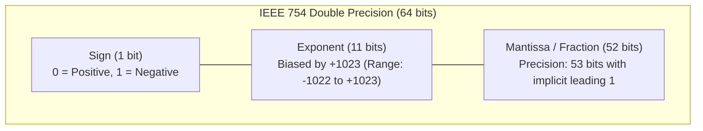
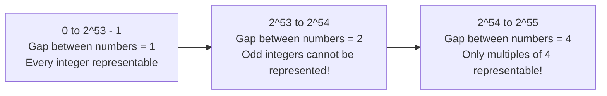
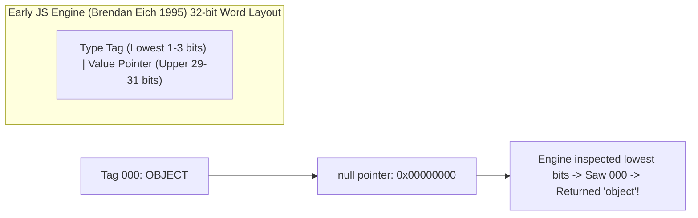

# Chapter 07: Numeric Representations & IEEE 754 Floating-Point Quirks (Deep Dive)

> **Welcome to Chapter 07 of the Python & JavaScript Track!**
> Few systems bugs have caused more catastrophic financial losses, rocket explosions, and subtle runtime defects than **numeric representation errors**.
> 
> * Why does JavaScript report `0.1 + 0.2 === 0.30000000000000004`?
> * Why did the European Space Agency's Ariane 5 rocket self-destruct 37 seconds after launch due to a 64-bit float to 16-bit signed integer conversion?
> * Why is `Number.MAX_SAFE_INTEGER` exactly $2^{53} - 1$ in JavaScript?
> * How does Python seamlessly calculate $2^{1000}$ without an overflow error, while JavaScript rolls over into `Infinity` unless you use `BigInt`?
> * Why does `typeof null === "object"` exist in JavaScript?
> 
> In this chapter, we explore the physical bits and memory layouts of numbers in Python (CPython) and JavaScript (V8).

---

## 1. IEEE 754 Double-Precision (64-bit) Floating-Point Standard

Both Python's `float` and JavaScript's standard `Number` conform to the **IEEE 754 binary64** standard. In memory, every 64-bit float occupies exactly 8 bytes organized into 3 fields:



### The Value Equation
A normalized 64-bit float represents the number:
$$\text{Value} = (-1)^{\text{sign}} \times (1.\text{mantissa})_2 \times 2^{\text{exponent} - 1023}$$

* **Sign bit (1 bit)**: Bit index 63.
* **Exponent (11 bits)**: Stores $2^{11} = 2048$ possible states. It uses a bias of $1023$. A stored value of $1023$ corresponds to $2^0 = 1$.
* **Mantissa / Significand (52 bits stored)**: Because normalized binary numbers always begin with `1.` (e.g. `1.10101...`), IEEE 754 omits the leading 1 to save space, providing **53 bits of effective precision** (equivalent to $\approx 15 \text{ to } 17$ decimal digits).

---

## 2. Why Does `0.1 + 0.2 !== 0.3`?

This classic question trips up developers in almost every tech interview. The reason has nothing to do with bugs in Python or JavaScript—it is a fundamental property of **base-2 (binary) fractions**.

### The First-Principles Math
In base-10 (decimal), fractions whose denominators have prime factors other than 2 or 5 result in infinitely repeating decimals:
$$\frac{1}{3} = 0.33333333\dots \text{ (base 10)}$$

Similarly, in base-2 (binary), fractions whose denominators have prime factors other than 2 result in infinitely repeating binary fractions:
$$\frac{1}{10} = \frac{1}{2 \times 5} = 0.00011001100110011\dots_2 \text{ (repeating indefinitely!)}$$
$$\frac{2}{10} = 0.0011001100110011\dots_2 \text{ (repeating indefinitely!)}$$

Because computers have finite storage (52 mantissa bits), the repeating fraction must be rounded off:

| Decimal Value | Exact IEEE 754 Stored Value (Hex/Binary) |
| :--- | :--- |
| `0.1` | `0.100000000000000005551115123126` |
| `0.2` | `0.200000000000000011102230246252` |
| **Sum (`0.1 + 0.2`)** | `0.300000000000000044408920985006` |
| Stored `0.3` | `0.299999999999999988897769753748` |

When JavaScript or Python compares `0.1 + 0.2 === 0.3`, it compares their bit patterns:
$$0.3000000000000000444 \neq 0.2999999999999999888$$
Therefore, the equality test evaluates to **`False`**!

---

## 3. Safe Integers & The Precision Cliff

### JavaScript's `Number.MAX_SAFE_INTEGER` ($2^{53} - 1$)
Since JavaScript has 52 mantissa bits plus 1 implicit bit, it can represent all integers up to $2^{53}$ without losing precision.
$$2^{53} - 1 = 9{,}007{,}199{,}254{,}740{,}991 \text{ (9 quadrillion)}$$

Beyond $2^{53}$, the gap between representable integers becomes greater than 1:

```javascript
// In JavaScript:
console.log(Number.MAX_SAFE_INTEGER); // 9007199254740991
console.log(9007199254740992 === 9007199254740993); // true! (Precision Lost!)
```



### The Production Danger: 64-bit Database IDs
When a backend database generates 64-bit integer IDs (e.g., Twitter Snowflake IDs, PostgreSQL `BIGINT` up to $2^{63}-1$), sending them as raw JSON numbers will cause V8 in the browser or Node.js to silently truncate or alter the lowest digits!
* **The Production Fix**: Always serialize 64-bit IDs as **Strings** (`"9007199254740993"`) in JSON APIs!

---

## 4. Python Integer Internals vs. JavaScript Numbers

### Python: Arbitrary-Precision Bignums (`PyLongObject`)
In Python 3, integers have **unlimited precision**. Python automatically expands integer sizes to fit available RAM.

```python
# Python effortlessly calculates massive numbers
x = 2 ** 1000
print(len(str(x))) # 302 digits long!
```

#### How CPython Implements It:
Under the hood, CPython represents integers as a C struct `PyLongObject`:
```c
struct _longobject {
    PyObject_VAR_HEAD
    digit ob_digit[1]; // Array of 30-bit digits
};
```
* CPython breaks huge integers into "digits" in base $2^{30}$ (on 64-bit systems) or $2^{15}$ (on 32-bit systems).
* Addition and multiplication use schoolbook or Karatsuba algorithm extensions in C!

### Small Integer Caching (`-5` to `256`)
To avoid allocating heap memory for frequent integers, CPython pre-allocates an array of `PyLongObject` instances for numbers from `-5` to `256` during interpreter startup.

```python
a = 100
b = 100
print(a is b)  # True (Identical memory address!)

c = 1000
d = 1000
print(c is d)  # False (Different heap allocations!)
```

### JavaScript Solution: `BigInt`
To handle arbitrary integers in modern JavaScript, ES2020 introduced `BigInt`:
```javascript
const huge = 9007199254740991n + 2n; // Notice the 'n' suffix
console.log(huge); // 9007199254740993n

// Strict type rule: Cannot mix BigInt with standard Number without explicit cast!
// const fail = huge + 1; // TypeError: Cannot mix BigInt and other types
const success = huge + BigInt(1);
```

---

## 5. JavaScript Bitwise Operators: The 32-bit Truncation Trap

In JavaScript, all numbers are 64-bit floats. However, when you perform bitwise operations (`|`, `&`, `^`, `~`, `<<`, `>>`, `>>>`), the ECMAScript specification mandates:
1. Convert the 64-bit float to a **32-bit signed integer** (or unsigned for `>>>`).
2. Perform the bitwise operation.
3. Convert the result back to a 64-bit float.

```javascript
// High 32 bits are discarded!
const large = 0x1FFFFFFFF; // 8589934591 (exceeds 32 bits)
console.log(large | 0);    // -1 (Truncated to lower 32 bits: 0xFFFFFFFF = -1!)

// Fast Math.floor trick:
console.log(4.9 | 0);      // 4
```

---

## 6. Edge Cases: `NaN`, `Infinity`, and `+0` vs `-0`

| Operation | Python Result | JavaScript Result | IEEE 754 Spec Meaning |
| :--- | :--- | :--- | :--- |
| `1 / 0` | `ZeroDivisionError` | `Infinity` | Positive division by zero |
| `-1 / 0` | `ZeroDivisionError` | `-Infinity` | Negative division by zero |
| `0 / 0` | `ZeroDivisionError` | `NaN` | Not a Number |
| `NaN === NaN` | `float('nan') == float('nan') -> False` | `NaN === NaN -> False` | NaN never equals anything |
| `+0 === -0` | `0.0 == -0.0 -> True` | `+0 === -0 -> True` | Represents sign in limits |
| `Object.is(+0, -0)` | `math.copysign(1, 0.0) != math.copysign(1, -0.0)` | `Object.is(+0, -0) -> False` | Strict bit-level equality |

### Why `NaN !== NaN`?
According to IEEE 754: "NaN is not an ordered number; any relational comparison involving NaN must evaluate to false."
* In JavaScript: Use `Number.isNaN(x)` (not global `isNaN(x)`, which coerces strings!).
* In Python: Use `math.isnan(x)`.

---

## 7. The Story of `typeof null === 'object'`

In JavaScript, `typeof null` returns `"object"`. This has confused every beginner for 25 years.



* **The Historical Reason**: In the original 1995 implementation of JavaScript, values were stored in 32-bit words where the lowest 3 bits served as a type tag:
  * `000`: Object
  * `1`: Integer
  * `010`: Double
  * `100`: String
  * `110`: Boolean
* A C `NULL` pointer has value `0x00000000`. Its type tag was `000` (Object).
* When `typeof null` was evaluated, the engine saw tag `000` and returned `"object"`.
* A proposal to fix this in ECMAScript 6 was rejected because it would have broken backward compatibility across millions of existing websites!

---

## 8. Exact Currency & Financial Calculations

### The Rule: NEVER use floating-point types for money!
Rounding errors compound. If you calculate sales tax, discounts, or loan amortization with floats, rounding fractions cause balance discrepancies.

### Python: `decimal.Decimal`
```python
from decimal import Decimal, ROUND_HALF_EVEN

# ALWAYS initialize Decimal with string, never raw float!
price = Decimal("19.99")
tax_rate = Decimal("0.0825")
tax = (price * tax_rate).quantize(Decimal("0.01"), rounding=ROUND_HALF_EVEN)
total = price + tax

print(f"Total: {total}") # Exact: 21.64
```

### JavaScript: Minor Units (Cents/Paise) Pattern
Because JavaScript lacks a built-in `Decimal` type (though a TC39 proposal is in progress), standard industry practice is to store and compute currency exclusively in **integers of minor units (cents, paise, yen)**:

```javascript
// Never: let price = 19.99;
// Always: Minor currency units (e.g. cents)
const priceInCents = 1999;
const taxRateBasisPoints = 825; // 8.25% = 825 basis points

const taxInCents = Math.round((priceInCents * taxRateBasisPoints) / 10000);
const totalInCents = priceInCents + taxInCents;

console.log(`Total: $${(totalInCents / 100).toFixed(2)}`); // $21.64
```

---

## 9. Real-World Production Case Studies

### Case Study 1: The Vancouver Stock Exchange Index Disaster (1982)
* **The Incident**: In 1982, the Vancouver Stock Exchange created a new index initialized at `1000.000`. After 22 months of active trading, the index had unexpectedly plummeted to `524.881`, despite the stock market experiencing massive growth!
* **Root Cause**: The software truncated fractional changes to 3 decimal places instead of rounding them. The daily loss of small fractions compounded thousands of times every hour, wiping out half the index's value on paper.
* **Resolution**: Recalculated the index with proper IEEE rounding formulas; the real index surged to `1098.892`.

### Case Study 2: The Ariane 5 Flight 501 Disaster ($370M Loss)
* **The Incident**: On June 4, 1996, the European Space Agency's maiden Ariane 5 rocket veered off course and self-destructed 37 seconds after launch.
* **Root Cause**: An inertial reference module reused from the Ariane 4 attempted to convert a **64-bit floating point value** (representing horizontal velocity) into a **16-bit signed integer**.
* The Ariane 5 had higher acceleration than Ariane 4. The velocity exceeded `32,767` (the maximum 16-bit signed integer), triggering a hardware arithmetic overflow exception. The backup computer crashed with the exact same error, sending corrupted diagnostic data directly to the rocket's engines.

---

## 10. FAANG & Top Tech Commonly Asked Interview Questions

#### Question 1: "Why does `0.1 + 0.2 !== 0.3` in JavaScript and Python, and how do you write a function to compare floats safely?"
* **Answer**:
  * In binary floating-point representation, numbers like $0.1$ and $0.2$ are infinitely repeating fractions. Rounding to 52 mantissa bits produces small precision errors where `0.1 + 0.2` becomes `0.30000000000000004`.
  * To compare floats safely, use an epsilon tolerance $\varepsilon$:
  ```javascript
  function areFloatsEqual(a, b, epsilon = Number.EPSILON) {
      return Math.abs(a - b) < epsilon;
  }
  ```
  * In Python: `import math; math.isclose(a, b)`.

#### Question 2: "What is `Number.MAX_SAFE_INTEGER`, and why does JavaScript fail to distinguish `9007199254740992` from `9007199254740993`?"
* **Answer**:
  * Double-precision floats provide 53 bits of mantissa precision (52 stored + 1 implicit leading 1).
  * $2^{53} - 1 = 9{,}007{,}199{,}254{,}740{,}991$.
  * For numbers $\ge 2^{53}$, the least significant bit represents 2 instead of 1. Consequently, odd integers cannot be represented and round to the nearest even representable number.

#### Question 3: "Explain the difference between `NaN === NaN`, `Number.isNaN()`, and global `isNaN()` in JavaScript."
* **Answer**:
  1. `NaN === NaN`: Evaluates to `false`. By IEEE 754 design, NaN is not equal to any value, including itself.
  2. `isNaN("hello")`: Evaluates to `true`! The global `isNaN` coerces `"hello"` to a number (`Number("hello") -> NaN`) before checking.
  3. `Number.isNaN("hello")`: Evaluates to `false`. `Number.isNaN` performs **strict type checking** without coercion; it returns `true` if and only if the argument is both of type `number` and has the value `NaN`.

#### Question 4: "How does Python handle arbitrary-precision integers under the hood?"
* **Answer**:
  * Python integers (`PyLongObject`) use a variable-length C structure containing an array of digits (`ob_digit`).
  * On 64-bit systems, each digit stores 30 bits of the integer. Python dynamically allocates more digits in RAM as numbers grow, performing multi-precision arithmetic. It is only bounded by available system memory.

#### Question 5: "What is the result of `1 / 0` and `0 / 0` in Python vs. JavaScript?"
* **Answer**:
  * **Python**: Raises a runtime `ZeroDivisionError` exception for both operations.
  * **JavaScript**: Conforms strictly to IEEE 754 float responses:
    * `1 / 0 -> Infinity`
    * `-1 / 0 -> -Infinity`
    * `0 / 0 -> NaN`

#### Question 6: "What is the difference between `+0` and `-0` in IEEE 754, and how can you distinguish them in JavaScript?"
* **Answer**:
  * IEEE 754 has a sign bit, allowing both positive and negative zero. They represent limits approaching zero from positive vs. negative directions.
  * While `+0 === -0` returns `true`, they behave differently in division:
    * `1 / +0 === Infinity`
    * `1 / -0 === -Infinity`
  * Use `Object.is(+0, -0)` which returns `false`.

#### Question 7: "Why does `(10000000000000000).toString()` work in JavaScript, but `(100000000000000000).toString()` produces scientific notation?"
* **Answer**:
  * JavaScript automatically switches to exponential/scientific notation when formatting numbers with 21 or more digits or with more than 6 leading zeros after the decimal point.
  * Large integers lose their clean string formatting unless converted to `BigInt` (`100000000000000000n.toString()`).

#### Question 8: "What happens when you apply bitwise operators to numbers in JavaScript?"
* **Answer**:
  * JavaScript casts the 64-bit float to a 32-bit two's complement signed integer.
  * Any bits beyond the 32nd bit are discarded, which can result in unexpected negative numbers or silent integer wraparounds (e.g., `(2**31) | 0` evaluates to `-2147483648`).

#### Question 9: "Explain Python's small integer caching and why `a is b` evaluates to True for 256 but False for 257."
* **Answer**:
  * CPython caches `PyLongObject` instances in the range `[-5, 256]` in a static array at interpreter initialization.
  * When `a = 256` and `b = 256` run, both point to the identical memory address (`a is b -> True`).
  * For 257, Python allocates two distinct heap objects, so their memory addresses differ (`a is b -> False`), even though `a == b` is `True`.

#### Question 10: "How should monetary values be stored and manipulated in high-scale e-commerce applications?"
* **Answer**:
  * **Never** use IEEE 754 floats.
  * Approach 1: Store values as integers in the smallest currency unit (e.g. cents, paise, satoshis).
  * Approach 2: Use an arbitrary-precision decimal library (`decimal.Decimal` in Python, `decimal.js` or `BigNumber.js` in JavaScript).
  * In databases, use `NUMERIC(precision, scale)` or `DECIMAL(precision, scale)`, never `FLOAT` or `DOUBLE`.

#### Question 11: "What is the Temporal/Subnormal float range and what is Gradual Underflow?"
* **Answer**:
  * When a floating-point number is too small to be represented as a normalized number (exponent all zeros), the leading implicit 1 bit becomes 0.
  * This is called a **subnormal (or denormal) number**.
  * Gradual underflow allows calculations to gracefully approach zero with reduced precision instead of abruptly flushing to zero, preventing division-by-zero crashes in iterative numerical simulations.

#### Question 12: "Why does `typeof null === 'object'` exist, and why has TC39 refused to fix it?"
* **Answer**:
  * In the 1995 JavaScript engine, value type tags were stored in the bottom 3 bits of a 32-bit pointer. Type tag `000` designated an Object. `null` was represented as pointer `0x00`, causing `typeof` to classify it as an object.
  * TC39 rejected fixing it because checking for null via `if (typeof x === 'object' && x !== null)` is deeply embedded in millions of production web libraries; fixing it would break global web backward compatibility.

---

## Chapter 07 Checklist (Summary)

Before proceeding to Chapter 08, make sure you can answer:
- [x] How are 64 bits split among sign, exponent, and mantissa in IEEE 754?
- [x] Why does base-2 conversion make $0.1 + 0.2 \neq 0.3$?
- [x] What is `Number.MAX_SAFE_INTEGER` and why is it $2^{53} - 1$?
- [x] How does Python CPython support unlimited integer sizes?
- [x] Why does `typeof null === "object"` exist?
- [x] How do you handle financial currency math in Python and JavaScript?

*Chapter 07 is complete! Proceed to [Chapter 08: Text Encodings, Unicode & String Representation Internals](./chapter_08.md).*
