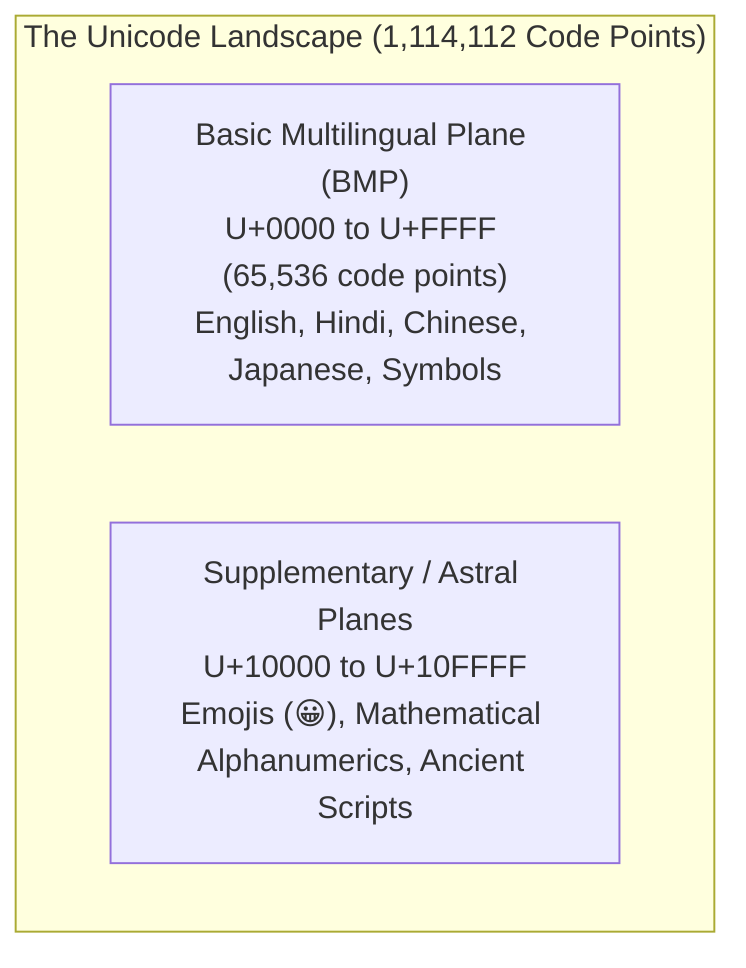
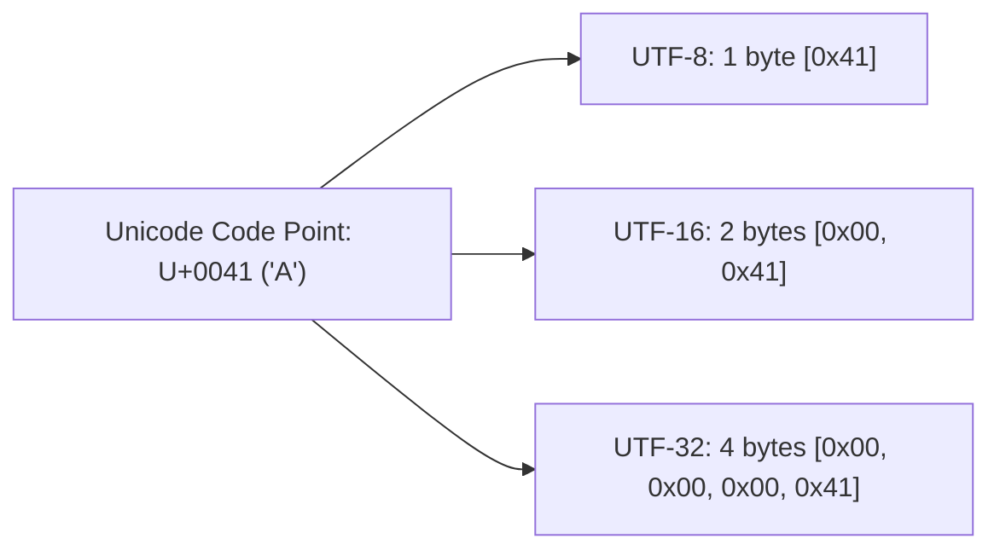
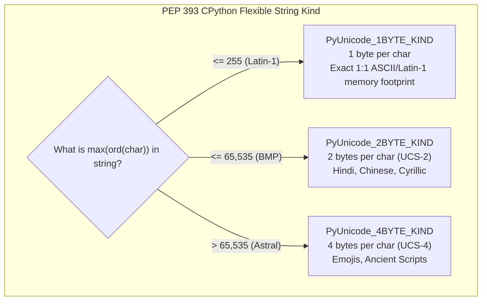
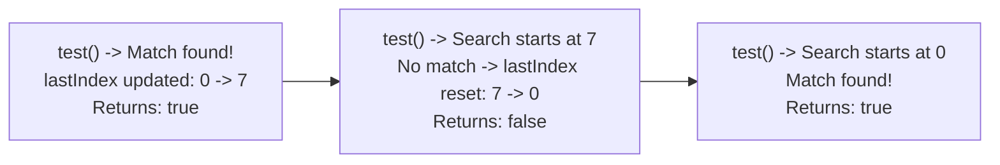

# Chapter 08: Text Encodings, Unicode & String Representation Internals (Deep Dive)

> **Welcome to Chapter 08 of the Python & JavaScript Track!**
> Modern software handles multilingual user input, globalized text, emojis, and binary payloads across networks. Yet, text encoding remains one of the most misunderstood topics in engineering.
> 
> * Why does `"😀".length` return `2` in JavaScript, but `len("😀")` returns `1` in Python?
> * Why does a family emoji like `👨‍👩‍👧‍👦` have a length of `7` in JavaScript and `4` in Python?
> * What caused the infamous MySQL `utf8` data truncation vulnerability?
> * How did Python solve the multi-byte string indexing performance problem using PEP 393 (Flexible String Representation)?
> * Why does JavaScript's `regex.test()` alternate between returning `true` and `false` when using the `/g` flag?
> 
> In this chapter, we delve into ASCII, UTF-8, UTF-16, surrogate pairs, grapheme clusters, and the low-level string memory engines of CPython and V8.

---

## 1. ASCII to Unicode: First Principles

### The ASCII Era (1963)
Computers store only binary bits (`0` and `1`). To represent text, early engineers mapped numbers to characters:
* **ASCII (American Standard Code for Information Interchange)**: Uses 7 bits to map integers `0` through `127` to English letters, numbers, and control characters (e.g. `65 = 'A'`, `97 = 'a'`, `10 = '\n'`).
* **The Problem**: 7 bits cannot represent accented characters (`é`, `ñ`), Cyrillic, Hindi (`ॐ`, `क`), Chinese (`汉`), or Arabic.
* **The Chaos of Code Pages**: Systems introduced 8-bit extended ASCII (ISO-8859-1, Windows-1252), but byte `0xE9` meant one character in French and a completely different character in Russian. Opening a foreign file yielded unreadable gibberish (*mojibake*).

### The Unicode Standard
Unicode solved this by assigning every character, symbol, and emoji across all languages a unique numerical **Code Point**:
* Format: Written as `U+XXXX` (hexadecimal).
* Range: `U+0000` to `U+10FFFF` (1,114,112 possible code points).
* **Planes**: Unicode is divided into 17 planes of 65,536 code points each:
  * **Plane 0: Basic Multilingual Plane (BMP)** (`U+0000` to `U+FFFF`): Contains almost all modern living languages (English, Hindi, Chinese, Arabic).
  * **Planes 1–16: Supplementary / Astral Planes** (`U+10000` to `U+10FFFF`): Contains historical scripts, musical notation, and **all modern emojis** (`😀 = U+1F600`).



---

## 2. Character Encodings: UTF-8 vs UTF-16 vs UTF-32

A Unicode code point is just an abstract number (e.g., `U+1F600`). **Encoding** defines how that number is physically serialized into bytes in RAM or on disk.



### 1. UTF-8 (Variable 1 to 4 bytes)
* **Design**: 1 byte for ASCII (`0-127`), 2 bytes for Latin/Greek/Arabic/Hebrew, 3 bytes for Asian languages (CJK, Devanagari), and 4 bytes for emojis and rare scripts.
* **Key Advantages**: 100% backward compatible with ASCII; self-synchronizing (if bytes are corrupted, the decoder recovers at the next character); no endianness (BOM) issues. Dominates the web (>98% of all websites).

### 2. UTF-16 (Variable 2 or 4 bytes)
* **Design**: 2 bytes (one 16-bit code unit) for any BMP character; 4 bytes (two 16-bit code units, known as a **Surrogate Pair**) for any astral plane character.
* Used internally by JavaScript (V8), Java, Windows NT kernel, and C#.

### 3. UTF-32 (Fixed 4 bytes)
* **Design**: Every code point consumes exactly 4 bytes.
* **Tradeoff**: Trivially simple $O(1)$ random indexing, but quadruples memory usage for ASCII/English text. Rarely used in storage or transit.

---

## 3. JavaScript String Internals: UTF-16 & The Surrogate Pair Trap

In ECMAScript engines like V8, strings are stored as sequences of **16-bit UTF-16 code units**.

```javascript
const emoji = "😀"; // U+1F600

console.log(emoji.length); // 2 ! (Why 2?)
console.log(emoji[0]);     // "\uD83D" (Broken half-character!)
console.log(emoji[1]);     // "\uDE00" (Broken half-character!)
```

### The Math of Surrogate Pairs
Because `U+1F600` is greater than `0xFFFF`, it cannot fit into a single 16-bit word ($2^{16} = 65,536$).
The Unicode Consortium reserved two ranges in the BMP specifically for surrogate pairs:
* **High Surrogates**: `0xD800` to `0xDBFF` (1,024 values)
* **Low Surrogates**: `0xDC00` to `0xDFFF` (1,024 values)

Any astral code point $C \ge 0x10000$ is split into:
$$C' = C - 0x10000$$
$$\text{High Surrogate} = 0xD800 + \lfloor C' / 0x400 \rfloor$$
$$\text{Low Surrogate} = 0xDC00 + (C' \pmod{0x400})$$

For `"😀"` (`U+1F600`):
* $C' = 0x1F600 - 0x10000 = 0xF600 = 62,976$
* $\text{High} = 0xD800 + 61 = \mathbf{0xD83D}$
* $\text{Low} = 0xDC00 + 512 = \mathbf{0xDE00}$

When you ask for `emoji.length`, JavaScript counts the **number of 16-bit code units (2)**, NOT the number of visible characters!

### How to Iterate and Slice JavaScript Strings Correctly
```javascript
const str = "Hello 😀 World";

// WRONG: Standard loop breaks surrogate pairs
for (let i = 0; i < str.length; i++) {
    // str[i] will corrupt emojis!
}

// CORRECT 1: for...of loop (Unicode-aware iterator)
for (const char of str) {
    console.log(char); // "😀" is emitted as a single whole character!
}

// CORRECT 2: Array spread / Array.from
const chars = [...str];
console.log(chars.length); // 13 (correct number of Unicode code points)

// CORRECT 3: Code Point inspection
console.log(str.codePointAt(6).toString(16)); // "1f600" (Correct code point!)
console.log(str.charCodeAt(6).toString(16));   // "d83d" (Raw surrogate code unit)
```

---

## 4. Grapheme Clusters: The Emoji Modifier Nightmare

Even if you handle Unicode code points, text is still not straightforward. A single visible symbol on screen is called a **Grapheme Cluster**. Multiple code points can combine to form one grapheme!

### The Family Emoji: `👨‍👩‍👧‍👦`
```javascript
const family = "👨‍👩‍👧‍👦";

console.log(family.length);       // 11 (UTF-16 code units)
console.log([...family].length);  // 7  (Unicode code points!)
```

Why 7 code points? It is constructed using **Zero-Width Joiners (ZWJ, `U+200D`)**:
$$\text{Man} (U+1F468) + \text{ZWJ} + \text{Woman} (U+1F469) + \text{ZWJ} + \text{Girl} (U+1F467) + \text{ZWJ} + \text{Boy} (U+1F466)$$

### The Solution: `Intl.Segmenter`
Modern JavaScript provides the internationalization API `Intl.Segmenter` to split text by visual graphemes:

```javascript
const segmenter = new Intl.Segmenter('en', { granularity: 'grapheme' });
const segments = [...segmenter.segment("👨‍👩‍👧‍👦")];

console.log(segments.length); // 1! (Exactly one visible glyph!)
console.log(segments[0].segment); // "👨‍👩‍👧‍👦"
```

---

## 5. Python 3 String Architecture & PEP 393 (Flexible String Representation)

In Python 2, strings were raw ASCII bytes, and Unicode required a `u"..."` prefix.
In Python 3, **`str` is strictly text (Unicode code points)**, and **`bytes` is strictly raw binary data**.

```python
# Encoding: str -> bytes
raw_bytes = "Hello 世界 😀".encode("utf-8")
print(type(raw_bytes), len(raw_bytes))  # <class 'bytes'> 16 bytes

# Decoding: bytes -> str
text = raw_bytes.decode("utf-8")
print(type(text), len(text))            # <class 'str'> 10 characters!
```

### The $O(1)$ Indexing Challenge
How can an engine support $O(1)$ random indexing (`s[i]`) on variable-length Unicode strings without wasting huge amounts of RAM?
* If Python used UTF-8 internally: Finding `s[1000]` would require scanning all preceding bytes from the start ($O(N)$ time).
* If Python used UTF-32 internally: Every single ASCII string would consume 4 bytes per character (4x memory bloat).

### The CPython Innovation: PEP 393
In Python 3.3, PEP 393 introduced the **Flexible String Representation**. CPython inspects the maximum code point in the string upon creation and chooses the most compact fixed-width C array:



Because every character in a specific string has the **exact same byte width**, CPython achieves:
1. **$O(1)$ Instant Array Indexing**: `string_address + (index * byte_kind)`.
2. **Minimal Memory Usage**: Pure English text consumes only 1 byte per character!

```python
import sys

s_ascii = "hello"
s_hindi = "नमस्ते"
s_emoji = "😀"

print(sys.getsizeof(s_ascii))  # Compact (1 byte per char)
print(sys.getsizeof(s_hindi))  # Medium  (2 bytes per char)
print(sys.getsizeof(s_emoji))  # 4 bytes per char for astral plane
```

---

## 6. Regular Expression Trap: The Stateful `/g` Flag

In JavaScript, creating a regex with the global `/g` or sticky `/y` flag turns the `RegExp` instance into a **stateful object**!

```javascript
const regex = /pattern/g;

console.log(regex.test("pattern")); // true
console.log(regex.test("pattern")); // false! (WTF?)
console.log(regex.test("pattern")); // true!
```

### Why Does This Happen?
When `/g` is set, `regex.test()` updates an internal property: `regex.lastIndex`:
1. First call: Matches at index 0. Sets `regex.lastIndex = 7`. Returns `true`.
2. Second call: Begins searching from `lastIndex` (index 7). No further match exists. Resets `regex.lastIndex = 0`. Returns `false`!
3. Third call: Begins searching from index 0 again. Returns `true`.



* **The Production Fix**: Never reuse a shared global RegExp instance across HTTP requests or validations! Always use local regexes or reset `regex.lastIndex = 0`.

---

## 7. Real-World Production Case Studies

### Case Study 1: The Cloudflare Global Outage (ReDoS Catastrophic Backtracking)
* **The Incident**: On July 2, 2019, Cloudflare suffered a worldwide outage that knocked major web services offline for 27 minutes. Global CPU utilization surged to 100% across all edge nodes.
* **Root Cause**: A newly deployed Web Application Firewall (WAF) rule contained an unanchored regular expression with nested quantifiers:
  ```regex
  (?:(?:^|[\s,;])*(?:process\s+id|task\s+[\d+]+)\s*)+$
  ```
* **Failure Mechanism**: When scanning non-matching user requests containing consecutive spaces, the regex engine evaluated an exponential number of permutations ($O(2^N)$ backtracking), locking up the single-threaded NGINX CPU workers.

### Case Study 2: MySQL's Broken `utf8` vs `utf8mb4` Disaster
* **The Incident**: Thousands of applications found that user comments or profile names containing emojis were silently truncated. If a user entered `"Great product! 😀 Thanks!"`, the database saved only `"Great product! "`.
* **Root Cause**: Early MySQL engineers implemented a character set called `utf8` that allocated a maximum of **3 bytes per character**, violating the official RFC UTF-8 specification (which requires up to 4 bytes).
* When a 4-byte emoji was encountered, MySQL threw a warning or truncated the string at the emoji byte.
* **The Fix**: In MySQL 5.5+, developers must explicitly declare character set `utf8mb4` (UTF-8 Multi-Byte 4) and collation `utf8mb4_unicode_ci` to properly support full Unicode.

---

## 8. FAANG & Top Tech Commonly Asked Interview Questions

#### Question 1: "Why does `'😀'.length === 2` in JavaScript, and how do you get the actual number of visible characters?"
* **Answer**:
  * JavaScript represents strings in UTF-16 code units (16 bits each).
  * Characters outside the Basic Multilingual Plane ($U+0000$ to $U+FFFF$), such as emojis ($U+1F600$), require two 16-bit code units known as a **surrogate pair**. `string.length` reports the number of code units (2).
  * To get Unicode code points: `[...'😀'].length` (evaluates to 1).
  * To get visual grapheme clusters (handling ZWJ and skin-tone modifiers): Use `[...new Intl.Segmenter().segment('😀')].length`.

#### Question 2: "Explain the difference between `str.charCodeAt(i)` and `str.codePointAt(i)` in JavaScript."
* **Answer**:
  * `charCodeAt(i)`: Returns the numeric 16-bit UTF-16 code unit value at index `i` (between `0` and `65535`). If `i` lands on an astral emoji, it returns only the high or low surrogate.
  * `codePointAt(i)`: Inspects if index `i` begins a surrogate pair. If it does, it combines the pair and returns the full 32-bit Unicode code point (e.g. `0x1F600` / `128512`).

#### Question 3: "How does Python 3's PEP 393 optimize string memory while maintaining $O(1)$ indexing?"
* **Answer**:
  * CPython dynamically determines the maximum character code point in a string at creation time.
  * It stores strings in one of three fixed-width internal representations:
    1. 1 byte per character (`Latin-1`, code points $\le 255$)
    2. 2 bytes per character (`UCS-2`, code points $\le 65535$)
    3. 4 bytes per character (`UCS-4`, code points $> 65535$)
  * Because width is uniform within each string, indexing `s[i]` is a direct pointer calculation in $O(1)$ time without wasting memory on English text.

#### Question 4: "Why did Python 3 separate `str` from `bytes`, and what was the problem with Python 2's string handling?"
* **Answer**:
  * Python 2 conflated ASCII byte sequences with Unicode text; comparing `'abc' == u'abc'` worked via implicit coercion, causing unpredictable `UnicodeDecodeError` crashes in production when encountering non-ASCII bytes.
  * Python 3 enforces a strict boundary:
    * `str`: Abstract Unicode text.
    * `bytes`: Raw binary sequence.
    * Transitioning requires explicit `str.encode('utf-8')` and `bytes.decode('utf-8')`.

#### Question 5: "What is Regular Expression Catastrophic Backtracking (ReDoS) and how can you prevent it?"
* **Answer**:
  * ReDoS occurs when a regular expression with overlapping/nested quantifiers (e.g. `(a+)+$`) is evaluated against an input that matches the beginning but fails near the end.
  * The NFA (Nondeterministic Finite Automaton) engine tests every possible permutation of matches, taking $O(2^N)$ exponential time and consuming 100% CPU.
  * Prevention:
    1. Avoid nested quantifiers (`(a+)+`).
    2. Use possessive quantifiers or atomic grouping where supported.
    3. Enforce execution timeouts or use linear-time DFA engines (e.g. Google's `re2`).

#### Question 6: "Explain why `regex.test(str)` with the `/g` flag returns alternating true/false on identical inputs."
* **Answer**:
  * The `/g` flag enables stateful execution by updating the `regex.lastIndex` property to the index immediately following the match.
  * Subsequent calls resume searching from `lastIndex`. When no more matches exist, it returns `false` and resets `lastIndex` back to 0.

#### Question 7: "What is a Byte Order Mark (BOM), and how does UTF-8 differ from UTF-16 regarding endianness?"
* **Answer**:
  * A BOM (`U+FEFF`) is placed at the start of a byte stream to indicate whether multi-byte units are stored in Little-Endian (`FF FE`) or Big-Endian (`FE FF`) order.
  * UTF-16 and UTF-32 require endianness resolution because their basic units are 16 or 32 bits wide.
  * UTF-8 operates strictly on individual 8-bit bytes; byte order within units does not exist, so UTF-8 has no architectural need for a BOM.

#### Question 8: "What happens when you slice a surrogate pair in JavaScript?"
* **Answer**:
  * Slicing across a surrogate pair (e.g. `"😀".slice(0, 1)`) extracts an isolated **lone surrogate** (`"\uD83D"`).
  * A lone surrogate is an invalid Unicode sequence. When rendered, the browser displays a replacement character (a question mark inside a diamond ``). When sent to strict JSON decoders, it can throw serialization errors.

#### Question 9: "What is Unicode Normalization (NFC, NFD, NFKC, NFKD), and why does `'\u00E9' === 'e\u0301'` return false?"
* **Answer**:
  * Characters can be represented either as a single precomposed code point (`\u00E9` = `é`) or as a base character plus a combining diacritical mark (`e` + `\u0301` = `é`).
  * Visually they look identical, but their binary code points differ (`'\u00E9' === 'e\u0301'` is `false`).
  * **Normalization** converts strings into a canonical standard:
    * **NFC**: Canonical Composition (favors precomposed characters).
    * **NFD**: Canonical Decomposition (separates base characters and accents).
    * JavaScript: `str1.normalize('NFC') === str2.normalize('NFC')` (evaluates to `true`).

#### Question 10: "Why was MySQL's default `utf8` dangerous for applications storing user passwords or emojis?"
* **Answer**:
  * MySQL's legacy `utf8` charset only supported a maximum of 3 bytes per character, whereas true UTF-8 supports up to 4 bytes.
  * When a user supplied a 4-byte character (like an emoji), MySQL threw an error or truncated the string right before the emoji. If an attacker chose a password with an emoji, the password could be truncated to an empty or partial string, creating severe security flaws.

#### Question 11: "How do you reverse a string in JavaScript while keeping emojis and surrogate pairs intact?"
* **Answer**:
  * Standard naive approach fails: `"cat😀".split("").reverse().join("")` yields `"tac"` (corrupted surrogates).
  * Unicode code-point approach: `[..."cat😀"].reverse().join("")` yields `"😀tac"`.
  * For strings with complex grapheme clusters (e.g. skin tones or ZWJ):
  ```javascript
  function reverseUnicode(str) {
      const segmenter = new Intl.Segmenter('en', { granularity: 'grapheme' });
      return [...segmenter.segment(str)].map(s => s.segment).reverse().join('');
  }
  ```

#### Question 12: "How does Python handle encoding and decoding errors gracefully?"
* **Answer**:
  * The `encode()` and `decode()` methods accept an `errors` parameter:
    * `errors='strict'`: (Default) Raises `UnicodeEncodeError` / `UnicodeDecodeError`.
    * `errors='ignore'`: Skips invalid unencodable/undecodable bytes.
    * `errors='replace'`: Inserts the Unicode replacement character `` (`U+FFFD`) or `?`.
    * `errors='surrogateescape'`: (PEP 383) Preserves unparseable bytes as private surrogates so they can be written back to disk without data loss (used extensively in OS file system paths).

---

## Chapter 08 Checklist (Summary)

Before completing Track 2, verify you understand:
- [x] How ASCII evolved into the 1,114,112 code point Unicode standard.
- [x] The difference between UTF-8, UTF-16, and UTF-32.
- [x] Why JavaScript strings use UTF-16 code units and how surrogate pairs work.
- [x] How `Intl.Segmenter` correctly parses grapheme clusters and ZWJ emojis.
- [x] How CPython's PEP 393 achieves $O(1)$ indexing with minimal RAM.
- [x] How ReDoS crashes single-threaded event loops and how to mitigate it.

*Track 2 (Python & JavaScript) is complete! Proceed to [Track 3: AI Engineer - Chapter 05: Attention Mechanics from Scratch & KV-Cache Deep Dive](../ai-engineer/chapter_05.md).*
